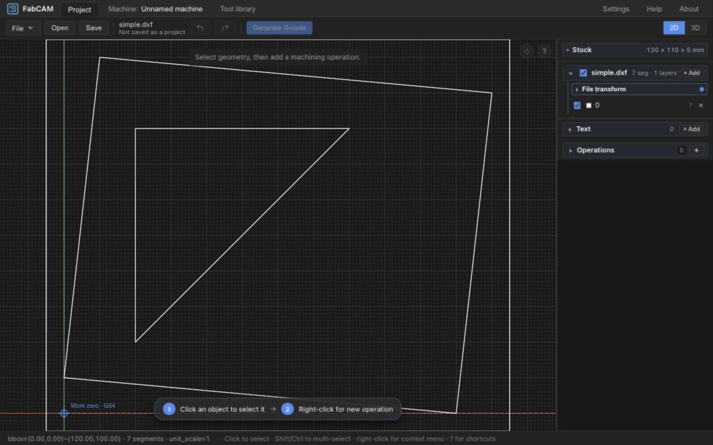

# FabCAM

Development line: V1.1; package version: [version policy](docs/releases/VERSIONING.md).
[Current STATUS](docs/shopbot-modernization/STATUS.md) identifies the accepted source
and the older canonical/frozen lines. These instructions describe that feature source,
not an assertion that a downloaded installer or remote default branch contains it.

**English** | [Deutsch](README_de.md)

**Open-source CAM software for practical digital fabrication.**


[Documentation index](docs/README.md) — current contracts, architecture and qualification evidence.

## Overview

FabCAM is a milling-oriented fork of [ivaCAM](https://github.com/aalarchiv/ivacam).
Prepare geometry, stock, tools, operations and explicit cutting values, then generate,
simulate and export supported machine output. Software qualification is bounded;
installed-native and physical machining acceptance remain separate.

## Main features

- SVG/DXF import, layers, source-preserving drawing edits, mouse placement and proportional dimensions; V10 project save/reopen.
- Profile/Pocket Main Cutting and optional Finishing; scoped Pocket Walls / Floor / Walls and floor with bounded polygon, tangent-curve and simple-island proof.
- Explicit RPM/feed/plunge/DOC, machine/tool validation, local tested presets with strict matching, and selective reviewed starting-value reuse without transferred attestation.
- Tool-library descriptive substrate/coating metadata, stock/work-origin configuration and bounded fixture diagnostics.
- 2D/3D preview and full-program simulation; bounded remaining-material diagnostics, not implemented optimized rest machining.
- Built-in G-code/HPGL and native CPS posts, including restricted ShopBot OpenSBP. Other inherited operations retain their own cutter/entry/output restrictions.
- Native file authorization/CSP, loopback HTTP admission and bounded import expansion. Unsupported or unproven combinations refuse.

There is no integrated cutting-recommendation engine or automatic chipload calculation.
FabSpeed is independent; optional future exchange is planned, not implemented.
See [architecture](docs/ARCHITECTURE.md) and [cutting contract](docs/CUTTING_CONTRACT.md).

## Screenshots

Historical UX2.2 interface reference, not proof of current native acceptance:



[Branding review](docs/shopbot-modernization/ux/A1_BRANDING_INTEGRATION.md).

## Supported platforms

| Target | Qualification boundary |
| --- | --- |
| macOS | Native target exists; current security qualification is command/mock based. Installed-native file workflows remain unqualified. |
| Windows / Linux | Build targets exist; current installed-platform acceptance is not established. |
| Browser | UI/WASM software checks exist; the default WASM package has no CPS. ShopBot requires a CPS-enabled native adapter. |

Frontend locales are English and German; no complete French catalog. Inherited mobile
tooling is outside this desktop acceptance. No installer/release is implied.

## Getting started

Use pinned [Rust](rust-toolchain.toml), [Node](.nvmrc), pnpm 10+, wasm-pack and the
platform prerequisites in [BUILDING](docs/BUILDING.md) / [Windows setup](docs/BUILDING_WINDOWS.md).
Select the source identified in STATUS before relying on examples.

```sh
cargo build --locked
wasm-pack build crates/ivac-wasm --target web --release
pnpm --dir frontend install --frozen-lockfile
pnpm --dir frontend dev
```

For CPS-backed browser development, run `cargo run --locked -p ivac-server`
alongside Vite. The unauthenticated service is loopback-only, not a qualified remote
backend. See BUILDING for transport selection and native build commands. Packaging
requires separate authorization/acceptance. Internal `ivac`/`ivaCAM` names remain
compatible under the [identity decision](docs/shopbot-modernization/adr/ADR-0012-fabcam-product-identity.md).

## Basic workflow

1. Create/open a V10 project and import/review drawing units and dimensions.
2. Configure stock, work origin, machine, actual tools and fixtures.
3. Add operations; enter Main Cutting and optionally explicit Finishing, or the family's actual roles.
4. Author RPM/feed/plunge/DOC; load an exact tested preset or deliberately review selected starting values.
5. Generate and inspect full-program simulation, provenance and refusal/warning diagnostics.
6. Export only supported qualified output; separately perform actual controller/setup/physical checks.

[Quickstart](docs/QUICKSTART.md). FabCAM does not establish physical machine zero or operate the machine.

## Current status and limitations

- SAFETY-FIX-1 refuses unproven helical entry, legacy Profile overcut and affected two-sided holding/Back inputs. Thread's machining helix is distinct.
- Finishing is bounded by geometry, direct entry, cutters, coverage budgets and post constraints; no universal finishing or complete geometry repair.
- Strict preset matching is unchanged by advisory reuse; stepover and physical attestation do not transfer. Same-tool ShopBot RPM transitions can refuse.
- Native installed file workflows, authenticated remote HTTP and physical machining remain unqualified. Historical M4 square evidence does not qualify a new job.

[STATUS](docs/shopbot-modernization/STATUS.md) owns current source, blockers and evidence limits.

## Roadmap

See the [technical workstreams](docs/shopbot-modernization/ROADMAP.md) and
[release gates](docs/releases/RELEASE_ROADMAP.md). Optional FabSpeed exchange, broader
CAM, ProtoMAX/waterjet and vinyl are planned/deferred, not active implementations.
Accepted bounded software milestones do not authorize their next phase.

## Project origins

FabCAM derives from **ivaCAM by Soenke J. Peters**, [aalarchiv/ivacam](https://github.com/aalarchiv/ivacam).
Its core is in part a Rust port of [viaConstructor](https://github.com/multigcs/viaconstructor)
geometry/toolpath routines. [Estlcam](https://www.estlcam.de/) inspired terminology
and contributes no code. Original notices and dependency attribution remain,
including dxf-rs, cavalier_contours, clipper2-rust, usvg, Svelte, Three.js and Tauri.

## License

**GPL-3.0-or-later**; [LICENSE](LICENSE). Dependencies and separately licensed assets
retain their notices. [Historical source-data licensing](docs/shopbot-modernization/feeds-speeds/DATA_SOURCES.md)
is preserved; it does not advertise a current source-pack engine or redistribution rights.

## Contributing

Read [CONTRIBUTING](docs/CONTRIBUTING.md), architecture and current STATUS first.
Preserve compatibility, attribution, historical evidence and human approval gates.
Repository tracking uses Beads. Source: [harry-finch/FabCAM](https://github.com/harry-finch/FabCAM).
