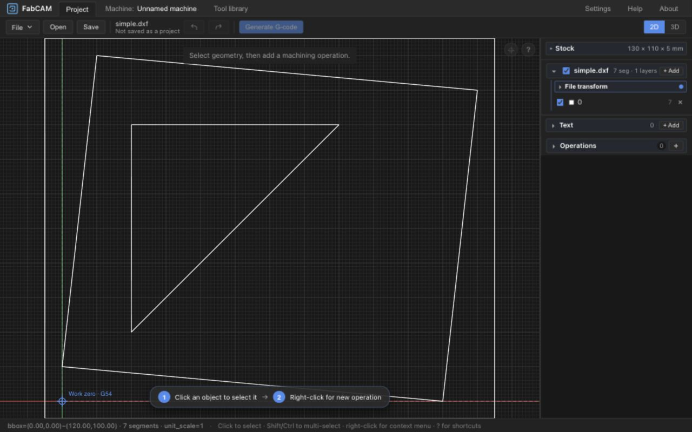

# FabCAM

**English** | [Deutsch](README_de.md)

**Open-source CAM software for practical digital fabrication.**


## Overview

FabCAM prepares drawings for CNC machining through a compact desktop workflow: geometry, stock, tools, operations, cutting parameters, preview and machine output. The current focus is milling in workshops and fablabs, including bounded ShopBot OpenSBP support. It is an actively developed fork of [ivaCAM](https://github.com/aalarchiv/ivacam), not a claim of universal production readiness.

## Main features

- SVG/DXF import, layers, drawing transforms and project save/reopen.
- Profile, pocket and drilling; tabs, leads and entry controls with machine/post-specific checks. Inherited operations also include engraving/text, V-carve, chamfer, thread, dovetail and T-slot; their presence does not qualify every machine or combination.
- Stock and work-origin configuration, machine profiles, tool libraries, fixture authoring and generated-path collision warnings.
- Milling Feeds & Speeds recommendations with provenance, bounded reference matching, explicit Apply, authoritative manual values and private local presets.
- 2D/3D preview and material-removal simulation. Bounded per-pocket/depth remaining-material analysis is implemented; Rest Machining is not.
- Built-in G-code/HPGL dialects and native CPS posts, including a restricted ShopBot OpenSBP subset. Unsupported output combinations reject.
- Atelier shell with Welcome, New/Open/Import/Save/Close, recent projects and machine/operation-tool context.

The Rust CAM core, independent cutting-recommendation engine and Svelte UI remain separate. See [architecture](docs/ARCHITECTURE.md) and [fork architecture](docs/shopbot-modernization/ARCHITECTURE.md).

## Screenshots

Actual UX2.2 interface with the approved A1 branding:



[Welcome/icon review](docs/shopbot-modernization/ux/A1_BRANDING_INTEGRATION.md) and [product identity/About review](docs/shopbot-modernization/ux/PRODUCT_IDENTITY.md).

## Supported platforms

| Target | Current verification |
| --- | --- |
| macOS | Local optimized Tauri app built and launched; branding/display identity inspected. Signing and installer upgrades require separate qualification. |
| Windows | Build target and icon resources exist; this checkpoint has no Windows package/runtime trial. |
| Linux | Build target and icon resources exist; this checkpoint has no Linux package/runtime trial. |
| Browser | Development and production UI checked. Current standalone WASM has no CPS support; ShopBot needs a native server or desktop app. |

Inherited Android tooling remains outside current desktop qualification. No release or binary publication is created by this identity update.

## Getting started

Prerequisites: [pinned Rust](rust-toolchain.toml), Node 20.19+ or 22.12+, pnpm 10+, wasm-pack and Tauri CLI 2 for desktop packaging. System libraries, sccache and matching WASM tools are in [BUILDING.md](docs/BUILDING.md); [Windows instructions](docs/BUILDING_WINDOWS.md).

```sh
git clone https://github.com/harry-finch/FabCAM.git
cd FabCAM
cargo build --locked
wasm-pack build crates/ivac-wasm --target web --release
pnpm --dir frontend install --frozen-lockfile
pnpm --dir frontend dev
```

For a desktop bundle, after satisfying platform prerequisites:

```sh
cd crates/ivac-tauri
cargo tauri build
```

For CPS-backed browser development, run `cargo run --locked -p ivac-server` from the root alongside Vite; see the build guide for transport selection. Executable/installer filenames may retain `ivac`/`ivaCAM` for compatibility; the [identity decision](docs/shopbot-modernization/adr/ADR-0012-fabcam-product-identity.md) explains why.

## Basic workflow

1. Create/open a project and import SVG/DXF geometry.
2. Configure stock, work origin, machine and fixtures.
3. Select tools and configure operations.
4. Review cutting parameters; deliberately apply a recommendation or use manual values.
5. Generate paths and inspect preview and warnings.
6. Export a supported program, then perform machine-specific setup and controller/physical checks.

[Quickstart](docs/QUICKSTART.md). FabCAM does not establish physical machine zero or control the machine directly.

## Current status and limitations

- Software qualification is separate from physical evidence. M4 records a bounded operator-reported ShopBot square trial/comparison, not blanket milling validation.
- ShopBot CPS is restricted: helical entry, unqualified two-sided/translated registration and nonzero work-origin Z remain limited/rejected. Rough/finish spindle-RPM transitions have a known export limitation.
- Fixture diagnostics and remaining-material overlays have bounded geometric scopes; they do not prove all physical clearances.
- Manufacturer ReferenceData and derived recommendations are not physical lab validation. **FS4 physical Feeds & Speeds validation remains deferred.**
- Human CAM/FS/UX handoff reviews remain open. A legacy CPS two-sided success-expectation test needs alignment with the explicit rejection.

[STATUS](docs/shopbot-modernization/STATUS.md) and [CAM qualification](docs/shopbot-modernization/CAM_VALIDATION.md) are authoritative for supported combinations and evidence limits.

## Roadmap

Priority milling workflow/coverage improvements continue within human approval gates. Dogbone/T-bone relief and planar surfacing have bounded local software handoffs. Reusable Profile/Pocket/planar-surface templates have an accepted bounded software handoff ([UX4.1 qualification](docs/shopbot-modernization/UX4_1_QUALIFICATION.md)); advanced strategies remain later work. FabSBP is planning only; ProtoMAX/waterjet and vinyl are deferred. See the canonical [ROADMAP](docs/shopbot-modernization/ROADMAP.md); planned work is not implemented functionality.

## Project origins

FabCAM is derived from **ivaCAM by Soenke J. Peters**: [aalarchiv/ivacam](https://github.com/aalarchiv/ivacam). The fork develops ShopBot preparation, cutting recommendations, stock/origin/fixture workflows and a dedicated workshop UI. Original authorship and contributions remain credited; FabCAM is a separate derivative project.

ivaCAM's CAM core is in part a Rust port of [viaConstructor](https://github.com/multigcs/viaconstructor)'s geometry/toolpath routines (`calc.py`, `machine_cmd.py`, `setupdefaults.py`). [Estlcam](https://www.estlcam.de/) inspired feature terminology and contributes no code. Existing source copyright notices and dependency acknowledgements are retained, including dxf-rs, cavalier_contours, clipper2-rust, usvg, Svelte, Three.js and Tauri.

## License

**GPL-3.0-or-later**; see the unchanged [LICENSE](LICENSE). Dependencies, imported reference data and separately licensed resources keep their own notices. [Source-pack licensing records](docs/shopbot-modernization/feeds-speeds/DATA_SOURCES.md). Local/private manufacturer packs are not automatically redistributable and are not added to public distribution by this update.

## Contributing

Read [CONTRIBUTING](docs/CONTRIBUTING.md), architecture and current STATUS/ROADMAP before proposing changes. Repository-local tracking uses Beads. Preserve compatibility/attribution and include evidence appropriate to CAM changes. Source: [harry-finch/FabCAM](https://github.com/harry-finch/FabCAM).
