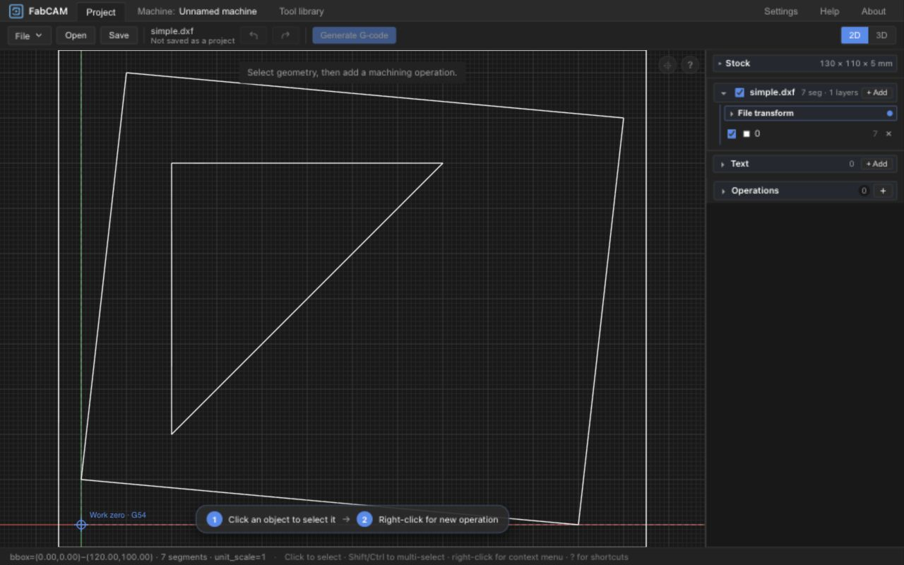

# FabCAM

Entwicklungslinie: V1.1; Paketversion: [Versionsregeln](docs/releases/VERSIONING.md).
[Aktueller STATUS](docs/shopbot-modernization/STATUS.md) nennt den akzeptierten Stand
und die älteren kanonischen/eingefrorenen Linien. Diese Anleitung beschreibt diesen
Feature-Stand; ein Installer oder der entfernte Standardbranch kann davon abweichen.

[English](./README.md) | **Deutsch**

**Open-Source-CAM für praktische digitale Fertigung.**


[Dokumentationsübersicht](docs/README.md) — aktuelle Verträge, Architektur und Qualifikationsnachweise.

## Überblick

FabCAM ist ein fräsorientierter Fork von [ivaCAM](https://github.com/aalarchiv/ivacam).
Geometrie, Rohmaterial, Werkzeuge, Operationen und explizite Schnittwerte vorbereiten,
dann unterstützte Programme erzeugen, simulieren und exportieren. Die Softwarequalifikation
ist begrenzt; native Installation und physische Bearbeitung bleiben getrennte Abnahmen.

## Hauptfunktionen

- SVG/DXF-Import, Ebenen, quellenerhaltende Zeichnungsbearbeitung, Verschieben per Maus und proportionale Abmessungen; V10-Projekte speichern/öffnen.
- Profile/Pocket mit Hauptbearbeitung und optionaler Schlichtstufe; Pocket mit Wände / Boden / Wände und Boden innerhalb begrenzter Polygon-, Tangentialkurven- und Inselnachweise.
- Explizite Drehzahl/Vorschub/Eintauchvorschub/Zustellung, Maschinen-/Werkzeugprüfung, lokal getestete Presets mit exakter Zuordnung und bewusst geprüfte Übernahme von Ausgangswerten ohne Testbescheinigung.
- Beschreibende Werkzeugdaten für Substrat/Beschichtung, Rohmaterial-/Nullpunktkonfiguration und begrenzte Spannmittelprüfungen.
- 2D/3D-Vorschau und Gesamtprogrammsimulation; begrenzte Restmaterialdiagnose, kein implementiertes optimiertes Restfräsen.
- Eingebaute G-Code-/HPGL-Ausgabe und native CPS-Posts, einschließlich eingeschränktem ShopBot OpenSBP. Weitere übernommene Operationen behalten eigene Grenzen.
- Native Dateiautorisierung/CSP, lokale HTTP-Zulassung und Importbudgets. Nicht unterstützte oder nicht nachgewiesene Kombinationen werden abgewiesen.

Keine integrierte Schnittwertempfehlung und keine automatische Spanlastberechnung.
FabSpeed ist unabhängig; optionaler Datenaustausch ist geplant, nicht implementiert.
Siehe [Architektur](docs/ARCHITECTURE.md) und [Schnittwertvertrag](docs/CUTTING_CONTRACT.md).

## Bildschirmansichten

Historische UX2.2-Ansicht als Referenz, kein Nachweis aktueller nativer Abnahme:



[Gestaltungsprüfung](docs/shopbot-modernization/ux/A1_BRANDING_INTEGRATION.md).

## Unterstützte Plattformen

| Ziel | Grenze der Qualifikation |
| --- | --- |
| macOS | Natives Build-Ziel vorhanden; aktuelle Sicherheitsprüfung auf Kommando-/Mock-Ebene. Installierte native Dateiabläufe bleiben unqualifiziert. |
| Windows / Linux | Build-Ziele vorhanden; aktuelle installierte Plattformabnahme nicht nachgewiesen. |
| Browser | UI-/WASM-Softwareprüfungen vorhanden; Standard-WASM ohne CPS. ShopBot benötigt einen nativen Adapter mit CPS. |

Frontend-Sprachen sind Englisch und Deutsch; kein vollständiger französischer Katalog.
Mobile Werkzeuge liegen außerhalb dieser Desktop-Abnahme. Kein Installer/Release zugesagt.

## Einstieg

Die festgelegten Versionen von [Rust](rust-toolchain.toml), [Node](.nvmrc), pnpm 10+
und wasm-pack sowie [BUILDING](docs/BUILDING.md) / [Windows](docs/BUILDING_WINDOWS.md)
verwenden. Vor Nutzung der Beispiele den in STATUS genannten Quellstand auswählen.

```sh
cargo build --locked
wasm-pack build crates/ivac-wasm --target web --release
pnpm --dir frontend install --frozen-lockfile
pnpm --dir frontend dev
```

Für Browserentwicklung mit CPS `cargo run --locked -p ivac-server` parallel zu Vite
starten. Der nicht authentifizierte Dienst bleibt auf Loopback beschränkt und ist
kein qualifiziertes entferntes Backend. BUILDING erklärt Transportwahl und native
Builds. Paketierung erfordert getrennte Freigabe/Abnahme. Interne Namen `ivac`/`ivaCAM`
bleiben gemäß [Identitätsentscheidung](docs/shopbot-modernization/adr/ADR-0012-fabcam-product-identity.md) kompatibel.

## Grundablauf

1. V10-Projekt anlegen/öffnen und Importeinheiten sowie Abmessungen prüfen.
2. Rohmaterial, Arbeitsnullpunkt, Maschine, tatsächliche Werkzeuge und Spannmittel festlegen.
3. Operationen mit Hauptbearbeitung und optional expliziter Schlichtstufe beziehungsweise den tatsächlichen Rollen konfigurieren.
4. Drehzahl/Vorschub/Eintauchvorschub/Zustellung eingeben; exakt getestetes Preset laden oder ausgewählte Ausgangswerte bewusst übernehmen.
5. Programm erzeugen und Gesamtprogrammsimulation, Herkunft und Warnungen/Ablehnungen prüfen.
6. Nur unterstützte qualifizierte Ausgabe exportieren; reale Steuerungs-/Einrichtungs-/Materialprüfungen getrennt durchführen.

[Kurzanleitung](docs/QUICKSTART.md). FabCAM setzt keinen physischen Maschinennullpunkt und steuert keine Maschine.

## Aktueller Stand und Grenzen

- SAFETY-FIX-1 weist unbewiesene Helix-Einfahrten, alten Profile-Overcut und betroffene zweiseitige Halte-/Rückseitenkonfigurationen ab. Die Gewindefräshelix ist davon zu unterscheiden.
- Schlichten unterliegt Grenzen für Geometrie, direkten Einstieg, Werkzeuge, Nachweisbudgets und Posts; kein universelles Schlichten oder vollständige Geometriereparatur.
- Strikte Preset-Zuordnung bleibt trotz beratender Werteübernahme unverändert; Überlappung und physische Testbescheinigungen werden nicht übertragen. ShopBot-Drehzahlwechsel am selben Werkzeug können abgewiesen werden.
- Installierte native Dateiabläufe, authentifizierter HTTP-Fernzugriff und physische Bearbeitung bleiben unqualifiziert. Historische M4-Quadratversuche qualifizieren keinen neuen Auftrag.

[STATUS](docs/shopbot-modernization/STATUS.md) führt Quellstand, Blocker und Nachweisgrenzen.

## Roadmap

Siehe [technische Arbeitsstränge](docs/shopbot-modernization/ROADMAP.md) und
[Freigabestufen](docs/releases/RELEASE_ROADMAP.md). FabSpeed-Austausch, breiteres CAM,
ProtoMAX/Wasserstrahl und Vinyl bleiben geplant/zurückgestellt. Akzeptierte begrenzte
Softwaremeilensteine autorisieren nicht automatisch die nächste Phase.

## Projektursprung

FabCAM basiert auf **ivaCAM von Soenke J. Peters**, [aalarchiv/ivacam](https://github.com/aalarchiv/ivacam).
Der Kern ist teilweise eine Rust-Portierung von [viaConstructor](https://github.com/multigcs/viaconstructor).
[Estlcam](https://www.estlcam.de/) inspirierte Begriffe und liefert keinen Code.
Urheberrechts- und Abhängigkeitshinweise bleiben erhalten, einschließlich dxf-rs,
cavalier_contours, clipper2-rust, usvg, Svelte, Three.js und Tauri.

## Lizenz

**GPL-3.0-or-later**; [LICENSE](LICENSE). Abhängigkeiten und separat lizenzierte Ressourcen
behalten ihre Hinweise. [Historische Datenlizenzen](docs/shopbot-modernization/feeds-speeds/DATA_SOURCES.md)
bleiben dokumentiert; sie bewerben keine aktive Datenpaket-Engine und erteilen keine Weitergaberechte.

## Mitwirken

Zuerst [CONTRIBUTING](docs/CONTRIBUTING.md), Architektur und STATUS lesen. Kompatibilität,
Attribution, historische Nachweise und menschliche Freigaben erhalten. Aufgabenverwaltung
mit Beads. Quellcode: [harry-finch/FabCAM](https://github.com/harry-finch/FabCAM).
