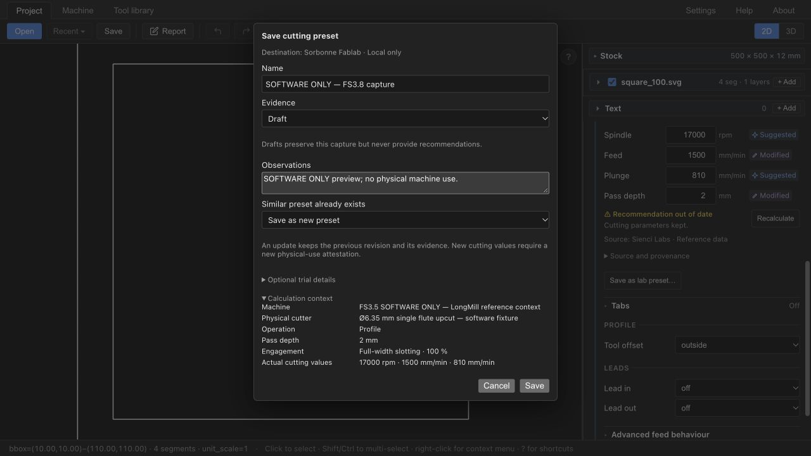

# Build your own Feeds & Speeds data source

This guide is for fablabs and CNC milling workshops that want to keep reusable
cutting knowledge. You can capture local presets in FabCAM, or author an external
JSON source pack. These are different workflows with different editing tools.

Original guide checked on **2026-10-20**, source `94cdd6b` (beta.3/pipeline63).
Named local preset packs updated on **2026-10-21** against the reviewed
`FabCAM-v1.1` tree based on `ef807cf`, subsequently committed as `0075317`;
this is not a release qualification.
Older screenshots and technical documents can use earlier names.

## Choose your workflow

| You want to… | Current route |
|---|---|
| Create a named preset collection | Settings → Feeds & Speeds → **+ Create preset pack**; also available in Save as preset |
| Keep actual operation settings and trial observations | Operation → Cutting parameters → **Save as preset…** |
| Review, disable, restore or promote a captured preset | Settings → Feeds & Speeds → your pack → **Lab presets** |
| Use another workshop's compatible source | Settings → Feeds & Speeds → **Import source pack…** (JSON file) |
| Create a pack with your own publisher/catalog/records | Edit JSON externally, validate, then import; there is no generic pack-authoring wizard |
| Change source precedence | Enable/disable sources; there is no user-defined priority order |
| Back up captured lab presets | **Export preset pack…** in Lab presets |
| Back up a generic imported source | Keep its original/versioned JSON files; no generic export button is exposed in Settings |

**Named preset packs (v1.1):** create an empty private pack with a free display name,
then explicitly choose the destination in **Save as preset…**. Creation is also
available in that dialog. Names (1–100 characters, including spaces/accents) are
independent of generated stable `lab-<UUID>` identities. Multiple packs have separate
histories and enablement. The legacy **Sorbonne Fablab** pack (`sorbonne-fablab`)
remains usable without migration or rewriting its evidence. The retained policy key
`sorbonne-local-validation-1` names the existing review contract; it is not an assertion
that Sorbonne tested a cut, nor an automatic qualification of another lab.
Use workflow B for generic reference-source authoring; the UI creates preset packs,
not arbitrary manufacturer catalogs. No automatic merge between packs is provided.

## What the evidence labels mean

| Label | Meaning | What it does not establish |
|---|---|---|
| Theoretical | Authored calculation or assumption | A physical cut |
| ReferenceData | Attributed reference information | Local trial, machine compatibility or guaranteed safe settings |
| Draft | An inactive, theoretical local authoring capture | Eligibility for a recommendation |
| Tested | Actual dated use in the recorded exact context, with required operator attestations | Validation of other tools, machines or materials |
| Validated | A Tested preset with a later explicit review against the recorded lab criteria | Universal machining safety or independent certification |

**Prudent / Normal / Rapid** are separate requested modes. Match quality
(exact, approximate, derived…) is another separate dimension. Neither mode nor a
closer match promotes evidence. A generic authored Theoretical record can produce
a recommendation; a local Draft remains inactive despite its theoretical evidence.
Import validates structure and scope; it cannot verify whether a person really
performed the stated trial.

## Workflow A — build a local workshop database

### 1. Establish identities before capturing

1. Open the actual milling project and machine you will use. In the machine editor's
   Current project → General area, find **Cutting data and presets**.
2. Local presets are available automatically. **Machine in your lab** identifies your
   physical machine; reuse an existing lab entry only for that same machine. The
   independent **Reference pack compatibility (optional)** adds recommendations from
   a compatible catalog model. It does not replace your lab identity or local presets.
   Apply the machine draft. Set known limits accurately; leave unknown limits unknown.
3. Edit the operation's **project tool** through **Edit this project tool** or the
   contextual Op. tool action. In **Process & notes → Cutting data and presets**,
   its lab identity is automatic; the optional reference cutter is a separate choice.
   Apply the reviewed project-tool draft. Merely editing the shop inventory does not
   replace a different project copy.
4. In **Stock → Material**, choose a precise material identity, including a catalog
   entry from an enabled source where appropriate. Stock dimensions are separate.
   **Other material…** currently uses the entered text as ID and revision `job-1`:
   changing that text changes its identity. Use consistent distinct grade/condition
   names, or a versioned external catalog, rather than silently renaming a material.

Machine/tool display names do not determine compatibility. Keep their identity when
renaming a label; a different physical setup/cutter needs its own identity. Sharing
JSON with the same label but different IDs is insufficient. Share the corresponding
project/machine/tool setup deliberately when moving knowledge between workstations.
Automatic identities do not create cutting data. Save a preset with the appropriate
evidence state. Matching Tested/Validated lab presets take priority; Drafts remain
inactive. Each suggestion displays its lab/reference source, retained after Apply.
Legacy identities are preserved; save migrated projects to persist new identities.

### 2. Prepare and record the operation

Choose the actual tool, material, operation, final depth, pass depth, entry and
engagement. Operation tool selectors include compatible library tools; selecting one
adds it to the project and current machine automatically. For an operation template,
this happens when creating the operation. Undo restores the assignment and stocking
together. Rotary cutters require milling capability; drag knives require vinyl/drag
capability, laser heads require laser capability, and torches require plasma capability. The current CAM assistant/capture adapter covers supported flat endmills
in **Profile and Pocket**. A Profile explicitly confirmed as full-width becomes the
assistant's `full_slot` context; Pocket has nominal overlap-derived engagement.
Schema names for finishing/surfacing/engraving do not mean those operations are
fully supported by the current UI adapter.

In **Cutting parameters**, use **Review recommendation…** when relevant, inspect
**Why these values?** and **Source**, and explicitly Apply an appropriate proposal
or retain/edit your manual values. Reading a proposal does not apply it. Manual
RPM/feed/plunge and effective pass depth are the values that matter, not a stale
proposal remembered from an earlier setup.

For a Profile, confirm full-width slotting only when that describes the intended
cut. Unknown engagement/entry cannot support Tested capture. Pocket nominal
stepover is not a guarantee of maximum instantaneous engagement. Capture represents
the primary roughing context; secondary finishing tools/rates are notes, not a
separate finishing qualification. See [capture details](../shopbot-modernization/feeds-speeds/PRESET_AUTHORING.md).

### 3. Run a genuine trial, or remain Draft

Use your workshop's separately approved machine setup and supervised trial
procedure. Record machine/setup, cutter and condition, material/grade/thickness,
operation, DOC, engagement, entry, RPM/feed/plunge, workholding and relevant results.
For example, record observed finish, dimensions actually measured, heat, vibration,
chip quality and problems. Do not invent a measurement or label an unsuccessful cut
as successful. This documentation does not authorize the deferred FS4 trial campaign.

If no physical trial has occurred, you can still save a **Draft** for later review;
it will never feed recommendations. None of the demonstration numbers below is a
recipe for that trial.

### 4. Capture the resolved values

1. Return to the same operation and confirm the settings still describe the trial.
2. Choose **Save as preset…**. The dialog is titled **Save cutting preset**.
3. Review the destination, name and **Calculation context**: exact identities,
   diameter/flutes, maximum scheduled DOC, entry, engagement and actual values.
4. Leave **Draft** selected if the evidence/context is incomplete. For **Tested**,
   supply the actual test date and confirm physical use and no critical failure.
   Dates must be valid and not in the future. Optional operator/job/detail fields
   are private information; record only what the workshop needs.
5. If a similar context exists, deliberately choose **Save as new preset** or
   **Update existing preset**. Save does not modify the operation's cutting values.

A changed project context or concurrent pack update can invalidate an open dialog.
Reopen it and review; do not manufacture a new revision to overwrite another writer.



This retained FS3.8 image illustrates the capture fields and Draft state. The
surrounding shell/button labels predate the current **Save as preset…** wording;
it is not a new physical test or a screenshot of this documentation checkpoint.

### 5. Review and maintain presets

Open **Settings → Feeds & Speeds**, find your named pack (or the legacy **Sorbonne Fablab** pack), then expand
**Lab presets**. Search/select the preset and inspect context, trial details and
**Revision history**. You can edit observations with **Save notes**, disable its
use, or make a confirmed reversible deletion and restore it. Draft cannot be enabled
or promoted directly to Validated.

For an actual Tested preset, **Promote to Validated…** opens a deliberate review:
provide notes and confirm the stated finish/behavior, absence of overheating,
chatter/overload, and suitability for normal lab use in this exact scope. Only
confirm what the evidence supports. The [local validation policy](../shopbot-modernization/feeds-speeds/LOCAL_VALIDATION_POLICY.md)
defines this workflow; its hardcoded policy ID is not a generic certification.

Changed cutting numbers require a new capture/update and fresh Draft/Tested
classification. Updating preserves the stable preset ID, creation date and prior
values/evidence in history; it does not inherit Validated status automatically.
The duplicate hint uses a 5%/0.01 mm DOC proximity rule, **not** a machining tolerance
or permission to broaden the actual saved scope.

### 6. Reuse and back up

Ensure the source and eligible preset are enabled, return to the matching operation,
and request/review a fresh recommendation. The resolver favors eligible exact
Validated/Tested presets before compatible references; there is no priority slider.
Apply is always explicit. Reopening or disabling a pack does not recalculate or
replace the cutting values already saved in a project.

Use **Export preset pack…** in Lab presets. It exports the current pack
and retained history, including observations/operator/job details. Keep a protected,
versioned backup and associated machine/tool/project identities. A project file
contains its actual cutting values and safe knowledge references, **not** the
private source database or trial notes; saving a project is not a source backup.

Restore through **Import source pack…** on a fresh installation/storage context.
An equal/older reserved lab head is refused; there is no merge or rollback wizard.
Do not delete newer knowledge to force a restore. On a fresh installation, inspect
source enablement and loaded records after import. Keep older original backups.

Desktop data uses the application's OS-resolved `app_data_dir()/feeds-speeds/sources`.
Browser data uses IndexedDB `ivac-cutting-source-packs`, store `packs`, local to the
origin and browser profile. Changing host, port, browser profile or clearing site
data can make it unavailable. Export first. No automatic cloud backup or sync exists.

### 7. Remove an installed source

In **Settings → Feeds & Speeds**, use **Delete local source…** beside an imported
or local source. The confirmation covers every installed revision of that source,
including local preset history. Export any required backup first. Applied cutting
values already stored in projects remain unchanged. Native I/O failures report an
incomplete deletion and keep the latest head when possible; refresh and retry.
Bundled references are disabled with their checkbox because they ship with the app.

## Workflow B — author and import an external source

### 1. Start with a complete, non-machining example

- [Revision 1](examples/workshop-demo-v1.json): three **synthetic demonstration**
  records, not manufacturer or physical trial data.
- [Revision 2](examples/workshop-demo-v2.json): same pack/catalog IDs, new pack
  revision and one revised record; illustrates immutable updates.
- [Example notes and validation](examples/README.md).

The fictitious pack contains a Prudent nominal-50% Pocket reference, a Prudent
full-slot reference, and a Normal theoretical Pocket record for a fictitious router,
MDF identity and 6 mm/2-flute flat endmill. All numbers are invented. Even the
`reference_data` examples are clearly labeled schema demonstrations, not cutting
recommendations. No example claims Tested or Validated.

Duplicate the file as a starting structure, then replace the demonstration identity,
names, original data and provenance with your own justified records. Do not import
the unchanged demonstration as a source for production machining.

### 2. Understand the actual JSON envelope

A source pack is **one object with `manifest`, `dataset` and `records`**, not a bare
array, CSV, legacy dataset alone or a `{source_packs: […]}` calculation request.
Use the complete example; JSON does not allow comments or trailing commas.

| Block | Required authoring decisions |
|---|---|
| `manifest` | `identity:{id,revision}`, `schema_version`, name, publisher, origin, license, attribution, visibility, distribution, permission flags, default evidence and notes; nullable `source_url`/`license_url` must not imply nonexistent publications |
| `dataset` | `format_version:1`, description/license, machine/material/tool catalogs, and `profile_set` |
| `dataset.profile_set` | `schema_version:1`, its own identity, explicit machine/material family membership arrays, full profiles |
| Each profile | Identity/revision, category, evidence, source metadata, aggressiveness, scope, original cutting data, ordered reductions (empty when none) |
| Each `records` entry | Matching profile identity/revision, unique source record ID, original classification, optional explicit material taxon and tool traits; one-to-one with profiles |

Current **pack schemas 1, 2 and 3** load. Schema 1 is sufficient for these external
examples; schema 2 adds the reserved lab authoring/history workflow; schema 3 adds
optional bounded adaptation declarations. The three version fields above belong to
different models: do not change them all to 3. Unknown fields and dangling or
duplicate identities are rejected. Author against the real
[Rust pack types/loader](../../crates/ivac-feeds-speeds/src/source_pack.rs),
[dataset contract](../../crates/ivac-feeds-speeds/src/dataset.rs) and
[profile model](../../crates/ivac-feeds-speeds/src/model.rs), not an invented format.

For a generic imported reference use `distribution:"local_only"`. Public
redistribution rights, private visibility and installation-local storage are
separate facts. `external_reference` is a provenance-only entry and cannot contain
cutting records. `bundled` does not install a pack into the reviewed application
registry: user imports remain local.

### 3. Define catalogs and scope precisely

Use stable `{id,revision}` pairs. Machine/material catalogs contain identity, label
and notes. Tool catalog entries also specify `cutting_family`, `diameter_mm`,
`flute_count`, nullable `max_rpm` and notes. Do not fill in unknown maxima with a
preferred operating RPM. Profiles using exact identities must reference entries
with the **same revision**, and an exact tool scope must equal its catalog geometry
and flute count. Labels are for people, not matching.

Profiles declare machine/material selectors (`exact`, explicitly declared `family`,
or `any` where allowed), tool identity or null, family, diameter range, flute count,
operation, DOC range, engagement, optional entry and thickness range. Exact selectors
are the clearest first pack. A catalog label "MDF" alone does not match the built-in
`material/wood.mdf@1`; either select your catalog material in the job or deliberately
author the applicable identity/taxon with its actual meaning. Taxonomy names must
be existing application IDs, not arbitrary slash/dot hierarchies.

Normalized tool traits are optional. Do not guess helix, material, coating or shape
from a cutter name; extra traits require an exact tool binding. Machine/tool
reference selection in the UI is an operator compatibility declaration, not an
automatic physical identification check.

### 4. Enter original values and evidence

Both supported `data` shapes use `rpm`, `plunge_mm_min`, `doc_mm` and nullable
`stepover_ratio`. Choose **one** of:

```json
{"kind":"exact_values","rpm":12000,"feed_mm_min":600,"plunge_mm_min":120,"doc_mm":1,"stepover_ratio":0.5}
```

```json
{"kind":"chipload_target","rpm":12000,"chipload_mm_tooth":0.025,"plunge_mm_min":120,"doc_mm":1,"stepover_ratio":0.5}
```

These fragments explain the shapes; they are **not complete importable packs** and
contain synthetic demonstration numbers. Units are RPM, mm/min, mm and a **ratio**:
0.5 means 50%, not 50. Feed = RPM × flute count × chipload; the equation alone does
not establish appropriate cutting conditions. `exact_values` describes how values
are stored; it is not the same as the `exact_preset` qualification category.
Use positive finite data, appropriate DOC/engagement bounds and nullable unknowns
only where allowed. Full-slot scope uses `full_width`, not an unknown or small
nominal radial ratio.

Every profile has original `source.reference`, author, date, permission/license,
notes and nullable `evidence_record`. Every origin points to that exact profile and
records its source classification. A manifest default does not override individual
profile evidence. These category/evidence pairs matter:

- `reference` → `reference_data`; `theoretical` → `theoretical`.
- Real `tested`/`validated` records require `exact_preset`, exact individual
  machine/material/tool, diameter/flutes/DOC, known entry/engagement, original
  `exact_values`, no reduction rules and a genuine `evidence_record.trial_reference`.
- Validated additionally needs `validation_criteria_reference`. In the reserved
  schema-2 lab workflow it also needs the full dated lab review/history metadata.
- Tested/Validated cannot broaden through taxonomy fallback or a generic router
  transfer class. A generic external pack does **not** gain the lab manager UI by
  adding `lab` objects: the loader reserves those for private local packs with generated `lab-<UUID>`
  identities and the legacy `sorbonne-fablab`. These packs must satisfy the full
  authoring/revision contract, including physical attestations; the name alone grants no evidence.

Do not change an evidence string just to obtain a recommendation. When you later
have real trial data, author its true exact scope/provenance as a new revision.
See [source-pack specification](../shopbot-modernization/feeds-speeds/SOURCE_PACKS.md)
for all constraints and [ADR-0005](../shopbot-modernization/adr/ADR-0005-source-packs-and-cutting-knowledge.md)
for data ownership.

### 5. Validate, import and inspect

For the supplied files, from the repository root:

```sh
python3 docs/feeds-speeds/examples/validate_examples.py
```

The helper builds a temporary harness against this checkout's **actual Rust loader
and resolver**. Cargo/Rust and cached dependencies are required; it runs offline and
writes build artifacts under the OS temporary directory. It does not register a
source, touch the application database, call a machine or change repository code.
JSON syntax checks alone are insufficient. For your own pack, the real application's
import path is also a validation boundary; keep an original backup before importing.

In **Settings → Feeds & Speeds → Import source pack…**, choose one pack JSON (max
**2 MiB**). A successful import normally adds an **enabled** source reference: verify
the checkbox rather than assuming it is inert. Open its **Source** details and
check attribution, evidence, license and revision. Catalog choices come from enabled
sources. The application does not fetch URLs in the manifest to obtain missing data.

For a software-only demonstration, isolate the demo source in an unused project,
select its fictitious machine/tool references and Material entry, use a flat 6 mm
2-flute Pocket with Ramp entry, pass depth 1 mm and nominal 50% engagement, and review
the Prudent proposal without applying it to a machining job. The automated harness
checks exactly scoped matching contexts for all three records. It does not qualify
a real machine. Disable the demo source afterward.

### 6. Publish revisions without overwriting history

Never edit a stored `id@revision` file in place. Keep the same pack ID for the same
source and issue a **new revision** for any changed body. Keep stable record IDs;
revise a record's identity revision when its values/scope/provenance change, and
update the corresponding `records[].profile` reference. Catalog identity revisions
change when their meaning changes, not merely because the pack version increments.

The example v2 changes only its first synthetic Pocket feed 600→660, updates that
record's revision and the matching origin, and updates pack/profile-set revision.
Its other two records and catalogs are unchanged; the v1 file remains available.
For generic sources, **disable v1 first**, import v2, verify that only v2 is
enabled, then review/recalculate when desired. Both revisions can remain stored, but enabling two revisions of the
same pack causes an error. Import does not migrate saved projects or apply new rates.

The special lab workflow creates 16-digit monotonic timestamp revisions and manages
its own current head/history. Generic revisions need not use that format; both IDs
and revisions must be nonempty filesystem-safe ASCII letters/digits/`-_.` (max 100
characters, starting with a letter or digit). Do not use paths, `@` or spaces for pack IDs/revisions. Preserve old
JSON backups: generic imported pack bodies cannot currently be edited/exported or
pruned through this Settings screen.

## Why there is no recommendation

| Check | Typical cause / next step |
|---|---|
| Source | Disabled/unavailable, import rejected, two enabled revisions, no matching mode, or provenance-only `external_reference` |
| Machine/tool | Missing or different identity/revision; similarly named equipment is not identical |
| Geometry | Different diameter, flute count or unsupported cutter family; selecting a reference does not change physical geometry |
| Material | Different grade/identity, unconfirmed custom name or no explicit taxonomy applicability |
| Operation | Current adapter supports Profile/Pocket; full-slot requires truthful full-width confirmation; other schema operations may remain unavailable |
| DOC/entry/engagement | Missing or outside saved exact context; unknown engagement does not qualify a Tested preset; nominal stepover is not maximum WOC |
| Competing records | Different top-ranked RPM/DOC/engagement/reductions can be incomparable; inspect sources rather than inventing a manual priority |
| Existing project | Saved values are intentionally unchanged; request/review a new proposal explicitly |

Approximate matching is bounded and policy-driven. The FS3.9 layer can derive from
eligible transformation-permitted reference data within qualified diameter/DOC and
explicit transfer contexts; exact Tested/Validated presets do not broaden. It can
interpolate only eligible compatible anchors in one pack/series, not arbitrary
manufacturer tables or cross-material/vendor averages. Unknown material/tool traits
and missing engineering basis still refuse. See the current
[matching policy and its audit successor](../shopbot-modernization/feeds-speeds/FS3_9_MATCHING.md)
and [FS audit improvements](../shopbot-modernization/feeds-speeds/FS_AUDIT_IMPROVEMENTS.md).

Equally applicable comparable sources use deterministic mode-aware chipload choice;
there is no averaging or user ordering. A disagreement notice is not evidence
promotion. Inspect **Why these values?**, **Source**, selected/contributing IDs,
original versus derived quantities and any machine/tool clamps. Prudent, matching
confidence and actual physical validation answer different questions.

## Privacy, licensing and recovery limits

Your local preset export can contain trial notes, operator/job identifiers and
revision history. Keep backups in an access-controlled location appropriate to the
workshop. Source files are installation-local; there is no automatic upload, sync or
public registry submission. Browser operation, including an HTTP CAM backend, keeps
private cutting sources/calculation local rather than sending those datasets to the
CAM server. A deliberately shared export is a disclosure, so inspect it first.

Importing or labeling a pack `local_only` does not grant rights to copy, transform
or redistribute a manufacturer's tables. Keep the original source/version/date,
license, attribution and permission evidence. `redistributable` and
`transformation_permitted` must reflect actual rights, not desired behavior.
The [data-rights matrix](../shopbot-modernization/feeds-speeds/DATA_SOURCES.md) distinguishes
approved bundled subsets, private lab records and restricted manufacturer references.
The synthetic examples are original GPL-3.0-or-later documentation data, with no
manufacturer tables or private Sorbonne records copied.

Limits remain: 2 MiB per pack, 32 distinct installed IDs, 512 installed revisions and
32 non-lab revision files; calculations accept at most 32 enabled packs / 16 MiB.
Reserved lab history can grow to the pack cap; no automatic compaction or generic
cleanup/merge UI is supplied. Keep verified backups and seek an explicit migration
plan rather than deleting revisions, write locks or application data to bypass a
limit. See [storage/capture contract](../shopbot-modernization/feeds-speeds/PRESET_AUTHORING.md).

## Planned library and adaptation workflows

The [V1.1 release plan](../releases/RELEASE_ROADMAP.md#fabcam-11--presets-and-materials-ux)
adds PRESET-1 cross-source browsing, PRESET-2 explicit Duplicate & Adapt into a new
Draft, and MAT-1 material search/taxonomy. These are **planned and unavailable**;
existing named-pack capture/review workflows above remain the implemented contract.
Future copies must respect transformation rights, retain source/revision provenance
and never inherit physical validation. Material aliases must preserve record IDs
and grade distinctions; persistent taxonomy needs a separate architecture decision.
