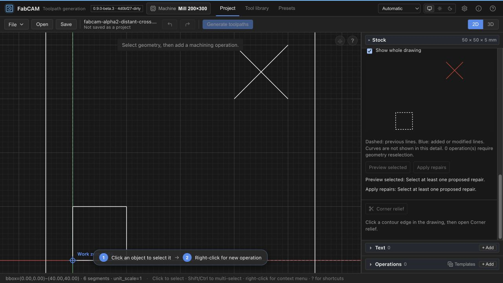
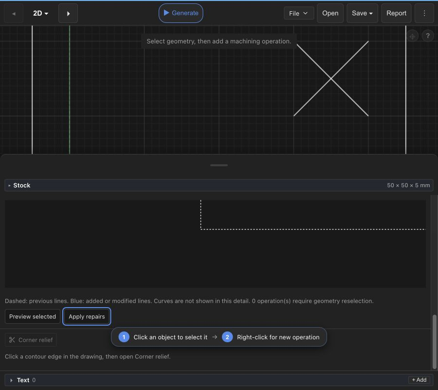
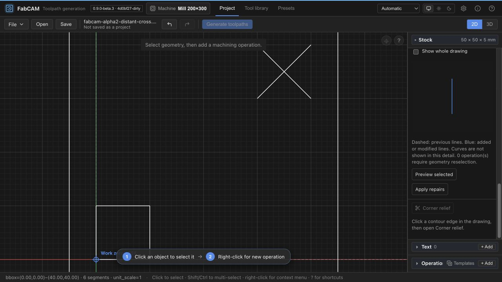
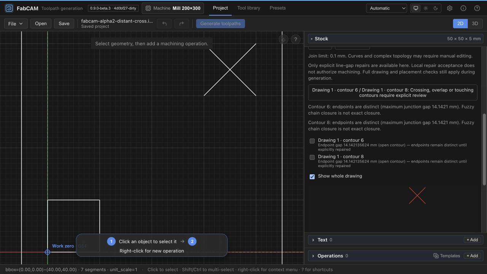

# ALPHA-2 — structured diagnostics and bounded local repair

2026-10-28. **Accepted by the user as a qualified, bounded first implementation.**
Local commits are authorized; integration, installed-native acceptance, machining,
release, push and packaging remain outside this checkpoint.

**Restrictions:** only proven isolated line-gap repairs are accepted. Nested or
overlapping envelopes, ambiguous placements and unsupported source contexts refuse.
`socle.dxf` is **not repaired or machining-ready**: all twenty real-drawing repair
probes were correctly refused; its three real crossings remain unresolved. Tracking: `ivac-4sylp.1`.

## Source and evidence

Isolated worktree `FabCAM-alpha-2`, branch `fix/alpha-2-geometry`, base
`4d0bf277c4023acc980f39accf8c8a40b77dbd13`; final software commit
`58ddde72295a01cbe43ce0270c98e1f79f2f1039`. The tested files are inventoried in
`ALPHA_2_QUALIFICATION_RECEIPT.json`. The software commit reproduces the qualified file fingerprint exactly. The receipt hashes production sources, tests and generated schema;
local logs are in `dist-test/alpha2/`. The real Git index remains unstaged.

The [preflight](ALPHA_2_PROTOCOL_PREFLIGHT.md) remains historical: its two red
counterexamples and their source/log hashes remain in `baseline.log` and
`receipt.json`. The corresponding tests now exercise explicit v2 behavior;
v1's strict global behavior has not been silently replaced. Neither baseline
failure was ignored or turned into a weaker v2 success condition.

## Implemented contract

| Boundary | Result |
| --- | --- |
| Drawing primitives, identities and lineage | v1, unchanged |
| Existing diagnostics/preview | v1, existing strict global behavior retained |
| New structured diagnostics/scoped repair | Explicit v2, separate HTTP/Tauri/WASM entry points; no v1 fallback |
| Persisted scoped snapshot/response | v2, containing drawing v1 |
| CAM generation | v1; complete topology and authored-placement guards retained |
| Portable project | v9 retained, with mandatory nested revision validation |

Rust returns real contour/edge identities and analysis completeness. Global,
budget and cancellation diagnostics have no invented contour. The existing exact
line predicates and conservative curve predicates are shared without changing
their tolerances. At most 2,000 retained primitives and 128 characterized issues
are admitted; exhaustion/incomplete analysis refuses scoped acceptance. A bounded
v1 proposal analysis can also refuse before a v2 result is constructed. There is
no partial report masquerading as complete proof.

Measured endpoint gaps and exact endpoint equality are distinct from the
importer's approximate chain closure. No import welding or V-Carve continuity
relaxation was added. Explicit snap/connector operations reuse the existing Rust
repair implementation. The frontend only frames Rust-supplied coordinates for
display; its normalized SVG frame makes micro-connectors visible.

### Exact scope of the local proof

This first v2 slice accepts **line-gap repairs only**. Before and after topology
must be completely characterized. A retained defect must involve unchanged
contours, with the same edges and reason. A defect involving edited geometry,
any new defect or an unsupported/ambiguous result refuses.

Unmodified contours are compared exactly, contour order/identities remain stable,
and each changed contour's combined before/after bounding envelope must be
strictly disjoint from every other combined envelope. This is a sufficient,
deliberately conservative containment/adjacency proof. **Nested contours,
overlapping envelopes and curve repairs remain unsupported**, even when a more
general proof might establish safety. Simplification/merge/removal proposals are
not enabled through v2. Full CAM validation remains mandatory after an accepted
local edit and again after reopening its project.

The project prefix must exactly match either the evaluated drawing or an
untouched, identity-transformed original import. The latter is reconstructed
from original ordinals and stable lineage, not coordinate proximity. Its actual
baseline topology is checked independently, and every unchanged world edge must
remain exactly unchanged. This handles raw import ordering and the frontend's
identity-transform shortcut without changing drawing-v1 evaluation semantics.
Other source orderings/transforms refuse if exact agreement cannot be established.
Auxiliary primitives are bounded/validated and must be disjoint from each repair
envelope. Live text is not admitted to this first repair-proof slice. These
source checks also cover direct API requests.

Authored placements are preserved only for one explicit, unchanged stable
contour whose actual operation source and placement ownership agree. All
operations, including disabled ones, participate. Changed, multiple, implicit or
ambiguous owners refuse. No placement is moved, deleted or reassigned. Existing
CAM's conservative refusal of edited geometry with authored placements remains;
preserving data during an edit does not qualify that CAM combination.

Placement proof additionally recomputes the actual source-object chaining,
requires its complete membership to agree with the stable owner, and excludes
auxiliary geometry touching that owner's envelope. This bounded placement slice
requires zero XY work offset and no live text. The final source audit added
regressions for falsely claimed source geometry, an auxiliary junction at the
owner, shifted placement context, and an auxiliary crossing in a proposed gap.
Nonfinite auxiliaries refuse; disjoint finite auxiliaries remain accepted.

### Revision-bound application

Preview carries typed drawing/project/operation/binding data and the complete
frontend source context: imports/transforms, operations/placements, work offset,
text, stock, fixtures, auxiliary sources, tools, machine and document epoch.
Apply supplies the current context. Rust compares it and recomputes the complete
geometry/ownership proof; an echoed token is insufficient. The frontend also
checks its current revision after the asynchronous response, before one atomic
history command. Undo/Redo and generation/export invalidation use the existing
history/freshness paths. The complete context is not persisted in portable
receipts. Loaded receipts are reevaluated and lose `local_edit_accepted`.

## Reader and transport qualification

The frozen actual pre-change frontend validator rejects snapshot/response v2.
Its bytes are identical at the user's historical build `1f353ef3b774382f63e67f93a9bb3a4652007de2`,
current primary V1.1 `34f41692ef1d90eddf1b3ff3b564d2b8600879d7`, and the isolated
base `4d0bf277c4023acc980f39accf8c8a40b77dbd13` (SHA-256
`3d0f358ee4850f7d598c30633a513b9c3888f21226397045512c7dc3f4651549`).
Existing supported file-dialog, browser upload, native path and restored-project
loading routes invoke that shared geometry validator; the new routes additionally
reevaluate using the explicitly requested backend protocol. Native Rust does not
independently parse the frontend portable project file: that reader lives in the
frontend. Native IPC tests exercise v1/v2 serialized responses and rejection;
they do not claim an installed native file-dialog walkthrough.

Real WASM tests exercise v1 retention, explicit v2, repair/apply/stale refusal,
portable v9 serialization, the actual new loader, the frozen old validator,
malformed nested revisions and Undo/Redo. They exposed a flattened-response Map
at the WASM boundary: only the new v2 export now uses JSON-compatible serialization.
Existing WASM exports and their contracts are unchanged. The new fallback export
also participates in the existing fatal-WASM-instance guard.

No supported project-loading path bypassing the nested revision guard was found.
Outer v9 is therefore retained; no broad migration subsystem was introduced.
An old backend that lacks v2 fails explicitly rather than silently downgrading.

## Private drawing

Read-only `socle.dxf` SHA-256:
`36ecdf0b3498b3df40fdf9e6c39bdf82fb300bf10dae96cb865578ca3bbf4a1a`.
It contains 995 segments / 34 approximately closed contours, of which 24 are
exactly closed. The ten measured gaps are separate from **three proper crossings**
confirmed by the earlier independent rational-determinant oracle. V2 identifies
the same three issues with complete analysis. No derived coordinates enter
committed/distributable fixtures or this report.

Twenty individual explicit preview probes (ten gaps × snap/connector) were run.
**All twenty refuse** under the conservative proof, because of overlapping
envelopes or an affected contour retaining a crossing. The source is unchanged.
ALPHA-2 does not claim to repair this entire private drawing or make it machinable.
The synthetic independent-crossing counterexample does accept its isolated gap
repair, while the full drawing still fails CAM validation.

## Qualification results

Final integrated gate: **20/20 PASS** (1,609 Rust PASS; 1,540 frontend PASS).
The exact file fingerprint is `eeb3a6f0fed2c8cc47fb2a66bc1d6a61d5ee83cc78f8ac6b93f806ed9028c462`. Results are recorded in the companion receipt and
`release-gate-qualified-source.log`. Earlier failures are retained: generated-file
drift against an intentionally uncommitted index; a CLI test's fixed target path;
new test construction errors; strict Clippy formatting in the diagnostic example.
The last browser pass also exposed an over-strict evaluated-order-only source
check. A new failing original-order/pivot regression was recorded before its
correction; both exact source layouts now have authoritative proofs. A strict
Clippy literal separator failure was corrected. One rerun inside the sandbox
could not receive file events, lock the advisory cache or launch/connect the
headless browser; the final unchanged gate runs with the necessary local test
permissions. A run against the stale generated WASM correctly failed the new
real-WASM regression; rebuilding the package resolves it, and the final gate
starts with that source-matched package. None were hidden by disabling tests or changing production-output
expectations.

For the drift checks, `GIT_INDEX_FILE=/private/tmp/fabcam-alpha2-qualification.index`
contains HEAD plus the two reviewed generated files. The existing generator-drift
commands then check reproducibility against that source snapshot. The real index
is unchanged. A local `target/debug` symlink points to the shared compilation
cache so the unchanged CLI gate locates its freshly built binary.

| Qualification | Evidence |
| --- | --- |
| Rust workspace, all targets/features through canonical gate | 1,609 PASS, 0 FAIL, 1 existing intentional ignored watchdog worker |
| Frontend full suite | 177 files; 1,540 PASS, 1 existing optional skip |
| Focused ALPHA-2 geometry/protocol | 4 baseline-target + 3 reader-boundary + 7 scoped tests PASS |
| Native v2 command | Dedicated async IPC-handler test PASS; no application launch |
| Real WASM + project loader | v1/v2 boundaries, stale apply, v9 save/reopen, old-reader refusal and Undo/Redo PASS |
| Frozen CNC corpus | 23/23 exact: program, geometry, provenance, line mapping and statistics; two-sided programs unchanged |
| Typecheck/lint/build/schema/freshness | See final gate; post-visual frontend checks additionally rerun |
| Browser | Real WASM production build, synthetic imports, preview/apply, stale refusal, Undo/Redo, download/reopen and narrow/keyboard review |

Commands: `scripts/pre-release.sh` with the pinned qualification environment and
absolute shared `CARGO_TARGET_DIR`; `python3 scripts/qual1a4/corpus.py
target/debug/ivac <fresh-local-output-directory>`; focused `cargo test --locked
-p ivac-tauri --all-features alpha2_native`; frontend `pnpm check`, `pnpm lint`,
`pnpm test`, `pnpm build`. No test flags were weakened. The existing large-bundle
warning and configured dependency-advisory notices remain observations.

### Visual walkthrough

The initial live build changed assets while a browser tab still referenced its
old chunk names. Review continued on stable local copies; this was not counted
as a successful import. Completed runs used the production WASM build.

- A 0.05 mm gap: explicit preview/apply adds one connector (4 → 5 segments), Undo
  restores four and Redo restores five. Browser download is outer v9 / snapshot
  v2 / drawing v1. Reopen reevaluates successfully and shows five segments.
- A 0.00005 mm gap with a distant crossing: actual crossing identities are shown
  and its two segments highlighted in the detail; selected gap preview/application
  succeeds locally while the crossing remains. Full CAM refusal is independently
  asserted by the Rust regression.
- Changing repair settings after preview disables Apply with the stale-analysis
  explanation. Keyboard Tab reaches Apply, Enter applies. At 900 × 800 the
  compact Stock & Layers drawer remains usable without horizontal overflow.
  Crossing the responsive breakpoint remounts cleanup and requires new analysis;
  it does not reuse the discarded preview.
- Micro-gap review exposed an invisible detail at extreme SVG magnification.
  The final view uses normalized display coordinates only; the connector is
  visibly blue, with unchanged underlying geometry. Curves are explicitly omitted
  from the line-only detail view; their diagnostic identities remain available.

The final source build was replayed in the browser after the source-order fix:
6 imported segments → explicit connector → 7 segments; Undo → 6; Redo → 7.
The downloaded v9 project contains snapshot/response v2 and drawing v1. The actual
file-open flow reopens it, and a new analysis still identifies the distant
crossing. The last screenshot is from this reopened final build. A local review
instance is available at `http://127.0.0.1:18855/?api=wasm` while its server runs;
this is a browser build, not an installed macOS candidate.

## Preservation and review boundary

Primary V1.1 and TOOL-META tracked worktrees remained clean at their inspected
revisions; ALPHA-1 source and its local evidence remain intact. No V1, postprocessor,
ALPHA-3/4, TOOL-META or FabSpeed changes. The private source hash is unchanged.
Native application launch, installed-platform acceptance, physical machining and
installed-platform acceptance remain **OPEN / NOT CLAIMED**. Bounded ALPHA-2 human acceptance is recorded above.

Authorized local commit inventory:

- Rust/protocol commit: `8296fc12b5bf2b080c6c36ae27df597a8cb423eb`.
- Final software commit: `58ddde72295a01cbe43ce0270c98e1f79f2f1039`.
- Report commit: the documentation-only child of the final software commit; its exact SHA is delivered in the handoff (no self-referential commit hash).

Reviewed grouping:

1. Rust v2 diagnostics/proof, explicit transport/schema and source-bound regressions.
2. Frontend v2 loading/application, continuity UI, micro-gap framing, compatibility
   fixture and real-WASM/Undo/fatal-state regressions.
3. Historical preflight, final report/receipt, synthetic screenshots and status/roadmap.

Exclude private inputs, derived private coordinates, build caches and local raw
logs from commits. Review the exact receipt inventory before any staging.

**HARD STOP after accepted ALPHA-2 local consolidation.** ALPHA-3
explicit finishing and ALPHA-4 cross-context preset reuse remain unstarted.

Post-commit verification: all 39 committed software files match their qualified SHA-256 entries byte for byte. No software changes required rerunning gates. The 20/20 qualification and 23/23 exact CNC references remain source-bound; raw logs, private inputs and caches are excluded from all three commits.
