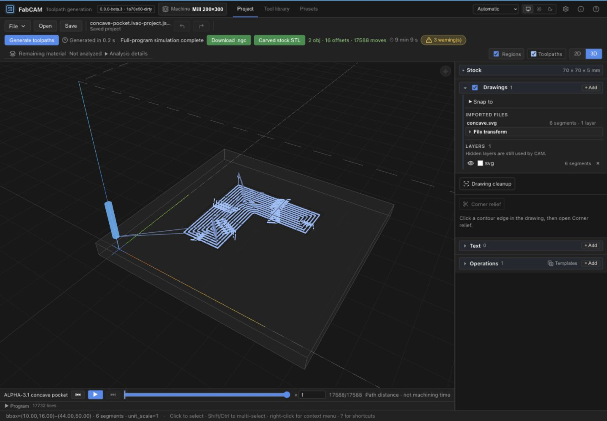
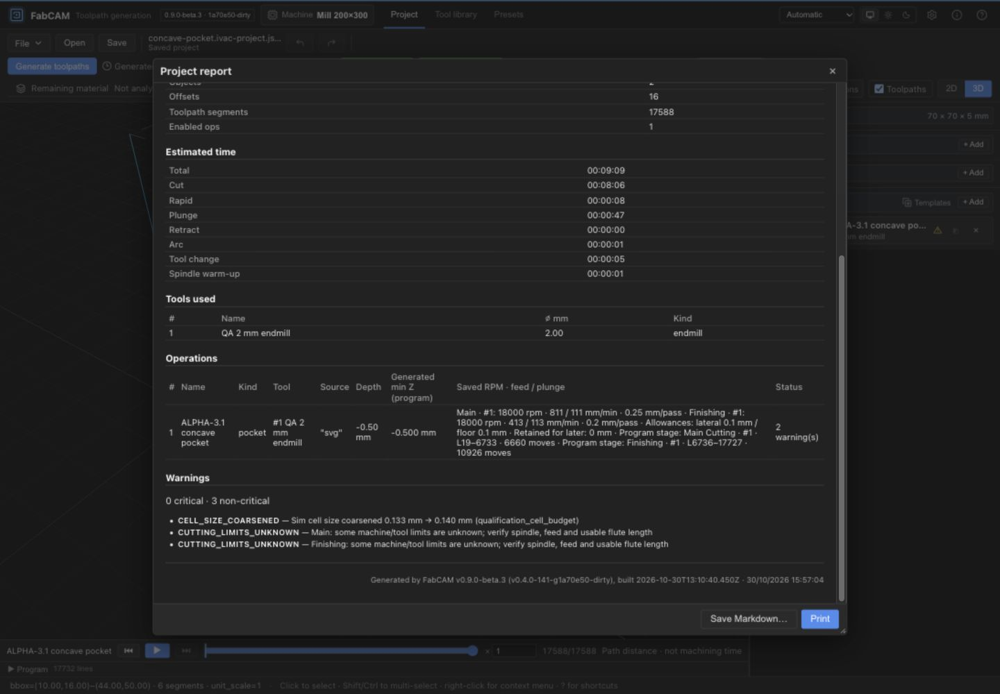
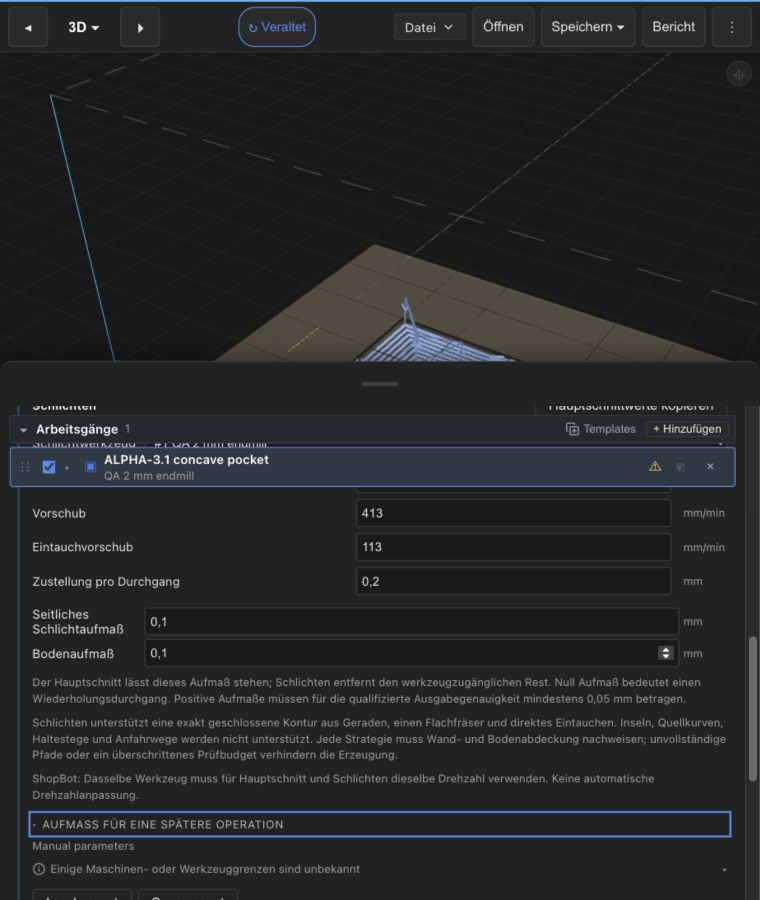

# ALPHA-3.1 — Generalized 2D Finishing

**Human acceptance and local consolidation — 2026-10-30.** The maintainer accepted
ALPHA-3.1 within the documented bounded scope and authorized the three proposed
local commits. Core: `59d8e233fa54facb9873b7203068ed45ad291011`. Qualified software/tests: `56743de13a1f66005d7e24519fc298e66bf9c224`.
All 1,302 committed software files match fingerprint `1673ddb0e22994cb716b04711c4943c4635d707dc1956c6fa9901c15a6c1224c` exactly
(including resolved tracked symlink content). No executable bytes changed after
qualification, so the source-bound gate remains applicable without rerunning it.
The documentation commit is the commit containing this acceptance record; its exact
SHA is returned in the handoff and pinned by the subsequent ALPHA-3.2 preflight.
[Consolidation receipt](evidence/alpha31/consolidation.json).

The report and proposed inventory below retain the pre-commit qualification context.
The original qualification receipt remains unchanged; its pending-review status is
historical and superseded by this acceptance. Geometry/strategy limits and all
installed-native, physical and publication exclusions remain unchanged.
No merge, push, installer or release. ALPHA-3.2 is authorized only after this baseline
is committed; a new incompatible contract requires a separate human decision.

## Historical qualification record

**2026-10-30 — CONDITIONAL GO for bounded software acceptance. Human review pending.**
Implementation is uncommitted in `feature/alpha-3-1-generalized-finishing`.
This is useful polygon finishing, not universal 2D finishing or physical qualification.
No commit, integration, push, installer, release or machine operation was performed.

## Source and preservation

Starting/final Git HEAD: `1a70e503b8661aeb59b8d3bff56e5fde4139836c` (accepted
ALPHA-3 documentation). Accepted implementation `0867b442b4e23ba8afe2261ac97f46b479a1f633`
and software/tests `42be450e080d63ef83b632ab3ec9389e4095e126` are ancestors.
Before modification, every file in the accepted 1,295-file inventory matched
`1918642857029aad70aff0a2881248e4b67b66daeeb267ad71954f49a54b4b46`.

The final uncommitted implementation is identified by
[software-files.json](evidence/alpha31/software-files.json), not by HEAD alone.
Its 1,302-file fingerprint is
`1673ddb0e22994cb716b04711c4943c4635d707dc1956c6fa9901c15a6c1224c`.
[qualification.json](evidence/alpha31/qualification.json) records its fingerprint,
actual final gates and log hashes; the runtime/browser receipts bind the tested
binary/WASM artifacts. The complete changed-file
inventory and proposed groups are in [proposed-commits.json](evidence/alpha31/proposed-commits.json).

ALPHA-1, ALPHA-2, accepted ALPHA-3, primary V1.1, TOOL-META and frozen V1 were
preserved. [Worktree evidence](evidence/alpha31/worktrees.json) records final heads
and status. Only the existing shared compilation cache was reused. Private
drawings, derived private coordinates and normal installed-application data were
not used. Test geometry and browser projects are synthetic.

## Contract and architectural change

The accepted rectangle branch remains intact. Its old restriction was a proof
restriction, not the limit of the existing Profile/Pocket generators. The new
`stage_polygon` module extends verification around those same generators;
it never emits replacement contours or introduces another machining engine.

No persisted field, schema or version changed: portable/native cutting **v10**,
`main_finishing_v1`, preset collection **v2**, drawing **v1**, ALPHA-2 repair/snapshot
**v2** and existing CAM protocol remain unchanged. Existing reader, preset,
freshness, placement and project regressions run in the canonical gate.

New internal `FinishingProof` errors use the existing structured `misconfigured`
wire kind with real `op_id`, precise message and actionable hint. They do not
mislabel a geometry refusal as a request to edit cutting rates. EN/DE help now
describes polygon eligibility and proof refusals instead of rectangle-only support.

### Supported input

- One selected, unpatterned, exactly closed simple contour, **3–256 straight edges**.
- Finite source coordinates within ±1,000,000 mm; each edge at least 0.001 mm.
- Either winding, rotation, translation and tested scale variation.
- Flat endmill, ordinary depth passes, direct entry; existing numeric/tool/setup
  limits and all full CAM guards still apply.
- Profile Inside/Outside: equal effective cutter diameters and lateral finishing
  allowance no greater than cutter radius, as in ALPHA-3.
- Pocket: one boundary without islands; a distinct flat finishing cutter is
  allowed only if both stages pass their own complete proofs.

Exact continuity is checked on original primitives. No fuzzy closure, snapping,
import repair, contour remapping or coordinate alteration is introduced.

### Explicit refusals

Open/micro-gap chains, self-crossings, overlaps/touches, ambiguous or nearly
collinear joins, tiny edges, source arcs/circles/splines, islands, multiple regions,
offset collapse/splitting/unproven trimming, unresolved floor coverage and exhausted
proof budgets refuse. Existing tabs, authored approach, leads, helix, overcut,
trochoidal, Halfpipe finishing and whirling exclusions remain. Main-only capability
is not narrowed by these finishing restrictions.

Source arcs were investigated: emitted offset arcs already have analytic support,
but arbitrary curved **source** reachability and trimming require another proof.
They remain explicitly unsupported; no silent tessellation broadens eligibility.

## Geometry and material-removal proof

### Compensation and reference

Existing Cavalier/Clipper-backed offsets and fill paths are generated unchanged.
Verification independently constructs parallel-edge/round-join references from
the original polygon. Convex inward/reflex outward joins use line intersection;
the opposite joins use circular transitions. Existing drawing topology validation
checks source and reference. Reversed/collapsed offset edges, self-contact and
trimming ambiguity fail closed. The reference is never a generated toolpath.

Every cutting trajectory must remain on the correct side with sufficient
distance from **all** original edges. Continuous segment-distance checks include
connectors, not only path vertices. Profile coverage uses a bidirectional
continuous distance bound against the compensated reference. A path that merely
exists, or a returned offset count, is insufficient.

### Pocket wall and floor

Let `r` be the actual stage cutter radius and `S` its lateral retention. The
reachable center region is `E = {p inside P : distance(p, boundary P) >= r + S}`.
The cutter-accessible opening is `E ⊕ disk(r)`. Sharp inaccessible corners are not
declared cleared.

Wall coverage is an interval-union proof: intersect each target chord continuously
with actual path capsules (rectangular tube plus endpoint disks). A missing
interior interval refuses even when both segment endpoints appear covered.

Floor coverage uses bounded tiles over the source bounds. Signed distance is
1-Lipschitz, so center distance plus tile half-diagonal can exclude an entire tile
from `E`. Otherwise all four corners must lie in one convex actual-path capsule,
which proves the whole tile covered, or the tile is subdivided. Unresolved tiles
refuse. Coverage of `E` plus its wall reference proves the accessible opening,
within the declared representation error. This is not a sampling-only acceptance
test and does not infer floor removal from a wall ring.

### Allowances and stages

`R` remains lateral stock independently retained for later; `L` and `F` are
Finishing allowances. With Finishing disabled, Main targets `(R, Z)`. When enabled,
Main targets `(R + L, Z + F)`, Finishing `(R, Z)`, with each stage's own cutter,
rates and axial schedule. Zero allowance is repeat machining. Positive allowances
below **0.05 mm** still refuse. Profile On-contour and Profile floor finishing
remain unsupported.

Pocket Finishing performs another complete reachable clearing pass. No optimized
rest-only machining is claimed. Different Pocket cutters have distinct reachable
regions and are proved separately; they are never silently substituted.

### Precision accounting

| Quantity | Bound / interpretation |
|---|---|
| Planned-path proof | 0.003 mm, includes existing approximately 0.0011 mm conservative pocket erosion pad and chord enclosure |
| Final decoded-path proof | Existing **0.02 mm** per-stage output budget, unchanged |
| Arc chord enclosure | Sagitta at most **0.0001 mm**; debited in clearance, interval and tile tests |
| Additional conservative arithmetic margin | 1e-8 mm |
| Final depth | Existing 1e-4 mm output-depth tolerance |
| Positive finishing allowance | At least 0.05 mm; not relaxed |

Decoded arcs use `ArcXY` center/direction rather than treating coarse 15° preview
segments as straight machining moves. Output rounding can put the terminal point
off the start-radius circle. Reconstructing an equal-sweep bulge then shifts the
center: both curves start at the same point, so their separation at **every angle**
is bounded by twice the center displacement. This measured enclosure plus the
arithmetic margin is **deducted** from 0.02 mm; exhaustion refuses. A dedicated
regression compares analytic interior points with that bound. No output bytes or
machine tolerance are changed to accommodate the conversion.

These are software representation budgets, not a claim of exact real-number
proof or physical machine accuracy. Cutter deflection, runout, rigidity, workholding
and surface quality remain unqualified.

## Final emitted-path gate and streaming

After output decoding and actual cutter/stage binding, newly supported polygon
finishing is checked again. Every cutting level is checked for envelope/depth
violations; wall and floor completion must exist at the authored final stage depth.
Exact identical planar motions may be deduplicated across axial passes for proof
work, without rounding coordinates or changing output. Removing floor motions,
shifting them into forbidden stock or deepening them is rejected by mutation tests.

The three native streaming entry points route **new polygon finishing** through
the buffered, decoded gate before writing any byte to the sink. Successful output
is the exact validated program; failed proof leaves the sink empty. Existing
transactional export and two-sided contracts remain mandatory.

**Cost:** this new streaming case uses O(program + decoded path) memory rather than
O(largest operation), and preparation is repeated. Main-only and accepted rectangle
streaming retain their prior behavior. This is a deliberate safety tradeoff, not
a streaming performance optimization or a universal memory guarantee.

## Accepted / refused representative matrix

Inputs are in [polygons.json](../../tests/fixtures/alpha31/polygons.json).
The following is for the recorded 2 mm flat cutter, direct entry, `L=0.1`,
Pocket `F=0.1`, `Z=-0.5` cases. It is not an unconditional shape whitelist.

| Source | Profile Inside / Outside | Cascade Pocket | Zigzag Pocket | Spiral Pocket |
|---|---|---|---|---|
| Axis-aligned rectangle | PASS, old bytes | PASS, old bytes | PASS, old bytes | PASS, old bytes |
| Rotated rectangle | PASS / PASS | PASS | Refuse floor coverage | PASS |
| Triangle | PASS / PASS | PASS | Refuse floor coverage | PASS |
| Irregular convex pentagon | PASS / PASS | PASS | Refuse floor coverage | PASS |
| Concave L | PASS / PASS | PASS | PASS | Refuse decoded proof budget |
| Irregular concave hexagon | PASS / PASS | PASS | Refuse floor coverage | Refuse decoded proof budget |

Other tested acceptance: 32-edge convex Profile/Pocket, translated/rotated/reversed
polygons, independent zero/wall/floor/combined allowances, retained-for-later stock,
nonzero work origin and distinct 1.5 mm Pocket finish cutter. Concave scale 0.7
with the distinct cutter passes; scale 1.0 in the additional ShopBot dual-cutter
case and scale 1.5 exhaust the proof budget and refuse.
Larger or more complex is not automatically supported.

Six additional runtime refusals cover a 1 mm narrow neck with a 2 mm cutter,
sub-0.001 mm edge, crossing, redundant collinear join, 1e-6 mm closure gap and
source arc. The island case refuses before stage publication. These are expected
safety outcomes, not qualified machining geometries.

## Independent oracle and motion inventory

The test oracle in `alpha31_finishing.rs` does not call production offsets,
flatteners, reference construction, capsule intervals or tile proofs. It separately
evaluates original-edge distances/winding and exact decoded analytic line/arc
distances. Representative intermediate motion points, target wall locations and
reachable floor grid points verify side, overcut, retention and final depth.
This sampled oracle complements rather than substitutes for the continuous
production proof. Its coverage and mutation tests detect missing-floor and gouge
counterexamples; it does not claim exhaustive universal polygon correctness.

The initial two nonrectangular Profile/Pocket regression probes failed against
the accepted source, and the captured 60-case baseline recorded 25 nonrectangle
finishing refusals. [baseline.json](evidence/alpha31/baseline.json) and hashed RED
log evidence preserve those outcomes. Final expected refusals reflect genuine
coverage/budget restrictions; no old accepted fixture or validator was weakened.

[runtime-comparison.json](evidence/alpha31/runtime-comparison.json) records **86 cases**:
73 accepted, including **28 newly accepted**; 13 deliberate refusals. **45** already
accepted programs and decoded paths are byte/exact-data identical to ALPHA-3.
[retained-corpus.json](evidence/alpha31/retained-corpus.json) independently verifies
the **23 historical fixtures / 24 programs** against accepted ALPHA-3 outputs:
programs, decoded motion, tools, stage bindings, line index and statistics match
exactly, including unchanged operation families and the earlier rectangular dual-tool
Pocket. No CNC golden was regenerated.

[motion-inventory.json](evidence/alpha31/motion-inventory.json) binds new requests,
programs and decoded output hashes to actual stage parameters, tools, line ranges,
axial levels, work origins and motion bounds. New acceptance is independently
qualified, not inferred from the baseline refusal becoming success.

## Runtime, simulation and UX evidence

- **70** comparable native/WASM cases match exact program text, stages, warnings
  and normalized nullable provenance. WASM streaming, native CLI streaming and
  the relevant two-sided front path match those program bytes. Refusals agree
  through WASM regular/stream/two-sided entry points.
- Binary64 native JSON and WASM transport differ by at most
  **1.4210854715202004e-14 mm** on decoded coordinates in the final campaign.
  A test-only 1e-12 mm absolute coordinate comparison is used; other fields and
  machine text remain exact. Production coordinates and geometric guards are
  untouched. This is distinct from the 0.02 mm machining-representation budget.
- Real HTTP handlers and native command functions compare convex/concave results
  with core, including two-sided/native refusal paths. These are not an installed
  Tauri IPC acceptance test.
- Native/core ShopBot tests exercise convex/concave Inside/Outside/Cascade,
  independently check decoded removal and preserve same-cutter RPM-change refusal.
  A convex Pocket with the distinct 1.5 mm cutter and 19,000 RPM Finishing versus
  18,000 RPM Main passes through the existing manual section/toolchange contract;
  the corresponding unscaled concave case refuses its proof budget. No new
  postprocessor capability or relaxed budget was introduced.
  Canonical browser WASM has CPS disabled: **no browser/OpenSBP equivalence claim**.
- Main `[-0.25,-0.4]`, Finish `[-0.2,-0.4,-0.5]` with G54 `(3,2,0)` is independently
  tested. Existing toolchange, SAFE-Z, placement, export and CPS suites pass.

Actual production-browser WASM/worker walkthroughs used fresh local QA origins,
1440×1000 and 760×900 viewports. The final rebuilt WASM repeated rotated/convex/
concave Profiles, convex Pocket, distinct-cutter Pocket and saved concave Pocket;
full-program verification completed and current export became available. The first
review additionally exercised interactive creation from SVG, Finishing off/on,
Main-only, wall-only, floor-only, combined allowances, strategy switching,
island/budget/coverage refusals, geometry/allowance edits, stale export and Undo/Redo.
The only subsequent production change was the arc enclosure; the final browser
repeat and 86-case differential cover that reinforced proof. The last source edit
adds the distinct-cutter ShopBot acceptance/refusal regression only; the complete
canonical gate was rerun afterward.

The browser-saved concave Pocket reopened as **V10**, preserving Main
18000/811/111/0.25 and Finish 18000/413/113/0.2 plus L/F=0.1. Playback identifies
Main/Finishing and actual cutter #1/#2. The report shows authored parameters and
actual output ranges (concave UI case: Main L19–6733, 6,660 moves; Finishing
L6736–17727, 10,926 moves). These synthetic rates are not cutting recommendations.
Simulation is derived from decoded motion; its disclosed 0.140 mm cell coarsening
is not an independent sub-0.1 mm machining measurement.

Remaining-material UI stays **Not analyzed** when the existing analyzer does not
support a strategy, arc or tool combination. The finishing proof does not turn that
into a false zero-residual certificate. Its structured statuses/reasons are retained
in the runtime receipt. EN/DE help wraps in the compact inspector, keyboard focus
is visible and body width equals the 760 px viewport. Existing compact navigation
is retained, not redesigned. Human UX acceptance is still pending.

Evidence: [final browser cases](evidence/alpha31/final-browser-cases.json),
[saved project](evidence/alpha31/browser-saved-pocket.ivac-project.json),
[browser receipt](evidence/alpha31/browser-review.json).

## Performance and bounded work

Proof ceilings: 256 source edges; 5,000 path segments/chords or distinct decoded
planar movements per stage; 5,000,000 checked work units per proof/scan; 100,000
pending tiles; unresolved half-diagonal below 1e-6 mm refuses. Arc subdivision and
work counters use checked limits; cancellation is cooperatively checked. Existing
global topology/output/resource limits remain. No global budget was raised to
make a rejected strategy pass.

[performance.json](evidence/alpha31/performance.json): separate fresh native debug
CLI processes measured with macOS `/usr/bin/time -l`; single observations, not a
release benchmark or universal memory bound. Native observations below include
launch/parse/generation; WASM observations come from the separate release-WASM
campaign and exclude browser UI/stock simulation.

| Case | Native wall | Native max RSS | Release WASM generation |
|---|---:|---:|---:|
| Rectangle Cascade | 0.01 s | 16.9 MiB | 3.5 ms |
| Convex Outside | 0.05 s | 16.3 MiB | 7.0 ms |
| Convex Cascade | 0.03 s | 17.4 MiB | 7.7 ms |
| Concave Cascade | 0.42 s | 29.9 MiB | 94.7 ms |
| 32-edge Profile | 0.08 s | 17.3 MiB | 12.5 ms |
| 32-edge Pocket | 0.08 s | 19.7 MiB | 22.3 ms |
| Eight Main-only contours | <0.01 s displayed | 16.1 MiB | 0.9 ms |
| Island refusal | 0.26 s | 17.3 MiB | refusal verified |
| Narrow-neck refusal | 0.01 s | 16.3 MiB | refusal verified |

The long Node differential campaign peaks near 320 MiB cumulative RSS (retained
WASM/JS results), not 320 MiB per proof. Concave path proliferation and conservative
tile coverage remain practical limits. No speed optimization is part of this lot.

## Final qualification

Final `scripts/pre-release.sh`: **20/20 mandatory gates PASS**, after the final arc
enclosure change and the final ShopBot regression. Rust **1,645 PASS, 0 FAIL, 1 intentionally ignored worker**;
frontend **1,542 PASS, 1 optional locale skip**, 178 files. Typecheck: zero errors/
warnings. Formatting, strict pedantic Clippy, all-features workspace, schema/version,
codegen/i18n drift, lint, production build, fresh web WASM, CPS size guard,
cargo-deny, UI smoke, transactional export/trust, SEC1 and candidate identity pass.

New coverage includes 9 integration tests, 6 proof-unit tests and HTTP/native
boundary regressions. Existing ALPHA-2/3, reader/preset, simulation/report,
ShopBot and CNC tests remain. The final standalone 86-case runtime harness and
retained 23-fixture differential pass after the final production change. The final
test-only change leaves all production bytes unchanged. Raw logs,
compilation caches and executables remain local, outside proposed commits; their
hashes are in the qualification receipt. Initial RED results and superseded test
attempts are not represented as final passes.

**NOT RUN / NOT ACCEPTED:** installed-native UI on the separate macOS account,
physical CNC, arbitrary source curves/islands/rest machining, publication and human
UX/motion acceptance. No credential, hardware or release operation was attempted.

## Commit proposal and decision

Three coherent groups are proposed, not executed:

1. Core polygon proof, stage/decoded/stream integration, synthetic fixtures and
   independent geometry regressions. Keep the error variant and all consumers
   together so this intermediate tree compiles.
2. HTTP/native regression boundaries, runtime qualification harness and EN/DE
   eligibility messages. Depends on group 1; no schema or postprocessor changes.
3. Sanitized evidence, this report, STATUS and roadmap. No private input, derived
   private coordinates, raw logs, built assets or unrelated changes.

**CONDITIONAL GO** for the bounded polygon implementation and human software review.
Meaningful convex and concave Profile/Pocket finishing is demonstrated. Conditions
are acceptance of the stated strategy/geometry and streaming-memory limits; no claim
of general islands, curves, rest machining, installed-native or physical readiness.

**HARD STOP before commits/integration.** Review the source fingerprint, motion
inventory, refused matrix and UX evidence. ALPHA-4, TOOL-META and FabSpeed remain
outside scope. The release roadmap's native Personal Alpha acceptance remains a
separate future gate; neither it nor another geometry extension is started here.
