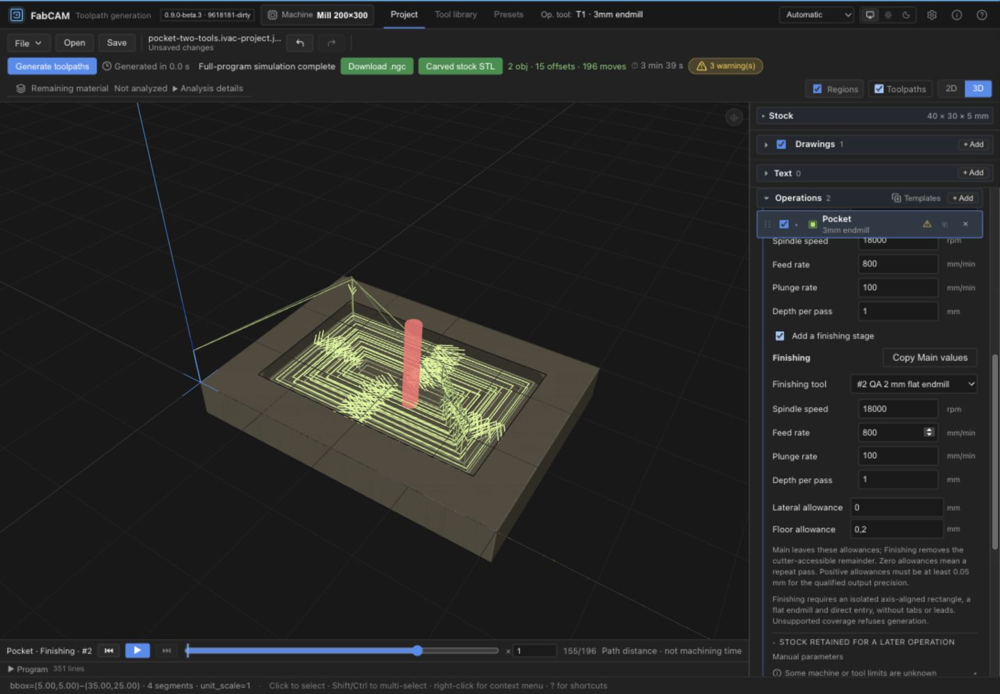

# ALPHA-3 — Explicit Main Cutting and optional Finishing

## Human acceptance and local commit receipt

The maintainer accepted the exact bounded implementation and authorized the three
proposed local commits. Implementation: `0867b442b4e23ba8afe2261ac97f46b479a1f633`.
Final software/tests: `42be450e080d63ef83b632ab3ec9389e4095e126`.
All 1,295 qualified file hashes match the committed software tree exactly; no executable
change required a new qualification run. [Acceptance receipt](evidence/alpha3-qualified/commit-acceptance.json).
The documentation commit contains this receipt; its exact SHA is recorded in the final
post-commit handoff, avoiding a self-referential commit hash. Other worktrees and frozen
V1 remain unchanged. No integration, publication or further implementation authorized.
The original qualification text below is retained as the pre-commit review record;
its PENDING/no-commit statements are superseded by this acceptance receipt only.
**HARD STOP after these local commits. All finishing/platform/physical limits remain.**

Date: **2026-10-29**. Tracking: `ivac-4sylp.3`.
**Implementation complete; bounded software qualification PASS; human acceptance PENDING.**
Recommendation: **GO for review of this bounded candidate**, not integration, installed-platform acceptance or machining.
No implementation commit, merge, push, installer, release or hardware action.

## Read these restrictions first

Main-only Profile and ordinary Pocket retain their existing geometry machinery. The new
**Finishing** stage is qualified only for **one selected, exactly closed, four-line,
axis-aligned rectangle**, with a flat endmill and direct entry. It refuses selected
islands/multiple contours, arbitrary/nonrectangular or rotated contours, patterns,
tabs, authored approach placements, leads, helix/overcut, whirling and Trochoidal
finishing. This is a deliberate first implementation, not general-purpose rest machining.

Profile supports compensated Inside/Outside lateral finishing with equal effective
cutter diameters and allowance no greater than cutter radius. On-contour finishing
and Profile floor finishing refuse. Pocket Cascade/Zigzag/Spiral support wall, floor
and combined allowances, including a distinct qualified cutter. Pocket Finishing
re-clears the whole cutter-accessible target at its own pass depth; it is **not an
optimized rest-only pass**. Sharp inaccessible corners remain material, not a claim
of full mathematical-square removal.

Positive finishing allowances below **0.05 mm** refuse; zero explicitly means a repeat
pass. Stage schedules currently use one positive depth per pass; legacy variable-depth
lists/finish-step contracts are not silently converted. Distinct-tool remaining-material
UI analysis remains explicitly unavailable, though generation coverage and decoded
motion are independently checked. Installed Tauri UI and physical machining are **NOT RUN**.

The private `socle.dxf` is **not repaired and not machining-ready**. ALPHA-2's three
real crossings and twenty refused repair probes are unchanged. No private drawing or
derived private coordinates were added to fixtures/evidence.

## Source and preservation

| Item | Exact identity |
|---|---|
| Isolated branch/worktree | `feature/alpha-3-main-finishing` / `FabCAM-alpha-3` |
| Starting and current Git HEAD | `96181814c6f97ac19390dade7a0d3110b2f4d681` |
| Accepted ALPHA-2 software ancestor | `58ddde72295a01cbe43ce0270c98e1f79f2f1039` |
| Final software fingerprint | `1918642857029aad70aff0a2881248e4b67b66daeeb267ad71954f49a54b4b46` |
| Version | `0.9.0-beta.3`, unchanged; UI identifies `9618181-dirty` |
| Implementation commit SHAs | **None — approval required before commits** |

The fingerprint covers 1,295 existing software/configuration/test/fixture files, including
new untracked implementation files and executable archived reader dependencies.
[Exact file hashes and algorithm](evidence/alpha3-qualified/software-files.json) distinguish
these tested uncommitted bytes from the historical HEAD. Documentation/screenshots are
separate evidence, not executable-source identity. Generated schemas are included;
raw logs, compiled packages and local caches are excluded. A final verification confirmed
all inventoried bytes unchanged after qualification and documentation.

[Qualification receipt](evidence/alpha3-qualified/qualification.json) records raw-log hashes,
WASM and browser-asset hashes and preservation checks. Primary V1.1 stays at
`34f41692ef1d90eddf1b3ff3b564d2b8600879d7`, ALPHA-1 at
`4d0bf277c4023acc980f39accf8c8a40b77dbd13`, ALPHA-2 at `96181814`, TOOL-META at
`efe98dc2e7e46f4d12783dd8dbc9c0b09d2f773d`. Their tracked trees remain clean; no
untracked user evidence was cleaned or moved. Frozen V1/main remains
`ef807cf8250ddc4bdf795c75bb9bf9f011db9bca`. The real Git index is empty.

## Historical evidence and implementation continuation

The initial three typed-model tests were retained and extended; the model was connected
to the real drivers, setup validation, readers, UI, simulation attribution and reports.
The [original preflight report](evidence/alpha3-preflight/preflight-report.md),
[preflight receipt](ALPHA_3_PREFLIGHT_RECEIPT.json), archived tests/readers and local
`dist-test/alpha3-preflight/` evidence preserve the two deliberately RED counterexamples
and old-reader findings. They are historical source-bound tests, not disabled current
assertions. Their desired behavior now has passing v10 generation regressions: Main
actually supplies Profile rates, and a missing unused Finish role no longer blocks Main-only.
The original 23-case output corpus was neither regenerated nor edited.

Review also corrected three implementation findings before the final gate: selecting a
rectangle within an **unselected** synthetic stock outline must not make it an island;
same-tool explicit stages can use the existing remaining-material analyzer; shared
numeric diagnostics must name Main/Finishing rather than dormant Rough/Finish roles.
A microscopic positive allowance could disappear within output precision, so it now
refuses instead of claiming material reservation. The final receipt retains the relevant
RED/green log hashes. Early environment/typing/lint failures are not presented as passes.

## Contract and reader boundaries

[Accepted ADR-0032](../shopbot-modernization/adr/ADR-0032-explicit-main-and-optional-finishing.md)
is implemented with these independent versions:

| Boundary | Current behavior |
|---|---|
| Portable editor document | Project **v10**; v1–9 and unknown future versions refuse before restore/history mutation. Original files are not rewritten. |
| Native machining request | Required `project.cutting_version: 10`; old, absent, mixed and malformed contracts refuse. |
| Adapter capability | Explicit `cutting-parameters-v10` in native/HTTP/WASM/worker; no v9 fallback. |
| Profile/ordinary Pocket | Typed `main_finishing_v1` in `params.stages`; required Main and required nullable `finishing`. |
| Other operation families | Existing exact role semantics inside the v10 envelope; Halfpipe retains its separate Rough contract. |
| Preset collections | New **v2** staged entries; historical v1 remains readable/inspectable and is not rewritten. |
| Geometry | Drawing primitives/identity v1, ALPHA-2 diagnostic/snapshot v2 and CAM drawing envelope v1 unchanged. |

Each stage owns actual tool ID, integer RPM/feed/plunge and positive finite depth per
pass. Nullable editable values stay null; generation refuses incomplete stages. No
rounding/clamping, legacy rate fallback or tool-default lookup at generation. Redundant
operation/stage tool assignments must agree. Legacy `cutting`, `step`, depth lists,
`finish_step`, rate overrides or `nocontour` cannot be mixed into staged input.

Rust remains authoritative. A targeted pre-conversion WASM guard enforces required
stage keys/shape where serde-wasm-bindgen would otherwise ignore JavaScript properties.
This is not a global serializer normalization. Disabled operations are also checked for
valid structure; editable null values do not imply execution readiness.

Actual archived frontend project/template reader code and the archived real v9 WASM
runtime refuse the new version/shape. The old template positive control still reads its
historical shape. The preflight establishes old native cutting-v10 refusal. Actual new
CLI, HTTP JSON extraction and Tauri command functions refuse v9 and match core output.
Both file-opening services use the strict portable validator before state replacement;
browser v9 refusal was observed with the current v10 program unchanged. Native **installed
file dialogs/WebView IPC** were not exercised and are not inferred from command tests.

Operation templates retain their existing envelope with an explicitly typed stage shape;
the actual old strict template reader refuses that shape. Historical Profile/Pocket
templates cannot be silently instantiated with v10 meanings. No broad migration system.

## Geometry, allowances and execution

Main-only Inside/Outside/On Profile uses its own cutter, rates and schedule through the
existing offset/entry/tab/SAFE-Z machinery. Main-only ordinary Pocket includes required
wall paths and fill as Main; `nocontour` is explicitly refused for v10 rather than used
as the finishing switch. Established Main-only nonrectangular/island geometry remains
subject to existing CAM validation. No new island-finishing qualification is claimed.

Let `R` be independently authored lateral stock retained for a later operation, `L`
the temporary lateral finishing allowance, `F` the floor allowance, and `Z` final depth:

- Main with finishing OFF targets compensation for cutter radius + `R`, and depth `Z`.
- Main with finishing ON targets cutter radius + `R + L`, and depth `Z + F`.
- Finishing targets **its own** cutter radius + `R`, and depth `Z`.

These are distinct authored quantities. Finishing never removes `R` by accidentally
substituting a distinct cutter's bare radius. On-contour retained lateral stock refuses
because no compensated side is defined. A floor allowance consuming all Main depth
refuses. Zero `L/F` is labelled repeat, with no promise that positive stock was reserved.

Both stage plans and their coverage proofs are completed before either is emitted;
failed finishing cannot produce successful Main-only completion. Existing offsets,
common emitters, entries, cancellation and machine validation are reused. Execution-local
legacy setup slots carry the **same explicitly selected stage values** solely to reuse
common machinery; they are never authored/persisted fallback roles. Path `is_finish`
does not select unrelated authored rates.

### Coverage and precision evidence

The bounded rectangle proof requires exact copied endpoints and axis alignment. It
checks all generated center segments stay in the cutter-safe target and that complete
wall spans exist. Pocket area coverage uses closed swept-strip union and a fallback
convex-capsule tile proof: all corners of a tile must lie inside **one** convex capsule,
which proves the tile interior too. This is not endpoint-only sampling. Outside Profile
uses its separately checked four lines and four quarter arcs.

Bounds: 5,000 path segments, 5,000,000 checked work units, 100,000 pending tiles,
1e-6 mm minimum unresolved tile extent; checked arithmetic and cooperative cancellation.
Ambiguous, incomplete or over-budget proofs refuse. Numerical guard EPS is 1e-8 mm;
it does not weld imported geometry or change ALPHA-2/V-Carve continuity.

Output budget for this bounded implementation: **0.02 mm per stage** covers the owned
emitters' four-decimal coordinate rounding (including inch conversion) and 0.01 mm
arc linearization. Two opposite deviations fit within 0.04 mm, hence minimum positive
allowance 0.05 mm. This is a software representation budget, not a universal machining
accuracy or physical tolerance claim. Zero is valid; (0, 0.05) refuses without alteration.
Unsupported/custom output that cannot establish stage attribution refuses Finishing.

Independent tests inspect **decoded output**, not just offset counts: a swept-disc
oracle queries separately constructed wall/floor envelopes for three strategies ×
wall/floor/combined allowances, checks final depth, reserved Main stock, rates/RPM and
tool attribution. Other cases cover distinct cutter, retained stock, non-round coordinates,
three output families, reach/holding/entry/strategy refusals and budgets/cancellation.
The same-tool rectangular remaining-area test compares against analytical inaccessible
corner area `(4 − π) r²` within 0.05 mm². The actual browser Ø3 case reports approximately
1.95 mm² in four corners; those corners are not marked cleared.

## Stages, ShopBot, simulation and reports

`cutting_stages` response bindings associate operation, Main/Finishing, authored
parameters, output line interval and decoded segment interval. All cutting motions
must belong to the correct actual cutter/stage; same-tool identity is established by
stage markers, not guessed from tool ID. LinuxCNC, GRBL and bundled ShopBot have resolved
output attribution. Other existing bundled CPS Main-only paths retain explicitly
**planned** attribution where a decoded interval is unavailable; their Finishing refuses.
Empty/unresolvable Finishing refuses; metadata cannot certify CAM validity.

No postprocessor file/capability changed. Same-cutter ShopBot differing RPM still
refuses the intra-section spindle event. No synthetic toolchange or RPM rewrite bypasses
it. A genuinely distinct cutter uses only existing qualified manual section/toolchange
rules. The UI explains that constraint beside finishing settings; Rust/CPS is the guard.

Playback reads actual decoded stages and tool provenance. The material simulation
uses the actual emitted motions, not an intended finishing overlay. Reports show active
stages, tools, RPM/feed/plunge, pass depth, allowances/retained stock, and fresh resolved
output intervals. Planned evidence is labelled as such. Screen and Markdown use the
same formatter. The [actual browser-exported report](evidence/alpha3-qualified/browser-machining-report.md)
shows Main #1 / Finishing #2 with matching ranges and warnings. Distinct-tool numerical
remaining-material analysis stays **Not analyzed**; full-program simulation completion
is a separate statement, not a zero-residual or physical acceptance certificate.

## Presets, editing and freshness

Collection v2 carries stage parameters and exact context (including finishing state,
actual cutter identities and strategy); v1 Profile/Pocket is historical/inapplicable.
Unchanged operation families keep their exact role matching when compatible. New staged
entries are not written into an existing v1 collection. Historical claims are retained
as history, never transferred to the new context. Stage preset snapshots omit private
notes/source bodies; authored values survive missing/edited collections. ALPHA-4
cross-context reuse is not implemented.

New Profile/Pocket operations show mandatory Main and Finishing OFF. Enabling Finishing
starts explicit incomplete controls; **Copy Main values** is a separate visible action.
Wall and floor fields are separate from retained-for-later stock. Missing values and
unsupported strategies produce actionable feedback. EN/DE catalogs and parity checks
are updated; no full French localization claim.

One toggle/tool/stage action uses one atomic history command. Stage fields reach the
canonical machining context: Main/Finishing tools, rates, DOC, toggle and allowances
invalidate current output. Retained stock and existing stock/work-offset/machine/geometry
context remain included. Tests exercise each stage field and atomic Undo/Redo, plus
save/reopen and document freshness. Undo may restore a previously qualified **identical**
context; changing it again disables stale export. Saving alone does not qualify output.

## Controlled machine-output differences

[Full inventory](evidence/alpha3-qualified/motion-inventory.json) binds exact v10 inputs,
old/new program hashes and generated evidence hashes. Source corpus: unchanged
`tests/fixtures/fs-reset3-output`, captured at `951b12f4477f64fd5e9c229b693748f23e794a0e`.
Review mapping is test-only explicit authorship, not a project migration implementation.

| 23 retained fixtures | Final comparison |
|---|---|
| 14 unaffected families | Exact program bytes, decoded paths, tool provenance, line index and statistics |
| 8 Main-only Profile/Pocket fixtures | Only stage/obsolete object-tag comments change; executable text and exact decoded movements/tools unchanged, excluding shifted line numbers |
| 1 dual-tool Pocket | Deliberately replaces old wall-only Finish with full reachable Pocket Finishing; separate motion/removal qualification below |

Two-sided reference contributes front/back comparisons; no blind golden regeneration.
Original expected outputs and their SHA256SUMS remain unchanged. Historical intentional
RED Profile probes are separately resolved by actual Main 811 versus former Finish 413
rate evidence; unaffected-byte comparison is not used to hide that authorized new behavior.

### Expanded dual-tool Pocket

[Detailed decoded summary](evidence/alpha3-qualified/dual-pocket-motion.json).
20 × 20 mm public synthetic pocket, G54 unchanged, final Z −2, 1 mm passes, clearance Z5.
Main #1 Ø3: 11,000 rpm / F811 / plunge111. Finishing #2 Ø2: 13,000 / F413 / plunge113.
These diagnostic values are **not cutting recommendations**.

- Total decoded movements **93 → 196**: +64 cuts, +24 plunges, +15 rapids.
- Main's **78 movements are exact**, excluding shifted source-line references.
- Finishing now has **116 attributed movements**, including 72 cuts, 27 plunges and
  17 rapids. The old tool #2 had 8 cuts/3 plunges and only its wall ring (its tool group
  also included the final return, hence group count is not an old stage interval).
- Both schedules still terminate at −1/−2; overall cutting center bounds stay 1..19
  in X/Y. Main bounds stay 1.5..18.5. No lateral rapid occurs below Z5.
- Actual cutter change and S11000/S13000 remain explicit; no fake section. Entry remains
  direct, with additional separately retracted fill contours, and final exit at clearance.
- The new smaller-tool fill re-cuts cleared interior and reaches its cutter-accessible
  target; it is intentionally longer, not an optimization. Coverage proof and independent
  decoded swept-disc/retained-stock cases cover the new removal contract. Inaccessible
  sharp corners remain outside the cutter-accessible target.
- Stage ranges are Main lines20–146 / segments[1,79), Finishing lines157–345 /
  segments[79,195). Simulation and report consume those same generated bindings.

No post script, work-origin convention, compensation kernel or unrelated operation family
was changed. The significant executable difference is classified; human review of this
expanded Finishing behavior is still required before commits.

## Integrated qualification

Final canonical command: `scripts/pre-release.sh` with the pinned Rust1.88 / Node24 /
pnpm10 environment, actual Chrome and local WASM tools. **20/20 mandatory gates PASS**:
format, strict pedantic Clippy, workspace all-features tests, schema/version checks,
README parity, frozen install, schema-client and i18n drift, lint, typecheck, frontend
tests/build, WASM build/size guard, cargo-deny, actual headless UI smoke, CLI CPS trust
and transactional export, SEC1 release boundaries and candidate identity tests.

Rust: **1,628 PASS, 0 FAIL, 1 intentional ignored watchdog worker**. Frontend:
**1,542 PASS, 0 FAIL, 1 optional locale skip**, 178 files. Existing watchdog worker is
not run standalone without its campaign inputs; no new full TEST1 campaign is claimed.
Relevant core ALPHA-3 integration tests: 12 PASS, plus model/proof/provenance unit tests.
All workspace ShopBot/CPS, numeric/resource, Halfpipe, placements and serialization tests pass.

Because commits are forbidden, codegen drift used a temporary **alternate Git index**
containing only the reviewed generated client and i18n keys. Regeneration was checked
against those exact qualified bytes, not an outdated HEAD schema. The real index stayed
empty. No gate/test/script was skipped or softened. Sandbox-denied watcher/network/Chrome
operations were rerun with normal host access; an incorrect Chrome symlink launch and
two strict-Clippy test literal formats were corrected before the final full PASS.

| Additional boundary | Actual final evidence |
|---|---|
| Native CLI ↔ real WASM | 15 synthetic cases compare exact program, decoded path, stages, warnings and tool provenance; only established Map / optional-before-ref transport representations canonicalized in test code |
| Streaming | Same 15 WASM streaming outputs match native program/path/stage/provenance; CLI stream file bytes match buffered core, refusal preserves destination |
| Two-sided | Actual WASM entry exercised; Tauri command returns full two-sided result equal to core; frozen front/back corpus and all existing side/placement guards retained |
| HTTP | Real JSON extraction + handler returns entire v10 response equal to core and refuses v9 |
| Native Tauri command | Actual command functions match complete core response and two-sided response; installed WebView/dialog transport NOT RUN |
| Worker/browser | Actual worker generation and full-program simulation in source-matched browser; capability/freshness/transport regressions pass |
| Old readers | Archived actual frontend/template sources and actual old WASM positive controls/refusals, plus preserved native preflight evidence |
| Project/presets | Strict malformed/mixed/version tests; v10 precision/identities/ancestry round trips; v1/v2 import/preservation/context/private-data cases |
| Output ownership | ShopBot same-tool RPM refusal and real distinct-section behavior; guard against forged/unresolved stage markers |

Canonical web WASM has CPS disabled: browser walkthroughs use LinuxCNC. **No WASM
OpenSBP equivalence claim.** ShopBot is qualified separately by actual native/core/CPS
regressions. Native command tests do not establish installed macOS acceptance.

## Actual browser and visual review

Stable production assets served locally on port18833 with `?api=wasm`; assets/WASM
hashes in the receipt. Only new synthetic QA projects/collections were used. Actual
browser actions, not direct store mutation, exercised:

| Walkthrough | Observed result |
|---|---|
| New Profile | Main shown; Finishing OFF; Main-only generated; explicit Main feed edit reflected |
| Profile Finishing | Missing values shown, explicit Copy Main, independent rate edit, actual two-stage output; playback identifies same-tool Finishing |
| OFF / Undo / Redo | No dormant Finish requirement after OFF; stale export refused, atomic restore and re-generation observed |
| Pocket | Main-only, lateral0.2, floor0.2 and combined cases generated; distinct Ø2 Finishing cutter shown in playback |
| Residual material | Same-tool four inaccessible corners remain; distinct-tool analyzer reports unavailable rather than zero |
| Unsupported strategy | Trochoidal + Finishing refuses with explanation; no partial success or stale download |
| Persistence | Actual v10 download/reopen; v9 load refused without replacing current v10 name/program/state |
| Collections | Actual empty synthetic v1/v2 import and export; both coexist, exact semantic round trips; no physical attestation fabricated |
| Reports | Actual dialog and downloaded Markdown agree on stages, tools, authored values and generated ranges |
| Compact/keyboard | 900×900 tray readable, focused Finishing feed field after keyboard traversal; checkbox sizing corrected |

Populated preset author/copy/context behavior is covered by real-WASM/frontend tests;
the browser collection transfer used empty collections so it would not invent a workshop
attestation. UI Save preset correctly remained blocked without complete material context
and unchecked physical-test acknowledgment. This distinction is intentional evidence scope.

[Compact view](evidence/alpha3-qualified/compact-finishing.jpg) ·
[Machining report](evidence/alpha3-qualified/machining-report.jpg) ·
[Profile stage review](evidence/alpha3-qualified/profile-finishing.jpg).
The Profile image predates the final checkbox spacing polish; the Pocket/compact images
show the final controls. Screenshot appearance is supporting UX evidence, not a coverage proof.

## Bounded performance

[Measured receipt](evidence/alpha3-qualified/runtime-comparison.json), single-run debug
native process and production WASM on this Mac; native time includes process startup,
WASM warm-up is visible. No universal latency or memory guarantee:

| Representative case | Native elapsed | WASM elapsed | Decoded moves |
|---|---:|---:|---:|
| Profile Main (first/cold) | 52.77 ms | 41.30 ms | 63 |
| Profile lateral Finishing | 6.45 ms | 1.92 ms | 153 |
| Pocket Main | 12.45 ms | 6.16 ms | 119 |
| Pocket wall + floor | 13.47 ms | 1.53 ms | 281 |
| Distinct cutter Pocket | 9.03 ms | 2.08 ms | 353 |
| 24 Profile contours, Main | 16.93 ms | 4.78 ms | 1,466 |
| Pocket with island, Main | 30.68 ms | 8.26 ms | 2,096 |

Node process peak RSS across the series: about 88–135 MiB; a cumulative process
high-water mark including runtime initialization, **not per-operation allocation**.
Finishing islands refuse, so no island-Finishing speed claim. Existing resource limits
and proof budgets remain refusals rather than reason to broaden this checkpoint into optimization.

## Final disposition and proposed commits

Implementation and available software qualification are complete within the prominently
stated rectangle/direct-entry/flat-cutter scope. Remaining decisions are human acceptance
of that scope, UX and intentional motion changes, followed by separate commit approval.
Installed native evaluation requires the separate macOS test account. Physical workholding,
actual cutter/setup, ShopBot operation and workshop acceptance remain unqualified.

[Proposed exact commit inventory](evidence/alpha3-qualified/proposed-commits.json):

1. One coherent versioned implementation across Rust stage execution/coverage/provenance,
   transports/schema/client, frontend v10 persistence/editor/presets, simulation/report
   consumption and synchronized existing regressions. The incompatible contract is not
   split into a temporarily mismatched engine/editor pair.
2. Dedicated ALPHA-3 synthetic integration regressions, actual archived reader tests,
   runtime differential harness and public test fixture.
3. Sanitized source-bound evidence, original preflight archive, accepted ADR, current
   contracts, report and status documentation.

These are proposed coherent groups, **not existing commits**; the generated client stays
with its authoritative Rust schema and editor. Archived reader dependencies stay with
the dedicated old-reader test group. Review dependencies before committing so the final tree
matches the fingerprint. Do not stage raw logs, compiled WASM/web builds, caches, Downloads,
private drawings or unrelated work. All implementation remains uncommitted for review.

**HARD STOP — await human acceptance and commit authorization. No ALPHA-4, TOOL-META,
integration, push, installer, release or physical machining.**
