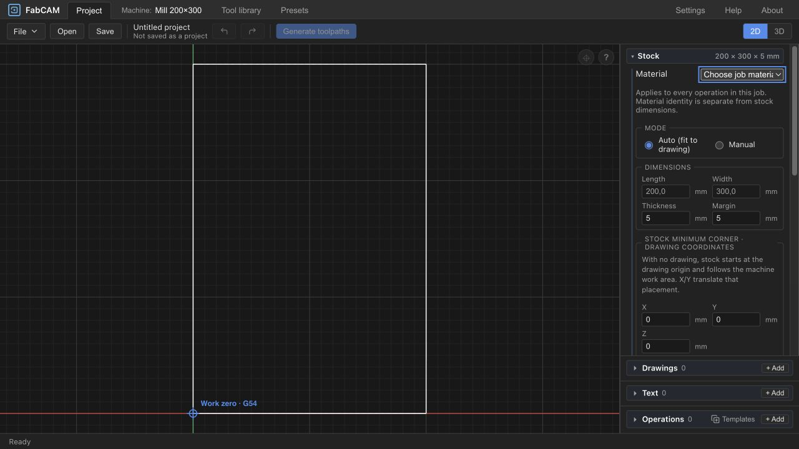
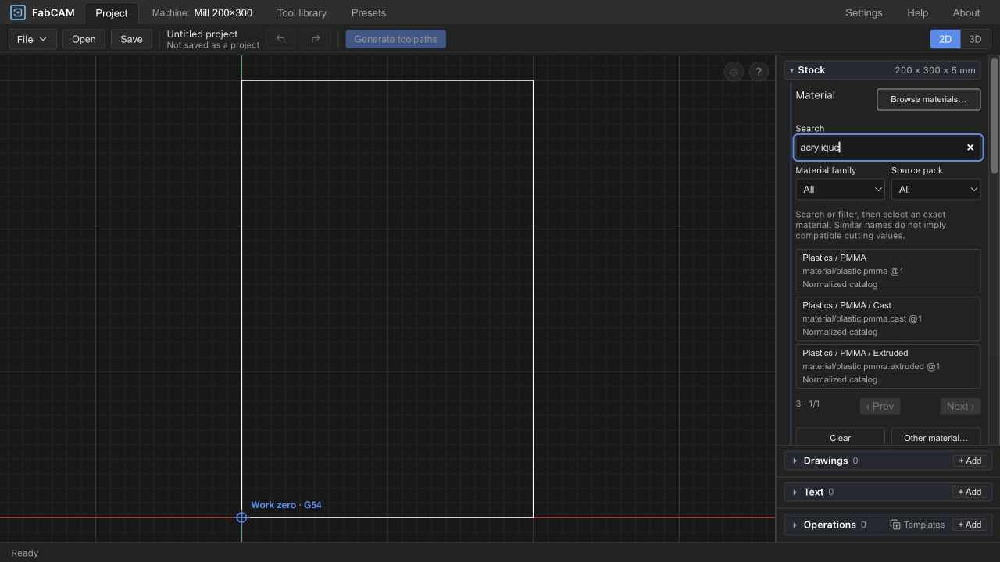
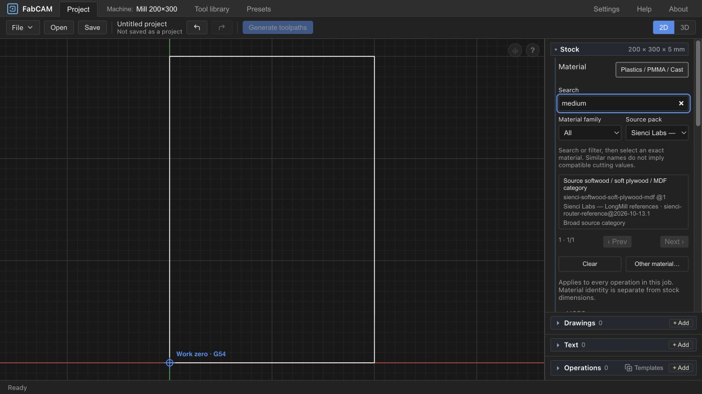
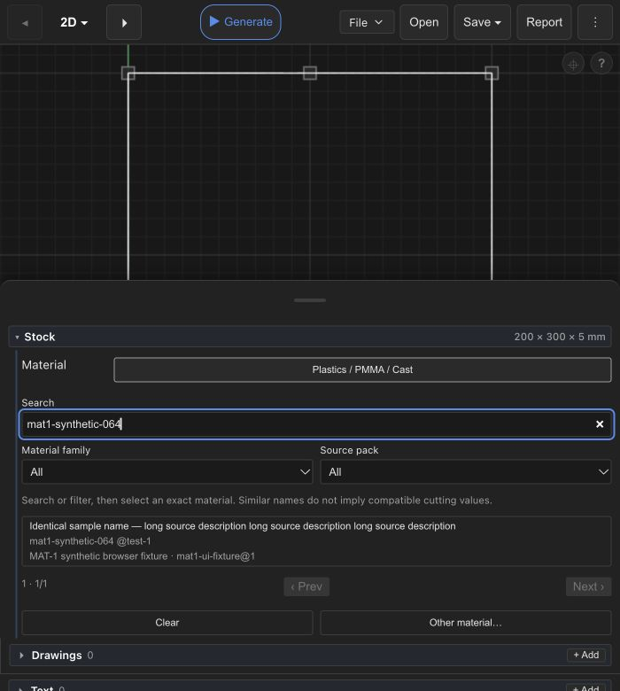

# MAT-1 — Material Families, Variants & Synonyms

Date: 2026-10-21. **Phases D–F implemented and software-qualified; final human UX review pending.**

Architecture approved by the maintainer, including source-filtered browsing of unknown/private catalogs. Implementation commit: `13b8a95e021817e046174e8b3a8145e8ef8c3862`, based on integrated PRESET HEAD `288afde`. See section 8 for delivered behavior and evidence. Sections 1–7 retain the original audit and its then-pending decision as history.

## Historical Phase A–C audit
Branch `FabCAM-v1.1`, inspected HEAD `b8deaef8ddfdb6553ecf44090311959431d7ead4`.
Tracking: `ivac-z96h4`. No production code, schema, data, project or resolver changes.

## 1. Coordination and actual baseline

PRESET source is now locally integrated: API `5ca5632`, native draft-storage guards
`bed3a92`, library/copy/unified-selector integration `b8deaef`. Material-related
source files are clean. This supersedes earlier reports saying the UI is uncommitted;
it does not independently close human acceptance gates. Seven documentation files
were already modified at audit start, and integration documentation is being updated
in parallel. Preserve those edits. Other worktrees: `codex/sec1-roadmap` at `7e1c24b`
and `codex/v1-freeze-readiness` at `85a93c4`; neither touched. Main/V1 remains unchanged.

## 2. Observed inventory and proliferation

| Representation | Identity/revision and source | Classification and limitations |
|---|---|---|
| Normalized catalog | 19 `material/<taxon>` identities, revision `1`; Rust `source_pack.rs::MATERIAL_TAXONOMY`, mirrored in frontend `NORMALIZED_MATERIALS` | Wood, plastic, metal plus explicit plywood species, PMMA condition and aluminium grades. Frontend labels are currently uppercase path segments. These are real selectable identities, not just headings. |
| Bundled Sienci | Active registry selects `sienci-router-reference@2026-10-13.1` (v3); older v1 `2026-10-12.1` retained | One catalog identity `sienci-softwood-soft-plywood-mdf@1`; original label “Source softwood / soft plywood / MDF category”. No material-family memberships or record material_taxon. Deliberately broad source category, not universal MDF/plywood. |
| Legacy Sienci dataset | Same material identity in `sienci-router-reference.v1.json` | Retained dataset and preference migration path; not a fourth material to invent. Legacy wrapping retains exact catalogs and provenance. |
| Installed native private references | Six JSON packs inspected at application-data `feeds-speeds/sources`; 16 distinct ID/revision pairs across 30 catalog occurrences; 1398 records | All inspected material selectors exact; no record material_taxon or declared family membership. Multiple tool-specific packs repeat seven identical material identities. Visibility/private distribution remains unchanged. No cutting tables or private trial notes copied into this report. |
| Sorbonne-compatible / named local packs | `sorbonne-fablab` or `lab-<UUID>`; existing capture/copy code | Exact selected identity/revision copied into scope and catalog; capture often labels the entry with its ID, copy can retain a user label. No installed authored lab pack was found in the inspected native directory; schema/fixtures/code audited, not asserted as actual workshop data. |
| Authoring examples | `guide-demo-mdf@1`, demo v1/v2 | Explicitly fictitious MDF; must not be merged with normalized or workshop MDF. |
| Custom job / legacy selection | User text as ID, revision `job-1`; saved unknown identities retained | Similar names can mean different identities; changing custom text changes identity. No automatic rename/migration proposed. |

Private installed examples reveal real presentation problems: “MDF” alongside
normalized “WOOD / MDF”; aluminium strength ranges, cast >6% Si, wrought-alloy
categories and generic aluminium names; combined hardwood/birch-plywood and
softwood/poplar-plywood categories; a hard-plastic category spanning PMMA/POM/PC/PVC.
These overlaps do **not** prove machining equivalence. Repeated identical IDs across
packs are source occurrences; labels alone cannot identify a duplicate. Different
names for the same *chemical concept* (acrylic/PMMA) are search vocabulary, not proof
that two actual stocks or supplier scopes are interchangeable.

Inventory bounds: native storage was read locally and separately from browser
storage. The fresh browser origin displayed the 19 normalized entries plus Sienci;
its IndexedDB does not establish what is installed in Tauri or other origins. Arbitrary
third-party packs remain unknown. Do not claim comprehensive workshop inventory.

## 3. Existing data flow and UX

| Consumer | Actual implementation | Proposed treatment |
|---|---|---|
| Stock and FS job context | `JobMaterial.svelte` → `MaterialPicker.svelte` → `setMaterialCommand` | KEEP history/identity semantics; EXTEND shared picker with search and display groups. |
| MaterialPicker | Normalized entries + enabled pack catalogs; Map keyed by JSON identity; native select; retained unknown selection; custom text | Currently last catalog occurrence supplies the label and source distinctions disappear. Use stable tuple keys and retain all source occurrences in a view model. |
| PRESET-3 Browse | `PresetBrowser.svelte`, `preset-library.ts`; display-label material filter | EXTEND shared classification/search; filter source rows without selecting job material. Keep row identity and compatibility status. |
| Presets library | `PresetsLibrary.svelte`, `presetRows`, `filterPresets` | Reuse shared classification. Existing materialFamilies mixes recorded family IDs, record taxa and `material/wood`-style prefixes; no uniform user vocabulary. |
| Save as preset | `LabPresetDialog.svelte`, capture adapter and `lab-presets.ts` | KEEP exact captured job identity. Improve displayed description using shared projection, not a second material picker or remapping. |
| Duplicate & adapt | Shared MaterialPicker with `context=preset`; `preset-adaptation.ts` | KEEP local form ownership and strict compatibility; reuse search without changing job material. |
| Local editing / import | `LabPresetManager.svelte`, source pack settings/storage; generic catalogs authored externally | KEEP format, immutable revisions, native/IndexedDB boundaries. No new metadata editor/import requirement. |

Existing preset search normalizes NFD/diacritics/case and searches recorded data;
there is no controlled synonym dictionary. Reuse normalization consistently and
keep original labels visible. Current job picker has no explicit search/family filter.

Rust `matching.rs::identity_matches` compares ID **and revision**, or explicit
`material_families` membership. `source_pack.rs::taxon_matches` traverses the known
parent graph only for `material/…@1`; record material_taxon may authorize existing
scope matching. `adaptation.rs` handles separately authorized reference derivation.
PRESET-3 explicit selection bypasses numerical adaptation but preserves existing
source-authorized taxonomy matching. PRESET-2 has its existing bounded taxonomy
relationship check; MAT-1 must not broaden or replace it.

`ivac-core::feeds_speeds::cam_request` receives the job material and stock thickness
separately. Machine, physical/reference tool identity, geometry, operation, evidence
and enablement remain independent constraints. A display group never enters these
requests and never makes a preset applicable.

## 4. Recommended architecture — NOT YET APPROVED

**EXTEND presentation only.** Introduce one pure frontend `material-presentation`
module used by picker, preset projections and labels. No new Rust type, API field,
source-pack version, persisted taxonomy, source rewrite or project migration.

View entry: original identity, original labels, source occurrences (pack ID/revision),
optional display family/material/variant, classification origin, broad-category flag,
search terms. Source rows keep pack/record identity. A job selection returns only the
existing MaterialIdentity; display metadata is discarded at the boundary.

Classification precedence:

1. Reviewed application mapping keyed by exact material ID/revision, optionally
   constrained to source pack/revision; broad-category mapping is explicit.
2. Existing normalized identities or explicit record taxa can provide known display
   ancestry, without adding matching rights. Arbitrary membership IDs remain source
   metadata unless a reviewed display mapping exists.
3. Unknown/conflicting classification → **Unclassified**, with original label and
   ID/revision still selectable. Never infer family from a substring or ID prefix.

The smallest first slice maps the existing normalized catalog plus the public Sienci
category. Private/unknown imported records fall back safely; do not hardcode private
catalog IDs into distributable application data. A later reviewed mapping may support
other public catalogs. User-defined persistent classification is deferred.

Same exact identity across packs: one job-selection identity may show all source
occurrences; preserve original labels in details and use deterministic ordering,
not last-source-wins. Different identities stay separate even with identical labels.
Conflicting names/classifications show alternatives/unclassified, not guessed grades.
In the preset browser, never collapse distinct pack records. This presentation does
not create new equivalence; the resolver already defines what an identical ID means.

### Proposed family/variant rules

| Family | Material | Variant / treatment |
|---|---|---|
| Wood products | Plywood | Birch and poplar remain distinct existing identities |
| Wood products | MDF | No invented “Standard” identity/grade |
| Plastics | PMMA | Cast and extruded remain separate; generic PMMA remains generic |
| Metals | Aluminium | 6061 and 7075 separate; broad aluminium remains generic |
| Wood products | Source categories | Sienci full original category, explicitly “Broad source category”; no split or narrowing |
| Unclassified | Original source label | Unknown supplier/grade IDs remain available and distinguishable |

Top-level normalized Wood/Plastic/Metal identities remain selectable as broad
identities, clearly distinguished from family filter controls. Thickness, dimensions,
feed mode and engagement are stock/process properties, not material variants.
Supplier ranges and mixed categories never acquire a precise alloy/species by inference.

### Proposed aliases and localization

Controlled application dictionary, reviewed alongside tests, keyed to display
concepts rather than rewritten identities. Initial examples: acrylic/acrylique/Acryl
→ PMMA; plywood/contreplaqué/Sperrholz → plywood; MDF/medium → MDF. Aluminium/aluminum
are spelling aliases. “Medium” is deliberately ambiguous and only a search token;
it never commits a selection. No fuzzy nearest-match selection, no alias-generated
material identity and no automatic grade choice.

Search indexes original labels, display family/material/variant, source names,
ID/revision and approved aliases. A parent concept can expose all its variants as
choices, not a preferred winner. Broad source categories explicitly tagged with
that concept also appear as broad results (e.g. MDF search may show Sienci).
UI labels use existing English/German translations; French vocabulary may be search
aliases without claiming a translated French interface. Normalize accents/case and
whitespace for search only; identity bytes never pass through that normalization.

## 5. Proposed interaction and bounded scope

Compact searchable popover/dropdown; search immediately available, optional family
filter, flat results with variant and source qualifier. No mandatory tree traversal.
Show complete original label/provenance in disclosure/tooltip. Clear focus, arrows,
Enter explicit selection, Escape cancel, restrained blue selection, narrow layout.
Typing or changing family never modifies job/operation state; only explicit exact
selection invokes the existing command. Duplicate form remains isolated.

Three bounded implementation slices after approval: (1) pure projection/mapping and
search tests; (2) shared picker plus preset filtering/display integration; (3) safety
regressions, keyboard/narrow visual review and documentation. Rough scope: one shared
module and its tests, existing MaterialPicker, preset-library, PresetBrowser,
PresetsLibrary, limited capture/detail labels and EN/DE keys. No engine or generic
source editor rewrite. A visual family filter and resolver family remain separate.

Alternatives: source-pack schema metadata would require author/import migrations;
a local persistent classifier would add ownership/sync/versioning. Both exceed this
presentation-first slice. Automatic name classification is rejected because uncertain
source categories would be presented with false precision.

## 6. Evidence and qualification boundaries

Audit-only regressions on inspected source: **39 frontend tests PASS in six files**
(preset library/adaptation, selector/service/WASM, feeds-speeds, source configuration);
**119 Feeds & Speeds tests + one doctest PASS**. Logs retained locally under
`dist-test/mat1-audit-2026-10-21/`. These qualify existing behavior, not proposed MAT-1.
No new type/lint/build qualification claimed: production code has not changed.

Before screenshot: `dist-test/mat1-audit-2026-10-21/before-material-picker.png`.
The accessibility snapshot exposes the current flat 20-entry material list; native
select menu pixels are not captured in the screenshot. **After screenshots deferred**
until approved implementation; no fabricated after-state or visual acceptance.

Phase D qualification must prove original identity/revision/source preservation;
multiple variants/same-name different IDs; ambiguous aliases; EN/DE/accent/unknown
labels; broad-category preservation; unknown/custom round trips; filter-only state
immutability; explicit material change history and generation freshness; unchanged
exact/family matching, local priority, PRESET-2 permissions and PRESET-3 pinning.
Then run relevant Rust/frontend tests, type/lint/schema consistency as applicable,
WASM freshness and production build. No tests weakened, no physical qualification.

## 7. Human decision / HARD STOP

Approve or revise: (a) application-owned nonpersistent classification;
(b) normalized + public Sienci coverage with unclassified fallback for other catalogs;
(c) explicit broad source category treatment; (d) controlled aliases with no automatic
selection; (e) one reusable searchable picker and independent browsing filters.

No MAT-1 implementation commit exists. This audit/report stays uncommitted alongside
pre-existing documentation changes. No push, merge, rebase, installer, version change,
publication or hardware action. Next authorized step requires human Phase C approval;
only then implement Phases D–F. Parameter-scaling research remains separate/unstarted.

## 8. Approved implementation — Phases D–F

### Delivered architecture and files

`frontend/src/lib/state/material-presentation.ts` owns the pure, nonpersistent
classification, canonical tuple keys, deterministic source/label aggregation,
normalization and alias matching. Reviewed coverage is the 19 existing normalized
identities at revision 1 plus the public Sienci broad identity. No private identifiers
or source tables are embedded in distributed metadata. Unknown revisions and unknown
material IDs stay unclassified. Existing IDs, revisions, packs and resolver inputs
are unchanged; no Rust, API, schema, pack or migration changes.

`MaterialPicker.svelte` now expands an inline searchable browser using
`MaterialBrowser.svelte`. It is reused by Stock/JobMaterial and Duplicate & adapt,
including the unified parameter selector's job-material context. Search, family and
source-pack filters operate on view state only. An explicit result click/Enter calls
the existing selection callback. Arrow/Home/End navigation moves focus without
selecting; Escape in search/results/filter controls closes the browser. Selection
restores focus to its trigger. The existing job command supplies Undo/Redo/freshness;
the duplicate dialog's callback changes only its own draft.

Rows show full wrapping labels, exact ID/revision and source name/pack revision;
original labels are available in the title. Same-name different identities remain
separate. Identical ID/revision occurrences aggregate all sources deterministically,
without selecting a source-specific recommendation. Canonical comparison uses tuples,
not JSON property order or last-source-wins. At most 30 material results render per
page, with a bounded scrolling list. Current unknown selections remain available
when their source is missing/disabled. Disabled sources otherwise retain existing
availability rules; enablement is not changed by browsing.

`preset-library.ts` supplies shared aliases and a separate `displayFamily` projection.
`PresetsLibrary.svelte` and `PresetBrowser.svelte` filter those display families;
recorded resolver-family memberships remain separate metadata. A source-authored
family named like a UI group cannot acquire that display classification. Source row
identity, original labels and PRESET-3 exact compatibility/apply semantics are retained.
`FeedsSpeedsSection.svelte` uses the shared label projection, also supplying the
material description to Save as preset. Save still captures the original exact identity,
not a family/alias. English/German labels and controlled EN/FR/DE search vocabulary
are included; no new French interface is claimed.

### Regression evidence

All checks ran against the implementation before the focused commit; no code was
changed after those final results. Logs in `mat1-2026-10-21-evidence/`.

| Check | Result |
|---|---|
| Full frontend suite / WASM guards | **1512 PASS, 1 pre-existing locale skip**, 172 test files; WASM package guards 10 PASS |
| Full Feeds & Speeds crate | **119 tests + 1 doctest PASS** |
| Svelte/TypeScript | **0 errors, 0 warnings** |
| ESLint / Prettier | PASS |
| WASM freshness + production build | PASS; existing import/chunk/timing notices remain |
| Scoped Git diff | No Rust/schema/source-pack/dependency/workflow/version changes; no private catalog metadata added |

New regressions cover normalized variants, broad categories, aliases, unclassified
IDs/revisions, identical labels, multiple source occurrences and stable order,
Unicode/accent handling, a 1500-material synthetic catalog, filtering immutability,
explicit material choice and generation-context invalidation with Undo/Redo. Existing
PRESET-2/3, real WASM selected-record, source storage, serialization and safety tests
remain passing. No component budgets, tests or numerical guards were weakened.

### Visual review

Real browser/WASM review covered: acrylic/acrylique returning generic/cast/extruded
PMMA without choosing one; ArrowDown then Enter selection; Undo and Redo; medium
returning both normalized MDF and the broad Sienci category; source filtering without
changing selected PMMA; Presets family display; and a synthetic imported catalog with
65 distinct homonymous long-label materials plus its original demo entry. Pagination
66 results → page 2/3 and exact identifier search were checked. Narrow 700px layout
uses the existing Stock & Layers drawer; crossing the responsive breakpoint resets
the transient open browser, without changing material. No unrelated layout redesign.
The synthetic browser pack remains installed but **disabled** in the test origin;
no private native pack was imported. No hardware, native-installation or cutting claims.

| Before | After |
|---|---|
|  |  |

### Limits and handoff

Classification is deliberately bounded: arbitrary private/imported categories are
not inferred from names, and normalized families do not grant compatibility. Unknown
catalogs remain useful through source/name/ID search and visible provenance. Catalog
labels remain original in preset rows; the job selector and save description use the
localized presentation path. Source-wide identity collisions already present in data
remain an authoring responsibility; this UI neither repairs nor reinterprets them.

Commit **`13b8a95e021817e046174e8b3a8145e8ef8c3862`** contains only the 13 frontend
implementation/translation/test files. A separate documentation commit records this
report, canonical status/roadmap updates and only MAT-1 evidence; its hash is provided
in the final handoff. Existing PRESET commits and unrelated local evidence are intact.
No push, merge, rebase, installer, V1 change, publication or physical operation.

**HARD STOP for final human UX acceptance (`ivac-9ilje`).** The next step is review
of the selector with workshop materials. Optional user-defined local classification
is a separate future roadmap item, not implemented. Parameter-scaling research also
remains separate and unstarted.
