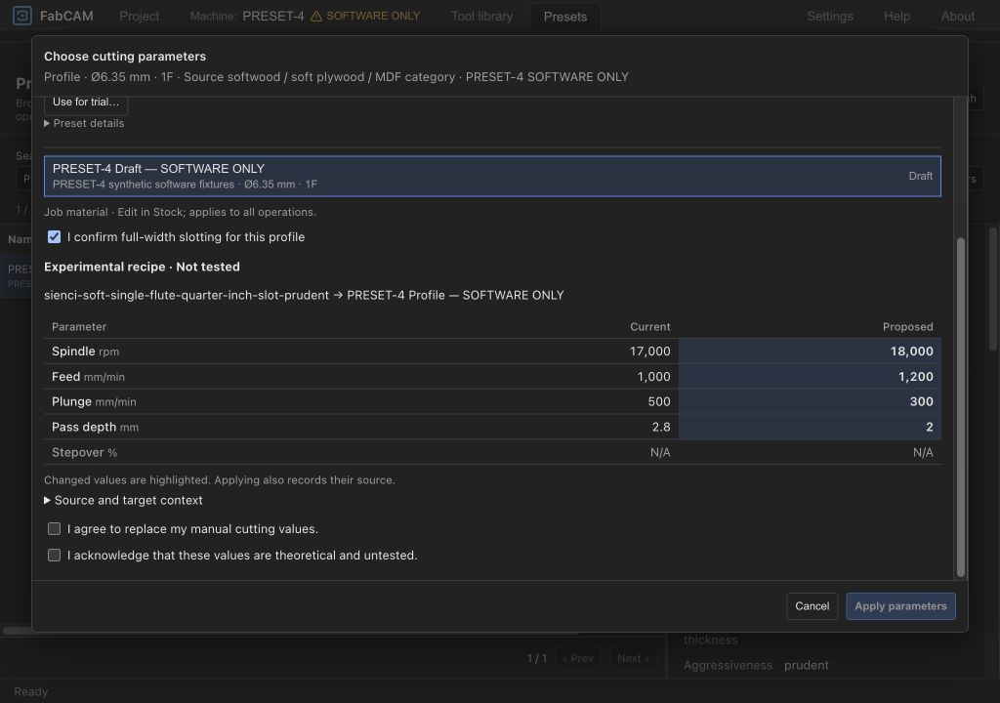
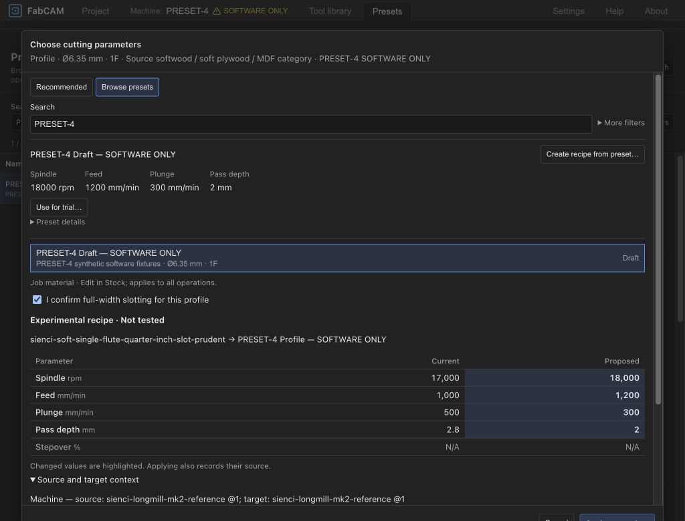
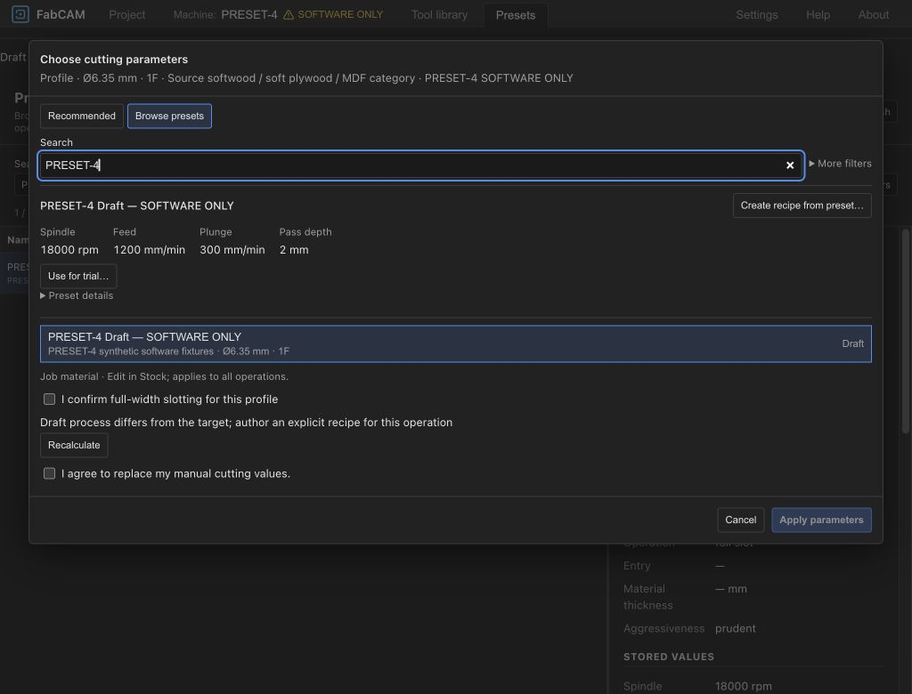

# PRESET-4 — Experimental recipe application

**2026-10-21: architecture approved, bounded implementation and software qualification complete. HARD STOP for final human UX review (`ivac-jwwom`).**
Architecture gate `ivac-knihp` closed on explicit approval; implementation `ivac-fypr1`.
V1 and its ShopBot qualification baseline are unchanged. No physical trial, installer,
release, push, merge or automatic recipe promotion was performed.

## Implemented contract

- `AppliedCutting.experimental_recipe` is an optional typed allowlist: theoretical/untested
  discriminator, source pack/record/profile identities and revisions, target machine,
  material and cutter identities, operation kind, diameter/flutes, and original applied
  values. Effective operation slots remain authoritative. No source bodies, trial notes,
  private text or local paths are copied into this snapshot.
- Rust `experimental_trial` preview/apply is separate from the recommendation resolver.
  Only exact, inactive, non-deleted local Drafts are accepted. Suggest eligibility is
  unchanged. `trial_acknowledged` is required for application, never preview.
- This slice supports Profile (including explicitly confirmed FullSlot) and Pocket,
  one standard flat endmill, no whirling or distinct finish cutter. Source process must
  match. Both rough/finish roles receive the exact authored values. Chipload-only data,
  automatic reductions, fractional rates and explicit depth schedules refuse application.
- The existing numeric request validator is reused. Machine minimum/maximum RPM, cutter
  maximum RPM, machine feed ceiling and cutter flute length must be known. No trial
  scaling, interpolation, rounding or clamping. Duplicate tool bindings are refused.
- Rust generation revalidates the saved snapshot, current target and both effective
  slots independently of installed packs. Missing/deleted/revised sources cannot change
  saved numbers. Target identity/process/diameter/flute changes require a new review;
  manual cutting-value edits retain ancestry and must still pass current limits.
- Only experimental projects save as `ivac-project-experimental`, version 8. Existing
  v1–7 reader behavior is compared with a frozen pre-change validator; older readers
  explicitly reject v8. v8 also permits the existing guarded drawing, corner-relief,
  surfacing and knowledge features. Nonexperimental save-version selection is unchanged.

## Unified interface and visual qualification

Both Presets library and Browse presets expose **Use for trial…**, using the same
PRESET-3 selector, fresh-source/context checks and atomic history command. The preview
shows source/target, exact current/proposed values and source/target context. The
untested acknowledgment starts unchecked; existing manual-overwrite acknowledgment
remains separate. Applying changes no machine, cutter or job material. Existing
freshness keys invalidate generated programs and export qualification.

The inspector retains **Experimental recipe · Not tested** and marks subsequent
manual changes. Missing/revised sources are disclosed without changing saved values.
Rust refusals use the existing error-normalization helper: a visual replay exposed
`[object Object]`, corrected and covered by a real-WASM refusal assertion.

Visual replay used actual application components, actual Rust/WASM and synthetic data
based on the public Sienci fixture, through a temporary local fixture loader. No private
source pack was used for evidence. The loader was removed from frontend sources and
retained only in local evidence. The test source was disabled afterwards. This proves
software UI flows, not native file-picker or installed-platform acceptance.

Replayed at 1280×720 and compact 1024×720: library entry, Browse entry, current/proposed
comparison, both acknowledgment gates, exact application, manual modification,
Undo/Redo, unchanged ordinary recommendation behavior and actionable process refusal.
The modal scrolls while retaining its action footer. Final screenshots:

## Qualification results

Qualified the complete working tree on `FabCAM-v1.1`, including preserved recipe-authoring
work; do not represent the core commit alone as the complete integrated UI build.

| Check | Actual result |
|---|---|
| `cargo test --offline --workspace --all-features` | **1692 PASS, 0 failed, 1 existing ignored**, 50 result groups. Includes existing CAM, CPS, ShopBot and export regressions. |
| New core adapter coverage | 30 adapter tests total (20 prior + 10 trial tests): exact application, fractional/numeric/hard limits, missing limits, source revision/deletion, direct-input/generation refusal, private data, edited ancestry, Pocket roles, unsupported cutters/multi-tool, ambiguous bindings. |
| `npm --prefix frontend test` | **1553 PASS, 1 existing skipped**, 178 Vitest files; Node WASM-package guard suite also passes. Real WASM trial/refusal, old-reader v8 rejection, legacy equivalence, privacy, history and qualification invalidation included. |
| `npm --prefix frontend run check` | Svelte/TypeScript PASS, 0 errors, 0 warnings. |
| `npm --prefix frontend run lint` | ESLint and Prettier PASS. |
| `cargo fmt --all -- --check` | PASS. |
| `cargo clippy --offline --workspace --all-targets --all-features` | PASS. |
| `cargo run --offline -q -p xtask -- schema-check` and regenerated TS byte comparison | PASS; no schema/client drift. |
| `npm --prefix frontend run build` | Fresh WASM package and production build PASS. Existing chunk-size/dynamic-import warnings remain. |
| Scoped diff whitespace validation | PASS. |

The first sandboxed full Rust run hit two existing macOS watcher timeouts. The watcher
suite then passed outside the sandbox (5 tests), followed by a successful complete
all-features run outside the sandbox. No tests or guards were weakened. An intermediate
build correctly refused stale WASM inputs while Rust edits were ongoing; the final
fresh rebuild passed. Logs and synthetic fixtures are local under
`dist-test/preset4-2026-10-21/`.

## Commits and preserved concurrent work

- **`d7b6531983d3b7bbcdd4849160e2ebac1c67f3cb`** — isolated Rust trial contract,
  generated schema/client, guarded project persistence, provenance helpers and regression
  tests. No preexisting recipe-authoring changes staged.
- This report and selected screenshots are a separate documentation commit (hash in
  final handoff; its own hash cannot be embedded without another commit).
- The qualified UI integration remains **uncommitted** because the shared browser,
  selector and translations already contained unrelated recipe-authoring changes.
  Its delta against the pre-task dirty baseline is retained as
  `dist-test/preset4-2026-10-21/preset4-ui-only.patch`; the original baseline is
  `preexisting.patch`. New trial UI components, picker/library integration and translation
  additions stay together in the worktree. STATUS/roadmap edits also remain uncommitted
  to preserve concurrent documentation. No broad staging or history rewrite occurred.

## Limits and next human decision

The configured common feed ceiling is not a separately qualified axial/plunge limit.
The snapshot is a compact identity/cutting baseline, not a physical-trial ledger or a
complete historical machine setup. Editing within limits does not constitute physical
validation. Software checks and existing ShopBot restrictions remain mandatory;
unsupported strategies and cutters are not enabled. Source context may differ only
with explicit user review; no automatic equivalence or parameter conversion occurs.
Core refusal text is currently English; the new interface labels include English/German.
Mobile layout, native installed-platform acceptance and physical machining are not
qualified by this checkpoint.

**Next action: human review of the two trial entry points and experimental/modified
status (`ivac-jwwom`). HARD STOP.** Integrate the retained UI delta only alongside the
separately owned recipe-authoring changes. No new feedback ledger, automatic promotion,
subsequent milestone or publication is authorized.

---

## Historical Phase A audit (superseded status, evidence preserved)

The following sections record the pre-approval audit. Statements below about pending
approval or unimplemented trial behavior describe that earlier checkpoint, not the
implementation status above.

## Snapshot and scope

Inspected `FabCAM-v1.1`, HEAD `17581be103c374b3b11a862ac26a7e8aaa1c3ae6`,
plus the existing uncommitted manual recipe authoring and compact browser changes.
This is a working-tree audit, not qualification of a reproducible committed release.
All prior source changes, untracked reports and local evidence were preserved.
No production code, schemas, generated clients, source packs, security policies,
machine output or accepted ADRs were changed for PRESET-4.

Relevant contracts: [PRESET-3](FABCAM_PRESET3_AUDIT_AND_IMPLEMENTATION.md),
[recipe authoring](PRESET_RECIPE_AUTHORING_2026_10_21.md),
[ADR-0027](../shopbot-modernization/adr/ADR-0027-lab-and-reference-identities.md),
[ADR-0028](../shopbot-modernization/adr/ADR-0028-preset-duplicate-adapt.md),
[ADR-0029](../shopbot-modernization/adr/ADR-0029-manual-inactive-recipes.md).

## Existing mechanisms audited

| Mechanism | Confirmed behavior and implication |
|---|---|
| Manual operation values | `frontend/src/lib/state/feeds-speeds.ts`: `editOperationRate` requires positive u32 integers; `preserveManualCutting` marks edited rate/DOC/stepover origins manual. Saved slots override tool defaults. This is a numeric path, not an experimental-provenance path. |
| Rust generation | `crates/ivac-core/src/feeds_speeds.rs`: `saved_rates` rejects zero/missing/duplicate roles; `validate_applied_project` rejects incompatible processes, operations and cutter families. Manual-only round-trip/generation has a direct passing test. |
| Recommended / Browse | `feeds_speeds` supplies preview/apply; pinned selected records use the same resolver checks. Frontend `cutting-selector.ts` rereads source fingerprints and checks current context around Rust validation before synchronous commit. Draft is inspect/copy only. |
| Source storage / eligibility | `source_pack.rs::validate_lab` requires Draft to be theoretical, inactive, without review. `resolve_packs` excludes Draft/disabled/deleted/reference-only records, including explicitly selected records. Authoring does not promote them. |
| Atomic application | `commands.ts::applyCuttingCommand` stores the prior operation/material/context for Undo/Redo and applies the operation patch synchronously. A future trial must preserve the existing job material/tool and recheck context, rather than changing them. |
| Portable projects | `AppliedCutting` in Rust has `deny_unknown_fields`; `CuttingOrigin` only has recommendation/manual/legacy_snapshot. Project validation explicitly allows those three origins. Saved format kind/version is guarded (currently 1–7). |
| Source privacy | `KnowledgeSummary` saves compact source identities/evidence, without source bodies/notes. Private recommendations omit the full proposal. This summary describes resolver output, including engine/policy and compatible-source counts; it has no experimental application discriminator. |
| Invalidation | `generation-context.ts` fingerprints the built project including cutting inputs. `program-qualification.ts` rejects missing/stale generation and stale verification keys. `services/file_ops.ts` rechecks export safety/current inputs, including after the save dialog. Saving alone cannot make stale generation current. |
| Physical review | `lab-presets.ts::saveCapturedPreset` requires dated successful physical-use attestations and known engagement/entry for Tested. `revisePreset` allows Tested → Validated only with review notes and all review criteria. Rust source-pack validation independently enforces the evidence policy. |

**Can manual values produce a qualified program?** They can generate machine output
without a recommendation or live source dataset. The ordinary mandatory simulation,
postprocessor and export gates still apply; this does not establish physical safety,
physical qualification or acceptance on an installed platform.

**Must Draft eligibility change?** No. Exact numeric values could enter a separate
explicit manual trial path. Making Draft eligible for the resolver is unnecessary
and forbidden by this checkpoint.

**Which operations/roles?** The recommendation adapter supports milling Profile
and Pocket. Saved manual slots additionally support PlanarSurface, with the cutter
family exceptions explicitly checked in `validate_applied_project`. Slots distinguish
tool ID and Rough/Finish; Drill is refused. All required tool/pass slots must exist
exactly once. Proposed first trial slice is Profile/Pocket, one assigned cutting
tool, without a distinct finish tool; it must explicitly populate every required
role without presenting this as support for multi-tool recipes. Surfacing and other
operations remain outside that first slice.

**Are current provenance structures sufficient?** No. Saving only manual slots loses
the requested experimental origin; reusing `Recommendation` or `KnowledgeSummary`
would suggest an engine evaluation that never occurred. A magic policy string,
context key, operation name, note or opaque extension would not establish a typed,
validated experimental state across Rust/frontend persistence and export. Arbitrary
fields inside `AppliedCutting` are not an extension point. The persistent
“Experimental recipe · Not tested” requirement therefore crosses the expressly
reserved project-persistence boundary.

## Minimal proposed architecture — NOT approved or implemented

1. Add one optional typed `experimental_recipe` snapshot to `AppliedCutting`.
   Absence preserves ordinary manual/recommendation semantics. Keep the existing
   per-field origins for numeric manual edits; the separate marker describes the
   untested source, not a new evidence rank or recommendation.
2. Snapshot only exact pack identity/revision, record ID, profile identity/revision,
   theoretical trial kind, target identity/context at application, and original
   applied cutting values. Existing slots/DOC/stepover remain authoritative. The
   original-value baseline permits truthful “modified since trial application”
   reporting. Do not embed pack contents, author/trial notes, local file paths,
   source licenses' private text, or fabricated evidence. Source-context inspection
   can use the installed pack transiently; missing packs must not erase provenance
   or change saved values. Historical upstream attribution remains in source packs.
3. Introduce a guarded project format for experimental snapshots (proposed version
   8), with all existing optional geometry/surfacing features supported. New readers
   continue reading versions 1–7 unchanged; old readers must refuse the new format
   explicitly, rather than silently losing experimental status. This is backward
   readability, **not** a claim that old software can open new experimental files.
   The version-7 edited-drawing equivalence checks must be updated deliberately.
4. Add a separate Rust preview/apply trial contract, shared by WASM/native
   transports. Resolve the exact local Draft and revisions; validate its existing
   source-pack contract, authorization, stable target identities, supported roles,
   numeric values, known machine/tool limits, flute length/DOC and overlap. Reuse
   existing setup/numeric validation where possible, without calling the Draft
   recommendation resolver or implementing another recommendation engine.
   Invalid/stale/deleted/missing sources or changed targets refuse atomically.
5. Preserve exact authored numbers: existing operation rate slots are integers,
   so fractional RPM/feed/plunge are refused with an explanation, never rounded.
   Chipload-only recipes require an explicitly authored feed before trial use;
   this slice must not derive it. Existing generation can clamp RPM/feed and emit
   warnings (`pipeline/setup_resolver.rs`); **trial preview/apply must reject values
   needing these clamps**. Preserve those existing pipeline safeguards unchanged.
   Unknown limits stay unknown; acknowledgment cannot override a known limit.
6. Reuse PRESET-3's selector, comparison, context/source refresh and atomic command.
   Add the deliberate “Use for trial…” action from both entry points, unchecked
   theoretical-use acknowledgment and compact persistent label. Keep ordinary
   Recommended/eligible selected-record behavior unchanged. Value/context edits
   invalidate confirmation; manual edits retain untested ancestry and mark changes.
7. Revalidate trial metadata and hard limits in Rust generation, so direct API/file
   input cannot bypass the trial contract. Preserve SAFE-Z, numeric budgets,
   operation/tool validation, ShopBot/CPS restrictions, tool provenance, program
   simulation and fail-closed export controls. Include experimental origin in the
   existing export feedback, without adding a second export route or suggesting
   that software verification is physical validation.

No source-pack format, eligibility rank, physical-evidence policy or existing CAM
safety invariant needs to be relaxed. The proposed API/persistence addition itself
requires approval; implementation details and its negative tests must be reviewed
before calling it safe. Generated API/schema artifacts must come from Rust tooling.

## Physical feedback lifecycle

The existing capture flow can record manually resolved operation rates as a dated
Tested record, and the existing manager reviews Tested records for Validated.
Neither action is a consequence of generating/exporting/applying a recipe.
The current manager does not provide a dedicated trial ledger linking an experimental
application to multiple observed outcomes and exact program/configuration snapshots.
Do not claim that complete end-to-end lifecycle is implemented.

After PRESET-4 acceptance, propose a bounded workshop feedback checkpoint: explicitly
record actual configuration, program reference, date/operator, observations and
successful/failed outcome; review how it links to existing capture/revision history.
Only independent human attestations/review may promote evidence. No automatic
qualification engine, hardware test or promotion is authorized here.

## Verification actually run at this checkpoint

| Command / scope | Result |
|---|---|
| `RUSTC_WRAPPER='' cargo test --offline -p ivac-core --lib feeds_speeds::tests -- --nocapture` | 20 PASS, 0 failed/ignored; 1173 unrelated tests filtered. Includes manual-only round-trip/generation, saved-value independence, private-body exclusion, explicit-record application and missing/duplicate/incompatible roles. |
| Frontend `vitest run` on feeds-speeds, source-packs, cutting-selector, cutting-selector-wasm, lab-presets, program-qualification, qualification-export, recipe-values and history test files | 97 PASS across 9 files, no skips. Real WASM test retains Draft rejection; unit checks cover review/eligibility, context changes, Undo/Redo and qualification/export guards. |

These are existing regression tests against the inspected working tree. No PRESET-4
implementation tests, UX replay/screenshots, all-features qualification, type/lint,
generated-contract regeneration or build are claimed: implementation stopped before
the schema boundary. No tests were weakened or skipped. Existing reports' broader
test results remain historical and are not substituted for this run.

## Handoff and human decision

Approve or amend the optional experimental snapshot, guarded project version and
separate Rust trial contract above before Phase B–G implementation. Then qualify
exact application/refusal, privacy, edits/staleness, source revisions, round-trip,
Undo/Redo, generation/export invalidation and both compact-selector entry points,
including narrow viewport screenshots. No physical acceptance follows from tests.

This audit adds this report and PRESET-4 navigation/status only. Existing recipe/UI
changes remain uncommitted. Any audit-only commit is identified in the chat handoff;
this document's inspected code revision remains `17581be` regardless of a subsequent
documentation commit. No push, merge, rebase, release, version promotion or hardware
operation. **HARD STOP for architectural approval.**
