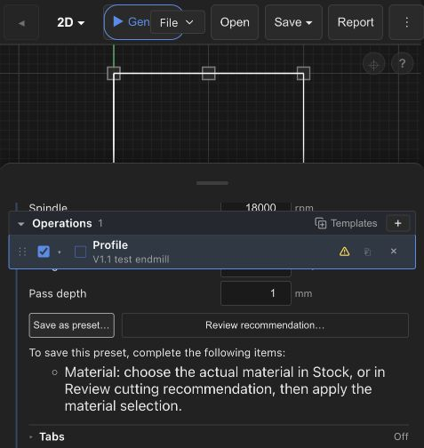
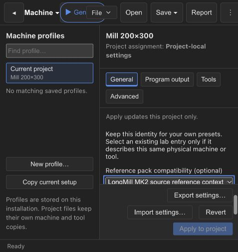

# FabCAM v1.1 — preset, tool and source UX

2026-10-21. User-requested branch `FabCAM-v1.1`, from
`ef807cf8250ddc4bdf795c75bb9bf9f011db9bca`. Implementation is committed locally
as `0075317`, with the development launcher in `b417d3c`. This is a development
handoff, not a version promotion or a release qualification. The dated checks below
retain their original pre-commit snapshot descriptions.
Tracker: `ivac-tnpyz`, awaiting user UX acceptance.

## Result

- Preset capture lists only the missing machine, material and selected-tool identities.
  The UI explains where to configure and apply each one; the core returns equally
  specific errors for callers outside that UI.
- Machine/tool editors now keep automatic **lab identities** and optional **reference
  pack compatibility** independently. Linking a pack never replaces a local identity.
  Existing lab entries can be reused explicitly for the same physical machine/tool.
  **Enable local presets** was removed following user feedback; see
  [ADR-0027](../shopbot-modernization/adr/ADR-0027-lab-and-reference-identities.md).
  Eligible Tested/Validated lab presets take priority; references remain available as
  fallback. Suggestions and saved operations show the selected source visibly.
- Operation selectors include compatible library tools. Selection adds the tool to
  the current project/machine and assigns it in one undoable command. Finish and
  spotting tools, planar surfacing and command-palette assignment share this path.
  Operation templates preview library choices without mutation, then stock only the
  selected tools when the operation is created, in one undo transaction.
- The existing active-machine-profile mirror persists the working tool list; local
  projects without a saved profile retain their embedded machine/tool configuration.
  ID collisions preserve the existing tool and remap the incoming copy; repeated
  selection reuses an identical remapped copy. As before, a remapped collision copy
  is project-local rather than a new guaranteed inventory identity.
- Each tool kind maps to one manufacturing process in both Rust and TypeScript.
  Rotary engravers are milling cutters; drag knives, laser heads and plasma torches
  retain their own process. Explicit multi-process machine capabilities still work.
  Existing incompatible assignments remain visible for correction; no old tool is deleted.
- Changing a cutter preserves explicit cutting values and their origins. The original
  captured recommendation context remains, allowing the existing stale-context review
  to flag the changed cutter. No feeds/speeds recommendation is applied automatically.
- **Delete local source…** confirms removal of every installed revision of that source.
  Browser storage uses a single IndexedDB read/write transaction. Native storage accepts
  validated IDs only, operates under private app-data, shares source write locks with
  import/save, checks the expected head and rejects symlinks before deleting entries.
  Native filesystem removal is not claimed atomic: on I/O failure it reports incomplete
  removal, deletes oldest first and keeps the latest head when possible for a retry.
  Applied cutting values in projects remain unchanged. Built-in sources are disabled
  by checkbox, not deleted from distributed application resources.

## Verification

Evidence is in [v1.1-ux-2026-10-21-evidence](v1.1-ux-2026-10-21-evidence/).

| Check | Result |
|---|---|
| `frontend/node_modules/.bin/vitest run` from frontend | 165 files, 1469 PASS, 1 existing skip |
| `node --test scripts/wasm-package-state.test.mjs` from frontend | 10 PASS |
| `svelte-check --tsconfig ./tsconfig.json` | 0 errors, 0 warnings |
| `tsc -p tsconfig.node.json`, `eslint .`, `prettier --check .` | PASS |
| `cargo test -p ivac-tauri --lib source_packs --locked` | 6 PASS, including removal/head/lock/path/symlink checks |
| `cargo test -p ivac-core feeds_speeds::tests --locked` | 18 PASS, including per-identity missing setup diagnostics |
| `cargo test -p ivac-core project::tool::tests --locked` | 6 PASS, including the synchronized process mapping |
| `cargo clippy -p ivac-core -p ivac-tauri --lib --locked -- -D warnings` | PASS |
| `cargo fmt --all`, `git diff --check`, `bash -n scripts/dev-web.command` | PASS |
| Verified WASM regeneration and `vite build` | PASS; existing chunk-size/dynamic-import advisories remain |

Node 24 was used. Rust commands used `RUSTC_WRAPPER=''` in this sandbox.
The first WASM attempt could not write/download its cached tools; regeneration
succeeded offline by adding the already installed wasm-bindgen 0.2.120 and wasm-opt
cache binaries to PATH. No freshness guard was bypassed.

Initial smoke, before the independent-identity follow-up below: after the user
launched `scripts/dev-web.command`, an in-app browser smoke verified:

1. A new project opens and the machine editor displays the new identity workflow.
2. Enabling a machine identity changes the readiness status and remains a draft until Apply.
3. A new library-only endmill can receive its own identity and be saved without stocking it.
4. A Profile selector offers that endmill under Library; selecting it moves it into the
   machine/project tool group and assigns it immediately.
5. With machine/tool configured, Save as preset reports only the missing material.
6. Undo removes the stocked copy and restores the previous assignment; Redo restores both.
7. Settings explains bundled-reference disabling versus local-source deletion.

This smoke used a fresh test project in the in-app browser, at a narrow viewport.
Full desktop installer flows, every template flow, browser IndexedDB deletion/reload
and cross-window races were not manually qualified. The native deletion path has
unit coverage. No machining, export qualification, physical trial or installed
Windows/Linux qualification is claimed. Existing V1/SEC1/NUMSAFE3 evidence remains
scoped to its own recorded source.

## Test handoff

The user-started processes were verified listening on `127.0.0.1:5173` (Vite) and
`127.0.0.1:8766` (Rust engine), and left running. The in-app browser is left open.
The launcher keeps both alive while its terminal stays open; Ctrl+C stops them.
It refuses occupied ports rather than stopping an existing process.

The source guide was updated with the new labels and removal workflow. User UX
acceptance remains open. No commit, push, merge, release-number change or publication
was requested or performed. Unrelated local audit/evidence files were preserved.

## Follow-up — simultaneous lab identity and reference pack

The user identified that the original Enable local presets button replaced pack
compatibility. The additive identity model in ADR-0027 supersedes that initial UI.
Creation/load establishes stable physical identities automatically; the existing
reference field remains independent. Legacy single identities are retained so old
presets still match; already shared legacy identities are not silently split.
The source catalog/limits and actual applied cutting values remain authoritative.

Final follow-up validation (2026-10-21, uncommitted working tree):

- Vitest: 166 files, 1473 PASS, one existing locale skip; WASM package tests: 10 PASS.
- Entire ivac-feeds-speeds crate: 111 integration tests plus one doc test PASS.
- Core FS adapter: 19 PASS; core drawing audit with its CPS feature: 13 PASS.
- Svelte-check/TypeScript, ESLint/Prettier, Clippy for engine/core/server, schema-check,
  native server build, WASM freshness rebuild and Vite production build PASS.
- Initial broad core integration invocation omitted `--features cps`; the existing
  drawing audit hit CpsUnavailable. The appropriate CPS-enabled rerun passes. This
  follow-up does not claim the full release suite or hardware qualification.
- Browser smoke with `?api=wasm`: new project automatically receives its lab identity;
  selecting LongMill reference then Apply retains exactly the same UUID. Both links
  are visible in the machine editor, without an activation button.
- Engine regression uses distinct physical and reference machine/tool IDs, checks lab
  priority regardless of pack order, reference fallback when local data is disabled,
  local availability without a reference, non-transfer to another physical entity,
  source provenance and malformed identity refusal. Capturing a preset uses physical
  identities without mutating the project. Project/workspace round trips retain IDs.

The user restarted `scripts/dev-web.command` after the new native engine build.
New listening processes were verified on 127.0.0.1:8766 (PID 84638) and :5173
(PID 84656), and the ordinary URL `http://127.0.0.1:5173/` was reopened successfully
in the in-app browser. Both processes remain running in the user's terminal.
The browser engine remains available at `?api=wasm` as well. No process was stopped
by the agent. Final frontend regression additionally proves that switching to a new
physical machine/tool cannot inherit a stale reference from a previous project,
while loading a legacy project deliberately materializes and retains its saved link.

## Named preset packs — follow-up checkpoint (ivac-lmq9l)

2026-10-21, same uncommitted `FabCAM-v1.1` tree based on `ef807cf`.
Extend the existing schema-2 local authoring workflow, without a new serialized
field, alternate recommendation engine, CAM change or release/physical claim.
Settings → Feeds & Speeds and Save as preset now offer **+ Create preset pack**.
The user supplies a display name (1–100 characters); stable IDs use `lab-<UUID>`.
The save dialog chooses a destination and checks the captured context is unchanged.
Pack identity, not its display name, owns provenance, physical catalogs, enablement,
export/import, immutable revisions and optimistic concurrency checks. Only the newest
head of each authored pack is loaded; older files remain stored, including history.
Generic external IDs starting with `lab-` are not reclassified unless they match the
reserved UUID identity form. The existing Sorbonne pack and review-policy identifier
remain compatible. Packs stay private/local, with explicit physical-test/review gates.
Reference catalogs remain separate from local machine/tool identities. Drafts never
supply recommendations; existing resolver priority, ambiguity handling and numerical
limits are retained. Importing the same/older authored head is refused, with no merge.

Validation on this dirty snapshot:

- Full `ivac-feeds-speeds` suite: 113 tests + 1 doc test pass. Named-pack cases
  cover empty creation, private-only authoring, attestation refusal, JSON round trip,
  resolver priority/fallback and preservation of generic external `lab-*` sources.
- Tauri local-source tests: 7 pass, including independent named heads/locks,
  compare-and-append, import downgrade refusal and retention of older files.
- Frontend: 1474 pass, 1 existing locale skip, 1 failing component-size guard.
  The saved pre-change snapshot has OperationsList 1008 and FeedsSpeedsSection 1011
  lines (guard counting); after this intervention they are 1008 and 1010. Both
  already exceeded the 1000-line cap. Budgets/tests were not weakened.
- Svelte diagnostics: zero errors/warnings. Scoped ESLint/Prettier pass. Production
  frontend build passes with rebuilt/verified WASM; existing chunking notices remain.
- Browser, isolated origins `127.0.0.1:18813` and `localhost:18813`: create Fablab X
  and Atelier ébénisterie in Settings; capture a Draft in X; create Fablab Z inside
  the capture dialog and save there; reload and check independent counts; export X
  and restore its named pack + Draft on the second empty origin. No user's desktop
  source files or usual browser storage were changed. Synthetic trials only.

[Created packs](v1.1-named-presets-2026-10-21-evidence/packs.png),
[destination choice](v1.1-named-presets-2026-10-21-evidence/destination.png),
[frontend results](v1.1-named-presets-2026-10-21-evidence/frontend-tests.log),
[Feeds & Speeds results](v1.1-named-presets-2026-10-21-evidence/feeds-speeds-tests.log),
[native storage](v1.1-named-presets-2026-10-21-evidence/native-storage-tests.log),
[build](v1.1-named-presets-2026-10-21-evidence/frontend-build.log),
[inspected source hashes](v1.1-named-presets-2026-10-21-evidence/source-sha256.json).
The private JSON export remains outside the repository. No binary publication,
commit or push. Existing unrelated changes/evidence retained; user review next.

## UI polish and authorized commit checkpoint

The material-only preset diagnostic now reads **Choose a material first.**, using
compact inspector typography. Expanding Operations no longer opens the operation
catalog; creation uses **+ Add** or the empty-state Add button. Text and Operations
share that label. A four-pixel gap keeps the sticky active-operation frame below its
section header. Sidebar sections share padding and single-pixel dividers, including
Text/Operations; nested panel borders no longer double the frame. Inactive main
navigation items no longer show isolated vertical strokes. The active tab retains
its complete outline. Ball-nose support was verified as existing; no new tool type
or CAM geometry was added for that request.

[Sidebar/navigation check](v1.1-ux-2026-10-21-evidence/sidebar-menu-borders.png) and
[sticky operation header check](v1.1-ux-2026-10-21-evidence/operation-header-spacing.png)
used temporary software-only projects. Scoped Svelte diagnostics, lint, formatting
and browser checks passed; the later complete-suite component-size limitation remains
recorded in the named-pack section above.

The user explicitly authorized local commits after reviewing the v1.1 summary:

- `0075317` — `feat(v1.1): improve lab preset packs and operation tool workflows`.
- `b417d3c` — `chore(dev): add macOS web development launcher`.
- Documentation, ADR-0027 and scoped v1.1 evidence are committed in the accompanying
  documentation checkpoint. Earlier unrelated local reports/qualification archives
  remain untouched and untracked. No push, merge, release or new qualification.

The earlier statements about uncommitted work describe the review snapshots, not
this final Git checkpoint. No production source changed during commit preparation;
recorded checks and their limitations remain applicable. User UX acceptance and
existing V1 human/platform/physical gates remain separate.
