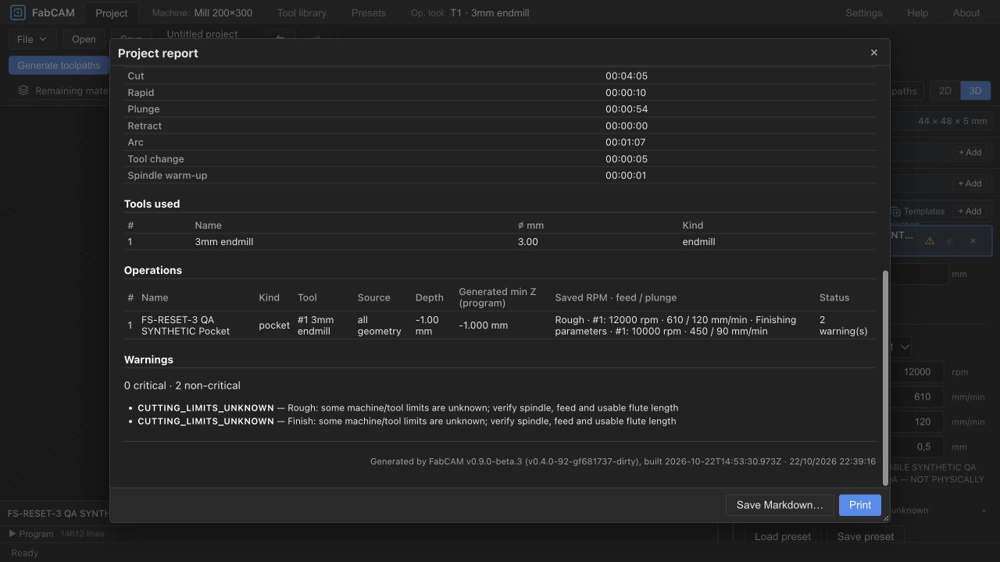
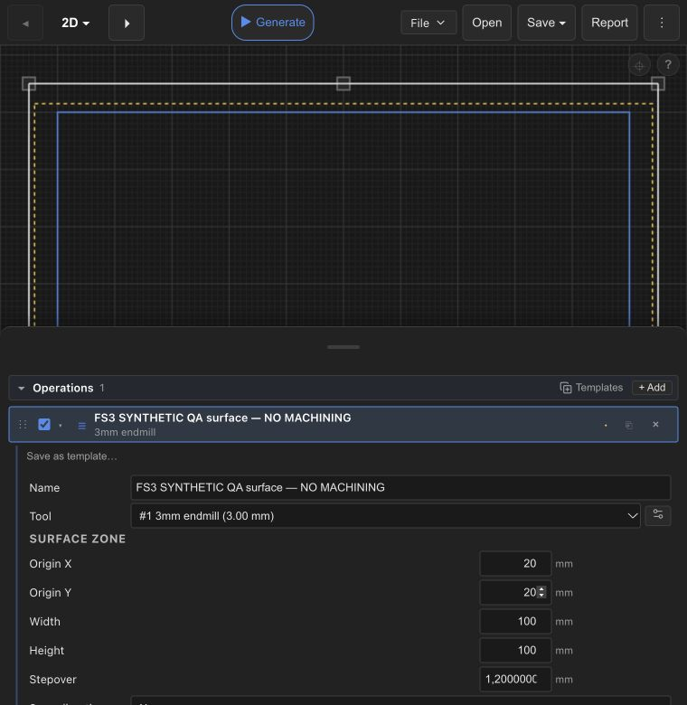

# FS-RESET-3 — legacy removal and final qualification

Date: 2026-10-22. Branch: **FabCAM-v1.1**. Engineering: `ivac-wjymz`;
final human review: `ivac-y25vq` OPEN. This report executes the maintainer's full
phases A–I authorization, superseding the earlier stop before mass removal.

**Implementation delivered; NO-GO for unconditional final qualification or release.**
No active recommendation engine remains. Explicit v9 operation values, neutral CAM
safety, tested collections, Sol's inspector/library UX and MAT-1 remain. The mandatory
pre-release gate is **16/20**, not 20/20. Known watcher failures, environment-limited
gates, baseline native/WASM V-Carve differences and cancellation latency remain visible.
No newly unexplained before/after executable output difference was found.

## 1. Source and exact local commits

Starting source: `951b12f4477f64fd5e9c229b693748f23e794a0e`.
Approved integrated FS2: `d6b08fe82011c54d0166a6559b329804c2e56cee`.
Qualified CLI Option A `030e2149f5bcb7f356711face54caafcf6155843` is an ancestor.
**Final qualified software source: `64d75849e3bdc05a2d3ce47c50486ad169058507`.**
Only documentation/evidence/tracking handoff changes follow it; the handoff commit SHA
is supplied in the delivery message (a commit cannot record its own hash).

| Commit | Independently bounded change |
|---|---|
| `a5907ac4ae284feb44c9984d1c3cc17ade524c88` | Freeze 23 explicit v9 output cases before production changes |
| `c5b13c9348aa0fd5ddbb08cdb27e78358e7e5ba4` | Remove internal absent-version/default delegates; neutral validation and fixture migration |
| `a15d99755c4e08039a6c0e6ba000e843f02b31de` | Detach frontend recommendation/source/Trial closure; preserve current UX and physical IDs |
| `a9d25bde4ad2c0102ed95e17874a00c6d7906ea3` | Remove legacy transports/native source store; regenerate strict current contracts |
| `f4896e4b2e5a9fef37c3037f87e15178293f7165` | Remove obsolete crate and shipped assets after consumer closure; transfer zero-rating refusal |
| `ded2348d760c434d6a4bc1ceda8ff232dc468279` | Author current performance fixtures and preserve strict comparison/timing guards, including failures |
| `64d75849e3bdc05a2d3ce47c50486ad169058507` | Correct three obsolete machine-limit tooltips; no algorithm or layout change |

[Incremental qualification receipts](fs-reset-3-evidence/BOUNDARIES.md) record each
boundary and its exact limits. The final complete gate below was rerun after the
last software change; an earlier run on ded2348 is retained locally, not substituted.

The two pre-existing tracked STATUS/RELEASE_ROADMAP edits remain uncommitted and intact;
only this task's current-status prefixes are staged. Unrelated untracked evidence,
other worktrees, frozen V1/main refs and user projects/application data remain untouched.
No push, merge, rebase, version change, installer, release or hardware operation occurred.

## 2. Removal and retained dependency closure

Removed `ivac-feeds-speeds` (22 tracked crate files), its workspace/core/lock entries,
11 shipped Sienci/license/registry assets, core recommendation/capture/Trial adapter,
Tauri source-pack storage and registrations, HTTP recommendation routes, WASM exports,
worker messages/capabilities, obsolete generated types, frontend source stores/resolver,
recommendation/adaptation/Trial UI and v1–8 project implementation paths. Old private
files and unused browser stores are deliberately left on disk, with no automatic reset.

No FabSpeed API, hidden fallback calculator or reduced matching engine replaces them.
`Setup` and existing operation/post dispatch remain generic. Creation defaults are
allowed once; milling generation uses only authored operation slots and explicit depth
schedules. Header-only setup no longer reads an unrelated tool library's rates.

[Starting inventory](fs-reset-3-evidence/start-consumers.csv) and
[final machine-readable consumers](fs-reset-3-evidence/final-consumers.csv) contain
per-reference dispositions. The start audit counted 4,385 lines in 258 operational
files, including whole-module/indirect fixture candidates. The final lexical scan has
202 lines in 49 non-documentation files; **the scan coverage differs, so this is not
a percentage-reduction metric**. Current documentation and historical references are
separately classified in [the preserved index](fs-reset-3-evidence/final-historical.csv).
Cargo metadata, registration checks and negative transport tests corroborate lexical review.

Remaining matches are KEEP or TEST-ONLY, not unresolved runtime migrations:

- `PipelineError::AppliedCutting` is the existing neutral validation error name.
- `FsExt` is Tauri filesystem authorization, unrelated to feeds/speeds.
- Explicit retired-key guards and negative tests must remain.
- Generic library `fsLocalIdentity.id` may preserve an existing physical ID when absent;
  old reference bindings are inert metadata, not source availability or project migration.
- 23 retained generic material/tool translation labels per language use historical key
  prefixes (46 generated key entries); renaming them is unnecessary product churn.
- Test-only authoring fixtures, historical data labels and embedded-font/image lexical
  coincidences are preserved. Test helpers are not linked into production generation.

Measured source delta for crates/frontend/schema/scripts/Cargo files: **230 changed
files, 1,977 added lines, 27,422 removed lines**, including tests/generated code and
excluding docs/new fixture directories. [Metric scope](fs-reset-3-evidence/final-diff-metrics.json)
is explicit. Deletion count alone proves neither correctness nor maintainability.

## 3. Neutral safety ownership and current contracts

[Current cutting/API contract](../CUTTING_CONTRACT.md) lists model details, validators,
actual roles and regression locations. [User guide](../TESTED_PRESETS.md) describes
reviewed copy, attestation and collection management.

`cutting_parameters` owns positive actual-role values, exact role/tool assignment,
known machine RPM/feed and tool RPM limits, depth/reach and specialized restrictions.
Known violations refuse without mutation or clamping; absent ratings remain disclosed.
The old validator's rejection of an explicitly zero minimum RPM was transferred and
regressed along with the three other zero known ratings. Specialized mandatory geometry
and process restrictions remain mandatory even when generic ratings are unknown.

Neutral setup/operation drivers retain tool attribution, explicit step/peck and supported
entry rules. SAFE-Z, work-origin/fixtures, NUMSAFE/2/3 budgets, provenance, ShopBot/CPS
restrictions and full-program simulation/export freshness retain their original owners.
Automatic double-sided dowel injection remains excluded; ordinary explicit Drill ops
are the supported path. No generic safety responsibility was deleted with a filename.

Saved frontend projects are v9 only; PipelineRequest requires cutting_version 9.
Incomplete editable values may be saved, but generation refuses missing required values.
Rust JSON generation structs reject unknown fields. WASM explicitly rejects the three
retired keys before conversion, including null/false/undefined; this is necessary because
serde-wasm-bindgen does not generally enforce Rust deny_unknown_fields. It is **not** a
claim of universal unknown-property rejection in the JS transport. Unrelated saved-file
extension metadata retains its existing preservation behavior.

Collections use `fabcam-preset-collection` version 1, bounded to 2 MiB/256 presets.
They store explicitly attested configurations, exact context and actual-role values.
Loading reviews and copies values, never silently replaces tools/machine/material and
never creates a live link. Imported attestation is not proof of testing on this machine.
Editing/deleting a source entry leaves loaded values intact. No old pack/recipe migration.

| Operation family | Preserved role contract | Evidence |
|---|---|---|
| Profile inside/outside | Rough stored, Finish drives contour | Fixed LinuxCNC/GRBL/ShopBot cases; role and winding tests |
| Pocket | Rough + Finish; actual distinct finish tool; nocontour Rough only | Fixed single/dual-tool cases and invalid secondary tests |
| Drill | Drill + enabled Spot/Chamfer, including shared cutter | Fixed shared/distinct cases, attribution and missing-role refusals |
| Chamfer | Rough; Finish when enabled | Fixed LinuxCNC/GRBL; reach/no-clamp tests |
| PlanarSurface | Rough | Fixed case, explicit manual ShopBot rates and rectangle/clearance tests |
| V-Carve / Engrave | Rough, supported explicit entry/strategy | Fixed ShopBot V-Carve/Engrave; broader before/after comparisons below |
| Halfpipe | Rough only | Fixed case; radius, depth and mandatory cutter tests |
| Relief / Waterline | Rough; explicit supported model/depth | Fixed cases; volume, reach and specialized negative tests |
| Thread / TSlot / Dovetail | Rough, specialized process/geometry | Fixed cases; kind/restriction and cutting-direction tests |
| Front/back | Same explicit role ownership on each side | Both programs and provenance exact; invalid back and auto-dowel refuse |

## 4. Test retirement and guard reachability

[Consolidated ownership ledger](fs-reset-3-evidence/final-test-ownership.json) links the
per-file phase B/C/D/E ledgers: obsolete product behavior, embedded safety assertions,
replacement locations and qualification. Pure ranking/aggressiveness/interpolation,
source resolution, Trial promotion and v1–8 compatibility assertions are retired.
No obsolete success expectation is used to weaken a valid refusal.

Old clamping/default tests now require refusal; analytical geometry fixtures explicitly
author the same previously effective geometry and preserve independent volume/floor
thresholds. Test-only constructors seed legacy geometric fixtures before serialization;
already-authored v9 and invalid-version inputs are never rewritten. Fixed expected
programs do not go through the authoring helper. Current PERF1 inputs are separate
hashed files in `tests/fixtures/perf-v9`; original historical records remain immutable.

SEC1 and NUMSAFE3 production executable probes use explicit v9 requests and assert their
intended CPS/numeric/publication errors, rather than accepting early format refusal.
TEST1 watchdog includes C2. Freshness inputs now cover the neutral source closure;
12 source/asset/package tests pass, including deletion/old-mtime changes and unused old
source assets. No mandatory gate became optional and no timeout/threshold was relaxed.

## 5. Machine output comparisons and deliberate differences

The **23 fixed pre-removal cases pass exactly** for G-code, complete toolpath,
provenance, line bindings and stats. A two-sided case compares both programs. The
final production CLI also passes all 23: 22 canonical buffered requests compare all
five fields; one two-sided stream compares front/back bytes using fresh destinations.
[CLI receipt](fs-reset-3-evidence/final-cli-corpus.json).

All 18 current PERF1 native inputs match the freshly built starting-source baseline
exactly on those five fields or the exact refusal. Sixteen return success envelopes,
including two missing-layer cases with no cutting motion and explicit missing/empty
source diagnostics; those are not successful machining. Both B8 medial cases retain
the V-Carve overcut refusal. All nine current WASM inputs match the preserved approved
FS2 WASM package: eight success envelopes, one identical B8 refusal. The FS2 and
starting-source core/WASM sources were verified equal. [Native comparison](fs-reset-3-evidence/phase-f-all-perf-before-after.json),
[WASM comparison](fs-reset-3-evidence/phase-f-all-wasm-before-after.json),
[source/binary fingerprints](fs-reset-3-evidence/phase-f-comparison-sources.json).

**Strict native versus WASM parity remains FAIL for two pre-existing medial V-Carve
inputs:** square has 5,376 native moves versus 5,368 WASM; text Test has 18,342 versus
18,351. Executable commands differ, not merely comments or tolerated rounding. The
same differences reproduce on the approved baseline, and each backend is unchanged
by this removal. Root numerical cause remains unresolved; no cross-runtime equivalence
is claimed and the comparison script still fails. These are not a newly unexplained
before/after difference, so no geometry workaround was introduced to evade the hard stop.

Historical pre-v9 PERF1 Test-outline refusal no longer reproduces even at the approved
starting source; it is recorded separately from this reset's before/after comparison.
The already-approved CLI direct-emitter→common-pipeline G2/G3 direction difference
remains documented in [CLI modernization](FS_RESET_3_CLI_MODERNIZATION.md). Current
winding/helix direction is qualified by the retained UX1/CAM3 ShopBot matrix, pocket
climb/conventional tests and specialized Thread tests; the deprecated emitter is not restored.

## 6. Final-source software qualification

Host: macOS 26.5.2 arm64; pinned Rust toolchain; Node 26.10.0; local pnpm 10.
CI still specifies Node24. CARGO_INCREMENTAL=0 and RUSTC_WRAPPER='' avoid the local
incremental-space/sccache constraints; matching cached wasm-bindgen/wasm-opt binaries
were placed on PATH. Commands and source fingerprints are preserved with the logs.

Full `scripts/pre-release.sh`, final source **64d7584**, exit 1:

| Mandatory gate | Result |
|---|---|
| cargo fmt --check | PASS |
| Workspace all-target/all-feature strict pedantic Clippy | PASS; existing documented allow-list unchanged |
| cargo test --workspace --all-features | FAIL: two native watcher tests; no filtering |
| xtask schema-check | PASS |
| xtask version-check | PASS |
| README parity | PASS |
| pnpm install --frozen-lockfile | FAIL: registry DNS unavailable; then no-TTY module-removal refusal; existing modules preserved |
| Generated TypeScript drift | PASS |
| i18n generated-key drift | PASS |
| Frontend lint/Prettier | PASS |
| Svelte/TypeScript checks | PASS: 0 errors/warnings |
| Full frontend suite | PASS: 171 files, 1492 tests passed, 1 existing optional locale skip |
| Frontend production build | PASS; existing large-chunk warning retained |
| WASM web release build | PASS |
| WASM CPS size guard | PASS: +1589 KiB gzip versus unchanged 1700 KiB budget |
| cargo-deny | FAIL: advisory database lock path is read-only in sandbox; no clean advisory claim |
| Headless UI smoke | FAIL / mandatory skip: no supported Chromium command on PATH |
| Real CLI trust and transactional export probes | PASS: SEC1 + NUMSAFE3 |
| SEC1 release-boundary regressions | PASS |
| Candidate identity regressions | PASS: 4 tests |

[Complete final pre-release log](fs-reset-3-evidence/final-pre-release.log).
The install/advisory/smoke failures are environment limits, not waived PASS results.
Existing node_modules allowed tests/build to run; a clean dependency install is not
qualified. The browser walkthrough does not replace the exact mandatory smoke script.

Because cargo's first failing binary prevents later targets, the complete suite was
also run with `cargo test --locked --offline --workspace --all-features --no-fail-fast`.
**1,575 PASS, 2 FAIL, 1 intentionally ignored TEST1 worker** across all normal binaries;
all doctest targets ran (zero examples). Core: 1,230 unit + 216 integration passes;
CLI 13, CPS 51, file-export 11, HTTP 19, Tauri 11 pass/2 fail, native WASM 24. The
ignored worker is separately exercised by the watchdog below, not counted as waived.
[Full unfiltered workspace log](fs-reset-3-evidence/final-workspace.log).

`debounce_collapses_rapid_writes` receives zero events; `single_path_emits_event`
times out at its existing two-second boundary. The exact two failures repeat the
source-bound pre-FS2 comparison recorded in [FS2 final acceptance](FS_RESET_2_FINAL_ACCEPTANCE.md).
No timeout or assertion changed. Installed-host watcher delivery remains open.

`python3 scripts/test1/run.py --binary <separately built release worker> --output
<new-directory> --frontend`: **256/256 PASS**, 27.098 s, original 120 s stage/10 s
worker limits; native 224 and C2 32. [Watchdog summary](fs-reset-3-evidence/final-test1-summary.json).
This is bounded software property evidence, not complete physical SAFE-Z acceptance.
Real WASM/serialization tests ran in the full frontend suite; native WASM bridge tests
also passed. NUMSAFE/2/3, SAFE-Z, imports, provenance, ShopBot/CPS, full-program/export,
transactional/two-sided cases and the fixed corpus ran in the complete suites.

Extended performance qualification remains limited:

- Five current PERF1 functional regressions pass; cache invalidation changes the actual
  authored role, and cancellation/resource recovery assertions remain.
- `/usr/bin/time -l` profiling cannot read `kern.clockrate` under the sandbox; that run
  fails, so resource/performance measurement is not claimed.
- Strict native/WASM comparison fails as detailed above; no epsilon/expectation relaxation.
- Cancellation functional behavior passes for all 70 measured observations: cancelled,
  no output. Original 200 ms p95 target **fails** on the idle repeated run: candidate
  many-segment Profile 229.928 ms and Test-medial 202.479 ms; control Test 200.643 ms.
  The 1 ms-delay case passes (~0.555 ms candidate). An earlier run passed, so timing is
  unstable, not reliably qualified. No retry-until-green or threshold change was used.
  [Timing observations](fs-reset-3-evidence/phase-f-cancellation-summary.json).

## 7. UI and manual acceptance boundaries

[Sixteen-step walkthrough](fs-reset-3-evidence/UI_WALKTHROUGH.md) records each result.
Direct actual-role editing, synthetic attestation, named collection, exact preview/copy,
Loaded/Modified status, Undo/Redo, preset edit/duplicate/delete isolation, tool/material
context refusal, known/unknown limit handling, full-program qualification, stale export
refusal and actual-rate report were observed through the real WASM UI. Desktop and
narrow drawers/parameter readability were inspected; not every action was repeated twice.
The only bounded UX correction was replacing obsolete clamping claims in three tooltips.

Actual browser save/reopen and JSON transfer remain **NOT TESTED**: automatic approval
review rejected the local file upload; the prior download limitation remains. No
alternate upload or injected browser state bypassed that decision. Automated v9
serialization/lifecycle tests pass, but do not close this manual gate. Synthetic QA
copies are clearly labelled and never claimed as real workshop evidence.

Installed native collection import/export, installed macOS/Windows/Ubuntu acceptance,
physical ShopBot and final V1.1 release acceptance are **NOT TESTED**. The local web
server is left running; no installer or physical operation was attempted.

## 8. Native authorization, two-sided and streaming limitations

`ivac-file-export` remains unchanged with 11 passing tests. Tauri canonicalizes the
program destination and checks `app.fs_scope().is_allowed` before staging. Existing
configured/dialog filesystem scopes are unchanged; this is not a narrower dialog-only
claim. `fs:allow-stat` and the bounded collection-import stat check remain intact.
Static ACL inspection, mocked file tests and staging unit tests do not establish
installed-native acceptance on any OS.

Per-file publication preserves old bytes on failed preflight/publish. Two-sided export
validates/buffers/stages both sides at fresh destinations, then publishes front followed
by back. A second-side failure reports front-created/back-not-published truthfully; the
pair is **not atomic** and no existing file is overwritten. These negative regressions
remain; removal did not generalize transactional guarantees.

Canonical CLI buffered generation uses neutral validation and the existing pipeline.
Streaming retains preflight/resource guards and staged file publication. Stdout cannot
be rolled back, and shell redirection is not transactional. CLI streaming still lacks
the application's full-program simulation qualification; this documented NUMSAFE3
limitation is not promoted into a safety claim. Bundled-only CPS and ShopBot restrictions
remain unchanged. Automatic dowel injection stays excluded.

## 9. Remaining debt and exact next human decision

Architecture removal is complete; there is no unresolved useful consumer requiring the
old engine. Remaining naming prefixes/fixture authors are explicitly classified and do
not justify another mass cleanup. Historical evidence remains authoritative only for its
original source. The default-created v9 per-op cache bypass remains as accepted in FS2;
this task does not add a performance feature to replace it.

**Recommendation: NO-GO for unconditional final qualification/release; completed
architecture is ready for human review with the documented exceptions.** The next human
decision is whether to accept the implementation boundary while keeping qualification
open, and separately authorize bounded work/host runs for the two watcher failures,
V-Carve cross-runtime differences, cancellation p95 and clean dependency/advisory/smoke
checks. Then perform authorized browser/native collection round trips and installed
three-platform acceptance; physical qualification remains a separate supervised gate.
Do not infer acceptance or authorization from this report.

**HARD STOP here.** No FabSpeed integration, PRESET-5, new CAM functionality, main merge,
push/rebase, version promotion, installer/release or ShopBot operation begins after this
handoff. Final human gate remains OPEN.

## Evidence retention

Committed receipts are under `docs/releases/fs-reset-3-evidence`; raw logs, explicit
requests/responses, source archives and performance executables remain in ignored
`dist-test/fs-reset3`. The final evidence manifest hashes committed receipts and final
source fingerprints. Raw logs are retained unchanged locally; committed terminal logs
only strip trailing whitespace. No generated benchmark or synthetic collection is
physical evidence. The original STATUS/RELEASE_ROADMAP edits and other worktrees remain
outside this task's commit scope.
