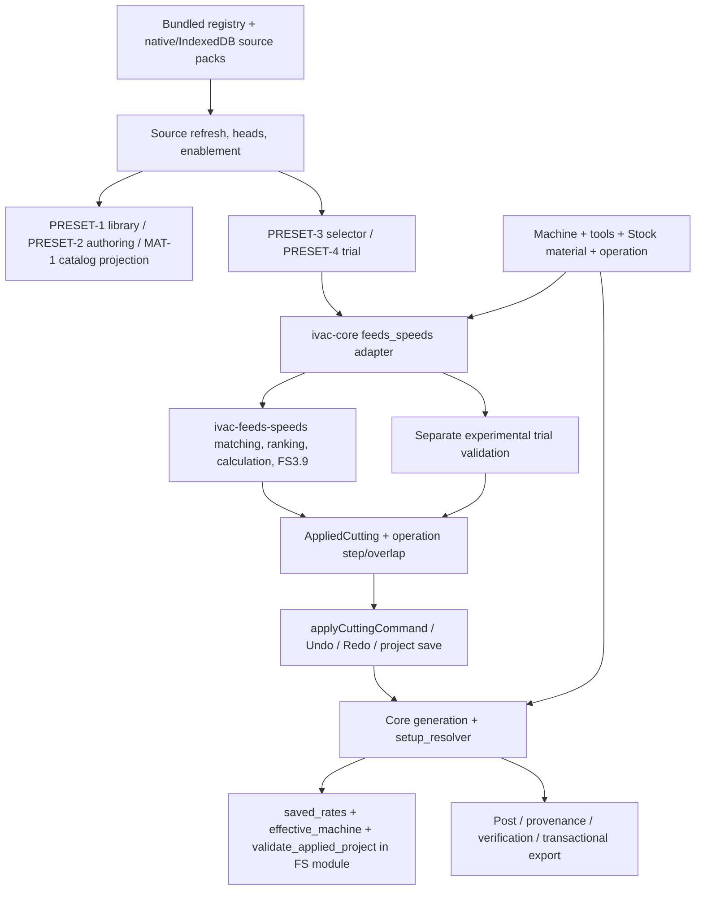

# FS-RESET-1 — Cutting parameters and tested workshop presets

Date: **2026-10-22**. Branch: **FabCAM-v1.1**. Audited code HEAD:
**e48241c89dbd911841eaf93dc72553f2763aa45f**.
Engineering: `ivac-j47dy`; human approval gate: **`ivac-909v6` OPEN**. **Architecture proposal; HARD STOP before production implementation.**
Decision record: [ADR-0030](../shopbot-modernization/adr/ADR-0030-fabcam-fabspeed-separation.md).

## 1. Decision and scope

The maintainer has decided that **FabCAM stops calculating or recommending feeds and speeds**.
FabSpeed owns calculation, analysis and experimentation as an independent application.
FabCAM owns explicit operation values, workshop-tested presets and mandatory CAM validation.
The product decision is authorized; the detailed replacement below awaits architecture approval.
FS-RESET-2 and FS-RESET-3 have not started. This audit changes documentation only.

Replace the old subsystem deliberately. Do not retain its resolver behind a renamed UI,
create a recommendation compatibility wrapper, migrate source packs or recipes, or preserve
project versions 1–8. Preserve general CAM behavior, user-owned files and V1 evidence.
Existing Git history contains the old implementation, including PRESET-4 and manual authoring.
No dependency on FabSpeed is needed to create, edit, save, generate or export a FabCAM job.

The main architectural finding is that **deleting the FS module is currently unsafe**:
`ivac-core::feeds_speeds` also owns saved-rate resolution, maximum tool RPM binding,
process/role checks and generation-time trial validation. These responsibilities must move
to a small core CAM parameter boundary before the recommendation crate can disappear.

## 2. Inspected baseline and dependency map

Read the recent [PRESET-1](PRESET_1_READONLY_2026_10_21.md),
[PRESET-2](PRESET_2_DUPLICATE_ADAPT_2026_10_21.md),
[PRESET-3](FABCAM_PRESET3_AUDIT_AND_IMPLEMENTATION.md),
[PRESET-4](FABCAM_PRESET4_EXPERIMENTAL_RECIPES_2026_10_21.md),
[MAT-1](FABCAM_MAT1_MATERIAL_TAXONOMY_2026_10_21.md),
[recipe authoring](PRESET_RECIPE_AUTHORING_2026_10_21.md),
[ADR-0027](../shopbot-modernization/adr/ADR-0027-lab-and-reference-identities.md),
[ADR-0028](../shopbot-modernization/adr/ADR-0028-preset-duplicate-adapt.md) and
[ADR-0029](../shopbot-modernization/adr/ADR-0029-manual-inactive-recipes.md).
Their historical receipts explain current dependencies; superseded product rules are not
requirements for the replacement. No earlier test count is presented as this audit's result.

Skills used: architecture, feeds-speeds, cam-validation, cam-ux-ui,
professional-workshop-ui and project-documentation. The two skills absent from the host
catalogue exist in `ivacam/.agents/skills/`. Architecture/validation/documentation copies
match the parent-workspace skills. The repository CAM UX copy adds desktop-density guidance;
that addition was read and retained. The new explicit product instruction supersedes the
old feeds-speeds skill's recommendation/ranking/product lifecycle rules.

### Current data flow



The pipeline does **not** invoke the recommendation engine. It reads operation snapshots or,
when absent, live tool defaults and legacy overrides. That latter fallback is a second rate
source and must disappear for the new milling operation format.

Source references and the bounded lexical dependency inventory are in
[dependency-files.txt](fs-reset-1-evidence/dependency-files.txt). This scan is an aid, not a
removal list: generic dependencies below were inspected independently of their names.

### Subsystem disposition

Paths below are repository-relative; grouped filenames refer to the same directory.

| Component / actual responsibility | Class | Replacement or retained contract |
|---|---|---|
| `crates/ivac-feeds-speeds/src/{engine,matching,rank,adaptation}.rs` | REMOVE | Calculations, automatic eligibility/ranking, reductions, FS3.9 interpolation/adaptation disappear. No numerical substitute in FabCAM. |
| FS `model.rs`, `dataset.rs`, `source_pack.rs`, `source_error.rs` | REMOVE | Remove source manifests/catalogs, family eligibility, permissioned transformations, evidence ranks and revision chains. Extract only neutral identity/material vocabulary needed elsewhere. |
| FS `validation.rs::request_issues` | REPLACE | Move relevant numeric/geometry/known-limit constraints to core CAM validation; dataset/aggressiveness/profile validity disappears. |
| `ivac-core/src/feeds_speeds.rs` request, recommendation, capture functions | REMOVE | No `FsCamRequest`, selected-record recommendation or capture via recommendation scope. |
| Same module: `saved_rates`, `effective_machine`, `validate_applied_project` | REPLACE | Core `cutting_parameters` resolves explicit role values, checks assignments/process/limits and is called by every generation entry. |
| Same module: `AppliedCutting`, `FsPass`, context key | REPLACE | Neutral operation rate roles and a compact optional preset baseline; no proposal, knowledge or evidence-origin tree. |
| `feeds_speeds/experimental.rs` + v8 trial fields | REMOVE / REPLACE | Remove Draft trial source lookup/acknowledgments; preserve numeric, slot, tool-limit and flute-depth safeguards in the ordinary core path. |
| `project/{tool,machine,params,op}.rs` | SIMPLIFY | Keep geometry, limits, operation strategies and tool/pass roles. Operation values become complete; tool rates are creation seeds only. |
| `pipeline.rs`, `pipeline/setup_resolver.rs` | KEEP / SIMPLIFY | Keep planning, budgets, output policy, setup synthesis and header consistency. Replace FS calls and live milling-rate fallback; known limit violations block instead of substituting values. |
| `pipeline/op_drivers/*`, `gcode/*`, `sim/*`, `pipeline/provenance.rs`, `safe_z.rs` | KEEP | Existing geometry, spindle transitions, role attribution, verification and process restrictions remain independently qualified. |
| `ivac-file-export`, CLI publication, Tauri path authorization | KEEP | Per-file transactional export, scope checks and partial-publication reporting are unrelated to recommendation removal. |
| `frontend/state/feeds-speeds.ts` | REPLACE | Keep purpose of explicit role editing/context comparison; remove catalog parsing, reference bindings and legacy fallback. |
| `feeds-speeds-persistence.ts`, project version dispatch in `project-file-ops.ts`, validation | REPLACE | One new explicit project format; strict new reader, old-format refusal, portable values and compact preset snapshot. |
| `cutting-identities.ts`, `preset-identities.ts`, `FsContext` | SIMPLIFY | Keep stable physical IDs. Remove physical/reference parallel selection and legacy alias inference; put tool maximum RPM on the tool. |
| `feeds-speeds-sources*`, `feeds-speeds-pack-store.ts`, `lab-presets-store.ts` | REPLACE | Local collection store with validated current documents and optimistic writes; no manufacturer registry, enablement or immutable revision archive. |
| Native `source_packs.rs` | REPLACE | Retain private app-data confinement, bounded parsing, locking/atomicity principles; implement current collection storage, not source-pack revisions. |
| `lab-presets.ts`, `LabPresetDialog`, `LabPresetManager`, `LabPackCreate` | REPLACE | One tested attestation at save; collections, edit/duplicate/delete; no Draft→Tested→Validated promotion. |
| `preset-adaptation.ts`, recipe-value editors, `DuplicatePresetDialog` | REPLACE | Simple independent copy/edit; changed context/values require fresh tested attestation before library save. No rights/rank/adaptation machinery for manufacturer records. |
| PRESET-1 `PresetsLibrary`, `preset-library.ts` | SIMPLIFY | Keep top-level entry, compact searchable table, details and keyboard navigation; replace pack projection with collection/preset rows. |
| `FeedsSpeedsSection`, `PresetBrowser`, recommendation/trial basis, selector/footer and provenance components | REPLACE / REMOVE | Direct Cutting parameters inspector plus compact Load/Save; remove Recommended/Browse, modes, ranking, trial and source-control surfaces. Reuse comparison/focus primitives where useful. |
| `cutting-selector*.ts`, `applyCuttingCommand` | SIMPLIFY | Keep target pinning, async cancellation, preview-before-commit and one history transaction. Apply only a validated operation patch, never Stock or source settings. |
| MAT-1 `material-presentation`, `MaterialPicker`, `MaterialBrowser`, `AnchoredPopover` | KEEP / SIMPLIFY | Preserve family/variant/alias search and explicit exact selection. Replace `LoadedSource` input and Sienci special case; no taxonomy-based cutting equivalence. |
| `operation-tool.ts`, `tool_inventory.ts`, `tool_family.ts`, `op_tool_constraint.ts`, workspace/toolset IO | KEEP / SIMPLIFY | Keep automatic stocking/assignment, inventory and process filtering. Simplify saved-rate rebinding; backend enforces process/tool validity too. |
| `operation-templates.ts` | KEEP / SIMPLIFY | Templates remain general reusable CAM intent. Instantiation must materialize explicit rates; templates are not tested cutting presets. |
| Tauri `feeds_speeds_cmd`, source-pack commands; WASM feeds/capture/validate pack; HTTP `/feeds-speeds` | REMOVE | New pure CAM edit/preset-validation contracts are shared by the same transports where needed. No deprecated API aliases. |
| CLI | KEEP / SIMPLIFY | No dedicated FS recommendation subcommand was found. `stream-gcode` consumes `PipelineRequest`; replace embedded legacy cutting schema, retain safety/trust/publication behavior. |
| `schema/openapi.yaml`, generated TS, WASM package checks/capabilities | REPLACE affected definitions | Regenerate from Rust; remove FS schemas, obsolete capability flags and exports. Keep drift/freshness checks, including material types needed by CAM. |
| `data/feeds-speeds`, frontend public registry/assets and packaging copy hooks | REMOVE | Remove active Sienci/bundled datasets and source licenses only where exclusive to removed assets. Preserve unrelated attribution. |
| Existing tests and reports | KEEP / REPLACE / REMOVE by property | Preserve safety tests and historical receipts; replace format/workflow tests, delete only tests of deliberately removed behavior with an exclusion ledger. |
| FabSpeed API | FUTURE | Optional external value supplier; no embedded crate, calculation code, network call or integration UI in FS-RESET. |

## 3. Mandatory core safety contracts

Safety is assessed from values and active CAM context, independently of preset existence or
attestation. A checked “tested” box must never disable a guard. Frontend validation provides
fast feedback; Rust is authoritative for direct callers, restored projects and generation.

| Contract | Current enforcement / gap | Required destination and proof |
|---|---|---|
| Finite numbers, explicit positive step magnitude, bounded depth loops | `pipeline.rs::require_valid_explicit_step`, `require_finite_setup`; CAM pass/resource budgets; numeric output guard | KEEP guards, reject invalid inputs before cached work/output; test NaN/Inf in direct Rust, overflow/tiny step, explicit zero and malformed JSON. |
| Positive milling RPM/feed/plunge for every consumed role | `saved_rates` checks explicit slots; legacy zero RPM may merely warn, emitted zero/missing feed is refused | New core role validator requires positive u32 rates, no rounding/saturation/fallback. Zero-RPM refusal is an intentional stronger new-format contract. |
| Machine RPM window and common feed ceiling | `setup_resolver` clamps with warnings; FS request validator detects contradictory bounds | New core validator rejects known violations/conflicts and keeps values unchanged. No hidden clamp during new-format milling generation. Both XY and Z remain below the existing common feed ceiling. Validate final resolved/derived rates too, so specialized path compensation cannot bypass limits. |
| Tool maximum RPM | Hidden in `FsToolBinding.max_rpm`; `effective_machine` takes min(machine, tool) | Move to neutral `ToolEntry.max_rpm`; combine known bounds without a source binding. Every primary/secondary role uses its own tool limit. |
| Unknown limits | Ordinary manual CAM allows unknowns; PRESET-4 requires known min/max/tool max/feed/flute | Proposed consistent manual policy: unknown stays unknown and is disclosed; it cannot override any known bound. No fictitious limit. Removing the trial-only completeness gate is an explicit approval decision, not accidental deletion. |
| Raw/effective geometry, flute count | FS requires positive diameter/flutes; raw finite geometry checked separately in pipeline; effective diameter otherwise floors values | Validate raw and effective diameter, wear, required cutter geometry. Known flute count must be positive; unknown/not-applicable denture must be explicit and must not fabricate a tooth count. Do not impose endmill rules on laser/knife/diamond denture. |
| Flute length and axial depth | Trial checks DOC≤flute; specialized surfacing/V-carve/relief/waterline checks differ | Retain specialized restrictions. Shared milling check rejects a declared pass exceeding a known usable flute length; check total reach/holder separately. Unknown flute length is visible, not a claimed safe reach. |
| Correct machine/process/cutter and required role set | FS applied-value validator only supports Profile/Pocket/PlanarSurface; general drivers have operation-specific rules; UI filters are broader | Derive allowed roles/tools from actual core drivers; no missing/duplicate/mismatched role fallback. Unsupported tool/process fails core validation; adding neutral rates must not broaden a driver’s capability. |
| Depth schedule and engagement | Step/finish_step/depth_list and per-kind fields affect planning independently of FS; Pocket 0 can inherit overlap | Single explicit operation storage; preserve nonuniform schedules and finite descending depths. Preset load must refuse incompatible schedules or offer an explicit reviewed replacement, never silently erase them. |
| Entry, clearance, fixtures and tool changes | Plunge strategies, SAFE-Z, work-origin, fixture checks and toolchange envelope | KEEP all. A preset carries applicable entry context; loading values never silently changes fixtures, WCS, tool selection or geometry. |
| No stale/partial operation commit | Selector context/source fingerprints and atomic history command | Recheck target after async work; preview and apply identical validated values. Cancel/failure leaves operation and Stock unchanged; Undo/Redo covers all loaded fields and baseline. |
| Generation/cache/export freshness | `generation-context.ts`, `program-qualification.ts`, file export checks before and after dialog; pipeline cache includes FS context today | Replace keys with complete explicit rates/role assignments/current setup and retained safety fields. Remove source availability from runtime dependence; do not remove qualification checks. |
| Tool provenance and full-program verification | `pipeline/provenance.rs`, per-tool simulation, ShopBot decoder, verification state | KEEP coverage of internal Pocket finish, Drill spot/chamfer, front/back and real emitted tool IDs; do not substitute one global tool envelope. |
| Native output publication | `ivac-file-export`, `publish_program_file` verifies `app.fs_scope().is_allowed(path)` | KEEP authorized destination boundary; no new unrestricted filesystem command. Per-file atomicity does not imply pair atomicity or crash durability. |
| Two-sided publication | CLI stages both, requires new names, reports second-side failure; desktop exports sides separately | KEEP precise partial-publication result and per-side qualification; never report total success after one side fails. |
| CLI streaming limits | Core streaming calls validation but omits preview/time estimate; CPS/HPGL refused; stdout cannot roll back | New core cutting validation must run here too. Do not claim full-program simulation/verification from successful streaming. Staged file publication is not machining qualification. |

The retained [NUMSAFE3 report](NUMSAFE3_RESOURCE_EXPORT_RESULTS_2026_10_20.md),
[SAFE-Z report](SAFE_Z_EXTENDED_RESULTS_2026_10_18.md) and
[TEST1 report](TEST1_RESULTS_2026_10_18.md) keep their original evidence limits.
No physical machining, controller operation or installed-platform acceptance is performed here.

## 4. Authoritative operation model

### Storage and initialization

Introduce a small neutral `ivac-core::cutting_parameters` module; keep preset validation in
a sibling module within core. No new calculator crate. The operation stores actual rates
for every supported role. Geometry, entry, depth schedule and lateral engagement remain in
their existing operation-specific fields: do not add duplicate operative DOC/stepover values
inside a rate block. A typed edit view combines these fields for UI/validation/serialization.

Conceptual contract (field spelling is proposed; generated Rust schemas remain authoritative):

```text
Operation.cutting: MillingCutting | absent for non-milling/program-only operations
MillingCutting {
  rates: RoleRates[]
  preset_snapshot?: LoadedPresetSnapshot
  external_origin?: { provider, contract_version, reference? }   // optional metadata only
}
RoleRates {
  role: rough | finish | drill | spot | chamfer
  tool_id: existing project tool number
  rpm: u32 | null
  feed_mm_min: u32 | null
  plunge_mm_min: u32 | null
}

Existing operation fields remain the ONLY executable owners of:
  step / finish_step / depth_list; plunge strategy and its values;
  Pocket.xy_overlap; PlanarSurface.stepover_mm; other specialized fields.
```

The role list is a closed set determined by the operation driver. Reject duplicate or stray
roles. Null fields explicitly represent an incomplete editable operation; preset save/load
and generation require complete positive values for every required role. This is a readiness
check, not a second persistent evidence lifecycle. Referenced tool numbers
must match actual assignments. Preserve integral rate storage in this redesign; fractional
inputs are refused explicitly rather than silently rounded. Millimetres/mm/min/rpm are the
canonical units; unit-aware display never changes stored meaning.

At operation creation, copy valid existing tool-library defaults once into the visible
operation fields and store them immediately. Defaults do not become tested presets. When a
role lacks usable seed values, retain an incomplete editable operation and block generation
with a precise missing-field message; never fill it at generation time. New disabled/incomplete
operations may save/reopen, with incompleteness preserved; enabling/generating them requires
complete values. Do not substitute a global fallback profile.

Changing an assigned tool, machine, material, tool default or preset later keeps existing
numbers. Tool reassignment explicitly rebinds the applicable role within the assignment
command, keeps values and invalidates the loaded-context status and generation qualification.
A newly added spot/finish role needs explicit visible initialization/review; existing roles
are not overwritten. Editing a template or library default never changes saved operations.

### Actual roles and depth semantics

| Existing operation path | Parameter/role treatment |
|---|---|
| Profile / ordinary contour milling | Preserve rough/finish distinction used by offset emission even with one tool. Compact main fields plus an explicit finish-role disclosure; no permanently linked rates. |
| Pocket, one tool | Rough clearing and finish ring may differ. Keep strategy, nominal overlap, finish allowance and no-contour flag; do not call nominal engagement a geometric measurement. |
| Pocket, distinct finish tool | Keep main rough and finish cutter values/geometry separately. Refactor synthetic finish setup to select the correct saved role explicitly; do not create fake unused slots to satisfy a legacy helper. Preserve the toolchange envelope. |
| Drill | Dedicated drill rates, existing Simple/Peck/ChipBreak cycle, dwell and peck increment. No generic milling DOC field when the driver does not consume it. Resolve peck seed once at creation instead of live library fallback. |
| Drill spotting | Separate `spot` role even if it uses the same physical tool; retain spot depth/tool and existing pre-pass/toolchange behavior. The current implementation creates a synthetic Drill op using library drill rates. |
| Drill chamfer-after | Separate `chamfer` role and cutter where configured. Current finish synthesis is reached through a Drill clone and may therefore inherit drill-set rates; pin the actual prior output in regression fixtures before changing this dispatch. Do not reinterpret it based on the label “finish”. |
| PlanarSurface | Existing explicit stepover in mm, depth and validated cutter/process restrictions remain; no FS endmill-only inheritance. Preserve its 95% diameter overlap bound and other qualified exclusions. |
| VCarve, Chamfer, Engrave, HalfPipe, Relief/SurfaceMill, Waterline | Use only the rates and specialized depth/lateral fields each existing driver consumes. Keep V-bit/ball geometry and existing restrictions. Do not force every operation to expose Pocket stepover. |
| Thread, TSlot, Dovetail | Keep specialized pitch/turns/undercut and feed-compensation behavior; these do not consume the generic step in the same way. Existing path-related rate compensation is CAM semantics, not material recommendation, and is not removed by name. |
| Laser, plasma, drag knife, future waterjet | Outside milling preset semantics. Retain existing process controls and generic infrastructure. No dummy spindle/plunge fields or new capability. |
| Pause, Homing, Probe, marker, GcodeInclude | Program-only handling remains; do not require cutting-role values or offer tested milling preset loading. |

For standard step schedules keep the current negative internal Z-step convention; show
positive “Depth per pass” in the inspector and convert exactly at the editor boundary.
Explicit depth lists remain supported. The new preset payload stores one tagged schedule
representation, not contradictory step and list alternatives. Copying it requires a preview
of all replaced fields. Final target depth, selected geometry, tabs and fixtures stay job intent,
not preset values. If a preset has a context requirement involving them, show a mismatch.
An operator-declared full-width context, when needed for exact preset reuse, remains an explicit
neutral context statement; it is never inferred from a Profile offset or required just to
enter manual values. It does not resurrect the recommendation-only `fs_full_width` contract.

### Limits and source of truth

Known bounds become **refusals**, not parameter clamps, for new-format milling inputs.
This intentionally changes out-of-bounds legacy behavior; unchanged valid in-bounds inputs
must retain comparable output. Unknown limits stay unknown with an actionable warning; manual
CAM does not require a source catalog or a machine/tool rating invented by the application.
Existing specialized mandatory requirements remain. The common feed ceiling continues to
cover XY and Z but is not advertised as an independently qualified axial limit.

## 5. Minimal tested-preset model

A collection is a named private document containing current presets. It has an ID, name,
schema version and an opaque concurrency token. The token prevents lost updates; it is not
an immutable evidence revision archive. A preset has a stable ID and no qualification rank.

```text
PresetCollection {
  format: "fabcam-preset-collection", version: 1,
  id, name, presets: Preset[]
}
Preset {
  id, name, description?,
  context: {
    machine: { physical_id, label, relevant setup snapshot },
    material: { id, label, exact variant/condition when known },
    operation_kind, strategy/entry/cutting-direction where relevant,
    roles: [{ role, tool: { physical_id, label, geometry snapshot } }],
    explicit additional scope restrictions when necessary
  },
  parameters: exact supported role rates + tagged depth/lateral/cycle fields,
  tested: true, test_date?, workshop_notes?,
  fabspeed_origin?: { contract_version, reference? }
}
```

Collection membership is the enclosing collection ID; do not duplicate pack references in
every object unnecessarily. Native local etags are store metadata, not part of the tested
claim. Test date is optional and user-entered; creation/import timestamps are not trial dates.
No operator ledger, promotion workflow, engine version, rank or numerical scaling is required.

**Identity:** reuse the existing stable physical machine/tool identity values, not names,
reference-model IDs or project-local tool numbers. Promote them to neutral machine/tool
fields when their contracts change. Machine profile IDs identify saved configurations and
are not automatically interchangeable with a physical machine identity. Configuration variants
can share one physical identity intentionally. Project copies keep that identity. Creating a
new physical entity gets a new ID. No automatic identity aliasing or similarity-based merge.
Material uses the existing exact ID vocabulary with stable custom IDs; taxonomy is display only.
IDs do not prove geometry unchanged: compare the relevant snapshots as well.

Tool geometry context includes effective diameter, type, relevant flute count if known,
cutting length, wear and operation-relevant shape/holder/stickout information. Missing data
remains explicit. Setup/engagement/entry differences are displayed, not guessed away. Known
new machine/tool limits are always revalidated even if identities match.

**Attestation:** saving a new preset from an operation requires an unchecked confirmation:
“I tested these values with this machine, tool, material and operation.” A successful Generate,
software test, import or FabSpeed response cannot tick it. Editing cutting values or cutting
context in the preset editor invalidates the attestation and requires renewed confirmation
before saving. Cancel preserves the original. Name/description/collection changes alone do not
invalidate the original cutting claim. Duplicate creates a new ID; any changed cutting context
or values require renewed attestation. Unsaved editor drafts are ordinary UI state, not a new
persistent Draft evidence lifecycle.

An imported collection may preserve its author's explicit tested claim. Display the collection
and recorded context; never describe it as newly tested on the importing machine. Forged
attestation cannot be established or disproved by software; core safety remains independent.

### Loading, exact compatibility and modified state

Default matching compares exact physical machine/tool IDs, geometry, material ID, operation
and relevant strategy/entry/engagement context. No family inheritance, diameter scaling,
interpolation, fuzzy aliases or “closest” candidate. Similar rows are inspectable and can be
opened for deliberate editing/duplication; they cannot use the **Load tested preset** action
as if they were exact. Manual entry remains available for theoretical experimentation.

Load previews old→new values per role, leaves unchanged fields clear, and requires an explicit
“Replace parameters” confirmation. It never chooses a different tool, machine or Stock material.
A pure Rust validator checks the full resulting operation and current limits. The existing
operation command is narrowed to apply that validated patch atomically, with Undo/Redo.
The operation snapshots the values; saving or deleting the library preset cannot update it.

`LoadedPresetSnapshot` contains collection/preset ID and labels, the exact context at load and
the original loaded parameter subset. This historical subset is for comparison only; generation
reads current operation fields. Do not embed workshop notes, full collections or private paths
in portable projects. Compare current stored values/context to the snapshot for:

- **Loaded preset: Collection — Name** when values/context still match the loaded baseline.
- **Modified from preset** after a supported value or relevant context change, including after
  save/reopen. Show the changed context when machine/tool/material differs.
- **Manual parameters** when no preset baseline exists. Future external values remain ordinary
  parameters with an optional origin label, never an automatic tested preset.

A preset changed/deleted in the library does not affect the offline baseline. Undo restores
values and baseline status together. Reverting exactly to the baseline restores equality;
there is no sticky “tested” flag on the operation itself.

## 6. Operation, library and material UX

Use graphite panels, blue action/focus accents, existing shared tokens, compact labelled
numeric controls and visible units. State is conveyed with text/icons, never colour alone.

```text
Cutting parameters                     [Main / Finish / Spot… when applicable]
Spindle speed           [     ] rpm
Feed rate               [     ] mm/min
Plunge rate             [     ] mm/min
Depth per pass          [     ] mm       (only where consumed)
Stepover                [     ] % or mm  (one explicit unit per operation)
[Load preset]  [Save preset]
Loaded preset: Sorbonne Fablab — Birch Ø6 / Modified from preset
```

Show specialized cycle controls with their operation; keep advanced depth schedule/finishing
controls accessible. “Main/Finish” switches the edited role rather than overwriting other roles.
Validation messages identify the actual field/role/limit; preserve machine/setup warnings.
No Suggest button, aggressiveness modes, evidence ranking, experimental acknowledgments,
manufacturer compatibility picker or pack enablement panel remains.

**Presets** stays top-level. Use a compact table and details pane with collection, machine,
tool, material and operation filters, plus search. Create/rename collections; inspect, edit,
duplicate and delete presets (confirmation names the item). Create from the current operation
uses its actual current values. Changes do not mutate source operations or Stock.
The inspector's Load action opens a compact anchored picker/drawer sharing the same row model;
selection reveals the small parameter diff, then confirmation. Do not nest the full library
inside another large modal. Keyboard focus, Escape, long labels, scrolling and narrow layouts
remain acceptance tests. Library “Load into operation” targets an existing selected operation
and uses the same command and validator.

**MAT-1 can largely survive as presentation.** Retain alias normalization, family/material/variant
labels, generic-versus-specific distinctions, unknown/custom entries, deterministic aggregation,
pagination, AnchoredPopover and explicit result activation. Replace its imports of
`NORMALIZED_MATERIALS`/`LoadedSource` from FS with a small neutral material catalog and collection
context projections. Remove the special Sienci category mapping. Preserve current unknown
material selection independently of a collection's availability. Search/filter never changes
Stock; only its explicit material-selection command does, with history and freshness effects.

## 7. Serialization and API strategy

Propose one portable envelope: **`kind: "ivac-project", version: 9`** for every newly saved
project, regardless of presence of presets. It represents an explicit contract break, not
migration. Versions 1–8 and their cutting/knowledge/experimental kinds are rejected before
restoring mutable application state. Explain the incompatibility and keep the original file
untouched. No fallback loader, tolerant loss of v8 provenance, automatic rewrite or “repair”.

Keep valid drawing, corner relief, surfacing, imports, text, stock, fixtures, two-sided intent,
work offsets and all unrelated project features in v9. Remove only obsolete FS fields and
version-dispatch complexity. The native project request must likewise require the new
explicit milling contract; legacy HTTP/CLI payloads must not regain tool-default fallback.
Use an explicit request version or required new-format fields so old payloads fail visibly.

Save/reopen must preserve authoritative values and optional baseline without any installed
preset, recommendation service or FabSpeed. Reject unsupported/newer versions and malformed
role/snapshot structures, unknown executable fields, invalid references and invalid numbers.
Separate portable metadata validation from generation readiness: a deliberately incomplete
new operation may reopen as incomplete; invalid ready-to-run values never qualify output.
WASM tests must pass through actual JS → JSON → parser boundaries, including null/absent
optional fields, rather than testing only synthetic objects that already have the right shape.

Regenerate OpenAPI/TS from Rust and refresh WASM. Remove old FS schema exports, capability
claims, Tauri command registrations and HTTP route. The new parameter-preview/validation and
preset/collection validation functions share core code across clients; storage remains local.
No recommendation-shaped `apply` API is retained solely for old callers. Postprocessors consume
resolved ordinary CAM Setup/IR values and never call a preset store or FabSpeed.

## 8. Storage inventory and reset implications

No cleanup was performed. [Metadata inventory](fs-reset-1-evidence/storage-inventory.json)
was taken read-only; private cutting tables and notes were not copied into this report.

| Existing location | Observed / affected data | Treatment |
|---|---|---|
| macOS `~/Library/Application Support/org.opcenter.ivacam/feeds-speeds/sources/` | **6 installed JSON source packs**, dated revisions in filenames | Leave intact and unreferenced by new code. Optional later explicit backup/removal scoped to these files; never delete the whole app-data root. |
| Same app-data root, `ivacam/workspace.json` | One file exists; generic machine profiles, inventory, templates and preferences use this store | Preserve. Not a source-pack cache; no blanket reset. |
| Same root, `.window-state.json` | One file exists | Unrelated; preserve. |
| Browser IndexedDB `ivac-cutting-source-packs`, version 1, store `packs`, keys `id@revision` | Code inventory only; actual records differ per origin/WebView and were not inspected | Leave intact. New store must not silently delete it or infer its contents from native storage. |
| Browser localStorage `ivac.settings` | `feedsSpeedsSources` includes active references and possible old source bodies; unrelated preferences share the key | Stop consuming FS settings. Preserve unrelated preferences; no `localStorage.clear()`. |
| Browser localStorage `ivac-workspace` | Machine profiles, tool inventory, templates, recent projects and layout | Preserve generic data and parse-error protections. |
| User `.ivac-project.json`, toolset/machine exports, repository import bundles and Downloads | User-owned files, including earlier CNCFraises/ShopBot packs | No scan-and-delete, rewrite or implicit migration. Old FS packs become unsupported imports; these artifacts remain on disk. |

**New collection store:** native app-data `presets/collections/<collection-id>.json`; browser
IndexedDB `ivac-preset-collections`, store `collections`. Each current collection is replaced
atomically after validation, with an expected content token to prevent lost updates. Reuse
bounded parsing (current 2 MiB limit), safe IDs, path confinement and symlink refusal principles;
collection/count/string budgets must be pinned and tested with the new schema. Browser writes
use one readwrite transaction; native writes use a lock plus unique same-directory temp and
atomic publication. Never silently overwrite a newer document. Preserve the original on errors.
There is no immutable source history or registry. Export/import is justified as the simple
backup/sharing boundary: one versioned JSON collection, validated before any write, with
explicit collision handling (replace reviewed current collection or import an independent copy).
No auto-binding imported physical contexts by display name.

**Generic workspace handling:** keep existing inventory/machine/profile functionality. If neutral
field ownership requires a workspace schema change, write to a separate `workspace-v2.json` /
`ivac-workspace-v2` and offer an explicit, bounded import of machine/tool assets only. Do not
build old-project, source-pack or trial migration. Preserve the v1 workspace as a recoverable
file; never replace malformed/future workspace data with defaults. Existing physical identity
values and explicit known safety limits must survive an accepted generic-library import.
This small asset import has ongoing value; recreating the old recommendation ecosystem does not.

A future optional reset must first inventory the actual selected backend/origin and show exact
paths/keys, export a readable backup, and request deletion confirmation. FS-RESET implementation
can function without deleting any old data. Tauri path permissions must stay scoped to app-data
and explicitly selected import/export files; no capability broadening for convenience.

## 9. Future FabSpeed boundary — documentation only

Local documentation was accessible at
`/Users/mugen/Documents/01_Projets/FabSpeed/docs/API.md`; its fingerprint is recorded in
[fabspeed-doc-reference.json](fs-reset-1-evidence/fabspeed-doc-reference.json).
The document describes `/api/v1`, including `POST /recommend`, explicit mm/min/rpm units,
values/origins/provenance, nullable results for unsupported cutters, warnings and version metadata.
No endpoint was called, no server behavior qualified, and no schema or numerical assumption
was invented here. The companion architecture mentions direct crate embedding as an option;
**the present user decision rules that out for FabCAM**.

Future adapter only: obtain the explicitly selected local context, map supported roles and
external IDs through a reviewed versioned contract, send an opt-in request, receive explicit
values plus minimal calculation metadata, preview them, validate them in FabCAM core, then
copy on confirmation through the same operation command. Existing external aliases/history
heuristics do not establish exact FabCAM compatibility; an external “tested” label is not an
automatic workshop attestation in the local preset library.

Before implementing that later milestone, define supported contract/version negotiation,
explicit unit conversion policy, missing/unsupported role handling, finite/range validation,
response-size limits, timeout/cancellation/error behavior and stale-context rejection. A timeout,
network failure or unsupported response changes nothing. Configuration is optional and no
request runs during generation/export. Credentials/private source bodies stay out of portable
projects. Map external decimals deliberately: current integer rates must not be silently rounded.
No FabSpeed diagnostic/calculation algorithm, fallback or background sync belongs in FabCAM.

## 10. Removal order and bounded milestones

| Boundary | Work and qualification | Commit / approval |
|---|---|---|
| FS-RESET-1 (this checkpoint) | Dependency/safety audit, models, storage inventory, report and proposed ADR; document-only preservation checks and focused current-behavior tests | Focused local documentation commit; **human architecture approval required before FS-RESET-2**. |
| FS-RESET-2 / slice 1 | Core neutral role/value model, shared validation, preset/collection contracts and atomic storage, explicit v9 serialization; move tool-limit ownership and retain native generation guards | Rust numeric/identity/role/import/storage/project tests; focused qualified commit. Old engine is only a temporary implementation dependency until removal, not a compatibility promise. |
| FS-RESET-2 / slice 2 | Direct operation inspector, exact Load/Save, explicit initialization and narrowed history command; no hidden defaults | UI/state + real core transport, Undo/Redo, stale target/generation, save/reopen; focused commit. |
| FS-RESET-2 / slice 3 | Simplified Presets library/collections, edits/duplication/deletion/import/export, neutral MAT-1 input | Attestation, collisions/concurrency, search/filter/Stock isolation, keyboard/narrow view; focused commit. |
| FS-RESET-2 / slice 4 | Wire all existing supported operation roles and specialized values, primary/secondary tool contexts and output | Representative identical-input output comparison, Drill spot/chamfer, Pocket finish and specialized-operation cases; explain every difference; focused commit. |
| FS-RESET-3 | Remove old engine/crate, adapters, endpoints, datasets/assets, source stores/UI, v1–8 project readers and obsolete tests; regenerate all contracts and current docs | Integrated qualification below, obsolete-test exclusion ledger, screenshots and `FS_RESET_RESULTS.md`; final human acceptance stop. No merge/release. |

Delete in dependency order: establish new core validation → all CAM consumers and constructors
use explicit fields → new persistence/UX/storage → neutral identity/material consumers → remove
transport registrations/generated legacy types → remove old UI/authoring/store code → remove
crate/assets/build hooks → remove dead tests/translations/docs claims. At each stage search the
remaining dependency graph. Never delete `feeds_speeds.rs` while pipeline calls remain.

Do not change `main`, frozen V1 worktrees, V1 release workflows or qualification baselines.
The V1.1 pre-release gate may be updated only to reflect actual retained features; its safety
requirements remain mandatory. Existing ADR texts and dated reports stay historical, with
new navigation/disposition links rather than erased evidence. ADR-0030 becomes accepted only
after human architecture approval. No PRESET-5, new machining capability or FabSpeed integration.

## 11. Risks and decisions needing approval

| Decision / risk | Recommended choice |
|---|---|
| Hidden safety dependencies in FS | Move and test ordinary CAM validators first; unknowns never masquerade as known safe values. |
| Old clamp behavior versus authoritative numbers | Reject known out-of-bound milling values in v9; compare unchanged in-bounds output separately. This changes legacy clamp/zero-RPM behavior intentionally. |
| Incomplete tool ratings | Allow ordinary manual setup with disclosed unknowns, retain specialized mandatory requirements and all known-limit checks; no trial-only activation gate or invented limits. |
| Role flattening / synthetic op helpers | Closed driver-derived role contracts, explicit spot/chamfer handling, output fixtures before refactoring dispatch. |
| Missing or altered physical context | Exact preset load only; similar configurations remain inspect/edit. Stable IDs plus relevant snapshots; labels/taxonomy never establish equivalence. |
| Loaded values edited after test | Preserve original baseline, display Modified from preset, require explicit new attestation before saving as a tested configuration. |
| Preset edits/import races | Optimistic current-document tokens and atomic writes; pin preview snapshot. Read→operation-commit is not a distributed store transaction: the copied reviewed snapshot remains authoritative even if another window edits the library immediately afterwards. |
| Project format break and generic assets | One v9 envelope, explicit old-format refusal; preserve files and generic inventory/workspace. No source-pack/trial migration. |
| Broader operation support for manual rates | Replace obsolete assistant applicability restrictions only where the existing CAM driver already supports the tool/process; never expand machining scope. |
| Current imported theoretical wiki packs | They are not tested preset collections and are not migrated/promoted. Keep originals for reference; recreate only actually tested configurations with human attestation. |

Approve or amend these recommendations as the FS-RESET-1 architecture. Approval does not
qualify physical cuts or close unrelated V1/platform/security/UX gates.

## 12. Acceptance criteria and test strategy

FS-RESET-2/3 acceptance is property-based, not a demand to keep obsolete test names green.

| ID | Required proof |
|---|---|
| RESET-A | Manual creation/edit/generation/save/reopen with no source registry, no installed presets and FabSpeed unavailable. No calls to recommendation code. |
| RESET-B | Each actual role retains its own tool/rates across assignment, duplicate, Undo/Redo and reopen. Distinct Pocket finish and Drill spot/chamfer have correct emitted T/S/F and simulation provenance. |
| RESET-C | Native, WASM, HTTP and CLI reject invalid/missing/duplicate roles, invalid raw/effective geometry, NaN/Inf, overflow, zero rates, invalid DOC/engagement and known limit violations. No frontend-only bypass. |
| RESET-D | Current values never change after tool-default, material, machine, source collection or preset edits/deletion. Context changes invalidate qualifications and reveal preset modification. |
| RESET-E | Explicit Load previews exactly what is committed, changes no setup/material/tool selection, rejects stale target/cancelled requests and uses one Undo/Redo command. Similar preset cannot masquerade as exact. |
| RESET-F | Save requires fresh tested attestation; value/context edits invalidate it. Import preserves external authorship without automatic local qualification. No persistent Draft/Tested/Validated promotion. |
| RESET-G | Collection create/rename/search/edit/duplicate/delete/import/export, malformed/oversized data, ID collisions, stale writes, interrupted writes and native path boundaries. No partial write or unrelated data deletion. |
| RESET-H | Real v9 save/reopen via native serde and actual WASM→JSON; optional fields/nulls, unknown versions, old-format refusal, portability without local library. All retained geometry/project features round-trip. |
| RESET-I | Freshness after manual/load/context edits, during save dialog, simulation and front/back generation. Stale export refuses. Native per-file publication and partial-pair failures remain truthful. |
| RESET-J | MAT-1 family/variant/synonym search never changes identity or Stock implicitly; custom/unknown/ambiguous labels remain explicit and usable. |
| RESET-K | Desktop and narrow screenshots/walkthrough: new operation → manual values → save tested preset → create/rename collection → exact load → modified state → duplicate/edit → save/reopen → Undo/Redo → context change → invalid rate refusal → qualified generate/export. |
| RESET-L | Identical explicit valid inputs reproduce established semantic/byte output where appropriate. Keep actual rate/role, WCS, SAFE-Z, fixtures, decoder/provenance and two-sided assertions; investigate unexplained changes. |

Integrated commands must include the existing `scripts/pre-release.sh` (all required steps),
workspace all-features tests, strict/pedantic Clippy with the gate's documented allows,
frontend test/lint/typecheck/build, fresh WASM, schema/client/i18n drift checks,
NUMSAFE/NUMSAFE2/NUMSAFE3, ShopBot/SAFE-Z/import/full-program/provenance/export regressions,
and the separate TEST1 watchdog corpus including C2 (`--frontend`). The ordinary ignored
TEST1 worker or pre-release alone does not establish complete TEST1 coverage. Record toolchain,
source SHA, command, exit status and actual case counts. No missing-tool silent skips.

Maintain an exclusion ledger for obsolete tests (ranking/interpolation/source schema/promotion/
legacy-reader equivalence), including replacement coverage for any shared safety assertion.
Do not weaken limits, budgets or unsupported-operation refusals to obtain green results.
No physical machining is authorized. Installed-platform and V1.1 human acceptance remain separate.

## 13. Audit qualification, exact Git state and handoff

### Checks actually run for FS-RESET-1

| Command | Result |
|---|---|
| `RUSTC_WRAPPER='' cargo test --offline -p ivac-core --lib feeds_speeds` | **30 passed**, existing adapter/trial/limits/persistence behavior — [log](fs-reset-1-evidence/baseline-core-fs.log) |
| `RUSTC_WRAPPER='' cargo test --offline -p ivac-core --lib pipeline::setup_resolver::tests` | **21 passed**, including current fallback/clamp behavior to replace explicitly — [log](fs-reset-1-evidence/baseline-rate-resolution.log) |
| Targeted Vitest on feeds-speeds, operation-tool, material-presentation, generation-context, program-qualification and qualification-export | **59 passed in 6 files** — [log](fs-reset-1-evidence/baseline-frontend.log) |
| Document links, scoped diff, tracked-source preservation | Receipt written in [audit-checks.json](fs-reset-1-evidence/audit-checks.json) after final review. |

These are baseline checks, not tests of an unimplemented replacement. No full-release gate,
new UI screenshots, production build, numerical qualification or physical test is claimed.

Initial branch/HEAD and all worktrees are captured in
[branch](fs-reset-1-evidence/branch-before.txt), [HEAD](fs-reset-1-evidence/head-before.txt),
[worktrees](fs-reset-1-evidence/worktrees-before.txt) and the **exact complete**
[pre-work status](fs-reset-1-evidence/git-status-before.txt). The latter records the initial worktree; the new evidence directory may appear once capture
has written its first file. All other recorded entries predate this audit.
There were two tracked documentation modifications, no staged changes and many untracked
historical reports/evidence paths. Their existing patch is preserved in
[existing-doc-changes.json](fs-reset-1-evidence/existing-doc-changes.json).

- Primary checkout: `FabCAM-v1.1`, `e48241c89dbd911841eaf93dc72553f2763aa45f`.
- Other worktree: `codex/sec1-roadmap`, `7e1c24b937e9bc01aa320537c835ffc30fc9389c`.
- Other worktree: `codex/v1-freeze-readiness`, `85a93c4a467ff5965655d5737354d9500c2e94fc`.
- Pre-existing tracked changes: `docs/releases/RELEASE_ROADMAP.md` and
  `docs/shopbot-modernization/STATUS.md`. Preserve them outside the focused audit commit.
- Source baseline is committed through PRESET-4 final handoff `e48241c`; prior core trial
  `d7b6531`, WASM fix `b0920ca`, UI/authoring `be9720a` remain recoverable in Git history.
- Other tracker work includes V1 candidates/security/import/provenance and the old identity UX
  checkpoint. Their acceptance is not inferred or closed. Worktree/tracker inspection cannot
  exclude edits in an external editor; source hashes are checked again before handoff.

No production files are edited or staged, no user data is reset, and no V1 worktree is changed.
The focused documentation commit hash is supplied in the chat handoff; it cannot be embedded
in its own content. Final remaining status is captured separately after the commit.

**HARD STOP:** review the operation-role model, known/unknown-limit policy, exact preset
compatibility, attestation/baseline semantics and v9/storage break above. Only explicit human
approval may start FS-RESET-2. FS-RESET-3, FabSpeed integration, merge and release remain unstarted.
