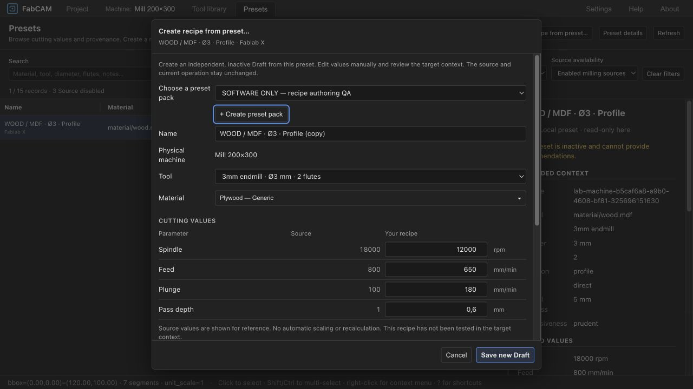

# V1.1 — Manually editable inactive recipes from presets

**Local consolidation update (2026-10-21):** approved authoring/UI now committed in
`be9720a2503bf689b3a5e4e15cf0e85b2ddb5710`, alongside its shared PRESET-4 integration.
Final integrated frontend: 1556 PASS / 1 existing skip; type/lint/WASM build PASS.
The earlier uncommitted receipt below is preserved historically. Human review remains
separate; no publication. See [PRESET-4 final handoff](FABCAM_PRESET4_EXPERIMENTAL_RECIPES_2026_10_21.md).

2026-10-21 · `FabCAM-v1.1` · parent `17581be103c374b3b11a862ac26a7e8aaa1c3ae6`.
Implemented locally, uncommitted. User explicitly authorized replacing the strict
copy workflow with manual recipe authoring across machine/material contexts.
[ADR-0029](../shopbot-modernization/adr/ADR-0029-manual-inactive-recipes.md) supersedes
those ADR-0028 restrictions; prior accepted reports and the preceding uncommitted
dialog styling work are preserved. Human UX review `ivac-2rh9l` remains open.

## Result

“Create recipe from preset…” replaces the visible “Duplicate & adapt” entry in
Presets and the cutting-parameter selector. Source values remain beside editable
RPM, feed (or chipload for chipload-based sources), plunge, pass depth and source
stepover where supplied. No automatic scaling, conversion from chipload to feed,
clamping or numerical recommendation occurs. Operation/entry intent remains based
on the source; final job cut Z is not a cutting-preset field.

Machine/material source applicability differences become explicit nonblocking
warnings. They do not establish equivalence or create source associations. Required
stable target identities, milling support, known tool-family compatibility, valid
geometry and copy rights remain blocking. Values must be finite and positive;
stepover must be within (0,100], pocket requires it and profile/full-slot excludes
it. Edited pass depth must fit known flute length; known machine RPM/feed and
recorded destination-tool RPM limits are respected without silent modification.
Editing any form value invalidates the previous review.

Save creates an independent exact-target recipe as **Draft / theoretical /
enabled=false**. No physical test, review or lab history is inherited. The original
pack/profile, scope, values, reductions, license, attribution and evidence category
remain in source provenance; authored values and applicability warnings are recorded
there too. Target DOC/nominal stepover scope follows edited values, and source stock
thickness is not asserted for the target. Source, operation and job material remain
unchanged. Source/destination stale checks, catalog collision checks and native /
IndexedDB compare-and-append storage are retained.

The existing format, generated API/schema, native permissions and recommendation
engine need no change. The unchanged Rust source-pack validator requires Drafts to
be inactive/theoretical. Actual WASM application of the new Draft is tested to fail
with “Draft, disabled”; a successful save grants no recommendation eligibility.

## Qualification

| Check | Result |
|---|---|
| Full frontend | **1546 PASS, 1 existing skip**, 176 files |
| WASM package guards | **10 PASS** |
| Svelte / TypeScript | **0 errors, 0 warnings** |
| ESLint / Prettier | PASS |
| WASM freshness + production build | PASS; existing chunk/import notices retained |
| New targeted coverage | 8 recipe tests plus expanded adaptation and real-WASM apply guards |

Tests cover edited values without scaling despite changed diameter/flutes; different
machine/material; source/input immutability; source and authored data provenance;
cleared qualification/history; invalid/missing/zero/negative/non-finite values;
stepover, known hard limits, edited flute-depth checks, chipload without invented
feed, synchronized DOC/nominal engagement and real WASM pack validation. Existing
rights, revision, identity and source/preset regressions remain passing. No test or
budget was weakened; old machine/material assertions now verify warnings rather
than the superseded save refusal.

Browser/WASM replay used a disposable project and synthetic local packs at port
18813. A Fablab X MDF source (18000 RPM, 800 feed, 100 plunge, 1mm DOC) was saved for
a different physical machine and generic plywood at **12000 RPM, 650 feed,
180 plunge, 0.6mm DOC** in “SOFTWARE ONLY — recipe authoring QA”. The recipe retained
these values after reloading and displayed **Draft / inactive / cannot provide
recommendations**. Source values were reread unchanged. A zero feed disabled save;
editing reset review. The replay saved one synthetic Draft only, without activating
it. That QA pack remains in the disposable browser origin, with no native data read
or changed.

The nested operation route retained compact 13px checkboxes; cancelling edits left
the operation feed at 800mm/min. At 480×720 the dialog remained 464px wide, with
clientWidth=scrollWidth=462px. No horizontal overflow or browser console errors.
No native installation, controller, output file or physical qualification is claimed.
The preceding UI report remains historical for unchanged-value copying; this
checkpoint owns the new authoring behavior.

[Receipt and source fingerprints](recipe-authoring-2026-10-21-evidence/receipt.json).

[Context review](recipe-authoring-2026-10-21-evidence/context-review.jpg) ·
[Saved inactive recipe](recipe-authoring-2026-10-21-evidence/saved-draft.jpg) ·
[Nested selector](recipe-authoring-2026-10-21-evidence/nested-dialog.jpg) ·
[Narrow layout](recipe-authoring-2026-10-21-evidence/narrow.jpg).

## Handoff

No commit, push, merge, release or new milestone. Existing unrelated untracked
qualification evidence is retained. Next action is human review of this manual
recipe workflow (`ivac-2rh9l`), independently of still-open MAT-1 and physical gates.
Automatic parameter scaling remains deferred.

Browser presentation follow-up: [compact selection and direct recipe access](PRESET_BROWSER_UX_2026_10_21.md).
