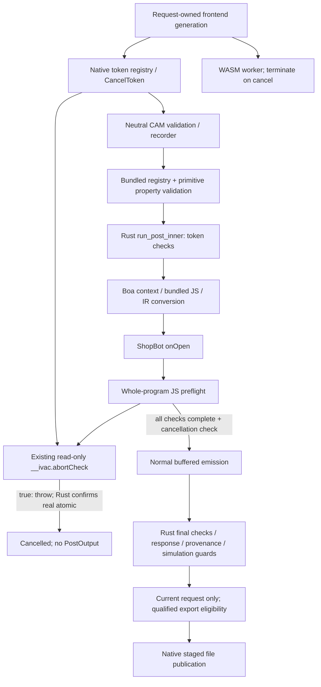

# QUAL-1B — Cooperative ShopBot cancellation

Engineering qualification, 2026-10-24. Scoped macOS Personal Alpha work; not an
installer, installed-native acceptance, release or physical qualification.

## Source and preservation

Starting primary `FabCAM-v1.1`: `f2b0427b2361ae33064eb9caa5a874716880ee4d`.
Its implementation is identical to qualified QUAL-1A.4 source
`8e2c9ce427007f9c5a3787b34dd28647b8cdcf95`; the extra commit is the A4 report.
QUAL-1B uses isolated `codex/qual-1b-cancellation`, checkout `FabCAM-qual-1b`.
Final software SHA / focused implementation commit:
`fd8fed652ab98ef801595d6cf12f378a8f28bf89`. Report/evidence are committed separately.
The two timed campaigns precede this commit; `BUILD_INPUT.json`, post SHA and
source-diff receipt bind the exact runtime bytes to this commit. No production
change followed measurement. The final regression gate runs at this commit.

The initial receipt hashes 8,473 dirty/untracked primary files, 8/8/87 files in
the prior experimental A1/A2/A3 worktrees, and 13,431 historical raw evidence files.
Ten primary tracked modifications remain independently owned (offset builder,
warnings, release roadmap, STATUS and six frontend files). The separate
`codex/roadmap-fabspeed` branch at `ff6486b` was read for the Personal Alpha plan;
none of its documents is edited or integrated here. Its provisional A4 status
is superseded by A4's committed receipt, not rewritten in place. See final receipt
for the actual end-of-task state. Software integrated by safe fast-forward
`f2b0427` → `fd8fed6` on `FabCAM-v1.1`; all 8,473 protected primary files
remain byte-identical and the ten tracked changes remain uncommitted.
Qualification applies to the isolated committed source, not to those independent
working-tree changes or their combined application behavior.
[Integration receipt](qual-1b-evidence/INTEGRATION.json),
[all-worktree/historical preservation](qual-1b-evidence/PRESERVATION_PRE_INTEGRATION.json).
Other worktree HEADs and saved artifacts are retained; no reset, stash, clean,
rebase, user-data removal or remote operation. The prior isolated A4 preview server
was left untouched; this task did not claim it was running the new native CPS code.

## Execution path and safety boundary



The production runtime is **Boa 0.21.1**, not V8. Node/V8 tests exercise the same
prelude/post under a second JS engine. Native Tauri creates a `CancelToken`,
retains it by token ID, and runs generation on another thread after the listener
handshake; `cancel_generate` flips its monotonic `Arc<AtomicBool>`. HTTP uses the
same primitive in its blocking generation task and returns a terminal cancelled
SSE event. Completed tokens are removed; cancellation of an unknown token is a no-op.
The CLI buffered path returns only successful complete responses; CLI streaming
has its separate documented contract and is not the UI's simulation certificate.

`pipeline.rs` passes the same shared atomic to `run_bundled`. The registry rejects
unknown/external posts and unsafe property shapes **before** calling the engine.
Rust checks cancellation before initialization, after bundle evaluation, after
IR conversion, after the JS call and before constructing successful output.
Its existing `AbortProbe` reads the atomic with relaxed ordering: it carries no
other cross-thread payload. A JS error string alone cannot forge cancellation.
The Rust check of the real token determines `PostError::Cancelled`; the pipeline
maps it to `PipelineError::Cancelled` and does not insert a successful CPS memo.

Frontend request identity/context/epoch and export freshness checks remain
unchanged. Cancellation cannot make a response current. A retained old preview
is not an accepted new result. Native and HTTP result/cancel events are distinct.
WASM's default build has no CPS; its worker cancellation terminates the worker,
because its event loop cannot receive a cancellation message during synchronous
WASM. The legacy inline WASM path is not made asynchronously interruptible by this
change. Native measurements below do not qualify browser cancellation latency.

## Root cause and bounded correction

ShopBot `onOpen` first calls a whole-program JavaScript `preflight()`. Rust cannot
poll while that callback is executing. QUAL-1's 64-record emission checks begin
only after `onOpen` returns. On the inspected baseline, the preflight never calls
the already-existing host cancellation probe.

The only production behavioral delta is 14 added lines in bundled `shopbot.cps`:

- Immediate existing-probe check on preflight entry and at each section boundary.
- Checks before every block of 32 record validations, section parameters, rejected
  helix-scan records and drill-cycle points.
- An immediate check after preflight and before warning/header/program emission.

The local `checkPreflightAbort` helper throws the existing cancellation marker;
it does not return a success flag or skip a validator. It adds no host function,
privileged capability, runtime feature, transport field or source-selection route.
All non-cancelled validation statements and their order remain unchanged. For a
cancelled run, early termination is failure, never partially validated success.
Preflight mutates only private run state (`safeZ`, spindle mode and loop locals);
it emits no machine text and performs no filesystem/network action.

The work bound is deliberately independent of the emission cadence. Linear
records perform decimal feed formatting; arcs inspect two points and a feed;
one cycle record can contain many points. Therefore counting outer records
alone is insufficient. The 32-item checks include nested variable-length loops.
Fixed three-by-three work-plane checks and the seven accepted cycle-parameter
keys do not need a separate polling cadence; an unknown parameter refuses
immediately. This bounds visited items, not wall time of any arbitrary individual
allocation, formatting operation or host scheduling delay.

No geometry, ordering, rate, machine limit, SAFE-Z, work-origin, provenance,
attestation, supported operation, budget, tool identity or numeric contract changes.
No program goldens are updated. The exact serialized post source is part of the process-local CPS memo key;
a restart starts with an empty memo, and subsequent valid output remains identical.

## Cancellation correctness

The new Boa tests instrument only test-owned copies using the **existing** `log`
binding. A test observer starts and joins a separate native thread that flips
the real atomic while the named JS callback is active. This provides deterministic
phase injection without a production test hook. These tests prove state and
propagation, not wall-clock latency. Existing production-linked trust tests still
execute with `cfg(test)` disabled in the library.

| Timing / property | Proof and required result |
|---|---|
| Before runtime initialization | Existing pre-cancelled malformed-source unit regression; no parsing/output |
| Before `onOpen` | Signal in test `onMachine`; preflight entry aborts before first text |
| During preflight | Signal at record 65; cancellation before traversal completes |
| Near preflight end | Signal at final record 128; post-preflight check forbids output |
| After preflight, before output | Signal immediately after return; no first-output marker |
| Ordinary emission | Signal in first linear callback; existing 64-record polling aborts; no successful `PostOutput` |
| After completion | Returned immutable output remains identical after a late token flip |
| Inner loops | Real-token Boa tests for cycle points, parameters and helix scan |
| Work bound | Node/V8 independent instrumented-array tests: cancellation at item 65, no visit beyond item 96; zero output |
| Complete uncancelled traversal | Invalid final record still refuses before output; all prior ShopBot guards retained |
| Recovery/cache | Exact uncancelled retry output; existing pipeline test proves no successful CPS cache insertion |
| Stale/export lifecycle | Actual frontend state/export tests and TEST1 C2, separately from native timing |

The Node regression fails against the unchanged baseline post: cancellation is
late, absent inside the targeted traversal, or machine text has already reached
the private JS sink. This is not evidence that baseline partial text was
publishable: the existing Rust final token check already rejected successful
responses. The correction makes abort timely inside preflight.

External CPS entry points are tested with both a clear and a pre-set cancellation
flag. They still return `UntrustedPost`, including malicious, renamed and exact-copy
bundled source. Cancellation is not used as evidence that an unrelated validator
ran. Uncancelled negative safety and resource-limit tests remain independent.

## Qualification and immutable output

Final gate at `fd8fed652ab98ef801595d6cf12f378a8f28bf89`: **PASS within the affected
software scope**. [Detailed receipt](qual-1b-evidence/FINAL_QUALIFICATION.json).

| Check | Result / scope |
|---|---|
| Rust release, CPS/core/CLI/file-export/server, all features, libraries + integration tests | **1,553 reported PASS, 0 FAIL, 1 ignored TEST1 worker** |
| CPS within that total | **55 PASS** (52 unit + 3 production-linked trust) |
| ShopBot M1 / M2 | **11 / 31 PASS** |
| NUMSAFE / NUMSAFE2 / NUMSAFE3 | **7 / 9 / 8 PASS** |
| Hatch SAFE-Z / extended SAFE-Z / provenance | **14 / 15 / 12 PASS** |
| Native file-export / CLI / HTTP | **11 / 13 / 21 PASS** |
| JS prelude/V8 + frozen differential fixtures | **46 PASS**, fixtures fresh; 5 new ShopBot tests |
| Negative control using original ShopBot source | **4 expected FAIL, 1 PASS**; proves new interruption tests detect the missing checks |
| Frontend lifecycle/export + worker-client | **81 PASS** (67 + 14), no UI source change |
| TEST1 + C2 | **256/256 PASS**, 27.773 s; unchanged 120 s stage / 10 s worker budgets |
| SEC1 real CLI / NUMSAFE3 real publication probes | **PASS**, actual release candidate via explicit local probe symlink |
| SEC1 release boundaries | **8 PASS** |
| Strict Clippy, affected crates/all targets/all features | **PASS**, `-D warnings` |
| Rust formatting / scoped source diff | **PASS** |
| `wasm32-unknown-unknown`, release, `ivac-wasm --features cps` | **PASS compilation check**, not browser runtime acceptance |
| Immutable CLI / complete native responses or refusals | **23 / 86 exact**, no golden update |
| Two fixed timing campaigns | **480 observations + 40 warmups**, all expected outcomes; candidate p95 criterion PASS |

The one ignored property worker is deliberately executed by TEST1's watchdog.
Reported Rust pass counts retain the existing optional-oracle early-return
limitations (absent external FANUC/DXF/local-project assets); those are not newly
qualified external references. Full normal core tests, including V-Carve envelope,
resource budgets, cache cancellation/retry and output invariants, did run.
This is an affected regression gate, not a new full 20-stage pre-release run.

Initial Node parameter-loop instrumentation fired during section preparation;
arming the test at preflight entry fixed the test location. The initial output
comparison runner wrongly assumed every request parsed, then was corrected to
compare actual parser refusals too. Both attempts and their raw evidence remain.
No production validator, test timeout or expected program was relaxed.

Completed: 23 frozen CLI cases (22 buffered responses, both programs of
one two-sided case); 86 full native responses or refusals compared byte-for-byte
with the preserved QUAL-1A.4 binary; targeted frontend 67 tests plus 14 worker-client
tests. The 86 comprise the reviewed 77-request V-Carve/numeric set and nine CPS
PERF fixtures, including B8 refusal. Parser failures are compared as actual stderr,
not treated as missing measurements. There is no new output tolerance.

The main unchanged-output corpus spans Profile, Pocket rough/finish tools, Drill
and secondary tools, V-Carve, Engrave, planar surfacing, specialized native
operations, bundled GRBL/ShopBot and supported two-sided output. ShopBot M1/M2,
SAFE-Z and provenance fixtures provide independent safety assertions.

## Performance protocol and results

**Both campaigns completed. All measured candidate cancellation p95 values <= 200 ms.**
480 retained observations plus 40 discarded warmups; no performance retries.
Worst candidate production p95: **3.177 ms**; worst observed cancellation return:
**5.687 ms** (Text/Test, campaign 2, p95 2.270 ms). This establishes the fixed
representative domain, not a universal bound.
`scripts/qual1b/measure.py` fixes warmups, counts, order, input and binary hashes
before execution. Production fixed-delay cancellation and uncancelled overhead
are measured using unmodified release binaries. Separate diagnostic copies record
runtime initialization, bundle evaluation, IR conversion, preflight, detection,
propagation and cleanup. They inject the same real token at preflight record 65;
they are not shipped binaries and expose no production API. Native pre-cancelled
requests are measured separately. Both campaigns, including failures, are kept.

No task-owned compilation or tests may overlap timed campaigns. Host/background
activity is uncontrolled (`ps` is denied); timestamps, toolchain and per-observation
results are retained. p95 uses nearest rank; no retry-until-green or raised timeout.

### Production cancellation (milliseconds)

Times are from actual timer-thread cancellation request to pipeline return.
Profile/Text inject at 50 ms; the smaller Square control injects at 1 ms.
Each pair uses a fresh process, with alternating order and fixed counts.

| Campaign / case | n per binary | Control median / p95 / max | Candidate median / p95 / max |
|---|---:|---:|---:|
| 1 / Profile | 10 | 129.471 / 137.022 / 137.022 | 2.792 / 3.177 / 3.177 |
| 1 / Text/Test medial | 20 | 162.876 / 169.775 / 170.879 | 2.124 / 3.005 / 3.089 |
| 1 / Square medial | 10 | 0.454 / 0.506 / 0.506 | 0.472 / 0.559 / 0.559 |
| 2 / Profile | 10 | 131.353 / 159.986 / 159.986 | 2.885 / 3.046 / 3.046 |
| 2 / Text/Test medial | 20 | 166.352 / 173.126 / 173.855 | 2.112 / 2.270 / 5.687 |
| 2 / Square medial | 10 | 0.571 / 0.610 / 0.610 | 0.611 / 0.662 / 0.662 |

The current A4 control also falls below 200 ms in these campaigns. This does not
erase the earlier 200.353 ms failure or establish a universal baseline pass. The
reproducible improvement is independently attributed to the targeted preflight
checkpoints and exact injected-phase tests.

### Diagnostic preflight injection (milliseconds)

These are separate instrumented copies using the same real atomic. Cancellation
is injected at record 65, not inferred from an elapsed timer. All 80 candidate
observations stop before preflight completes; all 80 control observations finish
the baseline preflight before detecting cancellation in ordinary dispatch.

| Campaign / case | n per binary | Control median / p95 / max | Candidate median / p95 / max |
|---|---:|---:|---:|
| 1 / Profile | 10 | 144.037 / 147.807 / 147.807 | 2.917 / 3.027 / 3.027 |
| 1 / Text/Test medial | 20 | 185.014 / 187.821 / 192.769 | 2.149 / 2.433 / 2.558 |
| 1 / Square medial | 10 | 55.679 / 59.093 / 59.093 | 0.694 / 0.711 / 0.711 |
| 2 / Profile | 10 | 145.839 / 177.564 / 177.564 | 2.982 / 3.054 / 3.054 |
| 2 / Text/Test medial | 20 | 185.858 / 188.024 / 188.125 | 2.175 / 2.328 / 2.392 |
| 2 / Square medial | 10 | 55.979 / 56.508 / 56.508 | 0.712 / 0.761 / 0.761 |

Candidate token-to-detection ranges **0.230–0.284 ms** over both campaigns.
Detection-to-pipeline-return, including remaining Rust/IR cleanup, is at most
**2.823 ms**. The diagnostic explicit `Engine` drop alone is 0.005–0.015 ms;
it does not include destruction of every remaining JS/IR local. Total return
latency is the authority, rather than that isolated drop measurement.

Across instrumented samples, candidate runtime initialization spans 0.162–1.250 ms,
bundle evaluation 13.042–30.251 ms and IR conversion 3.752–22.580 ms. These phases
are still non-preemptible. With cancellation pinned inside preflight, JS execute
returns in 0.949–1.848 ms after entry, versus 55.788–191.702 ms for the control.
Thus the corrected phase is the active JS traversal, not parsing or conversion.

The captured IR contains 17,281 Profile records, 18,398 Text/Test records and
5,370 Square records. One full, uncancelled diagnostic pilot per source/case
measured preflight control/candidate: Profile 135.944/136.197 ms, Text/Test
181.335/187.368 ms, Square 53.105/53.663 ms. These pilots identify the work unit;
they are not statistical overhead estimates. Item costs vary (notably decimal
feed formatting and nested cycles), which is why nested work also polls.

Pre-cancelled requests (10 per binary/campaign) set the token **before** generation.
Candidate handling median/p95/max: campaign 1 **0.070/0.077/0.077 ms**;
campaign 2 **0.068/0.084/0.084 ms**. The timer starts after the prior flag write;
these are already-cancelled handling times. No runtime initialization occurs.

### Uncancelled generation overhead (milliseconds)

Ten fresh-process observations per binary/case/campaign, one discarded warmup.
This measures complete cold generation, including CAM, post and preview; it does
not substitute a warm CPS cache hit for post execution.

| Campaign / case | Control median / p95 / max | Candidate median / p95 / max | Median change |
|---|---:|---:|---:|
| 1 / Profile | 1227.455 / 1250.666 / 1250.666 | 1219.189 / 1360.138 / 1360.138 | -0.67% |
| 1 / Text/Test medial | 774.877 / 809.061 / 809.061 | 777.985 / 809.388 / 809.388 | +0.40% |
| 1 / Square medial | 250.889 / 281.118 / 281.118 | 251.476 / 254.995 / 254.995 | +0.23% |
| 2 / Profile | 1215.411 / 1248.739 / 1248.739 | 1209.745 / 1256.662 / 1256.662 | -0.47% |
| 2 / Text/Test medial | 778.987 / 812.375 / 812.375 | 781.185 / 817.056 / 817.056 | +0.28% |
| 2 / Square medial | 250.818 / 255.618 / 255.618 | 251.850 / 280.378 / 280.378 | +0.41% |

No reproducible material median throughput penalty appears (−0.67% to +0.41%).
Candidate tail increases are retained: Profile campaign 1 p95 1360.138 versus
1250.666 ms; Square campaign 2 280.378 versus 255.618 ms. With only ten samples
and uncontrolled host load, these are not attributed solely to polling and do
not establish zero overhead. No extra campaign was run to improve those tails.

[Protocol](qual-1b-evidence/MEASUREMENT_PROTOCOL.json),
[all distributions and observations](qual-1b-evidence/PERFORMANCE.json),
[preflight preservation proof](qual-1b-evidence/PREFLIGHT_PRESERVATION.json).

## Publication and resource boundaries

`ivac-file-export` remains unchanged. A cancelled generation has no accepted
program to offer it. Its staging, collision, failure, cleanup and destination
preservation tests remain independent, as do the real CLI SEC1/NUMSAFE3 probes.
Two-sided publication is **not pair-atomic**: both files are staged first, but a
front-side publish may succeed before a back-side failure. Existing truthful
partial-publication reporting and new-only destinations remain. No rollback claim.
CLI streaming retains validation/resource/transactional file rules, but does not
receive buffered full-program simulation qualification; stdout is nontransactional.
The single-sided byte-stream API still refuses CPS: ShopBot uses buffered CPS
execution. This correction does not broaden streaming post support.
Static Tauri ACL tests and mocked file/dialog tests do not establish installed-native
filesystem acceptance. Automatic double-sided dowel injection stays excluded.

## Limitations, recommendation and next human decision

Other phases remain cooperative/non-preemptible: JS parsing/evaluation,
JSON-to-JS conversion, section construction, individual formatting/string work,
arc linearization, cycle expansion during emission, and cleanup. This is a bounded
ShopBot-preflight correction, not a general VM interruption design or universal
200 ms guarantee. Actual installed macOS cancellation/file dialogs and physical
ShopBot work are not qualified here.

The three previous pre-release gaps remain visible and are not repaired or waived:
native watcher environment failures, current `cargo-deny` advisory audit, and
Chromium/CDP headless smoke. They need their own current-source host evidence in
QUAL-1C; historical 17/20 is not a new complete release-gate run.

Recommendation: **CONDITIONAL GO for human acceptance of QUAL-1B**. The bounded
correction, real-token correctness and measured 200 ms criterion are satisfied;
final-source regression results and the linked preservation receipts govern this handoff.
The next human decision is to accept this exact correction and its residual
non-preemptible phases, then separately authorize QUAL-1C on the maintainer’s
Mac. This is not acceptance of an installed Personal Alpha or a latency exception.
No exception to the 200 ms target is requested for the measured domain.
Human review remains separate from engineering completion. HARD STOP after this
report: no QUAL-1C, installer, hardware, FabSpeed, UI redesign, main merge, push,
rebase, version promotion or release.


## Evidence and reproduction

Compact committed evidence: `docs/releases/qual-1b-evidence/`. Complete responses,
raw phase traces, original/modified diagnostic sources, binaries, pilots, warmups,
campaigns, preservation inventories and TEST1 workers remain in the owned
`FabCAM-qual-1b/dist-test/qual1b/` directory and a retained primary copy. The raw
manifest hashes the complete archive; the later final handoff receipt is recorded
separately to avoid a self-referential checksum. Earlier QUAL-1/A evidence was
hash-verified before integration and is unchanged.

Reproduction: [qualification scripts](../../scripts/qual1b/README.md). Final gate:

```sh
export RUSTC_WRAPPER='' CARGO_INCREMENTAL=0
cargo test --offline --locked --release -p ivac-cps -p ivac-core -p ivac-cli \
  -p ivac-file-export -p ivac-server --all-features --lib --tests --no-fail-fast
cargo clippy --offline --locked --release -p ivac-cps -p ivac-core -p ivac-cli \
  -p ivac-file-export -p ivac-server --all-features --all-targets -- -D warnings
cargo fmt --all -- --check
node crates/ivac-cps/prelude/tests/run.mjs
cargo check --offline --locked --release -p ivac-wasm --features cps \
  --target wasm32-unknown-unknown
```

Use the TEST1 release worker from `scripts/test1/build.py` with `--frontend` and
unchanged default budgets. Run the CLI corpus, full response comparison, real
SEC1/NUMSAFE3 probes and targeted frontend suites as recorded in the evidence.
For timing, complete all compilation/tests first and use the fixed two-campaign
protocol; keep unsuccessful results and do not reinterpret a diagnostic run as
an uninstrumented production measurement.

Engineering issue `ivac-knijo` ends at this handoff. Human gate `ivac-y25vq` stays
open. QUAL-1C is proposed next: actual macOS startup, persistence/dialogs/permissions,
current-source host gates and explicit disposition of remaining alpha limitations.
It is **not begun or authorized by completion of QUAL-1B**.
