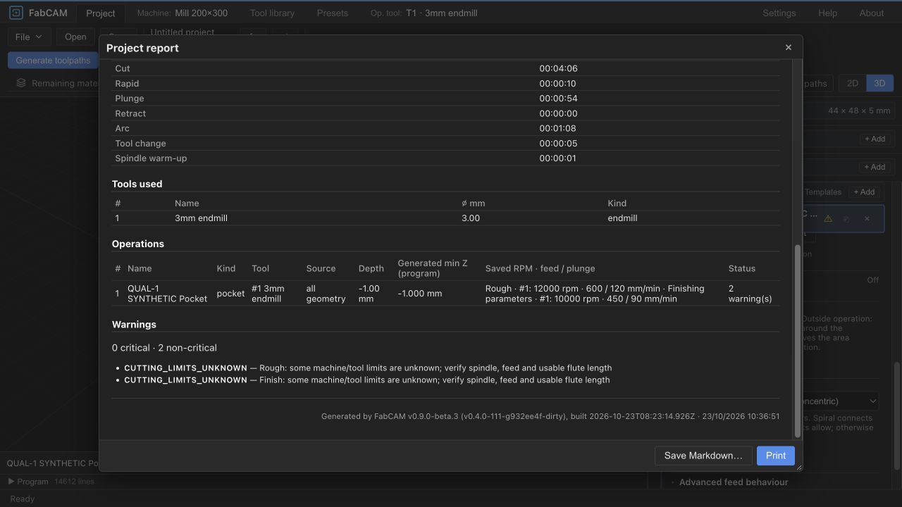

# FabCAM V1.1 — QUAL-1 software qualification and stabilization

2026-10-23 · `FabCAM-v1.1` only · engineering investigation; no publication or hardware.

**NO-GO for unconditional final V1.1 qualification/release.** QUAL-1 quantifies the
native/WASM discrepancy and improves one bounded cancellation mechanism. It does not
waive remaining parity, latency, native-host, file-transfer or physical gates.

## 1. Sources, scope and local commits

- Approved FS-RESET-3 production: `64d75849e3bdc05a2d3ce47c50486ad169058507`.
- Actual starting HEAD: `932ee4f6d5cfae4b2e08ebf008e8f850d635ad4f`; intervening changes
  are documentation only.
- Final qualified software source: `558efc4f7e7cfb5d008c88cf7469a958cc8dc053`.
- Focused local correction: `558efc4` — CPS cancellation checkpoints every 64 records
  instead of 1024; one Rust live-atomic regression and two V8 positive/negative tests.
- This report/evidence/checkpoint commit follows the software commit and changes no
  executable source. Resolve its exact hash with
  `git log -1 --format=%H -- docs/releases/QUAL_1_SOFTWARE_QUALIFICATION.md`.

No geometry, medial-axis, offset, smoothing, machine-motion emission, post safety
preflight or export algorithm was changed. The CPS delta changes cooperative polling
frequency only; uncancelled outputs match exactly. It **does not** establish universal
200 ms cancellation or interrupt long callbacks. No FabSpeed, PRESET-5, v1–8 migration,
main merge, rebase, push, installer, version promotion or hardware operation.

An isolated shared local clone, `../qual-1-checkout`, stayed on `FabCAM-v1.1`.
Diagnostic patches were removed before final tests. Its committed source and clean
tracked index/worktree match `558efc4`. Local reference advancement used a non-forced
fast-forward fetch from the primary checkout; no remote publication or merge.
The original STATUS/ROADMAP edits, two blue-accent frontend edits, user files,
application data, other worktrees and historical V1 evidence are preserved. Initial
hashes/status/worktree snapshots are retained under `dist-test/qual1/start-*`.

## 2. Qualification audit and dispositions

[Initial matrix](qual-1-evidence/initial-matrix.json) was captured before corrections.
[Final matrix](qual-1-evidence/final-matrix.json) carries the results and next actions.

| Gap | Final disposition | Consequence / next action |
|---|---|---|
| Native/WASM medial V-Carve | **OPEN DEFECT / HUMAN DECISION** | Numerical source and geometric effect quantified; strict parity still fails; approve a separately scoped deterministic-arithmetic/simplification design before production changes |
| Cancellation p95 | **OPEN DEFECT** with bounded improvement | Profile improves; Test-medial still 200.353 ms p95 versus unchanged 200 ms target; ShopBot preflight remains non-interruptible |
| Native watcher | **BASELINE LIMITATION / ENVIRONMENT BLOCKED** | Same two tests fail; unrestricted same-source host execution required before assigning a native-platform cause |
| Clean pnpm installation | **RESOLVED for this cached environment** | Node24 isolated frozen install succeeds with 226 cached packages; online registry access remains blocked |
| cargo-deny | **ENVIRONMENT BLOCKED** | Writable advisory cache removes lock failure, fresh GitHub retrieval fails DNS; no current advisory PASS |
| Headless smoke | **ENVIRONMENT BLOCKED** | Chrome found, unchanged smoke attempted; local listeners/CDP unavailable in sandbox |
| Browser project/collection files | **ENVIRONMENT BLOCKED — NOT TESTED** | Prior explicit transfer denial respected; precise manual protocol supplied |
| Installed-native file workflow | **ENVIRONMENT BLOCKED — NOT TESTED** | Static capability/mock file tests are not installed acceptance |
| Three-platform installed acceptance | **HUMAN DECISION — NOT TESTED** | Separate macOS/Windows/Linux runtime evidence; no installer built |
| Physical ShopBot | **HUMAN DECISION — NOT TESTED** | Separate supervised controller/physical qualification |

## 3. Native/WASM V-Carve diagnosis

### Reproduction and source binding

The recorded explicit v9 square and text `Test` fixtures were reused byte-for-byte
from `tests/fixtures/perf-v9`, with manifest hashes verified. Fresh native release
build, Rust 1.88.0 / LLVM 20.1.5 / aarch64 macOS; direct WASM binding on Node
24.21.0 / V8 13.6.233.17-node.53. Each initial backend ran three deterministic repeats.
The same discrepancy exists in the approved pre-removal baseline, as established by
[FS-RESET-3](FS_RESET_3_RESULTS.md); QUAL-1 does not attribute it to removal or Node26.

In the isolated clone only, trace instrumentation captured parsed inputs, prepared
regions, samples, triangulation, circumcenters, medial axes, targets, plan inputs,
sweeps before/after simplification and planned paths, including f64 bit patterns.
Instrumented final responses equal uninstrumented production responses on both
backends for both cases. Trace overhead is never used as performance qualification.

The triangulation EMPTY half-edge sentinel is `usize::MAX`, represented as 64-bit
native versus 32-bit WASM. Its representation was normalized **only in diagnosis**;
all actual triangle/half-edge relationships match. No geometry tolerance was added.

### First meaningful divergence

| Stage | Square | Text `Test` |
|---|---|---|
| Parsed geometry, operation, tool, machine | Exact | Exact |
| Prepared contours, curve approximation, samples | Exact | Exact |
| Triangulation, circumcenters and medial axes/order | Exact after sentinel representation normalization | Exact after sentinel representation normalization |
| Tool half-angle tangent | Exact | `0.5773502691896256` native versus `0.5773502691896257` WASM |
| Target XYZ | Exact | Z differences up to 2.220446049250313e-16 mm |
| Planner segment lengths | `hypot` differs by one ULP, at most 2.7755575615628914e-17 mm in observed inputs | Target/tangent and some `hypot` differences propagate |
| First sweep | One Y differs by 1.7763568394002505e-15 mm | Small numeric differences in target/cut envelopes |
| Exact affine simplification | First differing sweep retains 201 versus 200 knots; point cardinality diverges | Exact comparisons retain different knots on some sweeps |
| Emission | Different subdivisions survive 4-decimal command quantization | Different subdivisions/rounding survive into executable commands |

A standalone standard-library probe, without geometry, serialization, triangulation
or postprocessing, reproduces the arithmetic difference for identical IEEE inputs:

| Function | Input bits | Native result bits | WASM result bits |
|---|---|---|---|
| `tan` | `3fe0c152382d7365` | `3fe279a74590331b` | `3fe279a74590331c` |
| `hypot` | `bfb99999999fba00`, `3fb999999999a300` | `3fc21a18520190e1` | `3fc21a18520190e0` |

Thus target-specific `f64::tan` / `f64::hypot` behavior is demonstrated, rather than
assumed. Exact comparisons in `cam/vcarve_plan.rs::simplify` amplify those tiny
arithmetic differences into retained-point differences. The square's triangulation,
medial-axis topology and initial target are identical; the first cardinality change
is in the planner, not import, curve sampling, or post formatting. Text first diverges
at the tool-angle tangent before target construction. [Stage trace summary](qual-1-evidence/STAGE_SUMMARY.json),
[minimal arithmetic probe](qual-1-evidence/MATH_SUMMARY.json).

### Actual emitted geometry and sequencing

[Measurements](qual-1-evidence/GEOMETRY_SUMMARY.json); complete differing blocks and
input/output pairs remain in `dist-test/qual1/reproduce/`.

| Measurement | Square | Text `Test` |
|---|---:|---:|
| Native / WASM moves | 5376 / 5368 | 18342 / 18351 |
| Cutting moves | 5365 / 5357 | 18280 / 18289 |
| Plunges / rapids, each backend | 3 / 8 | 20 / 42 |
| First differing move (zero-based) | 364 | 136 |
| First differing G-code line (one-based) | 384 | 156 |
| Changed ordered blocks | 8 | 25 |
| First same-index endpoint distance | 0.0144249783 mm | 0.01237457 mm |
| Maximum sampled distance between matched local polylines | 7.944e-15 mm | 8.451520177e-5 mm (0.0845 µm) |
| Native cutting path length | 796.1834146132574 mm | 949.5927299939198 mm |
| WASM cutting path length | 796.1834146132575 mm | 949.5927312039327 mm |
| XYZ extents, both backends | X/Y 0..44.95; Z -1..15 mm | X 0..52.2561; Y 0..26.5313; Z -1..15 mm |

The same-index endpoint distances compare differently subdivided paths; they are
**not** machining deviations. The comparison aligns exact ordered vertices and
measures vertices plus quarter points against the corresponding local polyline.
It is an observational sampled distance, **not a certified continuous Hausdorff or
swept-volume bound** and not an acceptance epsilon. Square changes are collinear
subdivisions. Text additionally has small quantized-polyline differences. Four-decimal
rounding is a relevant scale, not proof that every adversarial case is safe.

Non-cutting moves (including endpoints, kind, operation/tool identity, excluding
shifted G-code line numbers) are exact in both cases. Tool T1, spindle M3/S10000 or
S12000, feed/plunge command sequence, M5/M30, engagement order and SAFE-Z 15 are
unchanged. Total plunge/rapid lengths match; minimum Z remains -1. No reordered
non-cutting motion or tool/spindle substitution was observed. This is software
comparison, not controller timing or physical removal-volume qualification.

### Proposed correction — not implemented

Approve a separate investigation/fix that selects a shared deterministic arithmetic
path for the V-Carve tangent and length calculations, then requalifies the existing
exact envelope/simplification rules on native and WASM. Expected impact: retained
knots and some emitted command subdivisions may change to a chosen canonical output.
Do not choose either backend as oracle without checking geometric intent.

Require adversarial near-collinear axes, near-coincident breakpoints, acute angles,
scale extremes, depth/width caps, tight holes and B8 overcut cases; independently
check envelope/depth/clearance, ordering and swept geometry at emitted precision.
If a tolerance is proposed instead, require a geometric error bound and safety tests,
not a larger epsilon. Existing strict parity remains FAIL until reviewed. No
production V-Carve or postprocessor algorithm correction is authorized by this report.

## 4. Cancellation investigation and bounded correction

Two fixed campaigns were executed, not retried until green. Each has 70 observations:
20 paired Test-medial at 50 ms, 10 paired Profile at 50 ms, five paired Test-medial at
1 ms; alternating control/candidate order and a fresh process per observation.
One discarded warmup per binary/case-delay precedes each campaign. Release build,
no task-owned compilation during measurements; arbitrary OS/user background load is
not controlled (`ps` is denied by sandbox). p95 is the existing nearest-rank rule.

Campaign 1 compares approved pre-removal `951b12f` with fresh starting production
`932ee4f`. Campaign 2 compares `932ee4f` with the exact source committed as `558efc4`.
All 140 observations return Cancelled and no valid result. Warmups and instrumented
phase samples are separate. [All observations](qual-1-evidence/cancellation-observations.json).

| Campaign / case | n per binary | Control median / p95 / max ms | Candidate median / p95 / max ms |
|---|---:|---:|---:|
| Before, Profile 50 ms | 10 | 184.398 / 192.193 / 192.193 | 183.167 / **219.232** / 219.232 |
| Before, Test 50 ms | 20 | 185.570 / 189.632 / 207.848 | 183.510 / 192.145 / 192.240 |
| Before, Test 1 ms | 5 | 1.116 / 2.619 / 2.619 | 0.209 / 0.904 / 0.904 |
| After, Profile 50 ms | 10 | 200.151 / **228.536** / 228.536 | 141.603 / 152.416 / 152.416 |
| After, Test 50 ms | 20 | 201.095 / **217.956** / 231.934 | 172.507 / **200.353** / 240.209 |
| After, Test 1 ms | 5 | 0.600 / 0.736 / 0.736 | 0.580 / 0.717 / 0.717 |

The interval change improves the representative dispatch latency, with no claim of
statistical isolation from all host variation. It is independently justified by the
new deterministic bound of at most 64 subsequent record checkpoints before observing
a live cancellation. The V8 negative regression fails before the change and passes
after; uncancelled checkpoint output is identical; Rust exercises the live AtomicBool.
Existing pre-cancel/no-parse, error-text anti-forgery, runtime budgets and output
preservation tests remain. CPS suite: 52 Rust tests pass (including trust tests);
new V8 regressions 2/2 pass; strict CPS Clippy and formatting pass.

Phase traces rule out context creation as the dominant cost (~0.2–1.4 ms observed);
IR conversion is ~15–25 ms and bundle evaluation ~14–25 ms in these diagnostic runs.
The remaining delay is inside `execute`. More focused probes measure `onOpen` at
135.520–137.791 ms for Profile and 175.791–175.960 ms for two Test observations;
one Test observation cancels before entering `onOpen`. The first following cancellation
checkpoint arrives ~1.6–3.6 ms after `onOpen` ends. ShopBot `onOpen` calls its complete
record-by-record safety `preflight()` before output, with no cancellation checkpoint
inside that traversal. [Phase observations](qual-1-evidence/cancellation-stage-observations.json).

This identifies a long non-interruptible safety-preflight callback in addition to
polling cadence and host variability. No preflight guard was moved, skipped or weakened.
Changing this safety traversal is left for separate review: add cooperative abort
points without omitting any check on uncancelled execution; prove unchanged refusals,
no partial/stale publication, cleanup and output equality. Parsing, conversion and
other long callbacks remain non-preemptible. **Global 200 ms p95 remains FAIL**, and
WASM main-thread/browser-worker latency is not measured by this native campaign.

## 5. Environment gates and watcher

Node24 is now installed; the primary run uses v24.21.0 and pnpm 10.34.7. A fresh clone
install with an empty writable store first fails on registry DNS. Copying the existing
pnpm store into `/private/tmp/fabcam-qual1-copied-pnpm-store` permits a fresh offline
frozen installation: **226 reused, zero downloaded**, unchanged lockfile. The final
canonical `pnpm install --frozen-lockfile` also uses that copied store, without adding
`--offline` or suppressing a criterion. Existing node_modules/cache are untouched.
The package manager's existing ignored esbuild script warning is retained.

`cargo-deny` 0.20.2 supports `[advisories].db-path` in its installed configuration
schema. A temporary copy of deny.toml changes only this cache path to a writable
temporary directory. Lock failure disappears; GitHub advisory-db cloning fails DNS.
No stale/offline advisory data, allow-list change or disabled check is called PASS.
The canonical final gate still records its actual default-cache outcome.

Installed Google Chrome is found and exposed as `google-chrome` through a trivial
wrapper. The **unchanged** smoke script executes and uses its own temporary profile;
CDP/preview cannot be reached. An independent Node loopback bind reports `listen
EPERM 127.0.0.1`. A user-started Vite server and interactive browser review do not
substitute for this failed mandatory smoke. [Host procedure](qual-1-evidence/MANUAL_ACCEPTANCE.md).

An initial complete preliminary gate in the fresh clone also finds a missing
`frontend/dist` required by Tauri's compile-time `generate_context!`. Its later
frontend build supplies that prerequisite. This is preserved as a preliminary log,
not hidden or counted as the final source result. The final rerun follows the actual
source correction and repaired build prerequisite, not a timing retry.

The unchanged watcher tests `debounce_collapses_rapid_writes` and
`single_path_emits_event` retain their existing event assertions and two-second
boundary. Their prior equal pre/post-FS2 failures remain established by
[FS2 acceptance](FS_RESET_2_FINAL_ACCEPTANCE.md). No unrestricted native host is
available to establish whether sandbox delivery alone causes them. No polling
fallback, filtering, skips or timeout increase was introduced.

## 6. Final-source mandatory gate

**17/20 PASS; exit 1.**

| Mandatory gate | Final result |
|---|---|
| Rust formatting | PASS |
| Workspace strict pedantic Clippy, all targets/features | PASS |
| Workspace tests, all features | FAIL — two unchanged native watcher tests |
| Schema check | PASS |
| Version check | PASS |
| README parity | PASS |
| pnpm frozen install, Node24/copied cache | PASS |
| Generated TypeScript drift | PASS |
| i18n key drift | PASS |
| Frontend lint/Prettier | PASS |
| Frontend Svelte/TypeScript | PASS — 0 errors / 0 warnings |
| Full frontend tests | PASS — 1492, 1 existing optional locale skip; 171 files |
| Frontend production build | PASS — existing large-chunk advisory retained |
| WASM web release build | PASS |
| WASM CPS size guard | PASS — +1589 KiB gzip; unchanged 1700 KiB limit |
| cargo-deny, all four checks | FAIL — default advisory lock read-only; alternate writable path blocked by GitHub DNS |
| Unmodified headless UI smoke | FAIL — Chrome aborts, CDP connect EPERM; no supported sandbox execution |
| Real CLI SEC1 + NUMSAFE3 probes | PASS |
| SEC1 release-boundary regressions | PASS |
| Candidate identity regressions | PASS — 4 tests |

The final canonical script is unchanged, with Node24, copied pnpm store, cached
matching WASM tools, `CARGO_INCREMENTAL=0`, `RUSTC_WRAPPER=''`, installed Chrome wrapper.
[Final pre-release log](qual-1-evidence/final-pre-release.log). All 20 criteria remain
mandatory; failure is not a release waiver.

## 7. Additional contracts, output and safety qualification

The final `--workspace --all-features --no-fail-fast` run executes every target and
doctest: **1576 PASS, 2 FAIL, 1 existing ignored worker**. Only the two watcher tests
fail. The ignored TEST1 worker is deliberately executed by its external watchdog
below; no new exclusion was introduced. Optional external FANUC oracle fixtures in
`refs/cam-posteditor` are absent in both checkouts; existing early-return tests do
not establish that proprietary-oracle coverage. [Workspace receipt](qual-1-evidence/workspace-summary.json).

| Additional final-source qualification | Result and scope |
|---|---|
| TEST1 with C2 | **256/256 PASS** in 27.691 s: 224 Rust property cases plus 32 frontend lifecycle schedules; unchanged 120 s stage / 10 s worker bounds; zero timeouts. Bounded properties do not establish complete SAFE-Z qualification |
| Real WASM adapters / cutting serialization | **7/7 PASS**, three files; full-program clean/colliding simulation on both faces and explicit v9 role contracts; direct Node/WASM, not installed runtime |
| Full fixed CLI output corpus | **23/23 exact** against established pre-removal fixtures: 22 buffered explicit requests compare G-code, toolpath, tool provenance, line index and stats; one two-sided streaming case compares both published texts with its existing limitations |
| Native pre/post cancellation fix | **18/18 unchanged** LinuxCNC/ShopBot PERF cases, including identical B8 refusal; two deterministic post-fix repeats per case |
| Final WASM pre/post source comparison | **9/9 unchanged** LinuxCNC cases, three repeats each; eight complete outputs exact in the five fields above and the B8 refusal unchanged |
| Strict native/WASM parity | **FAIL**, unchanged checker stops at square toolpath cardinality; the separate complete nine-case comparison also retains the text discrepancy. Six successful programs match, two medial programs differ, one refusal matches |
| Numeric / SAFE-Z / provenance | NUMSAFE 7, NUMSAFE2 9, NUMSAFE3 8; hatch SAFE-Z 14, extended SAFE-Z 15, provenance 12 — all PASS within the full workspace run |
| ShopBot and native publication | ShopBot M1 11 and M2 31, CPS 52, native file export 11 — PASS; static Tauri boundary and frontend freshness/partial-publication tests also pass in the canonical run |

[Additional command exits](qual-1-evidence/additional-exits.json),
[TEST1 receipt](qual-1-evidence/test1-summary.json),
[CLI comparison](qual-1-evidence/cli-corpus-summary.json),
[native comparison](qual-1-evidence/FIX_OUTPUT_COMPARISON.json),
[final WASM comparison](qual-1-evidence/FINAL_WASM_COMPARISON.json).
The orchestration wrapper preserves failed subprocess exits and continues collecting
evidence; its own zero exit is **not** a workspace or parity PASS. The strict parity
failure is retained verbatim. Neither output references nor acceptance thresholds
were changed. No unexplained new output difference remains after the polling fix.

Retained safety ownership includes neutral per-role cutting validation, explicit
known-limit refusals/unknown-rating disclosure, specialized mandatory restrictions,
SAFE-Z/work origins, numerical/resource budgets, tool provenance, full-program
simulation, stale-result rejection and project v9 persistence. No recommendation
engine, live preset link or implicit generation-time defaults return.

Native `ivac-file-export`, Tauri request/dialog-derived filesystem authorization,
transactional writes and two-sided partial-publication reporting retain their code
and negative tests. A published first side followed by second-side failure remains
explicitly partial, never overall success. CLI `stream-gcode` retains its documented
non-buffered limitations: it does not acquire the buffered full-program qualification;
stdout/HTTP bytes cannot be rolled back. No streaming software test is reported as
full physical/controller acceptance. Bundled-only CPS and ShopBot restrictions remain.

## 8. Persistence, UI and remaining acceptance

[Limited UI review](qual-1-evidence/UI_REVIEW.md) covers new project, actual rough/finish
values, synthetic named collection/attestation, reviewed copy, independent secondary
roles, invalid inputs, full simulation, work-origin refusal, stale export and actual
report values. The actual file save/reopen and collection import/export flows remain
**NOT TESTED**. Prior browser file-transfer denial was not bypassed. Native stat/size,
cancel/malformed/collision/failure preservation and ACL checks are automated/static
only; installed native acceptance remains pending. [Exact manual protocol](qual-1-evidence/MANUAL_ACCEPTANCE.md).

Desktop and narrow report inspection finds dense combined value cells, long warnings,
technical codes and duplicated role prefixes. Warnings are accessible and invalid/
stale export remains blocked. Improvements are recorded for a later milestone;
no general redesign or warning-concealment fix was made. Existing Sol UX and MAT-1
are preserved, including the user's uncommitted visual accent changes.

## 9. Evidence, limitations and human decisions

Raw logs, input/output pairs, 46+ MiB stage traces, native binaries and fingerprints
remain under `dist-test/qual1/`. Compact committed receipts and reconstruction scripts
are in [qual-1-evidence](qual-1-evidence/README.md); `RAW_SHA256SUMS.json` fingerprints
the local raw artifacts. Scripts are diagnostic tools, not replacements for gates.

QUAL-1 is complete as a source-bound engineering investigation with the receipts
above. It is **NO-GO for unconditional software/release acceptance**.
The next approved work must address these explicit blockers:

1. Human review of the V-Carve arithmetic/simplification correction design and its
   expected machine-output changes; retain failing parity until independently qualified.
2. Human review of cancellable ShopBot preflight traversal, preserving every safety
   restriction and transactional/stale-publication guarantees; retain 200 ms p95.
3. Run the unmodified gates on an unrestricted, online Node24 host with native events,
   fresh RustSec data and working Chromium/CDP; preserve exact source identity.
4. Perform the documented actual browser/native file round-trips and installed
   three-platform acceptance; separate supervised physical ShopBot evidence remains.
5. Maintainer architectural/final V1.1 acceptance remains open (`ivac-y25vq`).

**HARD STOP.** No next milestone, FabSpeed API, extra CAM feature, report redesign,
PRESET-5, installer, main merge, version promotion, publication or machine operation
is started by this handoff.
