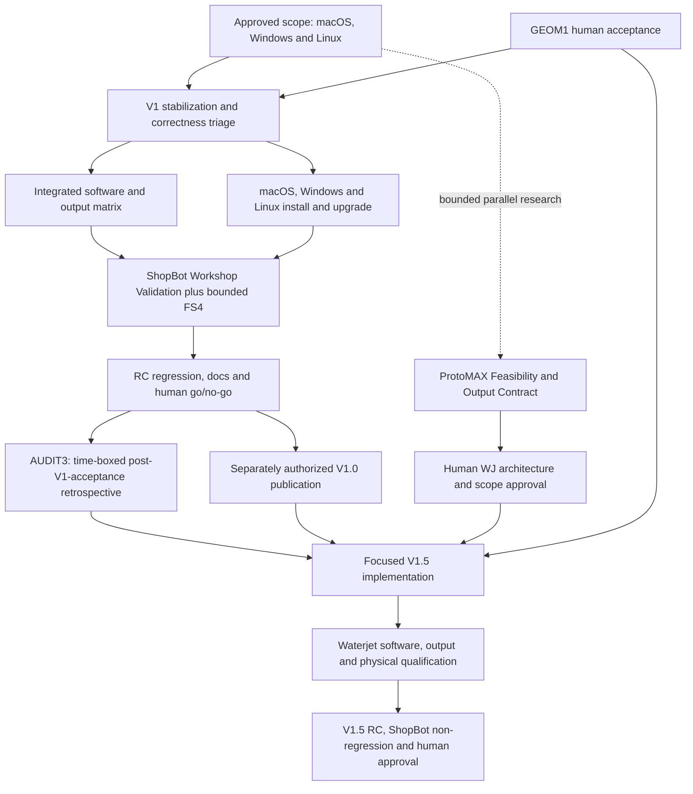

# FabCAM release roadmap — approved direction

> Source publication — 2026-10-17: user authorized commit/push of all pending
> changes. Current source version is **0.9.0-beta.2**; existing beta.1 installers
> and validation records retain their original versions. Earlier publication
> restrictions are superseded for this source checkpoint only; human/physical
> review gates remain open. No workflow dispatch, tag or Release.

> Current checkpoint — 2026-10-16: [REL1-B1 local packaging preparation](v1-stabilization-campaign/REL1_B1_RESULTS.md) complete: arm64 community DMG, strict ad-hoc/identity/integrity and SHA-256 PASS; workflows linted, no dispatch. Clean-download/install/runtime on the other Mac NOT TESTED and still V1-blocking. Developer ID/notarization remain optional POST-V1. Windows/Ubuntu Monday plans unchanged. HARD STOP for review; no commit/push/publication or transmission.

> Historical checkpoint — 2026-10-16: Phase 0 and simple beta-installation transition approved. [REL1-A implemented locally](v1-stabilization-campaign/REL1_A.md): FabCAM public package names, stable data identity, strict ad-hoc signature and native reopen PASS on macOS. No publication. Human review gate before UX7, then UX6-C; distribution remains UNQUALIFIED.

> Historical Phase 0 audit — 2026-10-16: UX7 generation timing, UX6-C bounded UI consistency, REL1-A public packaging identity, REL1-B macOS distribution blocker. [Phase 0 audit](v1-stabilization-campaign/PHASE0_AUDIT.md); implementation awaits explicit installer-identity transition decision. No RC/release qualification.

> Historical 2026-10-16 checkpoint: [desktop candidate preparation](DESKTOP_CANDIDATES.md).
> Stabilization accepted. macOS DMG built; Windows/Ubuntu candidates not yet built.
> Host availability expected Monday 19 October; installation/runtime gates remain open.

Current development version: **0.9.0-beta.1**, V1 stabilization beta.
[Version decision and progression](VERSIONING.md); 1.0 release gates remain open.

> Historical 2026-10-15 checkpoint: [bounded stabilization corrections](V1_STABILIZATION_RESULTS.md),
> following explicit user approval. Windows 11 x64 and Ubuntu 26.10 amd64 remain
> required alongside macOS; actual desktop installation/runtime gates remain open.
> GEOM1 human review is still pending. HARD STOP before the next checkpoint.

2026-10-15 · Documentation only · Local tracking ivac-7m4al.
**ROADMAP APPROVED with amendment: V1 requires macOS, Windows and Linux.**
Human approval recorded 2026-10-15 (ivac-zgmds). No release date, feature launch,
platform qualification or publication is implied; independent gates remain open.

## Executive summary

Make FabCAM 1.0 a practical ShopBot milling application: a small, explicit set of
import-to-OpenSBP workflows, installed desktop use, reliable saved projects and
representative supervised workshop validation. FabCAM 1.5 adds a bounded ProtoMAX
workflow after confirming its actual output contract. FabCAM 2.0+ retains advanced
manufacturing work without making it a prerequisite for either release.

Preserve useful existing features. Reduce promises and expansion, not safety checks.
FabCAM prepares machining intent and output; the operator/controller establishes
physical state and executes. Neither release requires FabSBP.

## Current project maturity

The [current engineering status](../shopbot-modernization/STATUS.md) and dated
qualification records remain authoritative evidence. The old roadmap accumulated
historical “pending” and “not implemented” statements later superseded by continuation
records; they are retained as history, not used as current release status.

| Maturity | Verified repository evidence / consequence |
| --- | --- |
| Implemented, bounded software qualification and continuation accepted | M0–M4 foundation; UX1, CAM2/UX2/UX2.1, CAM3, CAM4 A/B, CAD1, UX3, UX4/4.1, UX5, bounded V-Carve, PERF1 A/B1/B2, UX6 Phase 0/A/B. Acceptance does not broaden each report's matrix. |
| Implemented with open review | GEOM1 A–F engineering complete; ivac-e2jnb open. FS3.6–3.9.1 independent review gates and UX2.2/native/hierarchy gates remain. |
| Partial qualification | Curved rectangular tabs can retain excess stock; medial-axis V-Carve has incomplete area coverage; cancellation target missed; latest integrated desktop installation not qualified. |
| Planned, not implemented as qualified capabilities | GEOM2-A/A1/B, GEOM3, NEST1/2, two-sided registration, paired inlays, waterjet. Inherited code is not release qualification. |
| Physically validated, narrow historical scope | [M4 r2](../shopbot-modernization/M4_VALIDATION.md): operator-confirmed Preview, air cut and MDF square cut, qualitative dimensional/depth conformity and VCarve semantic comparison. No instrument readings or general machine envelope proof. |
| Physically untested additions | Post-M4 CAM/geometry/FS additions have software evidence only. FS4 remains deferred for lab access. Neither current V1 nor ProtoMAX has release-level workshop qualification. |
| Current correction checkpoint | Bounded XOR/Pocket, project-tool, text-reopen and WASM integrity fixes delivered; see stabilization results. Three-platform candidate and workshop qualification remain pending. |

GEOM1's latest recorded checks are 1198 core, 23 focused references overlapping that
suite, 44 CPS and 1312 frontend passes with one existing skip, plus build/schema/lint
checks. These are historical [GEOM1 results](../shopbot-modernization/GEOM1_RESULTS.md),
not tests rerun for this planning task and not a release certificate.

## FabCAM 1.0 — ShopBot Milling

[Scope, operation and acceptance matrices](FABCAM_V1_SCOPE.md) define the proposed
minimum. Required: reliable SVG/DXF, bounded GEOM1 cleanup, single-sided stock/XY
origin with existing Z restrictions, machine/tool copies, manual cutting values and
limited explainable FS assistance, Profile/Pocket/Drill, resolved preview, fail-closed
OpenSBP, persistence, a tested desktop package, docs and workshop evidence.
Keep already delivered surfacing, tabs/leads, dogbones and V-Carve within their
explicit matrices; broader variants are not blanket release blockers.

## V1 acceptance matrix

Use the [V1 matrix](FABCAM_V1_SCOPE.md#v1-acceptance-matrix) as the review sheet.
“Software qualified,” “human accepted” and “physically validated” are independent.
Every advertised supported operation needs release-level evidence; optional features
without it remain explicitly limited/software-only, subject to human scope approval.

## V1 required work

1. Apply the approved release scope and macOS/Windows/Linux platform requirement;
   resolve the GEOM1 human gate without closing independent approvals. Freeze the
   exact operation and OS/version/architecture/package test matrix.
2. Triage existing correctness risks on the current tree: tool identity, deep nested
   Pocket and XOR, then text-only reopen and rough/finish RPM refusal. Fix or explicitly
   exclude/refuse affected cases before claiming support; never mask changed intent.
3. Qualify the selected matrix end-to-end on one candidate across the three required desktop platforms: exact geometry, saved
   parameters, decoded output, preview, refusal and stale/critical export checks.
4. Qualify clean install and upgrade on macOS, Windows and Linux; run the minimal
   workshop campaign using that candidate and reviewed real machine configuration.
5. Freeze an RC, finish user docs/limits, rerun affected regressions after fixes and
   record a human go/no-go. Publication requires separate explicit authorization.

This is stabilization, not a new broad architecture program. Existing ADRs remain:
[post](../shopbot-modernization/adr/ADR-0001-shopbot-cps.md),
[FS ownership](../shopbot-modernization/adr/ADR-0003-feeds-speeds-data-ownership.md),
[private sources](../shopbot-modernization/adr/ADR-0005-source-packs-and-cutting-knowledge.md),
[resolved preview](../shopbot-modernization/adr/ADR-0007-shopbot-resolved-preview.md),
[coordinates](../shopbot-modernization/adr/ADR-0008-work-origin-frames.md),
[job intent](../shopbot-modernization/adr/ADR-0009-job-intent-machine-setup.md),
[geometry identity](../shopbot-modernization/adr/ADR-0021-edited-drawing-contract.md).
No parallel geometry engine, hidden rate recalculation, post-specific repair or
serialization change is proposed here.

## V1 conditional features

GEOM2-A1 exact whole-file Width/Height is useful but existing uniform Scale and
external SVG/DXF preparation provide a path. Cost is bounded but nontrivial: edited
bounds, frozen pivot, identity, history and freshness tests are required. Include only
if a demonstrated sizing workflow justifies it. No full GEOM2-A prerequisite.

Existing surfacing, relief, V-Carve and reusable templates are retained. Expanding
these, tightening cancellation below 200 ms or broadening UI polish is conditional
on a measured task-completion/safety problem. Cosmetic completion is not a gate.

## V1 deferred features / classification register

Categories describe release necessity, not implementation effort. Cost labels below
are qualitative remaining work, not estimates or authorization. “Retain” never means
remove existing code. This register covers the existing roadmap families and their
named refinements; detailed historical acceptance criteria remain linked below.

| Existing item | Category | Disposition and rationale | Remaining cost / dependency |
| --- | --- | --- | --- |
| M0–M4 foundation | V1 REQUIRED | Retain; core geometry/post/machine evidence, narrowly scoped physical baseline | Integration + new workshop evidence; medium |
| FS0/FS1/FS2/FS3/FS3.5 | V1 REQUIRED | Retain engine/data/manual-value persistence; usable conservative assistance | Acceptance/persistence review; low–medium |
| FS3.6, FS3.7, FS3.8, FS3.9, FS3.9.1 | V1 REQUIRED | Retain bounded existing UX, provenance, approximate matching, private packs and presets; close relevant reviews, no dataset expansion | Existing human gates; medium verification |
| FS3.9 sensitivity follow-up | EXPERIMENTAL / RESEARCH | Preserve audit; continuity/math changes not required for ordinary workflow | Separate evidence/approval |
| FS4 minimal selected trials | V1 REQUIRED | Required before recommending real ShopBot use of selected settings; software work remains unblocked | Lab/operator; medium, physical |
| FS4 exhaustive coverage | POST-V1.5 | No comprehensive material/tool database requirement | High, ongoing evidence |
| FS5 diagnostic assistant | POST-V1.5 | No necessary role in first complete workflow | New evidence/UX; high |
| UX1 / CAM2 / UX2 / UX2.1 | V1 REQUIRED | Retain entry, single-sided coordinates, fixtures and safeguards | Integrated candidate matrix |
| UX2.2 shell/welcome, Drawings/Layers, preview navigation | V1 REQUIRED | Retain usable new/open/import and clear selection; native review remains | Native/keyboard review; low–medium |
| Hierarchy/cosmetic follow-ups | V1 CONDITIONAL | Keep delivered polish; further changes only for comprehension/accessibility defects | Human review; low |
| CAM3 tabs/leads/direction | V1 REQUIRED | Bounded ordinary Profile combination; no unrestricted topology promise | Workshop matrix; medium |
| CAM4 A/B residual diagnostics | V1 CONDITIONAL | Retain depth-scoped diagnostic; not a proof of complete stock removal | Existing scope sufficient; no expansion |
| CAD1 / CAM4 C dogbones/T-bones | V1 CONDITIONAL | Include limited existing capability; not mandatory to cut ordinary parts | Physical sample if advertised workshop-qualified; medium |
| UX3 surfacing | V1 CONDITIONAL | Keep bounded raster, useful workshop task; not required to surface every stock geometry | Physical coverage/overtravel trial if included; medium |
| UX4 / UX4.1 templates | V1 CONDITIONAL | Retain existing local templates; extensive recipe automation unnecessary | Existing behavior regression; low |
| UX5 palette | V1 REQUIRED | Retain accepted workflow and keyboard access; no expansion | Integrated UI review; low |
| UX6 Phase 0/A/B | V1 REQUIRED | Accepted machine/profile/tool ownership UX; test persistence and identity | Native verification + defect triage |
| V-Carve A1–A4 / final diagnostics | V1 CONDITIONAL | Include bounded groove/spine modes as limited; no arbitrary clearing promise | Text reopen triage + physical sample if advertised; medium |
| Advanced V-Carve / paired inlays | EXPERIMENTAL / RESEARCH | Current coverage partial; paired fit unqualified, defer to 2.0+ | High geometry + physical evidence |
| PERF1-A/B1/B2 | V1 REQUIRED | Retain measured exact-input reuse; representative performance acceptance | RC measurement; medium |
| CPS cancellation improvement | V1 CONDITIONAL | Retain safe result suppression; 200 ms target missed is not automatically unsafe | ivac-nh6q review; stronger boundary may be costly |
| GEOM1 | V1 REQUIRED | Bounded repairs already implemented; common import failures justify inclusion | Human acceptance + integrated checks, no rewrite |
| GEOM2-A1 precise dimensions | V1 CONDITIONAL | Existing scale is usable; include only for demonstrated exact-size need | Low–medium with ADR-0021 compatibility proof |
| GEOM2-A full transforms | POST-V1.5 | Existing whole-file transforms suffice initially | Shared editing audit; medium–high |
| GEOM2-B basic drawing | POST-V1.5 | External CAD/import sufficient | Qualified transforms/source creation; high |
| GEOM3 advanced utilities | POST-V1.5 | Select individually later, not a full CAD program | Per-tool topology proof; high |
| NEST1 manual sheet layout | POST-V1.5 | Existing manual file positioning can suffice for first waterjet workflow | GEOM2-A/instances; medium–high |
| NEST2 true-shape / multi-sheet | POST-V1.5 | Optimization not a first-release requirement | NEST1 + independent constraints/license audit; high |
| Common-line cutting | EXPERIMENTAL / RESEARCH | New process/topology/order risks; not included in initial nesting | High; WJ evidence first |
| Two-sided machining/registration | POST-V1.5 | Keep inherited code explicitly unqualified for ShopBot; single-sided V1 | Separate frames/registration/physical tests; high |
| Rest machining / advanced residual analysis | POST-V1.5 | Current diagnostic does not establish cleanup paths | Reliable removal model + separate CAM proof; high |
| WJ feasibility/process/output/corpus/target-software/physical | V1.5 REQUIRED | First useful ProtoMAX contract, then bounded workflow; output unknown now | Feasibility first; effort unknown |
| VINYL / other processes / broader posts | POST-V1.5 | Retain inherited functions without extending release support claims | Separate process matrices |
| FabSBP job metadata/shared profiles/setup automation | POST-V1.5 | Apps independently useful; controller responsibility stays separate | Explicit cross-project contracts |
| Future measurements / background tracing / advanced automation | POST-V1.5 | Existing selected bounds and external CAD suffice | Individually scoped; no new milestone invented |
| Open correctness/build/persistence issues | TECHNICAL DEBT / DEFECT | Severity by supported-workflow impact, never hidden by feature labels | Triage table in V1 scope |

## FabCAM 1.5 — ProtoMAX Waterjet

[Bounded scope and acceptance matrix](FABCAM_V1_5_SCOPE.md). Reuse process-independent
GEOM1 and positioning; add explicit waterjet intent and confirmed output. No automatic
nesting, fake milling tools, direct machine control or mandatory FS dependency.

## ProtoMAX early feasibility gate

**ProtoMAX Feasibility & Output Contract** is a bounded proposed documentation/research
checkpoint in the existing WJ track. It can run alongside V1 stabilization, after
separate authorization, without competing with critical ShopBot fixes. Obtain exact
machine/software versions, lawful format references and an actual accepted sample;
assign parameter ownership and prove the transfer/import workflow. Unknown output is
currently a V1.5 blocker, not a reason to invent OMX or assume G-code acceptance.
This checkpoint plans that investigation; it does not establish a verified contract.

## V1.5 acceptance matrix

See [the separate waterjet matrix](FABCAM_V1_5_SCOPE.md#v15-acceptance-matrix).
All process/output/hardware gates remain unqualified. ShopBot non-regression is a
mandatory V1.5 gate. Target-software preview is distinct from independent decoding.

## FabCAM 2.0+ roadmap

GEOM2/3 beyond any approved A1 minimum; NEST1/2 and multi-sheet optimization;
common-line research; two-sided registration; complete-area V-Carve and inlays;
rest machining; extensive templates; additional processes/posts; optional FabSBP
interoperability. Retain plans and IDs, no dates or bundled commitment to all items.
Existing useful capabilities remain in the application with honest support labels.

## Dependency graph

Solid arrows show prerequisites; AUDIT3 arrows only sequence the post-acceptance
retrospective before main V1.5 implementation and do not block V1 release. Research need not wait for V1
publication, but implementation effort stays behind V1 stabilization. Workshop
failures return to a bounded fix and affected requalification before RC approval.
No arbitrary calendar dates; operator access and output evidence are real dependencies.

## Release readiness / packaging plan

**macOS, Windows and Linux are all V1 REQUIRED**, per human approval on 2026-10-15.
Each requires a usable desktop package and actual install/upgrade/runtime qualification
of the supported ShopBot workflow. Failure on any declared target blocks V1. Existing
macOS evidence is historical; Windows/Linux build infrastructure is not candidate
qualification. Exact OS versions, CPU architectures, Linux distributions and package
formats will be pinned in the next scope checkpoint; this is not support for every
variant. macOS Apple Silicon remains the initial macOS test candidate. No app identity
or version changes here. See the [packaging plan](FABCAM_V1_SCOPE.md#packaging-and-documentation).

## Release-blocker policy and definition of done

**Release blocker:** incorrect/unsafe output, silent geometry/binding or work-origin
changes, corrupted/lost project/tool data, export safeguard bypass, unsupported output
presented as valid, essential workflow impossible, or failed install on a declared
supported platform. An unresolved credible correctness risk blocks the affected
support claim until reproduced and resolved or explicitly excluded with an effective
refusal. A release cannot hide blockers in a generic debt bucket.

**Important but potentially deferrable:** advanced-case explicit refusal, moderate
UX inconvenience, uncommon tool types and performance outside representative loads.
**Future enhancement:** nesting, advanced CAD/simulation, automation and new processes.
Severity follows observed impact and scope, not existing Beads priority alone.

For each release-critical milestone: implementation, targeted independent tests,
relevant regressions, no known unsafe output within scope, persistence checks,
relevant UI review, limits documented, accurate STATUS/ROADMAP and human approval.
Physical milestones additionally require actual operator evidence tied to candidate,
machine/tool/setup and agreed measurements. Software success cannot close them.

With the roadmap approved, additions require an explicit necessity/safety/effort/regression/
V1.5-delay assessment and human scope-change approval. No automatic feature promotion
because it is interesting or nearly finished. The same rule bounds V1.5.

## Proposed roadmap file changes

- `docs/shopbot-modernization/ROADMAP.md`: concise release overview above preserved historical milestone plan.
- `docs/shopbot-modernization/STATUS.md`: current planning checkpoint, unchanged engineering/human gates.
- `docs/shopbot-modernization/DEVLOG.md`: append-only planning record.
- `docs/shopbot-modernization/README.md`: entry links to release review documents.
- `docs/shopbot-modernization/FUTURE_PROCESSES.md`: current WJ release placement above preserved historical assessment.
- `docs/releases/RELEASE_ROADMAP.md`: this proposal, classification, dependencies and approval decisions.
- `docs/releases/FABCAM_V1_SCOPE.md`: milling acceptance, triage, workshop, packaging and documentation.
- `docs/releases/FABCAM_V1_5_SCOPE.md`: waterjet feasibility, parameter ownership and acceptance.

## Existing human gates

Read-only local tracker snapshot 2026-10-15; no gate closed by this planning task.

| Gate | Current disposition |
| --- | --- |
| ivac-e2jnb | GEOM1 software/UX acceptance OPEN; first existing review to complete |
| ivac-tm7u / ivac-7yii | FS3.7 source/licensing and FS3.8 local evidence workflow OPEN |
| ivac-t0fk / ivac-anp0 / ivac-vgu4 | FS3.9 policy, FS3.9.1 and FS3.6 visual reviews OPEN |
| ivac-ein1 / ivac-1drzo | UX2.2/native and hierarchy review OPEN; no cosmetic redesign implied |
| ivac-nh6q | Cancellation improvement/remaining target review OPEN; ivac-q1nz1 investigation deferred |
| FS4, V1 Workshop Validation | Physical work deferred/unperformed for current scope; new release gate proposed, not completed |
| V1.5 ProtoMAX physical / release approval | Proposed future gates; no qualification |

UX5/V-Carve/PERF1 A/B1/B2/UX6 approvals already recorded remain accepted; older
report headers do not reopen them. Earlier source publication authorization does not
authorize a new commit, branch, version bump, release or machine trial here.

## Suggested next milestone

**V1 Scope Freeze & Release-Blocker Triage** has delivered its [handoff](V1_SCOPE_FREEZE_TRIAGE.md).
The next proposed milestone is the bounded stabilization lot: geometry correctness,
tool/text lifecycle and release asset integrity, followed by platform qualification.
GEOM1 human acceptance remains open; implementation needs lot approval.
GEOM2-A1 is not the automatic next engineering step.

## Approval recorded and remaining execution decisions

The user approved the roadmap on 2026-10-15 with one amendment: **Windows and Linux
are required for V1 alongside macOS**. This supersedes the initial macOS-first policy.
The release classifications, bounded capabilities and stabilization direction are
accepted planning; existing software/UX and physical gates are not thereby closed.

The next checkpoint must pin supported OS versions/architectures, Linux distributions
and package formats, operation claims and candidate acceptance evidence. Actual
workshop materials/tools/tolerances/rates remain operator decisions. GEOM2-A1 remains
conditional; no automatic launch of it or WJ research follows this approval.

**HARD STOP — roadmap approved; no next milestone, build campaign, physical trial or
release started by this documentation update.**

## REL1-B revised release gates — approved 2026-10-16

| Milestone | V1 priority | Acceptance / state |
| --- | --- | --- |
| REL1-B1 Community macOS distribution | REQUIRED | Valid ad-hoc FabCAM DMG, verified identity and SHA-256, clean browser-download/install/runtime with documented per-app Open Anyway where needed; local packaging preparation complete; clean-host qualification pending. Packaging, integrity and failed/missing clean-install checks block release. |
| REL1-B2 Developer ID / notarization / stapling | OPTIONAL POST-V1 | Missing membership, Apple identity or ticket does not block V1. No credentials/services configured now. |

GitHub Release distribution and checksum publication require separate explicit approval.
Never disable Gatekeeper or remove quarantine. Windows/Ubuntu test plans remain unchanged.

## AUDIT3 — post-V1 Git history and defect-provenance retrospective

**PLANNED — NOT STARTED · POST-V1 APPROVED RELEASE checkpoint, not a V1 blocker.**
After explicit human acceptance of validated FabCAM 1.0, use its frozen accepted
commit/tag and retained evidence for [AUDIT3](AUDIT3_PLAN.md), before main V1.5
implementation. Existing release/audit identifiers and gates are preserved; current
0.9.0-beta.2 is not the approved V1 historical endpoint. V1.5 ProtoMAX stays the
next product-development priority; authorized early feasibility is not interrupted.

Time box proposed at three engineering days, confirmed at launch. Evidence gaps
remain visible at expiry; extension requires human scheduling approval. Consolidate
Argon/Astra confirmed defects, deduplicate root causes and classify provenance with
historical/test support and confidence. Separate root cause from exposure, counts
from unresolved suggestions, and audit distribution from overall project defect rate.
Technical report, executive summary, charts/tables, engineering retrospective and
unpublished factual public draft require human review and accurate upstream/GPL credit.

Dependencies: accepted V1 reference/approval/evidence, accessible upstream/fork history
and finding/fix/test records. Newly identified critical regressions are separately
triaged/tracked only when authorized, without silently reopening V1 scope. No audit,
Git history investigation, issue/tag/release creation or publication in this roadmap
update. **HARD STOP — awaiting human approval of this addition.**
