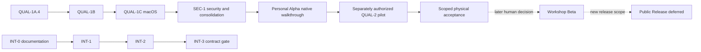

# FabCAM release roadmap

**Role:** one release plan, with ordered scope and acceptance boundaries.
[Current STATUS](../shopbot-modernization/STATUS.md) owns the inspected source and
active work; [consolidation/classification](ROADMAP_CONSOLIDATION.md) owns this
cleanup's provenance. Planning does not authorize implementation or release.
Status vocabulary: **COMPLETED**, **IN PROGRESS**, **PLANNED**, **BLOCKED**,
**SUPERSEDED**, **DEFERRED**, **HISTORICAL**. COMPLETED engineering is not human,
installed-platform, physical or publication acceptance. The Personal Alpha strategy
below supersedes the earlier immediate public-RC plan; dated reports keep their
original outcomes and scope.

## Current focus — FabCAM V1.1 macOS Personal Alpha

**Approved product strategy:** personal evaluation on the maintainer's own Mac,
local desktop, ShopBot-focused, followed by progressive supervised qualification
on their actual machine. No immediate public release or general university-fablab
deployment. Fast implementation does not imply product readiness: distinguish
implementation → software qualification → personal operational evaluation →
supervised physical qualification → controlled workshop availability → public
distribution. These are independent acceptance decisions.

QUAL-1A.4 and QUAL-1B are **COMPLETED** software checkpoints with bounded
acceptance. QUAL-1C produced the macOS arm64 app and a 19/20 software gate;
its Tokio advisory and native user walkthrough remained open. **SEC-1 is IN
PROGRESS**: targeted Tokio 1.53.3 correction, reviewed repository consolidation,
final-source qualification, local app rebuild and authorized development-branch
push. No version promotion or public release. The immediate next product milestone
is **Personal Alpha — Actual macOS Launch & Native Workflow Acceptance**, using
the separate test account chosen by the maintainer. Supervised QUAL-2 follows
only after separate human authorization.
[FabApps vision](../FABAPPS_VISION.md) preserves independent product maturity.

## V1.1 — macOS Personal Alpha qualification

FS-RESET implementation is **COMPLETED**, not final operational acceptance.
[Accepted ADR-0030](../shopbot-modernization/adr/ADR-0030-fabcam-fabspeed-separation.md)
and [removal results](FS_RESET_3_RESULTS.md) retain explicit actual-role cutting
values, v9, tested local collections, direct editing/reviewed copy, MAT-1,
independent CAM validation and modern explicit-input CLI. Recommendations/source
packs and Draft/Trial promotion are removed; old FS/PRESET work is historical.

Target one verified installation: maintainer's own Mac, actual architecture/OS,
local storage/dialogs and chosen installation method. Observed development host
is **arm64 / macOS 26.5.2**; confirm it is the intended installation target and
record the actual installed configuration in QUAL-1C. No other-Mac compatibility
claim follows. QUAL-1C built a local application, and SEC-1 authorizes its matching rebuild after
source qualification. The app remains local, ad hoc signed and not notarized;
public packaging is excluded. Actual native acceptance remains separate.

### QUAL-1A.4 — Deterministic V-Carve production integration

**COMPLETED software integration**, source `8e2c9ce`, report `f2b0427`.
[Exact-source report](QUAL_1A_4_PRODUCTION_INTEGRATION.md) retains portable
arithmetic, correctly rounded JSON parsing, strict P1 context review and reviewed
motion differences. Historical 17/20 gate and physical limitations remain recorded;
they are not generalized machine or force/collision qualification.

### QUAL-1B — Safe cooperative cancellation

**COMPLETED software implementation**, source `fd8fed6`, report `aeae820`.
[Qualification](QUAL_1B_COOPERATIVE_CANCELLATION.md) preserves every preflight
safety check and exact non-cancelled output. Two fixed native campaigns met the
unchanged 200 ms p95 target (worst measured p95 3.177 ms); script parsing and other
non-preemptible portions remain bounded observations, not universal GUI guarantees.
The historical 200.353 ms failure stays in its original receipt. Native UI recovery
still needs the actual Personal Alpha walkthrough.

### QUAL-1C — macOS build and software qualification

**COMPLETED build/software checkpoint**, source `700de73`, report `9520d98`.
[Report](QUAL_1C_MACOS_PERSONAL_ALPHA.md): real arm64 app, ad hoc signature verified,
19/20 canonical gates. The current Tokio advisory was the remaining automated
blocker. Watcher tests and Chromium smoke passed on the permitted host; earlier
sandbox failures remain historical evidence. No application launch occurred.

**PENDING human native acceptance:** use the separate macOS test account and
[test guide](QUAL_1C_MACOS_TEST_GUIDE.md) for startup, project create/save/reopen,
geometry/libraries, collection import/export, explicit roles, generation/simulation,
reports, cancellation/recovery and invalid/stale export refusal. Static ACL checks
and mocked file tests do not replace actual dialogs or native file round-trips.
Do not launch into the maintainer's ordinary application-data profile without
explicit authorization. Windows/Linux runtime acceptance remains deferred.

### SEC-1 — Tokio security and repository consolidation

**IN PROGRESS**, authorized 2026-10-24. Focused security commit `f0e4746` changes
only Tokio 1.52.2 → 1.53.3 in the lockfile. Current full cargo-deny and focused
native/output checks pass; final consolidated canonical qualification and local
macOS rebuild are pending at this integration checkpoint. Integrate reviewed
QUAL-1C and roadmap work; preserve pending local pocket/drawing/header edits,
experimental branches, app data and historical evidence. Clean only verified
reproducible/redundant outputs. Push only the qualified `FabCAM-v1.1` development
branch, without force, main merge, tags or public release. Stop after its report.

The uncommitted drawing-placement, fixed-stock/narrow-pocket and header lots remain
**PRESERVED / PENDING**. Their local reports retain tests and outstanding human UX
review; the header hardcoded-string failure and lack of combined-source qualification
exclude those executable changes from SEC-1. They are not silently discarded or
presented as shipped. MAT-1 and the accepted tested-collection UX remain retained.

### QUAL-2 — Supervised ShopBot pilot qualification

**PLANNED / NOT PHYSICALLY QUALIFIED.** Define a small representative fixture set:
work origin/WCS/setup; SAFE-Z/clearance/fixtures/tool dimensions; program inspection
and supervised non-cutting movement; simple Profile then Pocket; distinct rough/
finish tools; Drill/Spot/Chamfer; representative V-Carve; other supported operations
when ready. Two-sided work stays within explicit registration constraints; no
automatic dowel-hole injection, use reviewed explicit preparation.

Per case retain exact program, source SHA, machine/tool configuration and rates,
simulation/controller preview, observed physical result, anomalies/limits and human
acceptance. Initial runs require a competent supervising operator and machine-specific
precautions. Untried operations remain outside approved physical scope. This task
authorizes no hardware. Expand only through later accepted cases, not universal
machining certification or an exhaustive study before useful personal evaluation.

### Personal Alpha acceptance and later maturity

**PLANNED human decision:** accept the installed macOS app, qualified software
scope, documented limitations, supported workflows and safety preconditions.
Software preparation/simulation evaluation may begin once its relevant gates are
accepted; local installation/build requires separate authorization. The alpha may
remain software-only until physical cases are approved. Machine movement, including
air cuts, belongs to supervised QUAL-2, not desktop build acceptance.

Do not require one enormous cross-platform campaign before any personal evaluation.
Use successive bounded evidence checkpoints; affected results must still name the
actual consistent source, and safety-critical discrepancies cannot be waived.
Windows/Linux installers, general platform acceptance, public distribution signing/
notarization and public packaging are **DEFERRED**, unless required for the chosen
local install method. No public launch date or immediate public RC campaign.
After meaningful personal use, **Workshop Beta** means a separate human decision
for controlled supervised fablab evaluation. **Public Release** is deferred, with
new explicit audience/platform scope and qualification; neither stage is automatic.

### Risk-based acceptance policy

| Blocks the personal-alpha workflow | May be accepted only with explicit limited scope |
|---|---|
| Unexplained safety-critical motion, wrong generation-affecting machine/tool values, broken known-limit/SAFE-Z refusal, unsafe/stale publication, corrupted persistence or critical target-Mac failure | Unsupported operation families excluded from the pilot; minor cosmetics; characterized non-critical performance; deferred platforms/optional integrations; environment tests with independently assessed risk |
| Unsupported physical claims | Software-only evaluation, with no machining acceptance claim until physical cases pass |

A scope-limited decision records the failed/unexecuted result, affected workflow,
independent evidence, consequence, restrictions and maintainer acceptance. It does
not change the test outcome. Unresolved safety risk requires a narrower supported
workflow or a retained blocker; personal use never excuses a safety-critical defect.

## V1.2 — optional one-way FabSpeed integration

**PLANNED**, likely V1.2 allocation, not a publication commitment. Product principles
approved, implementation absent; separate from Personal Alpha stabilization.
[Proposed ADR-0031](../shopbot-modernization/adr/ADR-0031-optional-one-way-fabspeed-catalogue.md)
records approved ownership/direction; transport/storage specifics remain OPEN.
FabSpeed owns calculation/optimization, experiments, upstream validation and shared
technical catalogues. FabCAM owns CAM configuration, explicit operation values,
local independent resources, CAM-specific extensions, validation/simulation/export.
FabCAM stays autonomous and never embeds or dynamically requires the calculator.

Strict business-data direction is **FabSpeed → FabCAM only**. Identifier-based
reads are allowed; no upstream database/catalogue writes, CAM project/operation
uploads, experiment submission, record creation/validation or bidirectional sync.
Synchronization cannot mutate authored operation values. Apply only a reviewed,
compatible local copy with CAM validation; changed relevant safety limits require
invalidation/requalification of affected generated results.

### INT-0 — Shared Data Contract & Architecture

**PLANNED**, architecture/documentation only; may be studied alongside V1.1
qualification without production changes. Inspect real models/storage/API and
validate stable shared/local IDs, explicit linking without rewriting project
references, field ownership/CAM extensions, exchange schemas, provenance and
validation status, update/conflict/deletion/revocation policy, transactional cache,
offline/restart behavior and upstream trust. Decide local API/service/published
catalogue and operation when FabSpeed is closed; no always-running API assumption.
Acceptance: evidence-backed proposed ADR-0031 refinement, minimal reviewed UX,
migration-safe linking/security contract and human architecture decision before
implementation. This roadmap task prepares the proposal but does not perform INT-0.

### INT-1 — Automatic One-Way Catalogue Synchronization

**PLANNED**, depends on approved INT-0 and a suitably qualified V1.1 baseline on a
separate future feature branch. Synchronize machines, tools, materials and
experimentally validated presets; preserve shared/local identity, independent
local resources, CAM extensions, provenance and offline cache. Initial startup
sync where feasible, reconnect/bounded refresh, optional Settings “Synchronize
now”, visible last-sync/failure status, normal operation when FabSpeed is absent.
Acceptance: non-destructive ownership-aware updates, transactional recovery,
removal/revocation handling and safety-limit invalidation/requalification; no
wholesale overwrite or silent operation change.

### INT-2 — Hybrid Resource UX

**PLANNED**, follows INT-1. Unified local/synchronized machine/tool/material views,
read-only FabSpeed common fields, editable local CAM extensions, provenance,
status/refresh, offline/stale disclosure, exact compatible preset selection,
independent operation copies and reviewed linking/conflicts. Acceptance: ownership
and identity understandable, local edits survive refresh, no inferred physical
identity from names/diameters/models and no recreated experimental validation
system inside FabCAM. FabSpeed status is displayed, never invented or upgraded.

### INT-3 — FabSpeed Calculated Proposal Retrieval

**PLANNED; API/UX feasibility OPEN**, after INT-2 and approved read contract.
Offer a compatible validated preset first. Where supported, retrieve an existing
calculated proposal by identifier if no compatible validated preset exists;
suggestions may also remain accessible when presets exist, clearly untested unless
actual validated evidence establishes otherwise. Preview and local validation
precede explicit copying; preserve actual-role assignments and independent values.
No automatic apply/attestation, integrated engine or operation-context submission.
If the actual API requires uploading CAM context or cannot expose existing proposals
by ID, return to a separate product/API decision; do not invent reverse data flow.

## Dependencies and release boundaries

Non-conflicting protocol preparation may overlap. QUAL-2 may be recorded NOT TESTED
with a software-only alpha restriction; physical claims require approved actual
cases. Synchronization code starts separately from an appropriately qualified V1.1
baseline; INT-0 research can be separately authorized in parallel. INT-1/2/3 are not
V1.1 blockers. Frozen V1 is unchanged; later hotfix integration needs review and
combined-source qualification. No public release is needed to begin scoped use.

## FabApps portfolio

[FabApps vision](../FABAPPS_VISION.md) defines independent FabCAM, FabSpeed,
FabVents, FabParts and FabWeave products, their identities and maturity boundaries.
FabCAM Personal Alpha is the primary stabilization effort; other apps are not its
mandatory dependencies. Shared design principles/tokens/accessibility and a future
portfolio website are separate planned initiatives, not a shared-package mandate
or permission to build them. Do not embed their individual roadmaps here.

## Later CAM enhancements

**DEFERRED** from mandatory V1.1 stabilization; preserve existing bounded contracts
and human scope decisions, not a promise to implement an entire backlog:

| Track | Retained direction / evidence boundary |
|---|---|
| Workshop UX | Improved machining-report readability; optional explicit registration-hole assistant producing visible editable Drill operations; no hidden dowel injection |
| Geometry / milling | GEOM2/3, NEST1/2, REST1, HELIX1, VCARVE2, advanced inlays/two-sided and PERF2/TIME2; [advanced plan](ADVANCED_CAM_PLAN.md), [V2 priorities](V2_WORKSHOP_PRIORITIES.md). Existing supported features are not reclassified as absent |
| ProtoMAX V1.5 | [Native OMX/MAKE scope](FABCAM_V1_5_SCOPE.md), [OMX1](OMX1_PLAN.md), [ARCH-MACH](ARCH_MACH_PLAN.md); lawful format evidence and separate process/platform/physical gates; no LAYOUT fallback or automatic prerequisite from INT-1/2/3 |
| Integration / automation | [FabCAM/FabSBP](../shopbot-modernization/FABCAM_FABSBP_WORKFLOW.md), [MCP1](MCP1_PLAN.md), STEP/smart workshop in [V2 priorities](V2_WORKSHOP_PRIORITIES.md); separate security/data/process contracts |
| Engineering / security | [SEC1 follow-ups](SEC1_FOLLOWUP_ROADMAP.md), [post-audit policy](POST_AUDIT_CONSOLIDATION.md), [AUDIT3](AUDIT3_PLAN.md); retain bounded trigger/approval rules; obsolete FS ownership does not return |

Tool-inspector illustration remains a planned later **UX component**: compact,
lightweight reusable vectors matching FabCAM's graphite/blue UI, small outline
icons and clean brand geometry. Identify flat/ball/V/drill/chamfer families and
explain cutter/shank diameter, overall/cutting length, tip angle and applicable
dimensions, with unknowns explicit. Field hover/focus highlights dimensions and
vice versa with keyboard/non-color-only cues. No photorealistic/generic technical
rendering or CAM-engine work. Surface/core stock coloring and user-facing
Waterline → 3D Roughing / Relief → 3D Finishing remain separately reviewed UX ideas,
not V1.1 blockers or algorithm changes. Detailed prior scope is retained in the
[roadmap archive](history/RELEASE_ROADMAP_BEFORE_FABSPEED_CONSOLIDATION.md).

## V1 — frozen ShopBot baseline

**HISTORICAL frozen baseline; release/physical acceptance not inferred.**
`main` and `origin/main` were inspected at
`ef807cf8250ddc4bdf795c75bb9bf9f011db9bca`; RC1-ef807cf-39492251757,
beta.3/pipeline63. Retain [V1 scope](FABCAM_V1_SCOPE.md),
[V1 readiness](V1_READINESS.md),
[freeze report](V1_FREEZE_READINESS_2026_10_20.md) and their exact-source limits.
RC1 CI/packaging success does not accept clean installs, supervised ShopBot work
or publication. No V1 functionality, frozen ref, acceptance or release state is
changed here. macOS/Windows/Linux acceptance and existing human gates remain
separate; do not apply V1.1 results retroactively to V1.

## Historical and superseded directions

FS0–FS3.9 and PRESET-1–4 were delivered within their source-bound scopes, then the
recommendation/source-pack/recipe model was SUPERSEDED by ADR-0030 and FS-RESET.
MAT-1 presentation remains COMPLETED/retained; no old identity remapping or local
scaling assistant is restarted. Calculation/scaling belongs to FabSpeed. Preserved
anchor links land here rather than implying the former plans are active.
[Disposition ledger](ROADMAP_CONSOLIDATION.md#milestone-disposition),
[full previous roadmap](history/RELEASE_ROADMAP_BEFORE_FABSPEED_CONSOLIDATION.md),
[historical reports](HISTORY.md), accepted ADRs and frozen V1 evidence retain all
original qualification and unresolved human gates. They are not retroactively
accepted by this cleanup. **HARD STOP after the qualified SEC-1 development push and report.**
No physical testing, FabSpeed integration, installer distribution or public release.
