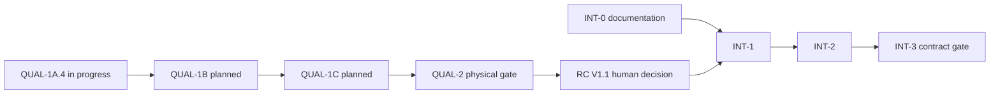

# FabCAM release roadmap

**Role:** one release plan, with ordered scope and acceptance boundaries.
[Current STATUS](../shopbot-modernization/STATUS.md) owns the inspected source and
active work; [consolidation/classification](ROADMAP_CONSOLIDATION.md) owns this
cleanup's provenance. Planning does not authorize implementation or release.
Status vocabulary: **COMPLETED**, **IN PROGRESS**, **PLANNED**, **BLOCKED**,
**SUPERSEDED**, **DEFERRED**, **HISTORICAL**. COMPLETED engineering is not human,
installed-platform, physical or publication acceptance.

## V1 — frozen ShopBot baseline

**HISTORICAL frozen baseline; release/physical acceptance not inferred.**
`main` and `origin/main` were inspected at
`ef807cf8250ddc4bdf795c75bb9bf9f011db9bca`; RC1-ef807cf-39492251757,
beta.3/pipeline63. Retain [V1 scope](FABCAM_V1_SCOPE.md),
[V1 readiness](V1_READINESS.md),
[freeze report](V1_FREEZE_READINESS_2026_10_20.md) and their exact-source limits.
RC1 CI/packaging success does not accept clean installs, supervised ShopBot work
or publication. No V1 functionality, frozen ref, acceptance or release state is
changed here. macOS/Windows/Linux acceptance and existing human gates remain
separate; do not apply V1.1 results retroactively to V1.

## V1.1 — explicit cutting parameters and qualification

**COMPLETED implementation, final acceptance BLOCKED by qualification/evidence.**
[Accepted ADR-0030](../shopbot-modernization/adr/ADR-0030-fabcam-fabspeed-separation.md)
and [FS-RESET-3 results](FS_RESET_3_RESULTS.md) establish the current product:
explicit per-actual-role spindle/feed/plunge values, project v9, direct editing,
reviewed preset copies, local tested collections, simplified Presets/MAT-1 UX,
independent CAM validators and explicit-input CLI. The integrated recommendation
engine, ranking/source packs and Draft/Trial promotion lifecycle are removed.
Legacy implementations completed historically before supersession; no restart or
old-format migration is scheduled. See the [classification ledger](ROADMAP_CONSOLIDATION.md#milestone-disposition).

### QUAL-1A.4 — Deterministic V-Carve production integration

**IN PROGRESS** in isolated `codex/qual-1a4-production`, owned by the chat
“Astra élevé”, tracker `ivac-awe23`. Scope: portable V-Carve arithmetic, correctly
rounded JSON numeric input, strict P1 exact-context preset refusal with review
guidance, accepted motion differences and full final-source qualification.
Predecessor prototype/design passes do not establish production acceptance.
Completion requires reviewed production commits, comparison with accepted motion
and refusal evidence, full qualification bound to the actual combined source and
explicit human disposition of failures/limits. Current evidence is catalogued in
[the consolidation report](ROADMAP_CONSOLIDATION.md#source-bound-evidence).
No integration/acceptance is inferred from two isolated production commits.

### QUAL-1B — Cooperative ShopBot cancellation

**PLANNED**, after reviewed QUAL-1A.4 disposition. Add cooperative cancellation
points in ShopBot/CPS safety-preflight traversal while retaining every security
and machining check. Acceptance: non-cancelled output unchanged; cancellation
suppresses partial/stale publication; fresh source-bound measurement of the
unchanged **200 ms p95** target. Preserve failed cases and explain residual
uninterruptible work. Distinct from QUAL-1's COMPLETED bounded polling-frequency
improvement; the historical Test-medial 200.353 ms p95 remains an observed failure,
not a new universal measurement or a relaxed threshold.

### QUAL-1C — Software, environment and installed-platform qualification

**PLANNED**; protocol preparation may overlap earlier work, final evidence must
name one consistent source. Acceptance includes unrestricted-host native watcher
tests, current cargo-deny advisory audit, unmodified Chromium headless smoke,
complete canonical pre-release gate, reproducible Node24 environment, final-source
provenance, TEST1/C2, output corpus and security gates. Also prove actual browser
project save/reopen and collection export/import, native Tauri dialogs/storage and
macOS/Windows/Linux installed-runtime behavior. Mock/temp-file/ACL tests do not
qualify installed dialogs or real file transfer. Retain every actual failure,
platform/signing limitation and unavailable check; no software-only shortcut.

### QUAL-2 — Physical ShopBot acceptance

**PLANNED / NOT PHYSICALLY QUALIFIED.** Separate supervised evidence gate:
setup/work origin → SAFE-Z/fixtures → non-cutting movement → Profile/Pocket →
multiple tools and actual-role values → Drill/Spot/Chamfer → V-Carve/specialized
operations → supported two-sided work with explicit registration preparation.
Use controller preview, air cuts, sacrificial material and measured outcomes with
actual machine/controller/tool/stock/zero/rates recorded. v9 supports no automatic
dowel-hole injection; explicit Drill preparation and registration must be reviewed.
Physical acceptance is limited to tested combinations, not inferred from software.

### RC V1.1 — reviewed candidate and release decision

**PLANNED**, gated by necessary software/physical acceptance decisions above.
Freeze reviewed source, separately authorize candidate construction, validate
installer integrity and installed behavior, finish regression/documentation review,
then decide main integration/promotion and obtain explicit human release authority.
Never merge/promote solely because an isolated prototype or V1 passed. No candidate,
version/pipeline change, installer, release or hardware action occurs in this task.

## V1.2 — optional one-way FabSpeed integration

**PLANNED**, product principles approved, implementation absent.
[Proposed ADR-0031](../shopbot-modernization/adr/ADR-0031-optional-one-way-fabspeed-catalogue.md)
records approved ownership/direction; transport/storage specifics remain OPEN.
FabSpeed owns calculation/optimization, experiments, upstream validation and shared
technical catalogues. FabCAM owns CAM configuration, explicit operation values,
local independent resources, CAM-specific extensions, validation/simulation/export.
FabCAM stays autonomous and never embeds or dynamically requires the calculator.

Strict business-data direction is **FabSpeed → FabCAM only**. Identifier-based
reads are allowed; no upstream database/catalogue writes, CAM project/operation
uploads, experiment submission, record creation/validation or bidirectional sync.
Synchronization cannot mutate authored operation values. Apply only a reviewed,
compatible local copy with CAM validation; changed relevant safety limits require
invalidation/requalification of affected generated results.

### INT-0 — Shared Data Contract & Architecture

**PLANNED**, architecture/documentation only; may be studied alongside V1.1
qualification without production changes. Inspect real models/storage/API and
validate stable shared/local IDs, explicit linking without rewriting project
references, field ownership/CAM extensions, exchange schemas, provenance and
validation status, update/conflict/deletion/revocation policy, transactional cache,
offline/restart behavior and upstream trust. Decide local API/service/published
catalogue and operation when FabSpeed is closed; no always-running API assumption.
Acceptance: evidence-backed proposed ADR-0031 refinement, minimal reviewed UX,
migration-safe linking/security contract and human architecture decision before
implementation. This roadmap task prepares the proposal but does not perform INT-0.

### INT-1 — Automatic One-Way Catalogue Synchronization

**PLANNED**, depends on approved INT-0 and a suitably qualified V1.1 baseline on a
separate future feature branch. Synchronize machines, tools, materials and
experimentally validated presets; preserve shared/local identity, independent
local resources, CAM extensions, provenance and offline cache. Initial startup
sync where feasible, reconnect/bounded refresh, optional Settings “Synchronize
now”, visible last-sync/failure status, normal operation when FabSpeed is absent.
Acceptance: non-destructive ownership-aware updates, transactional recovery,
removal/revocation handling and safety-limit invalidation/requalification; no
wholesale overwrite or silent operation change.

### INT-2 — Hybrid Resource UX

**PLANNED**, follows INT-1. Unified local/synchronized machine/tool/material views,
read-only FabSpeed common fields, editable local CAM extensions, provenance,
status/refresh, offline/stale disclosure, exact compatible preset selection,
independent operation copies and reviewed linking/conflicts. Acceptance: ownership
and identity understandable, local edits survive refresh, no inferred physical
identity from names/diameters/models and no recreated experimental validation
system inside FabCAM. FabSpeed status is displayed, never invented or upgraded.

### INT-3 — FabSpeed Calculated Proposal Retrieval

**PLANNED; API/UX feasibility OPEN**, after INT-2 and approved read contract.
Offer a compatible validated preset first. Where supported, retrieve an existing
calculated proposal by identifier if no compatible validated preset exists;
suggestions may also remain accessible when presets exist, clearly untested unless
actual validated evidence establishes otherwise. Preview and local validation
precede explicit copying; preserve actual-role assignments and independent values.
No automatic apply/attestation, integrated engine or operation-context submission.
If the actual API requires uploading CAM context or cannot expose existing proposals
by ID, return to a separate product/API decision; do not invent reverse data flow.

## Dependencies and release boundaries

Final qualification always applies to consistent combined source. INT-0 may run
in parallel by separate authorization; INT-1/2/3 are **not V1.1 blockers** and are
not IN PROGRESS. V1 remains frozen. Later V1 hotfix integration needs review and
combined-source qualification, without importing feature work into frozen V1.

## Later CAM enhancements

**DEFERRED** from mandatory V1.1 stabilization; preserve existing bounded contracts
and human scope decisions, not a promise to implement an entire backlog:

| Track | Retained direction / evidence boundary |
|---|---|
| Workshop UX | Improved machining-report readability; optional explicit registration-hole assistant producing visible editable Drill operations; no hidden dowel injection |
| Geometry / milling | GEOM2/3, NEST1/2, REST1, HELIX1, VCARVE2, advanced inlays/two-sided and PERF2/TIME2; [advanced plan](ADVANCED_CAM_PLAN.md), [V2 priorities](V2_WORKSHOP_PRIORITIES.md). Existing supported features are not reclassified as absent |
| ProtoMAX V1.5 | [Native OMX/MAKE scope](FABCAM_V1_5_SCOPE.md), [OMX1](OMX1_PLAN.md), [ARCH-MACH](ARCH_MACH_PLAN.md); lawful format evidence and separate process/platform/physical gates; no LAYOUT fallback or automatic prerequisite from INT-1/2/3 |
| Integration / automation | [FabCAM/FabSBP](../shopbot-modernization/FABCAM_FABSBP_WORKFLOW.md), [MCP1](MCP1_PLAN.md), STEP/smart workshop in [V2 priorities](V2_WORKSHOP_PRIORITIES.md); separate security/data/process contracts |
| Engineering / security | [SEC1 follow-ups](SEC1_FOLLOWUP_ROADMAP.md), [post-audit policy](POST_AUDIT_CONSOLIDATION.md), [AUDIT3](AUDIT3_PLAN.md); retain bounded trigger/approval rules; obsolete FS ownership does not return |

Tool-inspector illustration remains a planned later **UX component**: compact,
lightweight reusable vectors matching FabCAM's graphite/blue UI, small outline
icons and clean brand geometry. Identify flat/ball/V/drill/chamfer families and
explain cutter/shank diameter, overall/cutting length, tip angle and applicable
dimensions, with unknowns explicit. Field hover/focus highlights dimensions and
vice versa with keyboard/non-color-only cues. No photorealistic/generic technical
rendering or CAM-engine work. Surface/core stock coloring and user-facing
Waterline → 3D Roughing / Relief → 3D Finishing remain separately reviewed UX ideas,
not V1.1 blockers or algorithm changes. Detailed prior scope is retained in the
[roadmap archive](history/RELEASE_ROADMAP_BEFORE_FABSPEED_CONSOLIDATION.md).

## Historical and superseded directions

FS0–FS3.9 and PRESET-1–4 were delivered within their source-bound scopes, then the
recommendation/source-pack/recipe model was SUPERSEDED by ADR-0030 and FS-RESET.
MAT-1 presentation remains COMPLETED/retained; no old identity remapping or local
scaling assistant is restarted. Calculation/scaling belongs to FabSpeed. Preserved
anchor links land here rather than implying the former plans are active.
[Disposition ledger](ROADMAP_CONSOLIDATION.md#milestone-disposition),
[full previous roadmap](history/RELEASE_ROADMAP_BEFORE_FABSPEED_CONSOLIDATION.md),
[historical reports](HISTORY.md), accepted ADRs and frozen V1 evidence retain all
original qualification and unresolved human gates. They are not retroactively
accepted by this cleanup. **HARD STOP after documentation; no next software milestone.**
