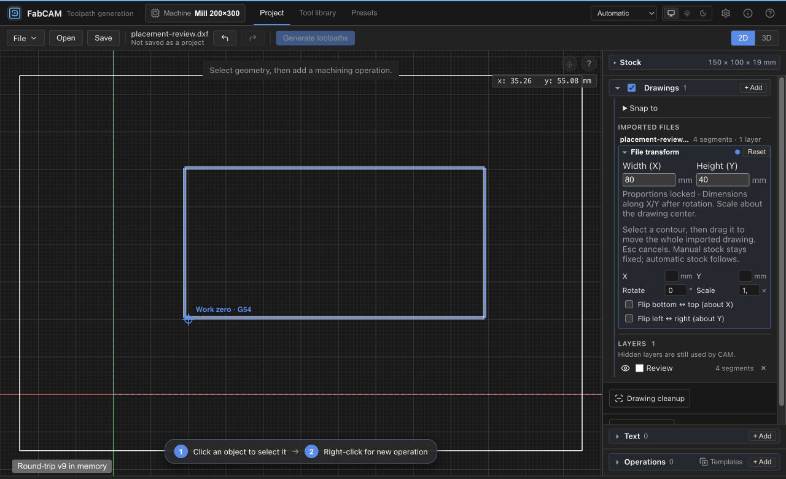

# V1.1 — Local placement integration and native test build

2026-10-24. Authorized local integration and software qualification on
`FabCAM-v1.1`. Starting HEAD: `98e249f`. No push, merge to main, public release,
version promotion, ordinary-profile launch or hardware operation.

## Integrated source and scope

**Qualified executable/build source: `1f353ef3b774382f63e67f93a9bb3a4652007de2`.**
The later documentation checkpoint does not change the application built from
that source. SEC-1's older app remains bound to `1350953`; it intentionally
excluded the local changes below. Its dated report is unchanged.

| Commit | Integrated change |
|---|---|
| `ed630cf6cb489f1aac18f274504b4774eef7ca13` | Conservative narrow-pocket wall-coverage diagnostic and regression expectations |
| `1fda7cd8dc8caf53eb11466c2a2aa514a20ee09c` | Drawing drag, proportional sizing, manual-stock anchoring, exact arc bounds, Drawings disclosure and header/theme/language UI |
| `1f353ef3b774382f63e67f93a9bb3a4652007de2` | Tool-library smoke recognizes all seven accessible header controls |

Select an imported contour, then drag its edge with the mouse to move that
whole imported file. The four-CSS-pixel threshold keeps taps inert; preview is
transient and release commits one undoable command. Escape, lost capture,
blur and pointer cancellation discard it. Modifiers and existing text, fixture,
approach and tab interactions retain priority. Movement is mouse-only, without
snapping or partial-file deformation. CAD-repaired/corner-relief geometry remains
locked against raw-import placement until that edit is cleared.

Drawings → File transform exposes Width (X) and Height (Y), measured on world
axes after rotation. Editing either applies uniform scaling about the existing
original-file center, preserving proportions. Invalid/nonpositive/degenerate
sizes are refused. Circular-arc extrema are measured analytically, including
mirrors and major arcs. State retains double precision; displayed dimensions
use up to six decimal places. Existing v9 transform fields remain authoritative;
no schema, migration or persistence-policy change.

Manual stock stays fixed through file translation, rotation, scale, mirror,
reset and Undo/Redo using existing offset compensation. Automatic stock follows
the drawing. This does not introduce a general anchor for file addition/deletion
or text regeneration. The viewport remains stable through placement/history;
explicit Fit and a new document/source reset the frame. Other imports and
operation approach markers retain their existing transform/history behavior.

The pocket correction changes **diagnostic eligibility**, not generated paths.
A single closed source with one continuous closed wall ring can certify its
interior coverage within a strip no wider than the cutter. There is no positive
tolerance enlarging the cutter. Empty, open, discontinuous, nonfinite, tabbed,
multiple-boundary and distinct-finish-tool cases keep conservative diagnostics.
Source corners, entry safety, combined-source pockets and physical cutting
qualification gain no acceptance from this certificate.

The header changes retain the blue top rule and current controls. Three new
hardcoded strings were moved into the English/German catalogs. The strict i18n
guard remains unchanged. `Option::is_none_or` was replaced by equivalent
`map_or(true, ...)` to respect the declared Rust minimum; no lint suppression.

## Qualification and preserved failed outcomes

**20/20 unchanged canonical stages PASS**, exit 0, on the committed source above,
with clean tracked source. [Final journal](v11-local-integration-2026-10-24-evidence/pre-release-final.log)
and [machine-readable summary](v11-local-integration-2026-10-24-evidence/qualification-summary.json).
The full workspace all-feature suite has **1,594 PASS / 0 FAIL / 1 intentionally
ignored TEST1 worker**. Frontend: **1,510 PASS / 1 existing optional locale SKIP**,
175 files. Strict pedantic Clippy, formatting, schemas/version, generated keys,
lint, Svelte/TypeScript, frontend/WASM builds, unchanged CPS size budget,
cargo-deny and CLI trust/transactional-export checks pass. All five native file
watcher tests pass on the host. No security policy, dependency or golden changed.

[Twenty-three frozen CLI cases](v11-local-integration-2026-10-24-evidence/output-corpus-summary.json)
match generated programs, paths, provenance, indexes and statistics, including
both two-sided files. This is not a new 77-case replay, TEST1 campaign or latency
measurement; their SEC-1 results retain their original source binding.

The first complete pass was **19/20** because the tool-library smoke retained
a CSS-class count from the old header. Navigation already passed; the library
probe now checks the same seven accessible names and continues its full
120-tool filter/sort/pagination/selection checks. Help is explicitly tested as a
shortcut dialog, including dismissal. Both smoke sections pass without browser
exceptions. [First journal](v11-local-integration-2026-10-24-evidence/pre-release-first.log)
and [initial MSRV failure](v11-local-integration-2026-10-24-evidence/clippy-first-msrv.log)
remain retained. The initial sandbox Rust toolchain failure was environmental;
the actual complete qualification ran on the host.

### Browser placement replay

The [retained synthetic fixture](v11-local-integration-2026-10-24-evidence/drawing-review.html)
loads through existing project APIs on an isolated local origin. At 1280 × 800,
source `1fda7cd` visibly transforms 60 × 30 to **80 × 40 mm**, then a 55/-33 CSS-pixel
mouse drag moves it by **X 9.006550218340612 / Y 5.403930131004367 mm** while
manual stock remains stationary. Cmd+Z restores center (50,35); Cmd+Shift+Z
restores (59.00655,40.40393). A JSON v9 snapshot/restore preserves the resulting
bbox and numeric transform. The final commit adds only the smoke selector.
[Replay values/limits](v11-local-integration-2026-10-24-evidence/browser-replay.json),
[visible state](v11-local-integration-2026-10-24-evidence/browser-committed.txt),
[restored state](v11-local-integration-2026-10-24-evidence/browser-roundtrip-committed.txt).



This replay bypasses the OS file picker. Escape/capture cancellation, generation
invalidation, stock compensation, multi-import isolation and arc cases are covered
by automated tests; not all were manually exercised mid-gesture. Very large
imports have no new performance qualification. Browser evidence is not installed
Tauri acceptance.

## Native application and source binding

Local app: `../builds/v1.1-local-2026-10-24/FabCAM.app`, relative to the repository root. **macOS arm64**, built on macOS 26.5.2 using Tauri CLI 2.11.3:

```sh
cd crates/ivac-tauri
tauri build --config tauri.dev-signing.conf.json --bundles app -- --locked
```

Package version remains **0.9.0-beta.3**, identifier `org.opcenter.ivacam`.
Both native executable and frontend contain **`v0.4.0-130-g1f353ef`**. The historical
git-describe prefix is not a release-version change. The frontend WASM exactly matches the fresh compiled package. Native default CPS
remains enabled, including bundled ShopBot support. No external HTTP preview is required
by the native application.

Strict deep signature verification **PASS**. Ad hoc signature, hardened runtime,
no TeamIdentifier, not notarized. No app launch, installer, Gatekeeper acceptance
or other-platform acceptance. [Build log](v11-local-integration-2026-10-24-evidence/native-build.log),
[signature](v11-local-integration-2026-10-24-evidence/codesign-details.log),
[source/assets](v11-local-integration-2026-10-24-evidence/source-binding.json),
[artifact manifest](v11-local-integration-2026-10-24-evidence/artifact-manifest.json).

Executable SHA-256: `4c5a449806032747e04959547641ca6d9b6cbfbb0120beebff97e0a94e85089f`.
Bundle file-manifest SHA-256: `9ed106657cedf933ca525655123901c2280385490e67b7d436346feabcdcede2`.

## Preservation and next human checkpoint

All **8,471** inventoried unrelated local reports/evidence files are hash-identical.
[Preservation summary](v11-local-integration-2026-10-24-evidence/preservation-check.json);
the complete private path inventory accompanies the app outside Git. The initial
tracked patch is retained locally. Older untracked reports/evidence remain local,
not silently staged. SEC-1's original executable still hashes to
`a2d2666e70ca8e73f44001b8472d71c61cd9710da67b1e400f719463ecb7eb0f`.
The previous primary generated app is separately preserved under
`builds/v1.1-local-2026-10-24/previous-primary-build/`. Existing projects, app data,
private presets, experimental checkouts and frozen V1/main are untouched.
Qualification-only servers/tabs are closed; other preview servers are untouched.

Next: **Personal Alpha — Actual macOS Launch & Native Workflow Acceptance**,
in the agreed separate test account. Verify actual OS open/save dialogs, real-file
round-trips, drawing movement/proportional sizing/history, generation/simulation,
cancellation/recovery, tested collections and selected output/post workflows.
Human UX acceptance and installed-native acceptance remain OPEN. Two-sided output
is not pair-atomic, streamed CLI output is not full-program simulation-qualified,
and automatic dowel injection remains excluded. ShopBot physical qualification
requires its separate supervised protocol and approval. No V1.2 work starts here.

**HARD STOP after this local documentation/build checkpoint. No push.**
