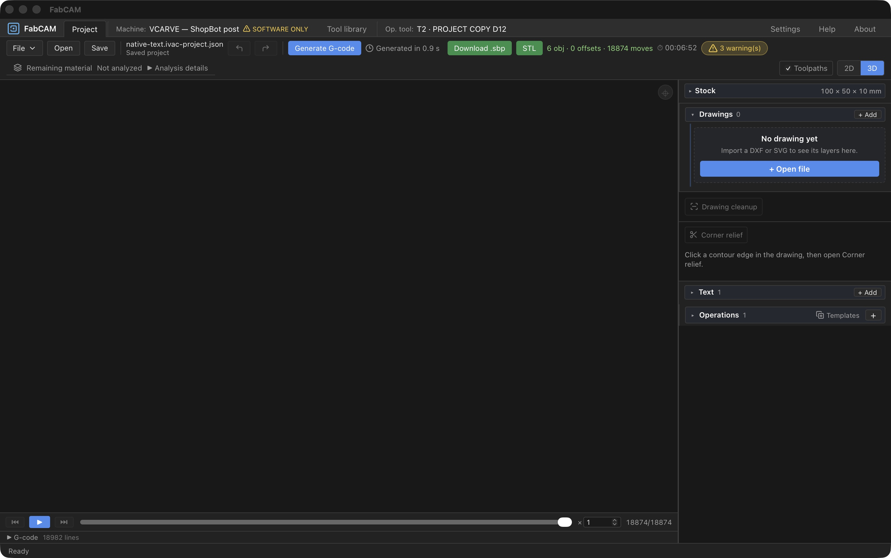
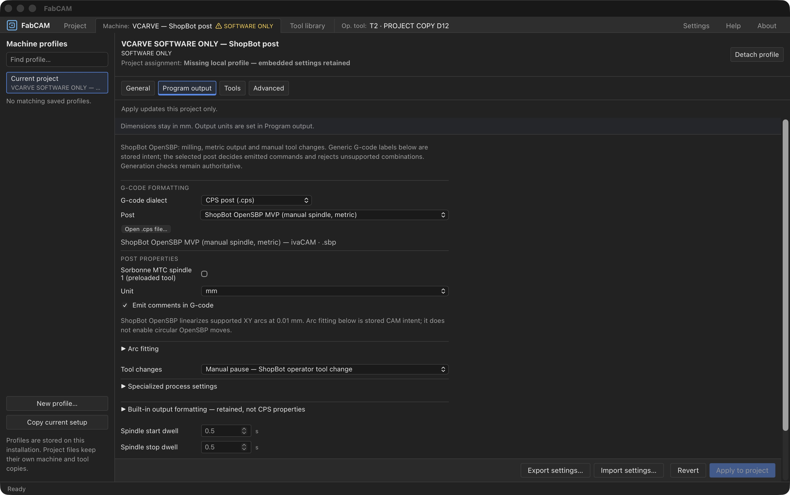
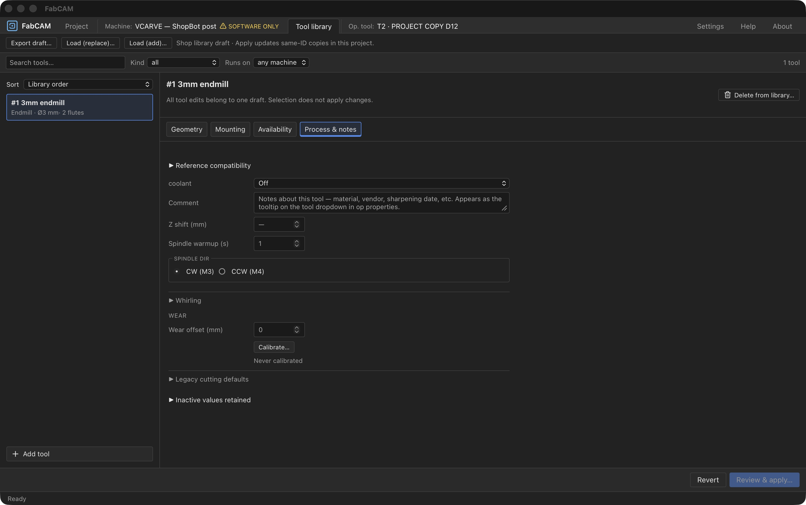

# Checkpoint E — integrated local macOS qualification

> Policy update 2026-10-16: [REL1-B1/B2](REL1_B_PLAN.md) supersedes Apple identity/notarization as a V1 requirement. Community clean-install/integrity gates remain required. Historical evidence below is unchanged.

2026-10-16 · ivac-upkvw.4 · Local qualification complete; human review pending.
User accepted REL1-A, UX7 and UX6-C including the Legacy heading correction.
Scope: integrated local development build, structural ad-hoc signature and bounded
native smoke review. No credentials, Apple submission, commit, push or publication.

## Source and regression checks

Based on 4ebd43394829f1fb8372e5f9152143b9dcf3c868 with accepted uncommitted changes.
Prior UX7 app copied to dist-test/v1-checkpoint-e/previous-ux7-FabCAM.app before build.
Installed /Applications/ivaCAM.app and /Applications/FabCAM.app and CI candidates untouched.

Full test rerun exposed the Legacy CSS follow-up crossing the component line budget:
1025 lines versus 1020. Increased this specific budget to 1030 with an explanatory
comment, as permitted by the guard. No production logic changed in this checkpoint.
Initial failure retained in checkpoint-e-tests.log; final rerun in
checkpoint-e-tests-final.log: 146 files PASS, 1324 tests PASS, 1 skipped; Node 10 PASS.

## Build and native observations

- App-only release build PASS with development ad-hoc overlay. [Build log](checkpoint-e-build.log).
- Strict `codesign --verify --deep --strict --verbose=4` PASS: sealed resources,
  bound Info.plist, stable org.opcenter.ivacam; arm64, ad-hoc/runtime flags, no team ID.
  [Signature evidence](checkpoint-e-signature.log), [source/binary provenance](checkpoint-e-provenance.json).
- New bundle launched by absolute path from target/release/bundle/macos/FabCAM.app.
  Native tauri://localhost UI reports 0.9.0-beta.1, 4ebd433-dirty. No installation replacement.
- Existing recent projects retained. Reopen of native-text.ivac-project.json PASS.
- Generation observed in flight with Cancel and elapsed 0.3 s; terminal “Generated in
  0.9 s”, 18874 moves / 18982 lines, 3 warnings, Download .sbp enabled and 3D selected.
  Counts match historical native fixture evidence; no byte-for-byte export comparison
  was repeated in this checkpoint. Cancellation/refusal matrix remains UX7's separate evidence.
- Machine Program output shows ShopBot limitations, typed CPS controls and collapsed
  arc/built-in formatting sections. No machine setting changed.
- Tool Process & notes shows corrected compact muted Legacy heading; opening it
  reveals retained 18000 RPM / 800 / 100 mm/min and collapsed Pass overrides.
  Closing it succeeds. No tool edits applied, project not saved or overwritten.
- Native app left open on Process & notes for review. Previous installed app remains
  an earlier build; launch the target bundle to inspect this checkpoint.

Existing Vite chunk-size and mixed static/dynamic Tauri import warnings remain.
No installer produced in this checkpoint; app-only local review artifact.

## Independent gates

Developer ID, notarization, Gatekeeper distribution and clean-host acceptance remain
UNQUALIFIED. Windows 11 and Ubuntu native host checks remain pending host availability.
Existing CAM geometric and physical evidence is not extended by this presentation smoke test.
HARD STOP after this checkpoint for human review.

Human acceptance: checkpoint E explicitly validated by the user on 2026-10-16. Next proposed step is REL1-B distribution preparation; credential access, Apple submission and publication still require separate authorization.
