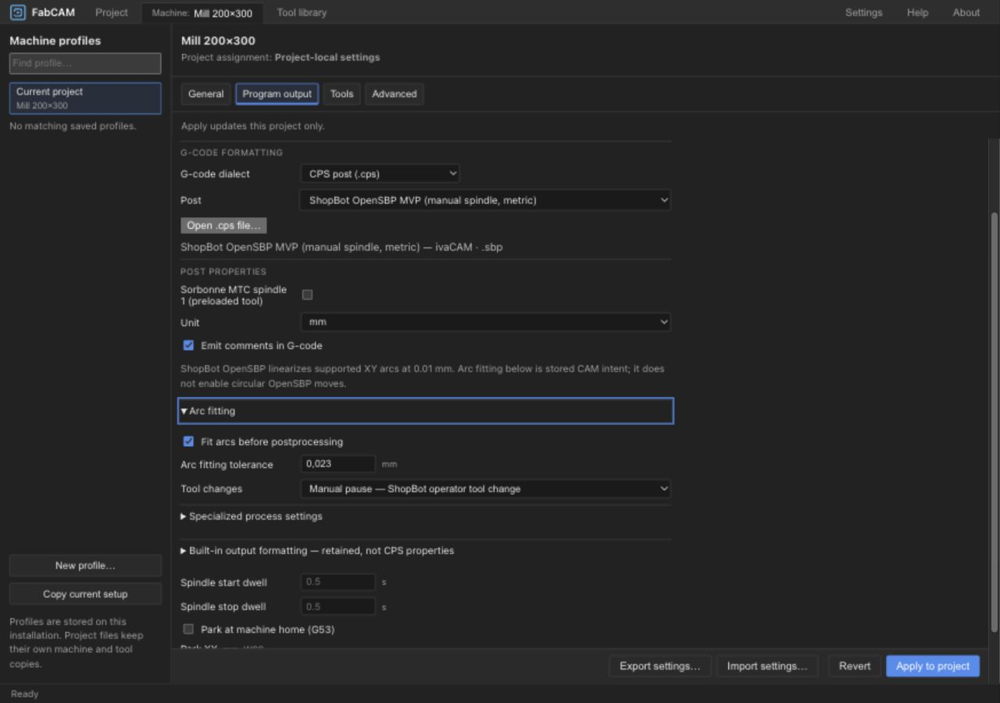
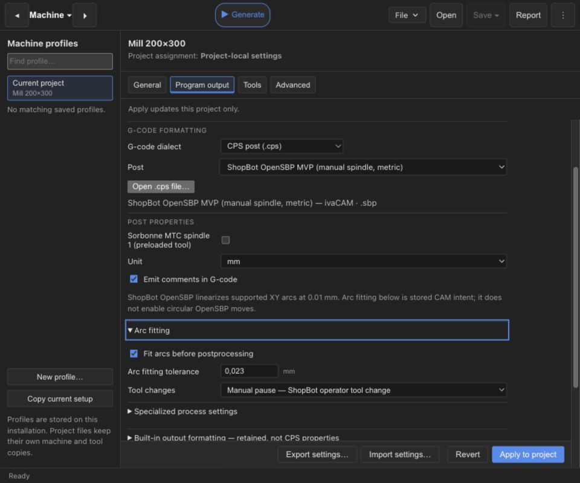
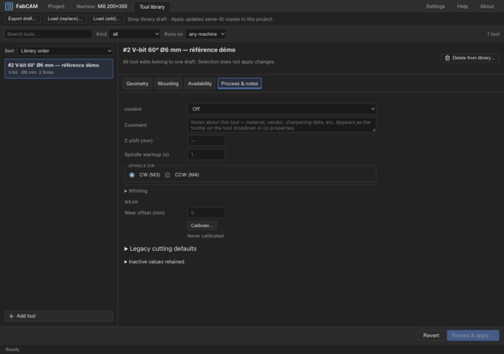
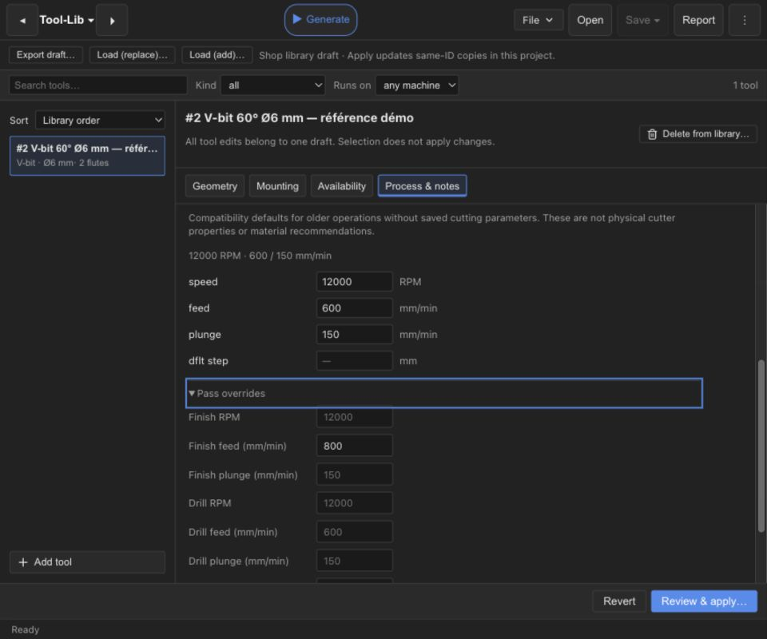

# UX6-C — Program output / Process & notes

2026-10-16 · ivac-upkvw.2 · Local implementation complete; human review pending.
UX7 explicitly accepted by the user before this package. No commit, push or publication.

## Changes

- Machine Program output: aligned compact CPS controls, selected-post metadata retained,
  arc fitting in a disclosure, optional stop alongside built-in formatting.
- Bundled ShopBot explains that supported XY arcs are linearized at 0.01 mm;
  “Fit arcs before postprocessing” describes stored CAM intent. It does not promise
  circular OpenSBP output. This matches the existing shopbot.cps tolerance/onCircular.
- Process & notes: inactive Whirling collapsed (enabled settings remain expanded),
  legacy Pass overrides collapsed with a single heading and explanatory tooltip.
  Wear/calibration, Z shift and spindle direction remain visible.
- Shared spacing, graphite controls, 28 px minimum control height, compact numeric fields.
  New explanatory text translated in English and German; generated i18n keys updated.

## Preserved boundaries

Presentation only: field callbacks, drafts, sparse/unknown CPS properties, tool defaults,
Review & apply, machine compatibility checks and conflicts are retained. No schema,
resolver, persistence, kernel, generated output, postprocessor or UX7 execution changes.
Existing dirty REL1-A and UX7 work and known-good CI candidates were preserved.

## Validation

- `npm run check`: PASS, zero Svelte/TypeScript errors or warnings ([log](ux6c-check.log)).
- `npm test`: PASS, 146 Vitest files / 1324 tests passed / 1 skipped; Node suite also
  passes 10 tests ([log](ux6c-tests.log)).
- `npm run build`: PASS ([log](ux6c-build.log)); existing large-chunk and mixed
  static/dynamic Tauri import warnings remain. No new acceptance claim for bundle size.
- Targeted ESLint for the three changed components: PASS.
- Rendered IAB review with current frontend and existing release HTTP backend at
  18803/18804, at 1280×900 and 960×800. Built-in output and bundled CPS ShopBot checked.
  Typed CPS controls, selected post metadata, explanatory help and compact alignment visible.
- Arc tolerance edited to 0.023, disclosure closed/reopened with Enter: value retained.
  Machine Revert restored pristine state; no machine setting applied.
- Tool finish feed changed by keyboard to 800, Pass overrides closed/reopened with Enter:
  value retained and Review & apply enabled. Revert cleared the value and disabled Apply.
  No library changes applied. Automated fill alone did not commit the onchange field;
  the keyboard interaction supplied the actual draft-state verification.
- Disclosure focus visible; narrow layout reviewed. Temporary viewport override reset.

## Rendered evidence

## Limits and gate

Software/browser presentation qualification only. No UX6-C native bundle rebuild or
new installation/runtime qualification on macOS, Windows or Ubuntu. UX7 native evidence
remains separate. Developer ID, notarization, Gatekeeper distribution and clean-host
acceptance remain UNQUALIFIED. No machine execution or signing credentials accessed.

HARD STOP for human UX6-C review. No next work package started.

## Human review follow-up — Legacy heading

User identified an oversized Legacy cutting defaults heading. The parent ToolLibraryDialog
disclosure had no summary typography and inherited the body size. Matched its muted
0.78 rem, normal-weight summary, spacing and divider to ToolRowExpandedEditor advanced
groups. CSS only; disclosure behavior and values unchanged. Svelte/TypeScript check
passes. Existing screenshots above precede this follow-up; native app not rebuilt.

Human acceptance: user explicitly validated UX6-C and its Legacy heading follow-up on 2026-10-16 and authorized checkpoint E. Earlier pending-review wording records the original handoff.
