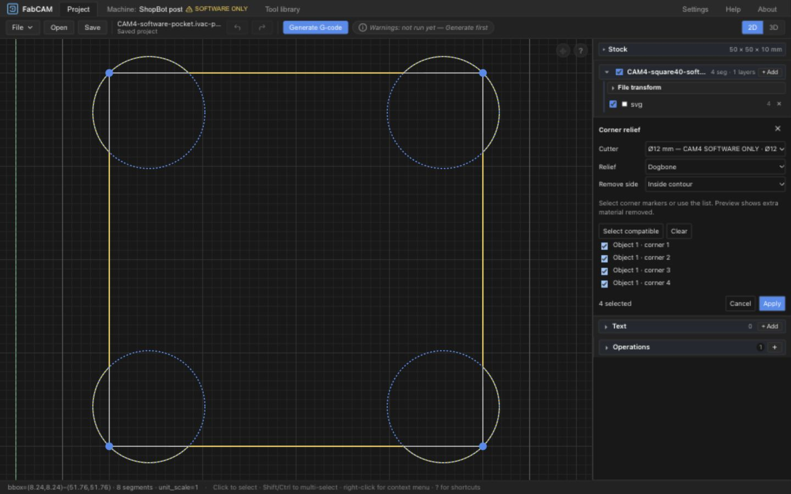
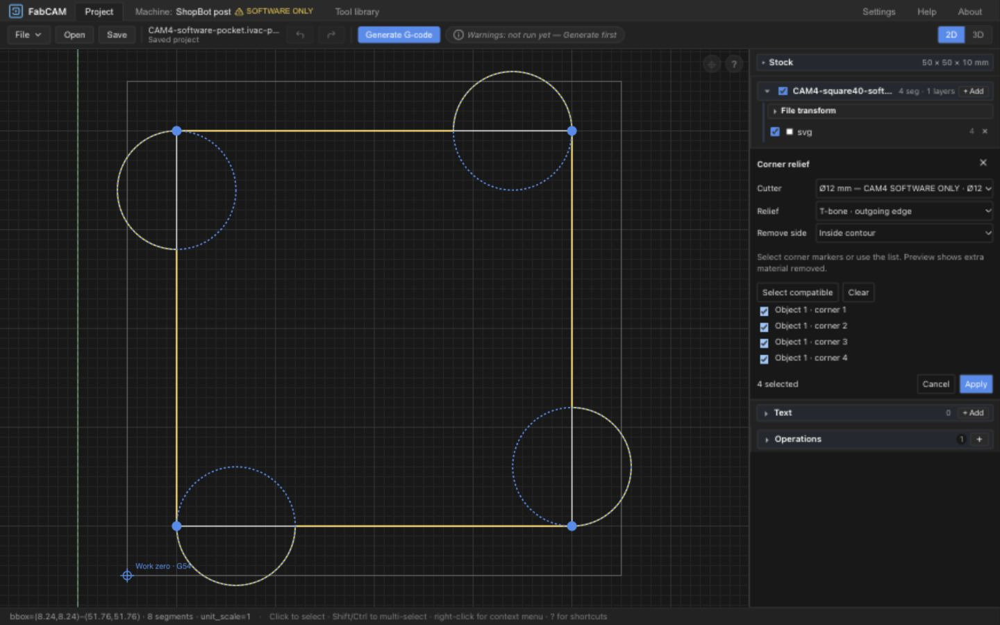
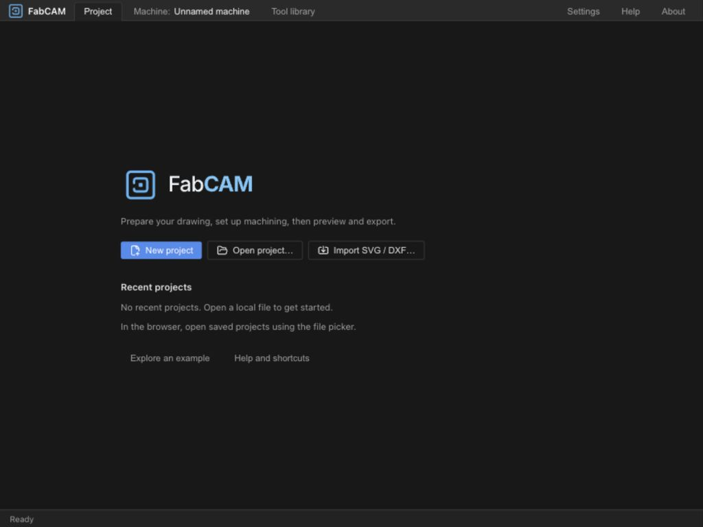

# CAD1 — Dogbones / T-bones qualification

> 2026-10-14 continuation: the user's request to launch the next milestone
> accepts this bounded software handoff for UX3 (ivac-7r7r closed). No physical
> or broader geometric evidence was added. The original review-pending wording
> below records the CAD1 handoff; [UX3 qualification](UX3_QUALIFICATION.md) is current.

Date: 2026-10-14. Software implemented locally; **human gate ivac-7r7r OPEN**.
Architecture/A/B prerequisite approved by the user after the
[initial audit](CAD1_AUDIT.md). [ADR-0013](adr/ADR-0013-persistent-corner-relief.md)
is the accepted implementation decision. No physical cutting or dimensional fit
qualification is claimed. No commit/publication and no UX3/UX4 implementation.

## Delivered behavior

Select closed contours, open **Corner relief**, choose the cutter, Dogbone or
T-bone incoming/outgoing, and the removal side. Select explicit corner markers or
checkboxes; **Select compatible** selects the eligible batch. Source edges,
proposed contour and cutter circles are visible before **Apply**. Cancel discards
the draft. Apply/Edit/Remove each form one Undo/Redo command.

The pure Rust evaluator constructs exact circular reliefs from the effective
cutter diameter (`diameter − wearOffsetMm`, the existing tool convention).
No tolerance enlargement is hidden in the geometry. Original imports/transforms
remain stored separately; every ordinary CAM/preview consumer sees the same
accepted evaluated contour. ShopBot uses its unchanged normal CAM/post pipeline.
HTTP, Tauri and WASM/worker expose the same geometry endpoint.

A changed source/layout/cutter invalidates generation and export until an explicit
new preview/application. Saving does not make stale output current. Version 5
`ivac-project-cad` persistence prevents older readers from silently ignoring reliefs.
A restore regression also now preserves all imported drawings and layout transforms.

## Qualified scope and refusals

- Metric, single-sided jobs; one editable project batch using one cutter/mode/side.
- Closed simple contours, right/obtuse line-line removal corners, multiple corners
  and objects. Unselected arcs, object IDs and nested contours are preserved.
- Normal inside/outside Profile and single-tool Cascade Pocket integration;
  outside concave geometry is unit-tested, emitted-motion matrix below covers
  inside profiles and pockets only.
- Acute removal angles are refused because an exact-radius lobe can require an
  isolated plunge or wider access. They are not described as physically impossible.
- Selected curved corners, open/self-intersecting contours, short edges, overlapping
  reliefs, neighbor/island conflicts, invalid diameters and >512 source segments
  are explicit refusals. Batch failure returns the original geometry atomically.
- Authored tabs/approach bindings, patterned affected operations, cutter/side
  mismatches, pocket allowances, frames and dual-tool pockets are refused by the
  frontend adapter. No silent reassignment of perimeter positions.
- CAM4 A/B residual analysis retains its curved-target exclusion: **Not analyzed**
  is expected on this fixture. CAD1 does not claim to extend that diagnostic.

## Automated evidence

| Check | Result |
| --- | --- |
| Core library, CPS enabled | 1070 passed |
| Frontend Vitest | 1151 passed, 1 existing skipped |
| CAD1 emitted-motion integration | 1 test / 18 cases passed |
| Existing ShopBot M1 / M2 / snapshots | 11 / 27 / 4 passed |
| Svelte/TypeScript / ESLint / Prettier | passed |
| Core Clippy with warnings denied | passed |
| OpenAPI schema consistency | passed |
| Tauri CPS compilation | passed; native UI runtime not requalified |
| Fresh WASM + production frontend build | passed; existing chunk-size/import warnings |

Seven new geometry tests cover D=2/6/6.35/12 mm, all three relief modes,
90/110/135/160° corners, 30/60/89° refusals, reversed winding, translation,
rotation/mirroring, batches, concave exterior corners, arcs, islands and conflicts.

The emitted-motion matrix uses 90/110/135° × three modes × Profile/Cascade Pocket,
D=6 mm, depth −2 mm and nonzero XY work offsets. An independent OpenSBP decoder
checks that emitted cutting motion reaches the original vertex with radius-3
sweep (0.00015 mm rounding allowance) and that decoded cut endpoints match preview.
An independent analytic triangle-union-disk oracle samples five positions along
each cutting chord and 72 circumference points, rejecting unintended removal with
0.012 mm allowance for the existing 0.01 mm post linearization and output rounding.
This sampled oracle is not a continuous swept-volume proof or physical measurement.

Reproduce with `cargo test -p ivac-core --features cps --lib`,
`cargo test -p ivac-core --features cps --test cad1_qualification`, and the existing
`shopbot_m1_qualification`, `shopbot_m2_post`, `snapshots_drill_tabs_whirl` tests.
Frontend: `npm run check`, `npm test`, `npm run lint`, `npm run build`.

## UX review and human handoff

Actual browser review used the CPS HTTP backend and the software-only CAM4 fixture.
Verified single/list/canvas selection, four-corner batch, both relief presentations,
wrong-side refusal, Cancel, Apply, Remove, Undo/Redo, save/reopen, generation, and
stale-source rejection. Generated fixture: 150 moves / 188 ShopBot lines. Saved
file retains 4 original segments and 8 evaluated dogbone segments. Desktop and
1024×768 layout checked; relief lobes remain inside the fitted viewport. Checkbox
accessible names identify object and corner. English labels follow existing UI;
German currently uses the normal English fallback for CAD1 strings.

Additional evidence: [wrong-side refusal](ux/CAD1-incompatible-side.jpg),
[stale transform blocked](ux/CAD1-stale-transform.jpg).

Human review fixture: [CAD1 software dogbones](CAD1-software-dogbone.ivac-project.json).
Open it in this updated build. Edit the four corners; switch to each T-bone direction,
select individual corners and cancel. Apply a chosen batch, Undo/Redo, save/reopen,
then Generate and inspect preview/export. Change the drawing scale or cutter
size and verify the explicit regeneration refusal. This is a software-only fixture,
not an instruction to run it on a machine.

Native Tauri transport compiles; this session reviewed the browser runtime rather
than rebuilding/launching a new macOS application bundle. WASM compiled successfully;
its endpoint was not separately exercised in the browser during this review.

**HARD STOP before the next milestone.** CAD1 awaits human acceptance; UX3/UX4
and planned UX5 remain unstarted. Independent FS/UX and physical gates stay open.

## Human-review correction — empty editor after panel switching

User reported losing contour selection after switching to a pocket operation.
Root cause: LayerList unmounted CornerReliefPanel when Operations became active;
the panel-local target list vanished while the global canvas editing flag survived.
The component now ends its transient draft on destruction and invalidates outstanding
preview callbacks. Returning to Layers restores normal contour selection. An empty
editor offers **Select contours** with explicit instructions; the inactive entry
also explains selecting a contour edge when nothing is selected.

Browser regression reproduced editor → Operations → Layers both with an existing
modifier and with an unapplied batch. Normal edge selection and reopening all four
corner candidates succeed. The saved geometry is unaffected by cancelling a draft.
[Selection guidance](ux/CAD1-selection-help.jpg),
[recovered four-corner preview](ux/CAD1-selection-recovered.jpg).
Frontend 1151 pass / 1 skip; check, lint and production build pass. ivac-qt54.
Human CAD1 gate remains open; no later milestone started.
