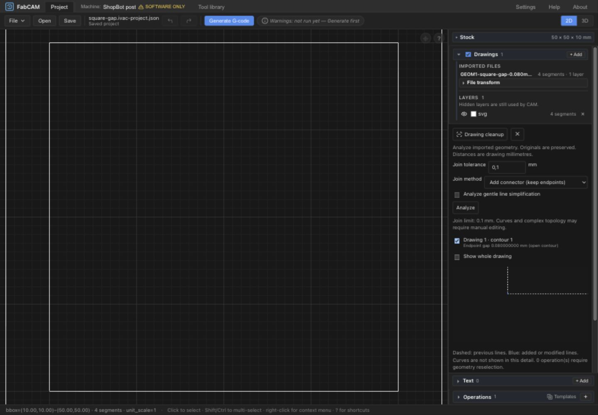
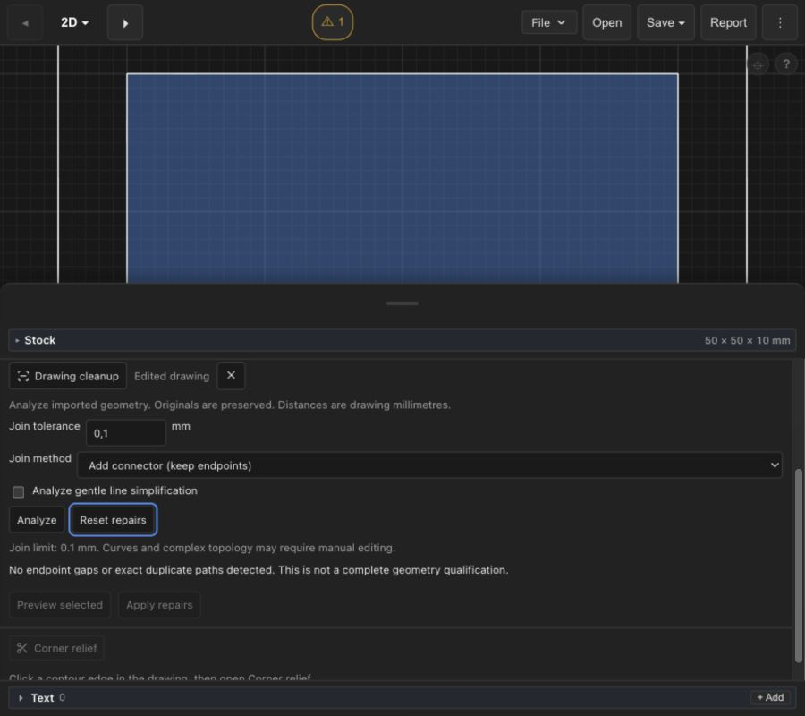
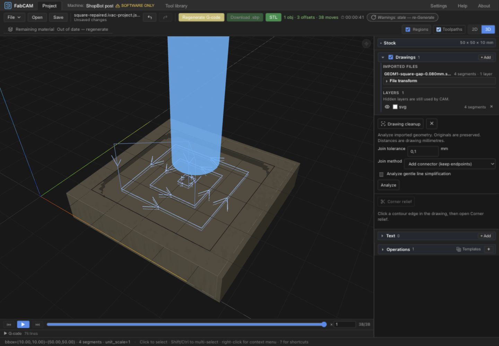

# GEOM1 — software implementation and qualification

2026-10-15. Engineering issue `ivac-8rura`. Approval attachment
`aeab0819-c7c9-4bef-aa5e-775d8793cb35`. No machine validation or publication.
This record supersedes the audit's pre-approval implementation status.

## ADR-0021 refinements and implementation

The four clarifications were formalized in [GEOM1_CONTRACT](GEOM1_CONTRACT.md)
before structural implementation. The selected architecture was retained.

| Phase | Delivered behavior |
| --- | --- |
| A | Stable import/entity IDs, explicit lineage and ambiguity rules; authoritative Rust evaluation; drawing-mm tolerance/pivot semantics; guarded v7 and protocol 1. |
| B | `drawing/{mod,api}.rs`; provenance returned directly by the existing chainer, never recovered by endpoint matching. Rust evaluates accepted local segments and returns coordinates, bounds and membership to every consumer. |
| C | Explicit line-gap snap or connector, unique same-import/layer open-path join, exact duplicate paths/repeated closed loops, exact zero LINE removal, conservative gentle-line simplification. Analysis and preview do not mutate originals; Apply is one geometry-plus-binding history command. |
| D | `ivac-project-geometry` v7; existing kinds v1–6 retain their existing read/save policy. Original source and transform/pivot are checked against the saved imports; display caches are recomputed by Rust on open. Inert top-level extension metadata survives. |
| E | Drawing-context panel, selectable findings, separate join/deviation values, detail/overview preview, explicit Apply/reset, stale proposal refusal, palette owner dispatch, visible unresolved sources, generation/export freshness guards. Actual desktop and narrow screenshots below. |
| F | Contract, ADR, results, roadmap/status/devlog and architecture/serialization notes. Human acceptance remains a separate gate. |

## Identity, lineage and source selection

IDs are pairs `(import, entity)` with a monotonic per-import allocator. Each retained
edge carries source segment ordinals within its immutable import. A unique endpoint
edit or simplification preserves contour identity. Joins allocate a new contour with
both parents; duplicate deletion records a tombstone. Removing a repeated loop from
a legacy doubled chain creates a new contour and records its parent. Split lineage
is represented and tested, but GEOM1 exposes no general split command.

Explicit bindings to merged/split/deleted parents become **unresolved**, even when
both merge parents were selected. They never fall back to All or an adjacent numeric
ID. Disabled operations retain this unresolved state. Fresh explicit selection is
converted to stable IDs; numeric object numbers remain temporary UI/CAM adapters.
Unrelated import IDs and original segments remain unchanged. Manual operation rates,
depths and tools are not edited by cleanup.

All/Layers remain dynamic selectors; their changed geometry is previewed. Generation
refuses an enabled selector with no remaining geometry. Synthetic stock-outline
selection, including All when a stock outline is supplied, requires explicit imported
contour/layer selection: GEOM1 does not silently drop it. Live text by named layer
continues through the existing Rust renderer. Explicit synthetic text/stock IDs,
patterns/frames and authored tabs/approach points have no qualified stable adapter.

Legacy numeric conversion requires agreement between actual source ordinals, UI
object tags and the actual global legacy chain (including auxiliary stock and live
text). Unproven selections require review. Generation additionally rejects a
remaining discrepancy between exact repaired membership/closure and legacy fuzzy
interpretation; it never uses fuzzy re-chaining to retarget a stable binding.

## Effective geometry and numerical policy

Original local-mm import → accepted local snapshot → original-pivot similarity
transform → Rust evaluated segments/membership → normal work-offset adapter → generic
CAM and existing post. The frontend draws returned geometry and frames its preview;
it does not calculate repairs. Applicable corner relief is presently an explicit
conflict requiring reset/removal, not a silently bypassed modifier.

Join distance is `hypot(local delta) × abs(scale)` in visible drawing mm, tested
inclusively against the requested limit. Translation/rotation/mirroring do not enter
the distance calculation; zoom is absent from the request. Tests cover 0.001×, 1×,
1000×, translation, 37°/90° rotations, mirrors and an independent second import.
Singular/nonfinite transforms, unrepresentable transformed edges and unsupported
transform fields refuse. This does not qualify every extreme finite coordinate.

Simplification replaces two original straight segments by their chord only when
the vertex projects onto the chord and the turn is at most 5°. The vertex-to-chord
bound proves continuous Hausdorff distance in both directions. A numerical margin
of `64 × f64::EPSILON × max(1, absolute local coordinates, chord length) × abs(scale)`
is included in the deviation budget (zero only for exact proven collinearity).
Borderline cases without room for that margin refuse. Previously modified or merged
edges cannot be simplified again; at most one vertex per contour per batch prevents
an unsupported cumulative bound. The entire result must pass intersection and
containment checks; a small island inside the removed sliver is a regression case.
Topology orientation uses a floating filter with exact dyadic-integer fallback;
containment ray tests use those predicates rather than rounded intersection division.

No global CAM fuzzy, flattening or output precision was changed. Bounds refer to
retained imported primitives, not to already discarded DXF entities or pre-flattened
SVG curves. CAM/post approximation is a separate budget. Software references do not
establish physical accuracy.

## Persistence, backend and lifecycle evidence

The real restore/snapshot code round-trips representative files for v1–v7, preserving
imports, operations, physical tools, machine/profile fields, material/cutting data,
corner relief, surfacing and inert metadata. Existing optional null/absent fields and
machine defaults retain their pre-GEOM1 normalization. v2 retains its prior upgrade
to the conditional cutting-format save policy; legacy files are not mass-migrated.

The frozen actual pre-GEOM1 v6 reader rejects v7. Unknown edit revisions, malformed
identity/provenance and unsupported transforms refuse. `/drawing` and
`/generate-drawing`, native commands and WASM exports all use revision 1. Edited
requests have a required `machining` envelope instead of the legacy `project` shape;
the actual legacy HTTP endpoint returned 422. Missing backend support has no fallback.

Reopening the actual UI-saved v7 reevaluates geometry, clears the old history and
allows subsequent reset/Undo/Redo and regeneration. A watched external change
preserves the accepted snapshot and surfaces a conflict. Source replacement or an
existing file-transform change invalidates the accepted input key; reset repairs
before changing that source/transform, then analyze again. Reset refuses changed source keys and unproven original selections for new operations. Original operation IDs are reserved across Add/Duplicate/templates while reset provenance exists. Orphaned stable/unresolved bindings cannot be saved to an older format or used for generation. Automatic edit replay or
rebasing is deliberately unsupported. Save cannot silently downgrade an edited file.

## Tests and output correspondence

Final evidence commands/results are recorded in [checks.json](geom1/checks.json): 1198 full core tests; 23 final focused references (overlapping the full suite); 44 CPS tests; 1312 frontend tests, one existing skip. Check/lint, strict Clippy, schema, native/WASM/Tauri compilation and production WASM/frontend build pass. The focused Rust suite includes independent analytical
references for identity, reversed provenance, deletion/merge/split, transformed gap
thresholds, snap versus connector, competing endpoints, crossings, exact duplicate
loops, legitimate POINTs, bounded simplification and containment. Frontend tests
cover bindings, coherent Undo/Redo, format/refusal guards and real legacy round trips.

The UI-created [original](geom1/square-gap.ivac-project.json) contains a square with
a 0.08 mm opening. [Accepted v7](geom1/square-repaired.ivac-project.json) retains its
four original segments and a five-segment accepted connector result. UI Apply,
Undo/Redo, save/reopen and generation were exercised. The saved
[OpenSBP software reference](geom1/square-repaired-software-only.sbp) matches the
Rust generation test exactly. An independent M3/J2/JZ decoder compares every resolved
movement, endpoint, motion kind and source line with preview. The same accepted
coordinates through the existing legacy pipeline produce identical output. Explicit
stable contour selection produces that same program.

[Real transport parity](geom1/transport-parity.json) compares compiled WASM and HTTP
native evaluation plus generic generation/resolved preview. OpenSBP remains on the
native CPS route; GEOM1 grants no new post capabilities. Existing V-Carve, Halfpipe,
CAD1, source-resolution and ShopBot refusal/output regressions remain required.

## Actual UX review

The first full-drawing preview made a 0.08 mm repair difficult to see. The revised
preview frames changed endpoints by default, with a whole-drawing toggle. Controls
have spacing, borders and visible keyboard focus. Curves are explicitly omitted from
this line detail, not rendered as false straight chords. Detailed findings remain
readable and scrollable; no operation panel contains a second repair engine.

The tested program has 38 resolved OpenSBP moves. Export waited for preview checks;
resetting repairs changed the drawing to four segments and immediately disabled the
old download as stale. Undo restored the exact accepted inputs and output eligibility.
The existing ShopBot software-only/manual-spindle warning remained visible. Changing the join tolerance after preview disabled Apply; closing the panel preserved the four-segment original and saved state. See [stale proposal](geom1/stale-proposal.png).

## Limits and approval gates

- Automatic repair scope is straight line chains. Curves/points are retained and
  reported separately. Overlapping curve bounds refuse repair topology analysis;
  this is not general curve healing or a promise to repair every imported drawing.
- Work budgets: 2000 retained segments for topology/analysis; optional simplification
  candidates limited to 200. Exceeding a budget reports incomplete/not analyzed.
- Cross-import joins, cross-layer intent, arbitrary near-duplicate removal, full
  automatic topology repair and general splitting are excluded. Competing endpoints
  require explicit review; no nearest-neighbor guess is applied.
- Corner relief, two-sided setup, synthetic stock/pattern source adapters and authored
  markers require explicit conflict handling/reset. Their saved data is preserved;
  simultaneous edited-drawing machining is not qualified.
- Changing accepted source transforms currently requires reset/reanalysis. GEOM2
  transformation UX and automatic source rebasing are not part of this delivery.
- Edited generation currently uses the buffered common pipeline. A cancelled result
  is discarded; prompt native cancellation latency/streaming performance is not
  qualified by GEOM1 and the independent PERF gate is unchanged.
- English diagnostics and controls use the existing fallback localization. No
  independent physical run, packaged native-app launch or new machine qualification.

Architecture approval completed; engineering issue ivac-8rura completed. Human gate **ivac-e2jnb OPEN**. Engineering checks and the bounded software scope
are reported separately from final human UX/software acceptance. **HARD STOP before
any next milestone.** No commit, push, merge or release performed.
