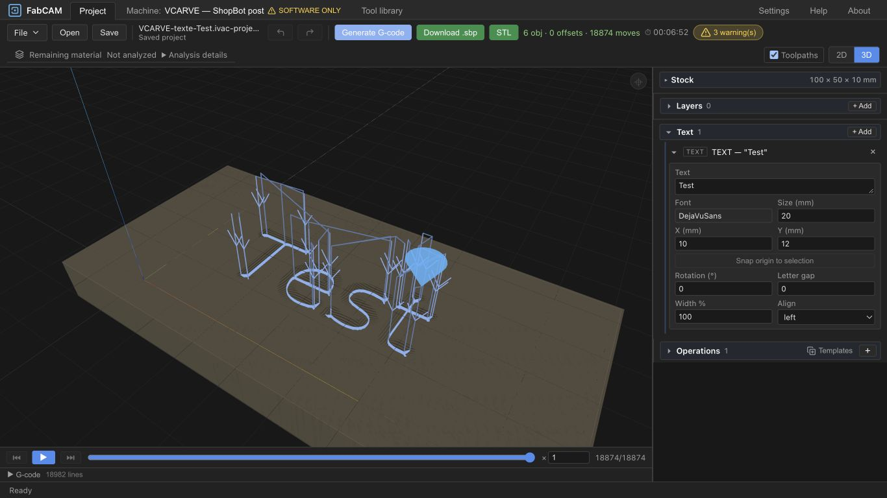

# PERF1-A — Profiling and benchmarking results

2026-10-15 · engineering ivac-sgnd complete · **human review ivac-xzys pending**.
**HARD STOP before PERF1-B.** This phase adds optional diagnostics and reproducible
harnesses, with no CAM algorithm, tolerance, cache policy or post optimization.

## Findings and decision proposed

On the representative saved Test project, the bundled ShopBot CPS post dominates
native generation: **769.4 / 781.9 ms, about 98.4%** in the profiled warm series.
The independent control series has a **903.5 ms** warm median. The many-segment
Profile also spends about **99.6%** in CPS. Pocket with islands instead spends
about **83%** in remaining-material analysis. These are different bottlenecks.

In the actual production browser over HTTP, Test reaches its first rendered 3D
frame at a warm median **935 ms**, while simulation replay completes at
**3531 ms**, range **2310–4051 ms**. That latter marker includes the existing
1000 ms debounce, configuration and replay; its cause is not yet isolated.

The user explicitly selected `VCARVE-texte-Test` as a **representative surrogate**.
The exact project associated with the reported 5–10 seconds is unavailable. These
results neither reproduce that report nor establish its cause.

Propose B1 first: investigate safe reuse of an unchanged, deterministic bundled
ShopBot whole-post result (existing ivac-rnsg), after auditing all inputs and
invalidation. This is a proposal, not an implemented cache or approved B scope.

## Scope, fixtures and measurement boundaries

[Environment and source/binary identities](perf1/ENVIRONMENT.json),
[request manifest](perf1/requests/manifest.json),
[full numerical summary](perf1/SUMMARY.json) and
[native table](perf1/SUMMARY.md) are retained with raw observations.
Machine: Apple M4, 10 logical CPUs, 16 GiB, macOS 26.5.2 arm64; Rust 1.88,
Node 24.21. Base published commit is `2032848e8087caf4dd1a1a466aa5bbb8c7027341`;
the measured diagnostics/harness changes remain uncommitted. Raw records pin the
actual measured binaries. The later harness-only MSRV/timeout fixes do not
change the production pipeline.

Nine cases run with both built-in LinuxCNC and native ShopBot CPS: square outline,
square medial, saved Test medial, Test outline, B8 medial, pocket with islands,
profile contours, synthetic many-segment profile, and a deliberately missing layer.
The exporter uses production project adapters, source combination and stock
placement, including rendered text bounds and embedded font bytes. Request hashes
pin tools, stock, operations, text, geometry and post properties. The synthetic
profile has 4096 imported line segments plus four stock segments, 129 objects.
Test has 738 segments after text rendering, six objects, 2637 medial samples,
4279 triangles, 2394 target points and 18863 planned points in the cold CPS probe.

Each native request/post starts a fresh process, serially, without concurrent
compilation: first call is **process-cold**, second warmup, last five warm samples.
OS filesystem/page caches are not flushed. Inputs are cloned outside the pipeline
timer; JSON serialization has its own timer. Existing caches are retained: generic
per-operation cache hits differ from CPS whole-program execution, which has no
per-operation result cache. No concurrent global cache reset is used.

Native control is release with `cps`; profiled release adds opt-in `profiling`.
Span timings are inclusive; **do not add child spans to their parents**. Control
and profiled batches were not interleaved/randomized. Their total differences
cannot quantify instrumentation overhead: Test's profiled median is lower than
control, so stage proportions use only the corresponding profiled series.
Default builds and WASM do not record native spans.

WASM runs the actual release package in standalone Node/V8, with seven calls per
request. Initialization and parsing are separate; generation includes JS/Rust
binding conversion, unlike the native inner pipeline boundary. It is **not a
browser worker, Tauri IPC, DOM or browser-memory benchmark**. Native release uses
thin LTO/codegen-units=1; WASM favors size (-Oz). Thus the comparison describes
these builds and boundaries, not an intrinsic language/backend speed ratio.
The browser series separately measures production HTTP plus actual state/render
boundaries. No native desktop/Tauri timing is claimed.

## Representative results

Milliseconds; native control warm n=5. Full cold/ranges/RSS and all nine cases
per post remain in [SUMMARY.md](perf1/SUMMARY.md).

| Workload | Native cold | Native warm median [min, max] | Moves | Peak RSS MiB |
| --- | ---: | ---: | ---: | ---: |
| Test medial / CPS | 820.49 | 903.53 [818.46, 975.72] | 18874 | 83.1 |
| Many-segment profile / CPS | 1271.34 | 1217.40 [1210.39, 1224.16] | 25215 | 126.2 |
| Pocket islands / CPS | 406.71 | 404.82 [403.32, 409.52] | 1535 | 38.8 |
| Square medial / CPS | 271.24 | 269.10 [268.81, 298.73] | 5862 | 44.8 |
| Test medial / LinuxCNC | 32.54 | 3.35 [3.34, 3.43] | 18877 | 31.5 |
| Pocket islands / LinuxCNC | 338.91 | 335.53 [334.02, 340.09] | 1538 | 14.8 |

LinuxCNC and CPS generate different programs/preview representations, so their
timings are not identical-output backend comparisons. The applicable same-request
native/WASM comparison uses LinuxCNC only:

| LinuxCNC request | Native warm pipeline | WASM warm binding | WASM cold binding |
| --- | ---: | ---: | ---: |
| Test medial | 3.35 | 22.60 | 98.34 |
| Pocket islands | 335.53 | 361.01 | 394.43 |
| Many-segment profile | 6.14 | 32.18 | 109.34 |
| Square medial | 0.75 | 3.81 | 39.97 |

WASM initialization is roughly 12–25 ms separately across fixtures. Its CPS
attempt explicitly returns `cps_unavailable`; that refusal is not a speedup.

Profiled warm stage attribution:

| Workload | Pipeline | Dominant inclusive stage | Other relevant stages |
| --- | ---: | ---: | --- |
| Test CPS | 781.95 | CPS 769.42 | operations 10.30; clearance 9.47 inside operations; decode 1.66 |
| Many-segment CPS | 1189.88 | CPS 1185.13 | operations 1.28; decode 2.32 |
| Pocket CPS | 396.03 | remaining material 328.75 | CPS 66.99; operations 0.08 |

`/usr/bin/time -l` raw files retain process CPU/real time and peak RSS. They cover
seven calls plus parsing/serialization, not isolated-stage allocation counts.
The separate three-second CPU sample confirms main-thread activity, but release
symbols are stripped; addresses do not identify fine Boa instruction hotspots.
No browser allocation count, memory-leak diagnosis or exact allocator attribution
is claimed. A separate debug seven-call batch exceeded its 90-second wrapper;
its recovered late result (12.4–13.6 seconds/call) is exploratory only and excluded
from controlled comparisons. It does not establish the cause of the user's report.

SVG/DXF import is measured separately, bytes already in memory, seven calls:
SVG first 8.34 ms / warm median 4.03 ms (4096 segments); DXF first 1.90 ms /
warm 0.32 ms (256 arc segments). Different representations prohibit a format
speed ratio. Historical Criterion DXF corpus files are absent; skipped optional
corpus benchmarks are not evidence of exercised coverage.

## Browser, cancellation and output validity

[Browser raw events](perf1/browser-http.json) retain all nine generations.
Warm baseline IDs 2,3,7,8,9 exclude exploratory 4–6, which overlapped standalone
WASM measurements. All endpoints are milliseconds from Generate, not durations
to add together. Tool upload/download stalls are excluded from these page clocks.

| Endpoint | Warm median | Range |
| --- | ---: | ---: |
| Context ready | 1.9 | 0.8–2.2 |
| Request sent | 2.3 | 1.1–2.8 |
| Response received | 822.2 | 787.4–871.7 |
| State applied | 827.4 | 790.0–873.6 |
| Wire buffers ready | 917.7 | 906.7–947.3 |
| First actual renderer frame | 935.4 | 923.3–975.0 |
| Simulation configured/replayed | 3531.2 | 2309.9–4050.5 |

First call reached frame at 1005.5 ms and simulation at 2400.7 ms. The frame marker
follows `renderer.render`, not proof of GPU presentation. Simulation markers reject
stale generated-result versions. Growing replay latency across repeats is observed;
finer debounce/configure/replay attribution is deferred as ivac-lf1e.
Opt-in `?perf=1` emits diagnostics; normal use has no probe log/clock session.

Native CPS cancellation: five requests at 1 ms return cancelled within 0.09–0.74 ms
after request; five at 50 ms take another 730–739 ms. Existing cancellation checks
surround monolithic post execution. All ten return cancelled, no valid partial
response. This measured responsiveness issue is deferred as ivac-sxmw. Browser
edit → stale/export-disabled → Regenerate → Cancel also retains disabled export;
Undo restores the saved project and prior valid output. No numerical edit is
claimed from a field fill whose change event did not commit.

All 14 returning native cases (12 accepted, two empty-source diagnostics) have
byte-identical full responses with/without profiling; warm responses remain stable.
Four Test-outline/B8 envelope refusals match and are classified separately.
The missing-layer case returns `op_source_empty`; it is not accepted machining.
All seven returning generic native/WASM cases have identical emitted programs and
move counts. Six full structures match exactly; many-segment preview coordinates
differ by at most 2.8422e-14 mm, with identical emitted G-code. The actual downloaded
Test OpenSBP file matches the native control program SHA exactly:
[browser output comparison](perf1/browser-output-comparison.json).
No new physical cut, measurement or machine qualification is asserted.



## Reproduction and checks

Run from repository root unless stated. Retained requests can be used directly;
fixture regeneration additionally needs the CPS server on 18794 for production
text sizing. No external data download is needed.

```sh
cargo build --offline --release -p ivac-core --features cps --example perf1_probe
python3 scripts/perf1-native.py --binary target/release/examples/perf1_probe --requests docs/shopbot-modernization/perf1/requests --output /tmp/perf1-control --work /tmp/perf1-work --repeats 7
cargo build --offline --release -p ivac-core --features cps,profiling --example perf1_probe
python3 scripts/perf1-native.py --binary target/release/examples/perf1_probe --requests docs/shopbot-modernization/perf1/requests --output /tmp/perf1-profile --work /tmp/perf1-profile-work --repeats 7
node frontend/scripts/perf1-wasm.mjs docs/shopbot-modernization/perf1/requests/text-Test-medial-linuxcnc.json /tmp/perf1-wasm.json 7
```

`frontend/scripts/perf1-fixtures.ts` runs under the existing vite-node with
`--config vitest.config.ts` from frontend. `scripts/perf1-report.py` rebuilds the
summary from retained evidence. For full response structural comparisons it also
uses regenerated temporary responses under `/private/tmp/fabcam-perf1/{control,wasm}`;
those large payloads are not source artifacts. Raw records retain program hashes.
`perf1_probe` optional modes are `import`, `cancel [delay_ms]`, or sample-loop seconds:
`perf1_probe moderate.svg result.json 7 import`,
`perf1_probe text-Test-medial-cps.json result.json 1 cancel 50`, and
`perf1_probe text-Test-medial-cps.json result.json 1 8`. Supply full request paths
from `perf1/requests`. The last mode permits separate macOS `sample PID 3 1`
CPU capture; it is not included in the timed baseline.

Checks: frontend 1262 passed/1 skipped; check zero errors/warnings; lint and release
build pass; strict standalone fixture TypeScript check passes. Core cps+profiling
1075 unit tests pass serially (including probe nesting/return/thread isolation),
geometry-source 7, V-Carve qualification 10 and ShopBot guards 7 pass. Clippy with
`-D warnings` and workspace rustfmt pass. Existing global cache race ivac-htc8
remains separate; serial execution avoids inventing a fix in this phase.

## Proposed PERF1-B scope and acceptance

1. **B1, first candidate — unchanged bundled ShopBot whole-post reuse.** Audit
   source/name, exact IR/program, all properties, runtime identity and every actual
   `run_post` input; restrict reuse to audited deterministic bundled behavior.
   Preserve warnings, line mapping, safety checks, decoding, freshness, cancellation
   and output byte equality. Do not apply speculative reuse to arbitrary dynamic
   CPS scripts. Proposed target: warm Test pipeline at most 400 ms and at least
   50% improvement versus a fresh paired control, with warm first preview also
   improving at least 50%. These are acceptance targets, not achieved claims.
2. **B2, separate candidate — remaining-material work.** Pocket analysis dominates
   despite cached operations. Consider exact-input reuse or carefully deferred
   analysis only with diagnostics/freshness preserved. Proposed stage target at
   least 50% reduction on the same pocket, with unchanged analysis results.
3. **Further measurement — simulation and cancellation.** Isolate configure/replay
   before selecting simulation changes; investigate bounded post interruption.
   No presumed leak, removed debounce or arbitrary VM rewrite is selected by A.

For each approved change, rerun same requests, exact output/refusal checks and
paired cold/warm CPU/RSS/UI comparisons; change source/script/properties/IR/tools/
stock one at a time to prove invalidation. No tolerance relaxation or physical
qualification shortcuts. **Review ivac-xzys must approve or revise B scope before
implementation. No new commit/push is authorized by this report.**
