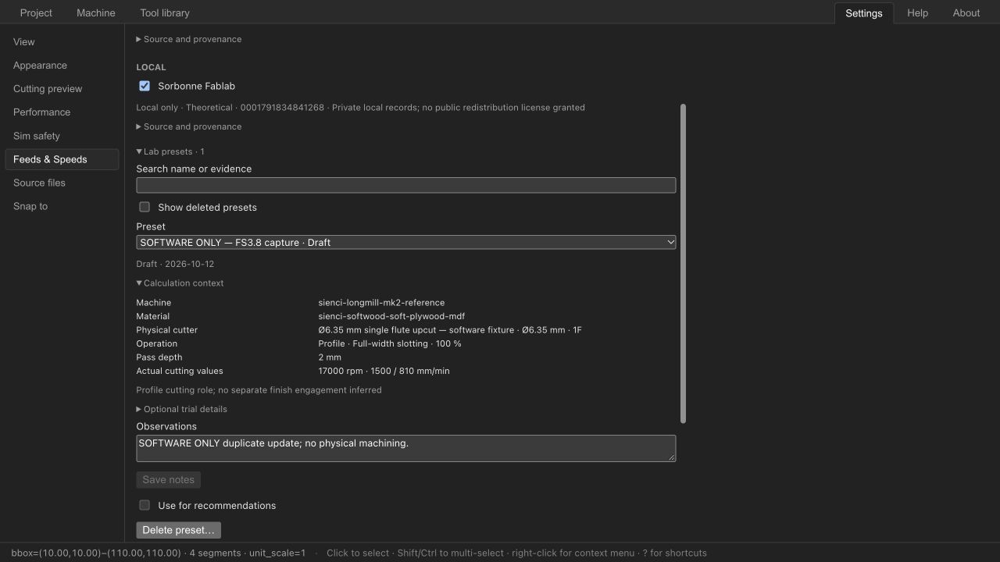

# FS3.8 — Local Preset Capture & Validation Workflow

Date: 2026-10-12. Engineering qualification; human gate **ivac-7yii** open.
User explicitly authorized this checkpoint only. FS4 remains unstarted.
No real physical trial, Tested or Validated production preset is claimed.
All programmatic physical attestations are synthetic SOFTWARE ONLY test data.

## Existing architecture reused

SourcePack, dataset/profile-set format 1, existing Evidence/ExactPreset model and
FS3.7 deterministic resolver; same Tauri app-data/IndexedDB stores; safe v4 applied
knowledge summary and saved-value generation. Core capture shares cam_request and
saved_rates, including main Profile Finish vs Pocket Rough roles. No mathematical,
ShopBot post or physical Tool/CuttingParameters model changes.

## Local preset model

Pack schema 2 adds optional LabPreset metadata and LabRevision history; schema 1
continues loading and Sienci remains unchanged. Sorbonne is private/local_only.
UUID stable preset IDs differ from names; exact machine/material/tool versions,
operation/DOC/entry/engagement/thickness and actual rates define applicability.
Draft is inactive theoretical authoring, not a new cutting Evidence member.
Missing reliable identities refuse capture. Existing Machine/Tool fsIdentity fields
now support deliberate local UUID setup for the first capture without a source
catalog; names never become identity. Renaming does not create a semantic conflict.

## Save workflow

Secondary Save as lab preset opens compact prefilled dialog. Name and observations
are common; trial details and actual calculation context are disclosures. Actual
manual rates win over old recommended values. Machine display name is taken from
current CAM metadata; identity remains the core snapshot's stable identity. Save
never applies/recalculates. Stale context blocks Save; stale pack head rejects write.

## Evidence / validation workflow

Draft is excluded from recommendation resolution. Tested requires physical-use and
successful-cut attestations plus a valid nonfuture date and known engagement/entry.
Validated is offered only later for a Tested record through explicit review notes
and confirmation under sorbonne-local-validation-1. No arbitrary cut count or
numerical scientific tolerance. Loader checks matching evidence, exact scope,
required attestation and review metadata, valid dates and chronology. Imports are
not automatically promoted. See LOCAL_VALIDATION_POLICY.md.

## Duplicate / revision handling

Matching stable context offers Save new or Update existing. Similar DOC threshold
(5% or 0.01 mm) is solely a duplicate hint; resolver scope remains exact. Matching
handles Rust JSON property order and omitted nullable fields, and display renames.
Updates retain ID/creation date and previous profile/evidence/authoring snapshots.
New values start Draft/Tested; old Validated review is retained as history, not
silently reused. Native imports and saves share a lock; saves additionally compare
expected head. Browser transaction compares head and appends immutable revision.
Only current Sorbonne head is loaded; history remains in the head and old files.

## Settings management

Compact searchable record selector, context/trial/history disclosures, observations
editing, enable/disable, confirmed reversible deletion/restore, later promotion and
backup. Selection and expanded sections survive writes. Draft cannot be enabled or
promoted. Reactive JSON props are cloned at the data boundary without mutating the
previous pack. Browser verification caught and fixed legacy empty names, reactive
proxy cloning, and Rust normalization mismatches before this handoff.

## Storage location

Desktop OS-resolved app_data_dir()/feeds-speeds/sources; application identifier
org.opcenter.ivacam. Immutable ID@revision.json, Unix 0600; repository paths and
symlink storage refused. Browser origin-local ivac-cutting-source-packs IndexedDB,
packs store. No parallel database, private source body in Git/project, auto bundle,
upload or sync. Native execution/storage is tested; no new desktop delivery bundle.

## Backup/export

Explicit export contains private operator/observations and full retained preset
history. Validated JSON restore on an empty installation/origin succeeds. Duplicate
or older installed Sorbonne revision is rejected; there is no silent rollback or
merge. Pack limits 2 MiB, 32 distinct IDs, 512 immutable revisions total / 32 non-lab
revision files. Export before limits; history compaction is not implemented. Native
crash recovery may require removing its marker only after closing all instances.

## Tests

| Check | Result |
| --- | --- |
| cargo test -p ivac-feeds-speeds | **77 passes + 1 doctest**; 8 new lab loader/resolver checks |
| core feeds_speeds adapter tests | **16 passes**; 3 new capture/override/context/no-mutation tests |
| native source_packs storage tests | **3 passes**; immutable CAS, shared import/write lock and existing path validation |
| frontend Vitest | **113 files, 1,087 passes, 1 optional skip**; 13 authoring regressions |
| Svelte/TypeScript | **0 errors, 0 warnings** |
| frontend ESLint/Prettier | Pass |
| Rust fmt and Clippy all targets: feeds-speeds/core/tauri/wasm, -D warnings | Pass |
| Optimized WASM and frontend release build | Pass; existing Tauri static/dynamic import warning remains |
| ShopBot CPS post regression | **8 passes**, serial; no post changed |
| Git whitespace check | Pass |

Browser checks use isolated http://127.0.0.1:18768 and localhost:18768, WASM-only,
with the existing SOFTWARE ONLY FS3.5 fixture. They do not populate production
source storage or claim machining. Verified:

- Actual capture 17,000 rpm, **1,500 mm/min manual feed**, 810 plunge, 2 mm DOC;
  the old public proposal's 1,620 feed is not substituted.
- Draft capture persists; Tested without physical/success attestations is refused.
- Changing feed after opening shows stale-context message and disables Save.
- Notes persist and create history; selected record remains selected.
- Search filters; Draft enable is disabled and promotion absent.
- Delete requires confirmation; restored record retains history (3 snapshots).
- Explicit backup emits schema-2 private/local_only pack with actual values/history.
  Restore on empty localhost origin succeeds; repeat import is refused clearly.
- Duplicate update after normalized Rust round-trip succeeds with stable ID/history.
- Actual project downloads before/after update have identical **operations, tools
  and machine**, and contain no private capture observations.
- Deliberate Machine local identity creation displays a UUID and current revision.

The synthetic promotion/Validated-vs-Tested precedence checks are automated; no
human machine validation is inferred from UI or programmatic confirmations.
Windows/Linux runtime, native desktop UI bundle, and real physical loop are not
qualified here. Existing partial WASM freshness issue ivac-5g51 was encountered
when sandboxed optimization left an incomplete pkg; an explicit successful
optimized rebuild regenerated the package before final browser verification.

## Documentation

Audit, ADR-0006, SOURCE_PACKS schema-2 extension, PRESET_AUTHORING workflow,
LOCAL_VALIDATION_POLICY, STATUS/ROADMAP/DEVLOG, architecture/upstream/validation
and indexes updated. FS3.7 historical evidence and unclosed human gate are retained.
The subsequent user instruction explicitly authorizes commit/push of FS3.7/FS3.8.
Publication does not close the human gate or authorize FS4.

## FS4 readiness

The software loop is ready for human review: set reliable identity/material,
recommend or edit → later physical cut → capture actual values as Tested with
brief observations → repeat → later deliberate review/Validated. Unknown context
stays Draft. Pocket secondary finishing qualification remains context-only; no
unsupported exact finishing scope is invented. A compatible source is required for
an initial recommendation; missing reference compatibility leaves manual values
available. No claim that generic Sienci data is a validated ShopBot preset.

**STOP — waiting for human approval before starting FS4.**
