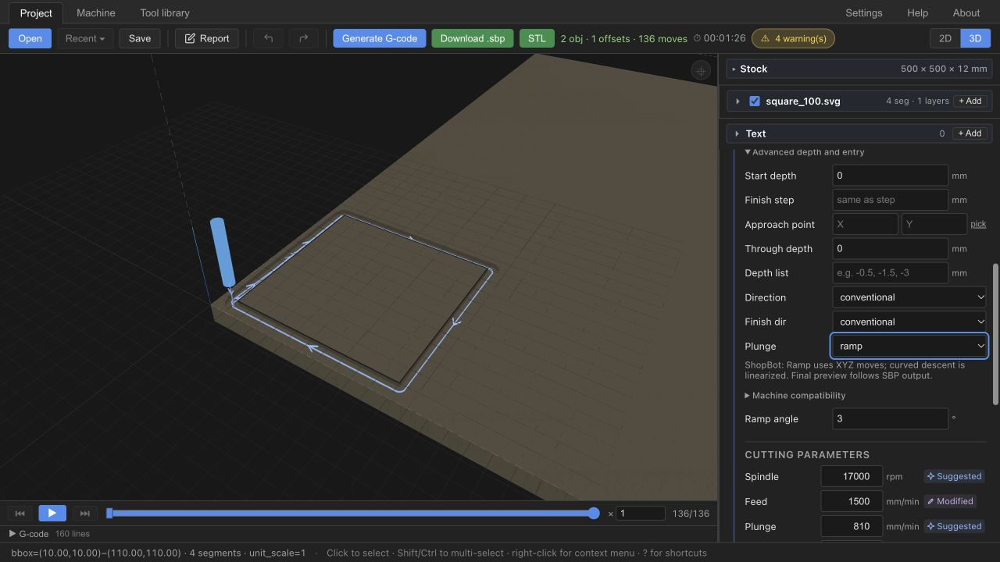

# UX1 — ShopBot-compatible milling entry strategies and preview/output parity

Software qualification: 2026-10-13. UX1 continues the approved milestone; earlier
Ramp, rejection, inspector and stale-export work is retained. Engineering
ivac-uigy; human review gate ivac-cb64. No publication/hardware authorization.

> UX1 qualifies milling entry strategies against ShopBot post capabilities and
> establishes preview-to-machine-output consistency.

This is CAM capability resolution/post qualification as well as UX. FS4 remains
DEFERRED/nonblocking. General Stock/Origins/WCS/Fixtures work is CAM2/UX2.

## Generic CAM behavior and geometry validity

| Requested entry | Profile | Cascade Pocket | Bundled ShopBot result |
| --- | --- | --- | --- |
| Direct | Existing vertical entry | Existing vertical entry | Existing SBP behavior, final preview decoded from output |
| Ramp | Path-following descent where sufficient path length exists | Path-following descent on emitted pocket contours | Scoped XYZ / linearized curved Ramp without tabs/leads; actual vertical fallback blocks |
| Helix | Local polygon-fit spiral where circle fits; current emitter later retracts/repositions/plunges at contour | Local spiral per contour; full region/island/inner-loop transitions are not fully qualified | Reject before output; requested Helix remains saved |

Generic geometry is machine independent. No ShopBot branch enters Profile/Pocket
planning. The existing Helix planner can resolve insufficient radius/space or open
paths to Ramp/Direct. A new generic emission comment makes this geometric fallback
explicit without rewriting intent. ShopBot preflight checks this before its
representation decision and rejects the fallback with the geometric cause. Valid
local helical motion also rejects, with a distinct explanation: full region
clearance and contour re-plunge remain unqualified. Linearization must not hide an
invalid or unqualified CAM entry. No automatic Helix→Ramp machine fallback.

The auto-radius region fitter's island tests remain; these do not prove every
later per-contour helix. Pocket islands are drawing topology, not clamp fixtures.
An arc crossing Ramp's descent length ends descent at its endpoint; its corrected
warning explains the shallower angle, without claiming a fictitious vertical dive.

## ShopBot capability resolution and preview/output parity

[ADR-0007](../adr/ADR-0007-shopbot-resolved-preview.md) records the smallest extension
of existing CPS preflight + `linearize`, avoiding a new universal capability model.
Scoped varying-Z XY Ramp arcs use existing kernel XYZ linearization at 0.01 mm
chord tolerance; emitted primitives remain reviewed M3 XYZ, ordered JZ/J2 jogs
and MS feed. No new OpenSBP syntax or controller capability claim.

Final bundled ShopBot preview decodes the owned post's output movement subset:
rounded XYZ endpoints, split rapid axes, feed/dwell and exact source lines.
Simulation, envelope warnings, playback and timing consume this same resolved
`toolpath`. Analytic ArcXY descriptors are absent for emitted straight chords,
so simulation no longer carves an ideal arc where output follows a chord.
Unknown commands/non-finite values/unestablished cutting XYZ fail qualification;
there is no silent return to generic IR. Other/custom CPS posts retain existing
IR preview and are outside this parity qualification. Filename alone confers none.

Requested CAM strategy is not necessarily machine representation, but adaptation
must be explicit, deterministic and reflected in final preview. Existing per-op
`entry_representation` diagnostic params expose requested/resolved/target,
`tolerance_mm=0.01` and `preview_source=emitted_output`; expected adaptation is
informational. No new request/response field or persisted resolution state.

Initial operator XYZ is unknown: the first JZ and XY placement establish a position;
the unknown starting trajectory is omitted rather than invented. All subsequent
moves, including every cut, follow emitted endpoints and source lines. Manual
intervention at pauses/zero/tool changes is not simulated. Geometry before Generate
remains generic; this qualification concerns the final generated path.

## Explicit refusal and preserved safeguards

- Helix/Trochoidal/path-wide helix: geometry failure/fallback or unqualified genuine
  helical transition rejects with op-scoped reason, keeping authored values.
- Ramp+tabs/leads: composition can substitute a direct plunge; choose Direct or
  remove the combination explicitly. Full entry×tabs×leads matrix is deferred.
- Too-short Ramp emitting vertical cutting descent blocks at four-decimal XY
  output precision; this includes small pocket contours.
- Existing nonzero numeric WCS/G55–G59 ShopBot safeguards are retained. No further
  origin/stock work in this continuation. Generic coordinate translation repair,
  stock reference clarification and real fixture authoring belong to CAM2/UX2
  (ivac-vj11). Explicitly shifted geometry/stock + zero numeric G54 remains tested.

## UX and persistence

Compact inspector status explains XYZ/linearized Ramp; collapsed Machine
compatibility shows human-readable requested/resolved representation and preview
source. Helix refusal remains inline; its tooltip now accurately describes the
existing retract/reposition/contour plunge. No large cards or default internals.

Operation strategy and manual cutting slots remain authoritative and portable.
Save/reopen does not convert Helix to Ramp. Runtime generation input identity
(shared wire builder + selected post/properties) continues to block stale export
independently of file Save; native export rechecks after the save picker. Undo/Redo
can restore/invalidate the matching prior result. No Tool/CuttingParameters/project
schema change, FS recomputation/data/mathematics/UX expansion or new machine limit.

## Durable acceptance evidence

| ID | Evidence and boundaries |
| --- | --- |
| UX1-01 | Actual Profile/cascade Pocket Direct/Ramp/Helix behavior; square/circle/concave/open/island test drawings, impossible radius/short-path cases. Local valid Helix tested generically; machine rejects unqualified operation. |
| UX1-02 | Ramp nonvacuous XYZ descent, floor/pass depth and pocket island cutter clearance. Known-state emitted XY jogs retain clearance. No blanket sweep proof for arbitrary advanced combinations. |
| UX1-03 | Independent SBP decoder compares final Direct/Ramp Profile/Pocket preview segment-for-segment: exact rounded XYZ, motion class, op and source line. Circular inside/outside geometry × direction checked analytically at 0.0102 mm (0.01 chord/import-fit + 0.0002 output-rounding allowance). This is not physical tolerance. |
| UX1-04 | Geometry-invalid Helix fallback identified before compatibility refusal; genuine Helix separately refused; Ramp vertical fallback/tabs/leads errors explicit. Requested Project JSON unchanged after both success and rejection. No unsupported variable-Z arc reaches SBP. |
| UX1-05 | Climb/conventional and inside/outside Ramp circles; generic Profile/Pocket local Helix winding follows direction and descends to authored pass/floor. Direct straight leads + rectangle/ramp tabs retain protected material. Existing lead/offset/snapshot regressions pass; broad combination qualification deferred. |
| UX1-06 | Actual compact inspector/default and expanded compatibility screenshots; expected adaptation informational, unsafe case blocks. Final preview uses emitted straight chords. |
| UX1-07 | Native serialized requested Helix survives reload/target change; browser reopens saved Helix, keeps manual feed 1500, rejects without rewrite, then explicit Ramp generates/exports. Prior edit/Save/Undo/Redo stale-output checks retained, frontend history/persistence tests pass. |
| UX1-08 | Human gate ivac-cb64 remains; no new hardware/desktop bundle/publication claim. Fixture/stock authoring removed from UX1 acceptance and explicitly recorded under CAM2/UX2. FS4 stays deferred. |

## Checks and reproducibility

Final serial native suite: **1,056 core library + 11 M1 + 17 ShopBot M2/UX1 + 4
snapshot tests pass**. Includes owned decoder fail-closed/precision/feed/dwell/line
tests, independent output parity, generic Helix direction/depth/invalid radius,
island/open Helix rejection, previous Ramp/clearance/island/tab/output goldens.
Frontend: **115 files, 1,092 passes, 1 optional skip**; check zero errors/warnings,
ESLint/Prettier, Rust fmt and core/CPS all-target Clippy warnings denied pass.
Complete optimized WASM package, frontend and CPS native HTTP server build pass;
existing Tauri mixed-import bundling warning only. Default WASM has no CPS;
UI evidence uses native local HTTP CAM with single localhost CORS origin.

```sh
CARGO_TARGET_DIR=/private/tmp/fabcam-ux1-target CARGO_INCREMENTAL=0 CARGO_PROFILE_DEV_DEBUG=0 CARGO_PROFILE_TEST_DEBUG=0 RUSTC_WRAPPER='' cargo test -p ivac-core --features cps --lib --test shopbot_m1_qualification --test shopbot_m2_post --test snapshots_drill_tabs_whirl -- --test-threads=1
CARGO_TARGET_DIR=/private/tmp/fabcam-ux1-target CARGO_INCREMENTAL=0 CARGO_PROFILE_DEV_DEBUG=0 CARGO_PROFILE_TEST_DEBUG=0 RUSTC_WRAPPER='' cargo clippy -p ivac-core -p ivac-cps --all-targets --features cps -- -D warnings
cargo fmt --all -- --check
```

Use installed Node 24 for frontend check/test/lint/build; native/WASM builds need the
configured Cargo/wasm-pack/wasm-bindgen/wasm-opt paths. Logs `/tmp/ux1-parity-*.log`. Test servers and tab were closed after review;
Cargo scratch target cleaned (1.5 GiB), root target/debug remains absent.
A parity-test small-pocket/3° input reproduced the existing vertical fallback and
correctly rejected; qualified ordinary pocket parity uses sufficient path/angle,
without weakening the guard. Prior 101 generic moves become 136 emitted movements
for the browser Ramp fixture; manual feed 1500 is retained and SBP with 160 displayed lines exports.

## Human review and remaining limits

[Software-only Ramp project](../UX1-software-ramp.ivac-project.json) uses inherited
public ReferenceData/software values, not ShopBot cutting advice. Generate in a
CPS-capable build, inspect entry and collapsed/expanded compatibility, review emitted
XYZ/source-line parity. Save/reopen Helix must keep Helix; ShopBot must refuse it.
Choose Ramp explicitly, regenerate and confirm export. Do not machine this project
as a physical validation protocol.



[Compatibility details](UX1-machine-compatibility.png),
[reopened Helix](UX1-helix-reopened.png); earlier stale-export evidence retained.

Helix full-region/contour transition qualification remains unimplemented, rather
than masked by linearization. Arbitrary advanced pocket combinations, other/custom
posts, unknown operator startup motion and manual actions are outside proven parity.
Physical controller/air-cut/material validation remains unperformed. CAM2/UX2 stock,
origin/WCS and clamp/keep-out authoring/collision work is documented, not started.
Stop at human review; no commit/push performed in this UX1 continuation.
