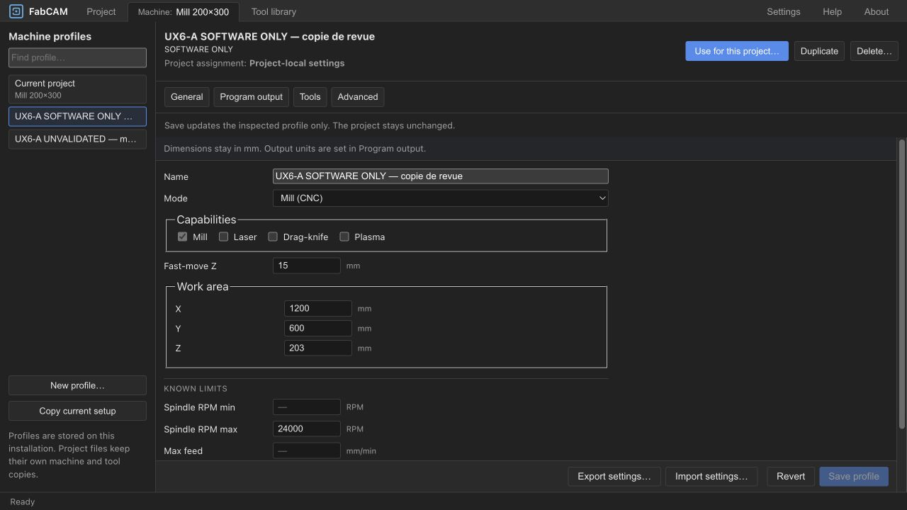

# UX6-A — Machine Profiles UX Redesign: results

2026-10-15 · Engineering complete; **human software/visual review ivac-osa4z ACCEPTED**.
User authorized A and accepted the [Phase 0 contract](UX6_PHASE0_AUDIT.md).
Engineering ivac-jhfns. **HARD STOP before UX6-B**. Software qualification only.

## Delivered behavior

The machine workspace now separates profile inspection from project assignment.
A searchable left browser keeps the current project and local saved profiles distinct.
Inspecting or saving an inactive profile does not change project settings, history or
successful output. “Use for this project…” reviews replacement of machine/tool copies,
including operations whose tool is missing or whose same-ID copy differs. Confirmation
uses the existing project command, history, compatibility and stale-output checks.
No automatic tool remapping or recalculation of saved operation cutting values.

General groups identity/process, job workspace, clearance and known RPM/feed limits.
Program output groups dialect/CPS properties, units/features and tool-change/end
behavior; ShopBot unsupported choices remain visible and explicitly described.
An unset dialect displays “Use workspace output default” rather than claiming LinuxCNC.
Specialized process and retained built-in templates remain discoverable disclosures.
Advanced distinguishes time-estimate assumptions from controller configuration, including
an explicit statement that the current time model does not consume jerk limits.
Tools preserves the existing active-project loadout workflow; inactive profiles show
saved copies and explain the assignment requirement. Tool Library redesign is deferred to B.

Dirty navigation offers keep editing, discard, or scoped save/apply. Changes to the
committed source or its active/inactive ownership while editing block commit and offer
reload. Active Apply retains existing project mirroring; inactive Save updates workspace
storage only. Profile deletion explains its local persistence scope and lack of project
Undo recovery. Project-local snapshots remain usable when a referenced profile is missing.

Creation is staged: identity/process → built-in output → workspace assumptions → review.
Saving a new profile does not assign it. No tools or known physical limits are invented;
initial workspace dimensions are explicitly defaults, not measurements. CPS can be
configured after saving in Program output. Duplicate/copy retain the existing copy model.
Machine import now reads into the draft; applying/saving remains explicit. Export writes
the displayed draft without committing it. Format/version and existing immediate-load
service behavior for other callers remain intact. Machine-only files exclude tools.

## Verification

| Evidence | Result |
| --- | --- |
| Full frontend suite | **141 files, 1277 tests pass, 1 existing optional skip** |
| Type/Svelte checks | **0 errors, 0 warnings** |
| ESLint / Prettier | Pass |
| Production frontend build | Pass; existing large-chunk and mixed Tauri event-import warnings remain |
| New focused regression cases | Missing/changed tool assignment review; migration/copy isolation; unknown creation limits; staged machine import, invalid/cancelled import, export/cancel without commit |
| Shared existing coverage | Profile commands/mirroring, history, dialog drafts, compatibility/stale export, machine roundtrip, ShopBot refusal and persisted cutting values |

Raw [tests](ux6-a/TESTS.txt), [check](ux6-a/CHECK.txt), [lint](ux6-a/LINT.txt),
[build](ux6-a/BUILD.txt). No core geometry, post or numerical behavior was changed;
this is not a new output algorithm qualification.

## Actual desktop review

Reviewed in the Codex in-app desktop browser, isolated localhost origin 18801 with
release HTTP backend 18802. This was an actual running UI, not the Phase 0 mockup.
The user's other browser origin and its profiles were not used for test mutations.

- Opened the existing V-Carve text project with a missing local profile reference;
  embedded machine/tool copies remained available. Generated 18,874 moves / 18,982 lines.
- Copied current settings, edited the inactive copy, used dirty-navigation Save, and
  returned to Project: original header, no project Undo change and SBP download retained.
- Reviewed and confirmed assignment: project header changed, Undo identified profile
  switching, previous generated output/download was cleared.
- Edited a draft, undid assignment from Project and returned: draft survived, ownership
  conflict was explicit and Save disabled; reload cleared it. [Capture](ux6-a/conflict-after-undo.png).
- Completed all four creation steps with a long UNVALIDATED name; saved without assigning,
  zero tools and unknown physical limits. Saved profiles survived page reload.
- Tested 1024 × 768 viewport: document width equals scroll width (1024), no horizontal
  overflow; long name truncates in browser, full accessible name retained, limitation
  remains visible. Arrow Up then Enter selected the preceding profile without assigning.
- Selected unsupported ShopBot automatic tool change in a draft: contextual warning and
  unsupported label appeared; Revert restored the committed manual selection.
- Inspected General, Program output, inactive Tools and Advanced with compact numeric
  fields, visible scope statements and fixed footer actions. Temporary viewport reset.

Additional captures: [narrow / long name](ux6-a/profile-narrow.png),
[ShopBot incompatible draft](ux6-a/shopbot-output.png), [Tools](ux6-a/tools.png),
[Advanced](ux6-a/advanced.png).

## Boundary and limitations

[Boundary check](ux6-a/BOUNDARY_CHECK.json) compares 781 tracked source inputs with
Phase 0's file-hash baseline: 8 existing frontend files changed, none missing.
Two new files add the pure assignment/creation helper and its tests. Core, post,
schema and shared project-command sources present in that baseline are unchanged.
This check is relative to the incoming working tree, not a clean upstream checkout.
Existing uncommitted milestone work is preserved; no Git operation/publication performed.

Packaged Tauri execution was not repeated. This review does not claim an exhaustive
post/process/backend combination matrix, physical machine validation, or human visual
acceptance. Destructive local deletion was not exercised in the browser; its existing
storage command and explicit confirmation path are retained. Import/export cancellation
is covered by service tests; not every operating-system file picker was reviewed.
Profiles remain installation-local, tool editing retains existing project semantics,
and inactive-profile tool editing is not introduced here. No UX6-B implementation.

**Accepted:** user approved A and explicitly authorized B; [B results](UX6_B_RESULTS.md) now hold the current review checkpoint.
Independent PERF cancellation ivac-nh6q, hierarchy ivac-1drzo and UX2.2 gates remain
unchanged. No physical qualification or release is implied.

## Human-review polish — 2026-10-15

User requested a persistent current-section cue and a clearer, spaced library-add
action. ivac-26854 corrects the ordinary-button CSS specificity that masked section
selection: subtle accent fill/border plus a 2px inset underline; aria-pressed retained.
MachineTooling adds a decorative Lucide Plus alongside the existing text and a 12px
gap before the list, with a quiet 28px button and expanded-state feedback. No model,
assignment, inventory or generation logic changed.

Actual browser review verified Tools remains highlighted after focus moves to the
library button, opening/closing the inventory works, and the add action is visibly
separated. [Updated actual capture](ux6-a/tools-polish.png). All 1277 tests pass
(1 existing skip); type checks, lint and build pass. No new tests for CSS-only polish.
UX6-A human gate ivac-osa4z remains open; UX6-B not started.

User accepted the A review polish and authorized B; historical pending-gate statements above are superseded by that acceptance.
