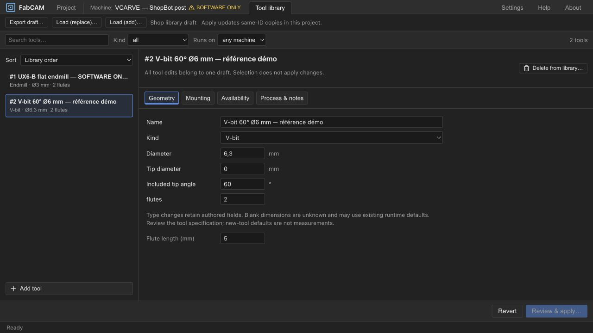

# UX6-B — Tool Library UX Redesign: results

2026-10-15 · Engineering ivac-f8w26 complete; **human review ivac-y2aln OPEN**.
User accepted UX6-A (ivac-osa4z closed) and explicitly authorized B.
**HARD STOP before another milestone.** Software qualification only.

## Implemented workflow

The editable multi-column table is replaced by a compact searchable list and one
selected-tool editor. Name, family, diameter and applicable flute count remain visible
in the list; kind/process filters, sorting and pagination retain their existing view
model. Arrow keys/Home/End move list focus; Enter inspects. A filtered-out selection
is explicitly identified and can be revealed without losing its draft.

Editing remains a single library-wide draft, with explicit Review & apply / Revert.
Switching tools or sections does not commit. The detail sections are:

- **Geometry:** identity, kind, diameter, applicable tip diameter/included angle,
  flute count/length and existing kind-specific geometry/process fields.
- **Mounting:** overall/shank/stickout dimensions, holder editor and presets. Unknown
  dimensions remain blank; authored defaults/presets do not claim measured clearance.
- **Availability:** current project copy, family compatibility, operation references
  and saved profile copies by ID. Add/remove uses the existing project commands.
- **Process & notes:** reference compatibility, coolant, Z shift, warmup/direction,
  whirling, notes, wear/calibration. Legacy cutting defaults and retained inactive
  fields are secondary disclosures, separate from physical tool dimensions.

Type changes preserve authored hidden values and no longer insert angle, flute or
thread-pitch defaults into the changed definition. New-tool creation still uses the
existing mode defaults, explicitly described as defaults requiring review. Suggested
conical-tool names use diameter when angle is absent instead of implying a measured
60°/30° angle. Existing custom names and stored files are not migrated or renamed.
Existing runtime defaults, geometry and post behavior remain unchanged.

No schematic was added: it was optional, and the scope uses explicit labeled dimensions
without inventing a body, holder projection or measured clearance from absent data.

## Ownership and consequences

The [approved Phase 0 contract](UX6_PHASE0_AUDIT.md) is retained:

1. Review previews all changed same-ID stocked copies and operation names before the
   whole library is saved. Diameter before/after is shown. Preview follows the existing
   serialization-sensitive copy-sync behavior, including property-order differences.
2. Apply uses existing inventory storage and project.replaceTools; manual/applied
   operation cutting values are never recalculated. Existing project Undo, profile
   mirroring, generation identity and stale export guards remain authoritative.
3. Project Undo restores project copies only. It does not undo the library save;
   inactive saved profiles retain their copies. The review explains these boundaries.
4. Dirty drafts survive external changes. Changes to committed inventory/project
   tools block blind Apply and require Revert/reload. A changed review token disables
   confirmation, preventing application of a stale consequence review.
5. Library deletion stages only removal of a definition, with operation/profile-copy
   counts and an explicit retained-copy explanation. Project removal refuses used or
   last tools. Library keeps its existing minimum-one-entry rule.
6. Availability actions require a clean library draft. Same-ID/different-definition
   additions retain existing collision renumbering; matching numeric IDs are never
   presented as proof of shared provenance or physical installation.
7. Replace-import previews replacement of the entire draft and explains 1..N ID
   renumbering and lack of operation remapping. Add-import retains existing duplicate-
   name skipping. Both remain staged; export writes the displayed draft without Apply.
   Project-tool editing now also stages imports through the existing pure import reader,
   rather than committing them from inside the file picker. No format/schema change.

The existing inventory/project stores are not a new atomic cross-store transaction.
If a save throws, the dialog reports the error and keeps its dirty draft; it does not
mark failure clean. Existing workspace persistence and project history scopes remain.

## Automated qualification

| Check | Result |
| --- | --- |
| Full frontend tests | **143 files; 1284 passed, 1 existing optional skip** |
| Svelte / TypeScript | **0 errors, 0 warnings** |
| ESLint / Prettier | Pass |
| Production frontend build | Pass; existing large-chunk and mixed Tauri event-import warnings remain |

[Tests](ux6-b/TESTS.txt), [checks](ux6-b/CHECK.txt), [lint](ux6-b/LINT.txt),
[build](ux6-b/BUILD.txt). No guard allowlist was broadened: obsolete translation keys
and the removed table's hardcoded-text allowance were removed.

Added regressions cover type/hidden-field preservation without fabricated dimensions,
changed same-ID copies versus local IDs, deletion retaining stocked copies, collision
renumbering, wear/holder review, staged replace/add/cancel/invalid import and export.
A command-level integration regression verifies inventory sync → project Undo/Redo →
JSON restore preserves a manually saved finish feed of 731 mm/min despite changed
cutter diameter and fallback feed. Existing generation-context, compatibility, project
file and output refusal tests remain in the full suite. Naming cases cover missing
angles and supplied angle/tip data.

## Actual desktop qualification

Reviewed the running frontend in the Codex in-app desktop browser at isolated localhost
18801 with the existing release HTTP backend 18802. Test inventory and changes were
confined to that origin; no user's other origin, machine controller or physical tool
was modified. The checked-in V-Carve Test project and a [two-tool software fixture](ux6-b/review-tools.ivac-toolset.json)
provide repeatable inputs.

- Opened the existing text project and generated **18,874 moves / 18,982 lines**.
  Preparing a replace-import and inspecting its V-bit left project Undo empty, project
  saved state intact and Download .sbp available.
- Changed the V-bit diameter to 6.3 mm, reviewed its affected “Carve Inside TEXT — Test”
  operation, then applied: project Undo became Update tool library, output became stale,
  and Download .sbp was disabled until regeneration.
- Edited a name, undid the prior project update externally, returned to the library:
  dirty name retained, conflict displayed and Review & apply disabled. Revert reloaded
  library data, accurately retaining the saved library diameter after project Undo.
- Availability showed differing current/saved same-ID copies and the referenced text
  operation. Used/last tool removal was disabled. Added an unstocked flat tool, then
  removed its unused project copy successfully through the same panel.
- Reviewed removal of the used V-bit from the *library draft*, including retained copies
  and dependency counts, then reverted. No persistent library deletion was performed.
- Changed V-bit → endmill in a draft: angle/tip controls disappeared, but retained-data
  disclosure showed 60° and tip 0 mm; Revert restored the type. Added a new tool and
  changed to V-bit: tip/angle/flute-length stayed blank; the proposed name was “3mm v-bit”,
  without a fabricated angle. Reverted that test draft.
- Search reduced the list to 1 of 2 tools; filtered selection notice and reveal action
  retained context. Arrow Up + Enter inspected another tool while a long-name draft
  remained present. Long title wrapped; list truncated with full accessible name.
- At **1024 × 768**, document clientWidth and scrollWidth were both **1024**. Numeric
  fields/footer remained accessible; selection cue persisted. Viewport override reset.
- Reviewed geometry, mounting/unknown dimensions, availability, retained fields and
  expanded legacy defaults. Calibration action/status aligned with field controls.

Captures: [search](ux6-b/search.png), [narrow](ux6-b/narrow.png),
[long name](ux6-b/long-name.png), [mounting](ux6-b/mounting.png),
[unknown dimensions](ux6-b/unknown-dimensions.png),
[legacy defaults](ux6-b/legacy-expanded.png), [retained angle](ux6-b/retained-angle.png),
[import preview](ux6-b/import-review.png), [apply review](ux6-b/apply-review.png),
[external Undo conflict](ux6-b/conflict-after-undo.png),
[availability](ux6-b/availability.png), [delete preview](ux6-b/delete-review.png).
The initial apply-review capture predates the added diameter-delta text; the applied
transition and operation consequence were already verified in that capture.

## Scope and handoff limits

Production changes are frontend presentation, draft guards, review helpers and truthful
name suggestions. Existing tool-family, inventory-copy, project-command, FS, post,
core geometry, API/schema and serialization formats are retained. New contextual
components reuse existing holder, form, calibration and compatibility editors.
The [781-file Phase 0 baseline comparison](ux6-b/BOUNDARY_CHECK.json) includes accepted
UX6-A changes as well as B: changed existing files are frontend only; none missing.
New files are not implied to be covered by that older baseline.

No packaged Tauri execution or physical qualification was performed. This is not an
exhaustive review of every tool-kind/post/backend/OS-picker combination or a new
numerical output certification. No controller capability, calibration measurement,
new association schema or global inactive-profile synchronization is claimed.
Known runtime fallback semantics remain; blank dimensions are not output qualification.
No commit, push, PR, release or subsequent milestone was authorized/performed.

**Next action: human software and visual acceptance ivac-y2aln — HARD STOP.**
Independent PERF cancellation ivac-nh6q and visual hierarchy ivac-1drzo gates retain
status. A new milestone needs its own explicit authorization.
