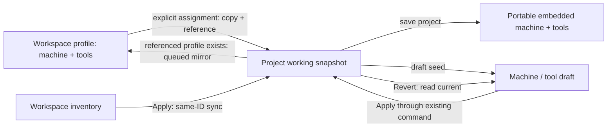
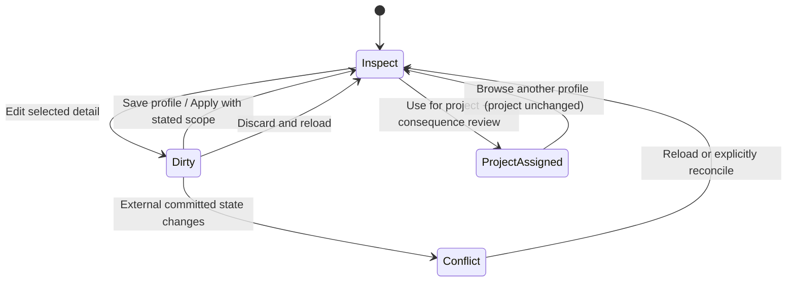

# UX6 Phase 0 — machine profiles and tool library audit

2026-10-15 · Engineering ivac-4df39 · **Audit complete; proposal awaiting human approval.**
Human review ivac-tjgt1. User accepted Drawings/Layers (ivac-ena7m) and authorized the next UX checkpoint.
This completes Phase 0 of [UX6](UX6_PLAN.md), not UX6-A/B implementation.

## Proposed decision

KEEP embedded project machine/tools, workspace profiles/inventory, command history,
current write-back and saved cutting parameters. EXTEND the interface with independent
profile inspection, explicit project assignment and compact contextual detail.
DEFER schema/reference-model changes, workspace-wide Undo, controller integration and
new post/CAM support. No replacement subsystem is justified.

Approve this interaction contract before [UX6-A](UX6_A_PLAN.md); approval does not
skip A's separate acceptance gate before [UX6-B](UX6_B_PLAN.md).
No production source, authored machine/tool data, format or output behavior changed.

## Evidence and boundaries

Source paths below are repository-relative. [Field/source index](ux6-phase0/FIELD_SOURCE_INDEX.json)
records all **30 MachineSettings and 48 ToolEntry fields**, with bounded lexical
references (navigation aid, not proof that every match executes). Tables below classify
effects against actual adapters/consumers, correcting stale source comments where found.
[Source baseline](ux6-phase0/SOURCE_BASELINE.json) and final boundary check preserve the
incoming dirty tree, including independent PERF work.

Actual browser desktop backed by local native HTTP server, frontend18781/API18792:
[machine form](ux6-phase0/current-machine-settings.png),
[uncommitted name](ux6-phase0/current-draft-name.png),
[tool list](ux6-phase0/current-tool-library.png),
[expanded V-bit](ux6-phase0/current-tool-detail.png),
[1024px tool view](ux6-phase0/current-tool-narrow.png).
These are current behavior, not redesigned screens or packaged Tauri qualification.
On an unlinked blank project, the audit checked draft name → Apply (header updates) →
second dirty name → global Undo (header resets, dirty draft survives) → Revert (draft
resets and Apply disables). [Stale draft reproduction](ux6-phase0/current-stale-draft-after-undo.png).
No profile assignment/deletion, inventory edit/import or user project save occurred.
The test tab was closed after restoring the draft; existing user tabs were retained.

## Ownership and state transitions

| Owner | Persistence and authority | Copy / relationship / Undo |
| --- | --- | --- |
| Project machine/tools/reference | Project snapshot plus project session; generation consumes working copies | Machine+tools+machineProfileId assignment is ONE command; embedded data remains usable if profile absent locally |
| Workspace machine_profiles | Per installation: native app-data file or browser localStorage | Named copies of machine+tools, not reference-only loadouts; upsert/delete have no project-history inverse |
| Workspace tool_inventory | Same installation scope, independent of project files | Tool library editor owns inventory; Apply syncs matching numeric IDs in CURRENT project's stocked copies; other inactive profiles are not globally traversed |
| Machine editor draft | Mounted component, not project or file | Clean drafts refresh from external changes; dirty embedded drafts survive external changes. Revert reads current committed project, not the original project at opening |
| Inventory/project tool draft | Component, source chosen by caller | Inventory and project editors have distinct commit/import/export scopes; hidden fields remain in objects |
| Operation | Project operation including toolId and appliedCutting slots | Physical changes can invalidate context/output; no implicit recalculation of saved/manual cutting parameters |

Sources: `state/workspace.ts`, `machine_profiles.ts`, `tool_inventory.ts`,
`project-machine-ops.ts`, `commands.ts`, `services/workspace-session.svelte.ts`,
`components/dialog-draft.svelte.ts`, `MachineDialog.svelte`, `ToolLibraryDialog.svelte`.

Project Undo/Redo restores the project state; the mirror can subsequently persist that
restored machine/tools to the referenced profile. Undoing assignment restores the
previous reference together with the previous payload, preventing old payload write-back
into the new profile. It does not undo creation/deletion of a workspace profile, or
restore an earlier inventory definition. Undo after inventory Apply can therefore
leave inventory and stocked copies different. No universal transaction is implied.

## Existing action audit

| Action / entry point | Actual mutation and persistence | Limitation / proposed presentation |
| --- | --- | --- |
| MachineWorkspace picker | Immediate project assignment (machine+tools+reference); output cleared; mode assessment when effective modes change | Not browsing. Replace presentation with explicit Use for this project after inspection |
| Detach / project-local | Clears reference via command; machine/tools retained | Not resetting machine; label Keep current settings, detach profile |
| Workspace New | Copies COMMITTED current machine/tools into new local profile and assigns it | Not blank creation; proposed Copy current setup label plus separate staged first-profile assistant |
| Workspace Duplicate | Copies selected active profile, fresh ID/name, updates copied machine.name, assigns | Proposed duplicate creates inspected draft; assignment remains explicit |
| Workspace Delete | Two-step inline guard; deletes local profile; detaches current project without removing payload | Project Undo cannot restore workspace deletion. Identify scope and retain current embedded data |
| MachineDialog Save as profile | Draft machine + committed project tools → workspace upsert + project assignment | Differs from Workspace New; consolidate the visible flow without changing copied payload |
| Machine Apply / Revert | setMachine command + output clear + mirror / reread committed machine | No library-wide rollback; dirty external change needs explicit conflict handling |
| Workspace Save file | Exports committed machine settings only | `.ivac-machine.json` is NOT a machine+tools profile bundle |
| Dialog Save… | Calls commit FIRST, then same file export | File-picker cancellation can occur after project mutation; separate Apply from Export in A, show which snapshot is exported |
| Machine Load file / dialog Load | Immediate project.setMachine; cache clear; tools/reference stay; mirror may update referenced profile | File import is not a profile assignment or draft-only load. Preserve handler semantics or explicitly approve staged import; Revert cannot undo imported project config |
| Tool library Save (inventory source) | Exports current draft, no Apply | Export is file exchange, not persisted inventory commit |
| Tool Save (project source) | Exports committed project tools | Do not relabel as export-draft without implementation decision |
| Inventory Load replace/add | Reads into draft; Apply persists inventory then syncs current stocked IDs | No replace confirmation in present handler; B must show affected IDs before Apply |
| Project tool Load replace/add | Immediately project.replaceTools; replacement clears pipeline cache | Existing operation toolIds remain; numeric replacement can mean a different physical tool |
| Add inventory tool to machine | Deep copy; retains ID if free; identical copy is no-op; different same-ID tool allocates max+1 | Colliding copy loses same-ID inventory association; show project-local copy, not a guaranteed live link |
| Remove from machine | Project removal; UI refuses last tool or toolId referenced by any operation | Does not delete inventory; retain safeguard and operation-use count |
| Delete inventory row + Apply | Removes definition; missing ID is left unchanged in stocked tools by sync helper | Does not remove all loadouts or operation assignments; use Delete from library and show retained copies |
| Delete project-tool row | Removes from draft, not MachineTooling's use guard; bulk replace leaves op references intact | Existing seam can leave missing references; B must retain authoritative refusal and expose dependencies before destructive edit |
| Type edit / preset / calibration | Draft fields; kind fill-ins only where unset; Apply commits. Preset can explicitly replace dimensions; wear/date calibration changes draft | Hidden fields preserved. Show geometry consequences and do not describe presets as measurements |

Import rules (`services/file_ops.ts`): machine/toolset `kind`, `format_version:1` exports;
toolset replace renumbers 1..N; add compares case-insensitive names against CURRENT
list, then allocates IDs. It does not update that name set while adding, so duplicate
names within one incoming file can both be appended. Current parsing checks envelope
shape, not a complete schema/version migration contract. Preserve IDs/rules; do not
claim merge-by-ID or silently repair them in UX6.

## Complete machine field matrix

All rows have project machine ownership and machine/profile snapshot persistence;
editor-produced values pass through draft Apply/Revert/history/mirror above unless
stated. Stored units remain mm, mm/min, seconds, degrees regardless of output unit.
“Output” below is conditional on the active process/post, not universal support.

| UI fields → wire / units | Meaning, absent/default and actual consumers/effects | Proposed section / context |
| --- | --- | --- |
| name | Optional display identity. Header reads project machine.name; local profile has separate generated name fallback. buildMachine does NOT emit name | General; distinguish viewed profile from current project |
| fsIdentity → fs_context.machine_identity | Explicit source reference id/revision or null; unspecified can inherit old fsContext. Not inferred physical identity or validation. Compatibility editor commits immediately, outside machine draft | General/reference disclosure; move into coherent edit scope in A without changing precedence |
| mode → mode; capabilities | Primary process drives emitter. Empty capability list means primary mode for UI; editor normalizes primary inclusion. buildMachine presently omits capabilities; frontend picker/loadout compatibility uses them | General, always visible; declaration is not post support |
| workArea → work_area, XYZ mm | Unset core200×300×50; UI clone materializes defaults. Auto-stock fallback, workspace canvas, post-emit out_of_work_area warning; not machine soft-limit configuration | General/workspace, include WCS assumptions |
| fastMoveZ → operation.config.fast_move_z, mm | Between-cut rapid clearance, default project5; CAM path/output/preview; NOT MachineConfig wire field | General/clearance, consequential and visible |
| unit → unit | mm/inch output selection; internal data mm. Built-in post formatting/output behavior; not converting form fields | Program output |
| gcodeDialect; cpsPost | Request-level post selection, NOT buildMachine fields. GenerateBar falls back to workspace.last_post_processor if unset. CPS bundledId or embedded file filename/script + sparse typed property overrides; capability probe governs CPS option | Program output; retain selected unsupported choice and refusal, no silent fallback |
| comments → comments | Comment emission; boolean project default true | Program output/contextual formatting |
| arcs → arcs; arcFitToleranceMm → arc_fit_tolerance_mm mm | Arc fitting/emission, default tolerance0.01, effective nonnegative. Only meaningful where arc support is used | Program output; tolerance behind arc control |
| toolchangeStrategy → tool_change | atc / manual_m6_prompt / manual_m0_pause / ignore; default manual_m0_pause; legacy supportsToolchange migration. Changes output, safety envelope and timing interpretation | Program output/tool changes; always accessible |
| optionalStop → optional_stop | False/unset M0; true M1 can be skipped by controller switch. Pauses/tool-change output depends on post | Same group, consequential explanation |
| spindleStartDwellSec, spindleStopDwellSec → spindle_*_dwell_sec, s | Unset0.5 each, effective ≥0. Generic tool-change envelope plus timing; start stacks with tool.pause; post-specific support/guards govern | Program output/spindle behavior |
| parkAtHome → park_at_home; parkXy → park_xy, mm WCS | End-program retract/park. False/unset falls back work zero; home chooses machine-coordinate G53; FE omits park_xy when home true | Program output/end behavior; coordinate frame explicit |
| decimalSeparator → decimal_separator; lineNumberStart → line_number_start | '.' default; positive N start else omitted; built-in formatting, not automatically CPS script behavior | Program output/formatting disclosure |
| postProfile → post_profile | Built-in post templates/axes; absent built-in behavior. Preset/name is separate from machine profile. Nested fields below | Program output/customization; not presented as CPS properties |
| plotModeZ → plot_mode_z | False/unset; true changes pass descent/ramp/helix treatment to single-pass/binary Z; CAM/output, not preview-only | Program output/process-specific, retain incompatible saved state warning |
| laserDynamicPower → laser_dynamic_power | False/unset; GRBL laser M4 vs M3 behavior, not general spindle control or CPS guarantee | Program output/laser contextual control |
| spindleRpmMin, spindleRpmMax → spindle_rpm_min/max, rpm | Unset no bound; setup_resolver clamps and warns; invalid max0/reversed interval validated. FS adapter also uses bounds; saved operation inputs retained | General/known limits; show unknown, never verified automatically |
| maxFeedMmMin → max_feed_mm_min, mm/min | Unset no cap; cutting/plunge resolver clamp and warnings; FS feed/plunge constraints. Not rapid-speed configuration | General/known limits |
| accel → accel XYZ mm/s² | Unset250/axis, editor clone materializes; sim/timing trapezoidal estimate, no controller configuration | Advanced/time estimate, clearly labeled |
| rapidSpeed → rapid_speed mm/min; toolchangeS → toolchange_s seconds | Unset5000 and5; sim/timing assumptions. Not authoritative hardware rapid/feed limits | Advanced/time estimate |
| jerk → jerk XYZ mm/s³ | Persisted/wire optional, enabled draft seeds100/100/50; sim/timing explicitly does NOT model jerk/S-curve. Current tooltip overstates effect | Advanced/reserved, preserve values; explain inactive estimate field, no S-curve implementation |

Nested postProfile: name (display), file_extension, line_ending, program_start/end,
tool_change, coolant_flood_on/off and coolant_mist_on/off are optional overrides.
axes x/y/z/i/j/feed/speed each carry enabled/name/format/scale; emission can drop,
rename/scale axes, not mere presentation. Keep explicit advanced editor and review;
undefined retains built-in behavior. CPS properties are script-defined boolean/number/
string with script defaults, not a second generic machine schema.

Wire-only fields absent from current frontend MachineSettings/buildMachine:
use_kinematic_time_estimate (core true), toolchange_xy (machine frame), post_change_z
(none/manual touch-off/fixed sensor variants), use_tool_length_offsets (false).
Do not invent controls, strip unknown loaded properties or claim UI support. File
exchange remains frontend MachineSettings, not a raw core-MachineConfig interchange.

Source consumers: `api/build-project.ts::buildMachine/buildOp/buildProject`,
`components/GenerateBar.svelte`, `state/tool_family.ts`, `project/machine.rs`,
`pipeline/setup_resolver.rs`, `pipeline/warnings.rs`, `gcode.rs`,
`gcode/post_profile.rs`, `sim/timing.rs`, `feeds_speeds.rs`.

## Complete tool field matrix

All rows persist on ToolEntry copies in inventory/profile/project/toolset. ToolLibrary
draft Apply persists according to source then project replace/history/mirror above.
Operation toolId, loadout membership and inventory existence remain separate facts.
Physical edits never silently rewrite operation.appliedCutting.

| Fields → wire / units | Actual consumers, default/unset and effects | Proposed detail group |
| --- | --- | --- |
| id; name | Numeric operation/CPS identity; name shown/output metadata; auto-name follows geometry only while empty/auto. Imports can renumber; no immutable global identity | List/title; dependency summary before removal |
| fsIdentity | Explicit reference identity via fs_context tool bindings, not buildTool physical field; absent can inherit prior binding, null explicit none | Availability/reference disclosure |
| kind → kind | Families/compatible modes/op constraints, resolver/CAM/simulation, CPS tool metadata. cone maps legacy wire kegel; preserve migration | Cutting geometry; existing kind choices only |
| diameter → diameter mm; wearOffsetMm → wear_offset_mm mm | Nominal minus wear drives effective diameter (floor in core), offset/CAM/sim and FS adapter. Wear default0; nominal stays visible | Cutting geometry with adjacent measured wear disclosure |
| tipDiameter → tip_diameter mm; tipAngleDeg → tip_angle_deg degrees | V/engraver/cone tip shape, chamfer/V-Carve math/reach, preview; absent tip fallback depends consumer, V tip0; wire angle60 by default | Cutting geometry/type-specific; included angle label |
| flutes → flutes count | FS chipload context and CPS metadata; not a generic feed recipe. Kind relevance from tool_family | Cutting geometry |
| fluteLengthMm → flute_length_mm mm | Cutting reach/engagement, diagnostics/holder boundary and preview; unset is unknown/legacy fallback, not measured full length | Cutting geometry; unknown explicitly |
| lengthMm → length_mm mm | Frontend tool_glyph/tool_mesh visual total length; omitted heuristic. Not emitted gcode or equivalent to stickout | Mounting/preview; no clearance proof |
| shankDiameterMm → shank_diameter_mm mm | Sim holder/shank sweep + visual; unset falls back nominal diameter | Mounting/clearance, mark inferred fallback |
| stickoutLengthMm → stickout_length_mm mm | Free shank above flutes before holder, sim holder geometry; positive sent, unset/0 collet at flute end | Mounting; label Free shank length (not total projection) |
| holder → holder | Cylinder/cone/stepped dimensions (all mm); collision envelopes and preview; absent no holder check | Mounting/clearance, dimensions not auto-certified |
| cornerRadiusMm → corner_radius_mm mm | Bull-nose shape, sim rounded floor; positive mapped else absent | Cutting geometry/bull-nose |
| formProfileMm → form_profile_mm [{z_mm,r_mm}] mm | Form cutter interpolated shape/sim and holder geometry; ≥2 rows sent only for form_profile, else fallback taper | Cutting geometry/form editor |
| compressionTransitionMm → compression_transition_mm mm | Compression tool warning about depth/transition in pipeline/warnings (source comment calling it display-only is stale); retained metadata | Cutting geometry/compression; do not hide as harmless note |
| threadPitchMm → thread_pitch_mm mm | Persisted and wired. No production path read found beyond storage; Thread operation owns actual pitch. Do not promise tool pitch drives helical program | Cutting geometry/thread metadata with limitation |
| dragoff → dragoff mm; dragKnifeSelfAlignAngleDeg → drag_knife_self_align_angle_deg degrees | Knife compensation/swivel; unset dragoff0, self-align30, explicit0 legacy all corners | Cutting geometry/knife-specific |
| kerfMm → kerf_mm mm | Plasma resolver uses kerf as effective cut width, sim laser/plasma uses legacy spot radius with floor0.05 (defaults0.15/1.5). This existing width/radius discrepancy needs separate numerical decision | Process geometry, clearly retain semantics; no new unified schematic kerf dimension |
| laserPierceSec → laser_pierce_sec seconds; laserLeadInMm → laser_lead_in_mm mm | Pierce dwell and resolver fallback lead-in if op has none; >0 transmitted. TS comment saying lead-in reserved is stale: setup_resolver consumes it | Process geometry/entry; consequential |
| pierceHeightMm, cutHeightMm, pierceDelaySec → pierce_height_mm, cut_height_mm, pierce_delay_sec | Plasma entry sequence; absent core defaults3.8mm/1.5mm/0.5s, not generic milling defaults | Process/entry contextual |
| zShiftMm → z_shift_mm mm | Static tool-tip Z/output offset, default0; not automatic tool measurement | Mounting/Z reference, prominent when authored |
| spindleDirection → spindle_direction | cw default vs ccw; emission/context safety, not a note | Program behavior disclosure adjacent mounting |
| pause → pause seconds | Per-tool spindle warmup default1; output dwell + estimated time; stacks with machine envelope where supported | Program behavior; preserve post restrictions |
| whirl; whirlExtraWidthMm; whirlStepoverMm; whirlOscMm → whirl, whirl_extra_width_mm, whirl_stepover_mm, whirl_osc_mm | Milling orbital overlay changes actual path; enable+positive extra width required, stride fallback half radius, unset wobble0. Not cosmetic geometry | Advanced machining behavior, authored settings summarized |
| speed, feedRate, plungeRate → speed, feed_rate, plunge_rate rpm/mm/min | Legacy cutting fallback/output when no authoritative operation slot; modern saved/manual values stay authoritative. UI validation remains kind-aware | Legacy cutting defaults secondary |
| speedFinish, feedRateFinish, plungeRateFinish → *_finish | Finish-pass fallback inherits general if absent; resolve_tool_rates / setup resolver | Same Legacy group |
| speedDrill, feedRateDrill, plungeRateDrill → *_drill | Drill-pass fallback inherits general; actual applicability differs from UI shorthand | Same Legacy group |
| defaultPeckStepMm → default_peck_step_mm mm | Legacy drill peck fallback when operation peck unset/0 | Same Legacy group, do not delete |
| defaultStep → default_step negative mm; defaultXyOverlap → default_xy_overlap fraction | Legacy per-pass depth fallback; overlap unset falls to global0.5. Relevant to CAM if op leaves unset | Same Legacy group; fraction↔display percent explicit |
| coolant → coolant | off/mist/flood program behavior, retained with fallback compatibility. Not a new gas-assist implementation | Program behavior, contextual support |
| lastCalibrated → last_calibrated ISO date; comment → comment | Date stale-calibration presentation; free notes/tooltips; calibration date is not physical validation evidence. Comment wire retained though no path math effect | Notes/calibration |

Nested holder dimensions: cylinder diameter_mm/length_mm; cone bottom_diameter_mm/
top_diameter_mm/length_mm; stepped cylinder_diameter_mm/cylinder_length_mm/
cone_top_diameter_mm/cone_length_mm. Form samples are height above tip and radius,
not diameter. No separate verified body, collet seating or overall projection field
exists. Do not fabricate absent dimensions in a sketch. Wire-only
vcarve_lead_in_angle_deg has no frontend ToolEntry control/mapping; retain the boundary.

Source consumers: `api/build-project.ts::buildTool`, `project/tool.rs`,
`pipeline/setup_resolver.rs`, `pipeline/op_drivers/vcarve.rs`, `pipeline/warnings.rs`,
`sim/heightmap.rs`, `sim/holder.rs`, `sim/*_check.rs`, `scene3d/tool_glyph.ts`,
`scene3d/tool_mesh.ts`, `gcode/cps_recorder.rs`, `feeds_speeds.rs`,
`state/tool_validation.ts`, `state/feeds-speeds.ts`, ADR-0004.

## Proposed interaction contract — approval requested

1. A browser selection is a UI-only selected profile ID, never another authoritative
   machine store. Project header continues to identify committed PROJECT machine.
   The detail title identifies VIEWED profile; a separate line names project assignment.
2. Active profile editing continues through existing project.setMachine and mirror;
   label **Apply to project and linked profile**. Inactive profile editing updates only
   that workspace profile on **Save profile** using upsert. It must not touch project
   history or generated output. No automatic apply-on-selection.
3. Dirty selection/import/assignment change offers Keep editing / Discard / Apply or
   Save with exact scope. External project change while dirty blocks blind Apply and
   offers reload committed state or explicit re-review; no silent old-draft overwrite.
4. **Use for this project** requires clean/reconciled inspected data; before executing
   existing applyMachineProfile, summarize replacement of machine and tool loadout,
   missing toolIds, same-ID definition changes and affected operation names. Do not
   remap operations or recompute stored cutting rates automatically. Current refusal,
   generation identity and export authority remain decisive.
5. Profile names: show profile display name in browser and project machine identity in
   header. Empty machine.name gets the same settings-derived DISPLAY fallback (no
   persisted rename). Duplicate retains existing naming behavior. Avoid making profile
   name a second editable persisted label that mirror immediately overwrites.
6. First-profile assistant stages existing supported fields (name/process → output →
   known envelope/limits → review), then explicit save; **Use for project** remains
   separate. Unknown RPM/feed limits remain unset. Default envelope is shown as a
   default requiring review, not measured evidence. It creates no validation lifecycle.
7. Tool list is read-only summary until detail editing. One selected-tool editor, but
   existing inventory-wide draft Apply/Revert transaction retained. Selection can keep
   multiple edited tools; title/footer clearly says Apply library changes. No surprise
   per-row autosave. Legacy cutting defaults stay collapsed with authored-value summary.
8. Tool library deletion removes only inventory definition; machine removal keeps current
   used/last safeguards. Show operation dependencies and retained copies. Existing same-ID
   sync can overwrite a project-local same-ID definition; disclose this actual consequence
   before Apply/import, do not invent stronger provenance from numeric IDs alone.
9. No inactive-profile global propagation, reference schema, new format or calculation.
   Confirmation/action previews are presentation over existing transitions. Any required
   semantic change beyond this contract is a separate decision before implementation.

Architecture impact is additive frontend selected/draft presentation using existing
workspace/command adapters, no core/schema/API/IR change or upstream sync. This document
is a proposal, not an ADR that has approved a new domain model. If A discovers that
these scopes cannot be represented without persistence changes, stop for a separate ADR.

## Representative layout proposal

[Review sheet](ux6-phase0/proposed-layouts.svg) is a **static proposal**, not an actual
implemented screenshot. Existing graphite tokens, restrained blue focus/selection,
28px controls, aligned 80–112px numeric values + unit column, Lucide actions with names.

Machine: ~220px profile browser + 560–680px detail; remaining width stays quiet.
General (identity/process/workspace/known limits/clearance), Program output (post-specific
output/tool changes/spindle/end/formatting), Tools (actual copied loadout), Advanced
(time estimate/reserved/legacy). Post options render only relevant editable controls;
authored inactive/unsupported values remain discoverable in a compact retained-settings
summary with reason and existing blocking information. Safety values never disappear.

Tool library: search/kind/process filter, 300–380px essential list, 520–640px contextual
detail. Geometry / Mounting / Availability / Notes & advanced / Legacy defaults.
V-bit schematic may show actual diameter, tip and included angle; endmill flute and
shank length only if present. Unknown values are dashes plus Unknown text, never invented
geometry. Do not annotate lengthMm as total mounted stickout or resolve kerf discrepancy.

At1024px retain 200–220px list, allow detail vertical scroll and wrapped section toolbar;
no page-wide numeric stretches, horizontal field table or inaccessible footer. Long names
truncate with full accessible names/tooltips; SOFTWARE ONLY qualifier remains visible.
Arrow keys navigate list, Enter inspects, assignment is its own named button, Tab follows
list→section→fields→footer, visible focus; text accompanies state color. Actual keyboard
and minimum-width qualification belongs to A/B, not a claim made by this static sheet.

## Compatibility and implementation qualification plan

| Checkpoint | Required cases and authority |
| --- | --- |
| A browsing/draft | Browse never mutates project/header/output; active/inactive Save scopes; dirty selection/import/close; external Undo while dirty; empty name/long name/missing local profile; assistant cancel/save/assign |
| A output/limits | Preserve existing project/machine files and extra authored values; machine limits vs timing changes; all supported posts plus CPS unavailable/incompatible saved settings; manual cutting values exact; stale output and byte/semantic output parity |
| A project transitions | Explicit assignment with missing/same-ID changed tools, mode compatibility, Undo/Redo machine+tools+reference, mirror post-Undo, detach, delete-with-payload-retained; file export cancel after explicit Apply remains accurately scoped |
| B inventory/loadout | Same-ID sync and different-ID/local copies, collision renumbering, multiple profiles (inactive unchanged), referenced/last removal, inventory delete keeps stocked copies, replace/add duplicate-name and ID conflicts, clean/dirty import/revert/Apply |
| B geometry/rates | Endmill/V-bit/engraver/cone/drill/process-specific kinds; type edit preserves hidden data; diameter/wear/tip/angle/holder invalidation; manual/applied slots and legacy fallback save/reopen exact; no silent recommendation Apply |
| Both qualification | Existing relevant unit/regression tests + actual desktop normal/reduced width, long/unknown/software-only names, keyboard/focus, warning/refusal, save/reopen; native packaged review separately reported. No physical/certified readiness claim |

Baseline targeted tests: **8 files / 140 tests pass**, unmodified suites covering profiles,
inventory, workspace persistence, commands/history, dialog drafts, build-project mapping,
feeds/speeds precedence and generation context. [Log](ux6-phase0/TESTS.txt).
These do not prove proposed interactions, mounted component behavior, all post combinations
or physical compatibility. No rebuild/core test required for documentation/static proposal.

Known existing discrepancies recorded for preservation/clarification, not fixed here:
jerk inactive despite tooltip; laser lead-in active despite reserved comment;
compression transition warning despite preview-only comment; kerf width/radius mismatch;
core-only fields not exposed by FE; UI capabilities omitted by buildMachine;
same-ID sync and replace renumbering can change tool meaning without op-ID repair;
dirty draft can outlive external committed changes; machine Save scopes differ by entry.

**HARD STOP: human architecture/UX approval of this proposal before UX6-A.**
Independent hierarchy ivac-1drzo, PERF ivac-nh6q and UX2.2 qualification gates remain
open. No commit/push/release or UX6-B launch inferred.
